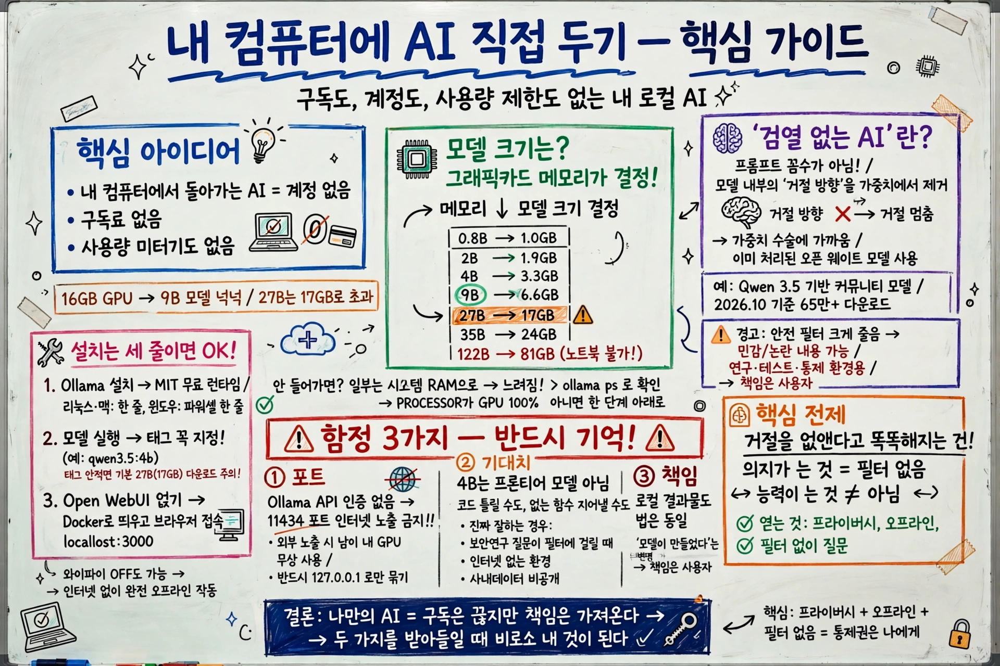
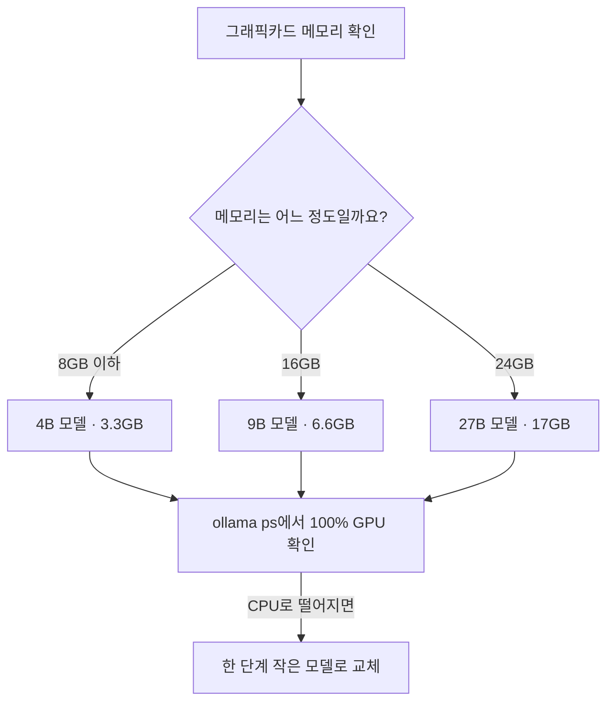
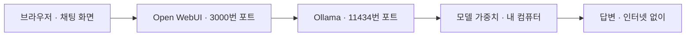

# 나만의 AI, 내 컴퓨터에 둡니다. 계정도 구독료도 없이, 오프라인에서도 돌아갑니다

> **Summary**
> Ollama와 Open WebUI를 이용하면 계정이나 구독료 없이 오프라인에서도 개인 컴퓨터에서 AI를 실행할 수 있습니다. 모델 크기는 그래픽카드 메모리에 맞춰 선택하고, 성능과 컨텍스트 길이를 확인해야 합니다. 로컬 AI는 프라이버시와 오프라인 사용에 유용하지만 프론티어 모델보다 능력이 낮을 수 있으며, 결과에 대한 책임을 지고 서버 포트를 인터넷에 노출하지 않도록 주의해야 합니다.

---

- 내 컴퓨터에서 돌아가는 AI는 계정이 없습니다. 구독료도 없고, 사용량 미터기도 없습니다.
- 크기는 그래픽카드 메모리가 정합니다. 4B 모델은 3.3GB, 27B 모델은 17GB를 내려받습니다.
- 설치는 `Ollama` 세 줄이면 끝나고, 채팅 화면은 `Open WebUI`를 얹으면 됩니다. 단, 포트는 절대 인터넷에 열지 않습니다.


"이 질문은 답을 안 해주네." 채팅창에 거절 문구가 뜰 때마다, 답이 없어서 거절당한 건지 필터에 걸린 건지 헷갈리신 적 있으시죠? 그럴 때 떠오르는 생각이 있습니다. "내 컴퓨터에 AI를 직접 두면 되지 않을까?" 이 글은 그 질문에 대한 답입니다. 목록이 아니라, 직접 돌리는 과정이 주제입니다!

🎥 [동영상 보기](https://www.youtube.com/watch?v=gDm8G8YSyAE)

## 검열 없는 AI, 그게 정확히 무슨 뜻일까요?

먼저 단어부터 정리하겠습니다. 여기서 "검열 없는 AI"는 프롬프트로 필터를 속이는 기술이 아닙니다. 가중치 자체를 건드리는 방식입니다. 2024년 한 연구진은 거절이 모델 내부의 한 방향으로 실려 있다는 사실을 확인했습니다. 그 방향을 가중치에서 빼내면 모델은 거절을 멈춥니다. 프롬프트 장난이 아니라, 모델 자체에 대한 수술에 가깝습니다.

그래서 이 글에서 다루는 모델은 이미 그런 처리를 거친 오픈 웨이트 모델입니다. `Qwen 3.5`를 바탕으로 한 한 커뮤니티 모델이 대표적입니다. 2026년 10월 기준으로 다운로드 수가 65만 건을 넘었습니다. 모델 페이지도 솔직하게 경고합니다. "안전 필터가 크게 줄었으니 민감하거나 논란이 될 수 있는 내용이 나올 수 있다"고요. 연구·테스트·통제된 환경용이고, 결과에 대한 책임은 사용자에게 있다고 적혀 있습니다.

> 거절을 없앤다고 똑똑해지는 건 아닙니다. 의지가 는 것이지, 능력이 는 것이 아닙니다!

이 한 줄이 이 글 전체의 전제입니다. 프론티어 모델보다 똑똑해지는 마법은 없습니다. 얻는 것은 프라이버시, 오프라인 사용, 그리고 필터에 막히지 않는 질문입니다.

## 하드웨어부터 재면 됩니다

모델 고르기는 취향이 아니라 산수입니다. 그래픽카드 메모리를 확인한 뒤, 그 안에 들어가는 가장 큰 모델을 고릅니다. 크기는 이렇게 잡혀 있습니다.

- 0.8B 모델은 1.0GB, 2B 모델은 1.9GB를 내려받습니다.
- 4B 모델은 3.3GB, 9B 모델은 6.6GB를 내려받습니다.
- 27B 모델은 17GB, 35B 모델은 24GB를 내려받습니다.
- 122B 모델은 81GB라서 노트북용이 아닙니다.
16GB 그래픽카드라면 9B 모델은 넉넉하게 들어가고, 27B 모델은 가중치만으로 카드를 넘깁니다. 맥은 사정이 다릅니다. CPU와 GPU가 메모리를 함께 쓰기 때문에, 16GB 맥은 9B 모델을 넉넉하게 돌리고 32GB 맥은 27B 모델까지 품습니다.



모델이 카드에 안 들어가면 어떻게 될까요? `Ollama`는 거절하지 않습니다. 들어가는 만큼만 GPU에 올리고 나머지는 시스템 RAM에 얹습니다. 답은 나오는데 몇 배는 느려집니다. 그래서 많은 분들이 "로컬 AI는 원래 느리다"고 오해하고 포기합니다. `ollama ps` 명령으로 확인하면 됩니다. PROCESSOR 칸이 100% GPU가 아니면, 한 단계 작은 모델로 바꾸는 것이 정답입니다!

## 설치는 세 줄이면 됩니다

설치는 의외로 짧습니다. `Ollama`는 MIT 라이선스의 무료 런타임입니다. 리눅스와 맥은 한 줄, 윈도우는 파워셸 한 줄이면 설치가 끝납니다.

```bash
# 리눅스 또는 맥
curl -fsSL https://ollama.com/install.sh | sh
# 윈도우 (파워셸)
irm https://ollama.com/install.ps1 | iex
```

다음으로 서버가 실제로 떠 있는지 확인합니다. 이 단계를 건너뛰면 "서버에 연결할 수 없다"는 오류만 보고 헤맵니다. 리눅스는 `ollama serve`로 직접 띄우거나 `systemctl`로 서비스를 시작하면 됩니다.

```bash
ollama pull huihui_ai/qwen3.5-abliterated:4B
ollama run huihui_ai/qwen3.5-abliterated:4B
```

여기서 태그를 꼭 적어야 합니다. 태그를 안 적으면 기본값인 27B 모델이 내려받히는데, 그게 17GB입니다. 두 번째 함정은 컨텍스트 길이입니다. 모델 페이지에는 256K 컨텍스트라고 적혀 있지만, 기본값은 그래픽카드 메모리에 따라 달라집니다. 24GiB 미만이면 4,096토큰, 24~48GiB면 32K, 48GiB 이상이어야 256K를 받습니다. 4,096토큰은 답까지 합쳐서 3천 단어 남짓이라서, 긴 대화는 앞부분을 잊어버립니다. 이럴 땐 이렇게 올리면 됩니다.

```bash
OLLAMA_CONTEXT_LENGTH=32768 ollama serve
```

다운로드가 끝나면 와이파이를 꺼도 됩니다. 인터넷이 없어도 그대로 돌아갑니다. 한번쯤은 직접 꺼보고 확인해 보시는 것도 좋습니다!

## 채팅 화면이 필요하면, 웹 UI를 얹습니다

터미널만으로 충분한 분도 있지만, 대화 기록과 여러 세션을 쓰려면 화면이 편합니다. `Open WebUI`가 그 역할을 합니다. `Docker`로 띄우면 되고, 브라우저에서 3000번 포트로 접속하면 채팅 화면이 나옵니다. 처음 가입한 계정이 관리자가 됩니다.



문서를 올려서 나만의 지식베이스로 쓰는 것도 가능합니다. 임베딩 모델을 하나 받아서 `Open WebUI` 문서 설정에 연결하면 됩니다. 이 부분은 선택 사항이라서, 일단 채팅부터 돌려보고 나중에 붙여도 늦지 않습니다.

## 함정 세 가지는 꼭 짚고 갑니다

첫 번째 함정은 포트입니다. `Ollama`의 로컬 API에는 인증이 없습니다. 노출된 서버가 수만 대에 달한다는 조사 결과도 있습니다. 11434번 포트를 인터넷에 열면 낯선 사람이 내 그래픽카드를 공짜로 씁니다. `Docker`로 띄울 때도 `-p 11434:11434`처럼 모든 인터페이스에 열지 말고, `127.0.0.1`에만 묶어야 합니다!

두 번째 함정은 기대치입니다. 4B 모델은 프론티어 모델이 아닙니다. 자신 있게 코드를 써놓고 컴파일이 안 될 수도 있고, 없는 라이브러리 함수를 지어낼 수도 있습니다. 거절이 사라졌다고 실력이 생긴 것은 아닙니다. 진짜로 잘하는 분야는 따로 있습니다. 보안 연구처럼 평범한 질문이 호스팅 필터에 걸릴 때, 비행기 안처럼 인터넷이 없을 때, 그리고 대화 내용을 회사 서버에 올리고 싶지 않을 때입니다.

세 번째 함정은 책임입니다. 로컬에서 만든 결과물에도 같은 법이 적용됩니다. "모델이 만들었다"는 변명이 되지 않습니다. 모델 페이지가 "사용자가 결과에 전적으로 책임이 있다"고 적어둔 이유도 여기에 있습니다.

나만의 AI를 직접 두는 일은, 구독을 끊는 일이기도 하고 책임을 가져오는 일이기도 합니다. 두 가지를 함께 받아들일 때, 이 설정은 비로소 내 것이 됩니다.

