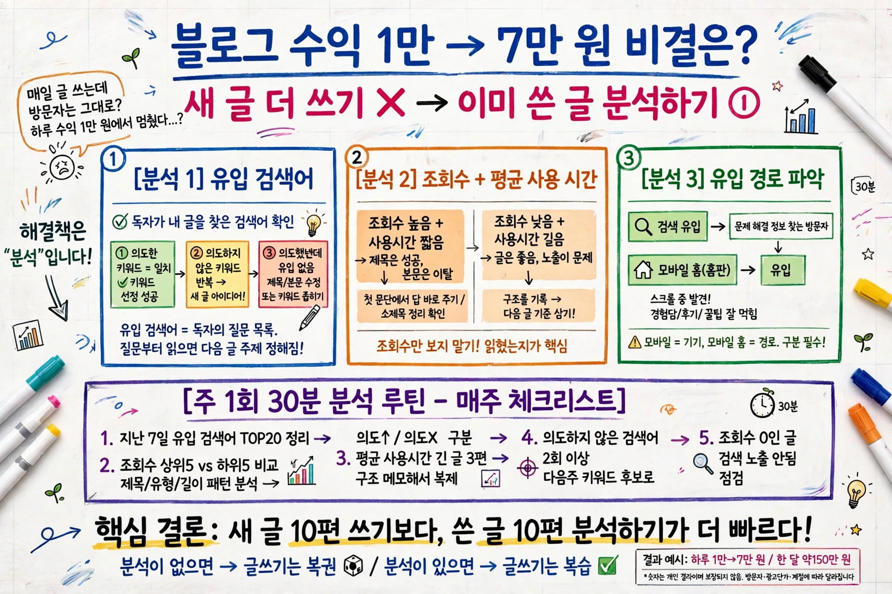
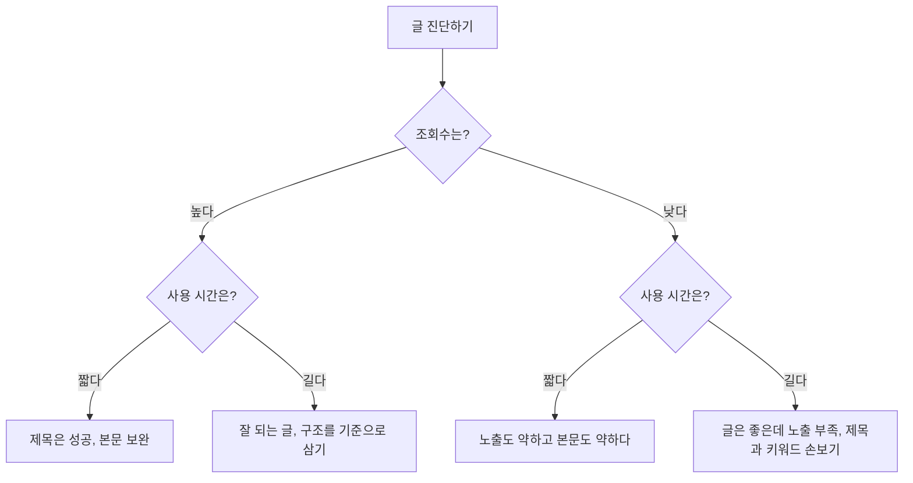
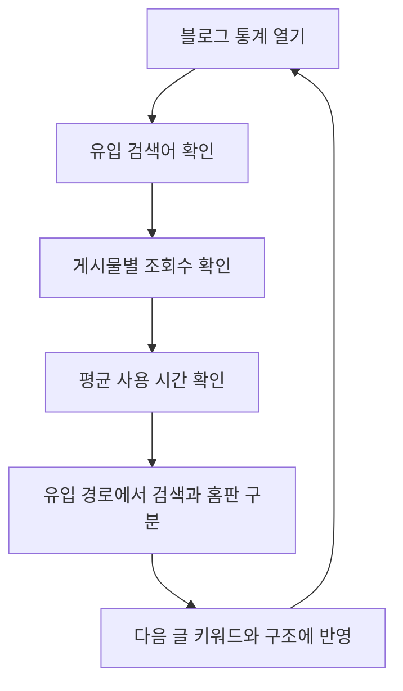

# 네이버 블로그, 하루 1만 원에서 7만 원으로 올린 비결은 새 글이 아니라 쓴 글 분석입니다

> **Summary**
> 네이버 블로그 수익을 높이려면 새 글을 더 쓰기보다 기존 글의 유입 검색어, 조회수, 평균 사용 시간, 유입 경로를 분석해 독자의 관심과 글의 강점·약점을 파악해야 합니다. 주 1회 30분 동안 통계를 살펴 키워드와 글 구조를 다음 콘텐츠에 반영하면, 검색 유입과 홈판 유입에 맞는 글을 꾸준히 개선할 수 있습니다. 수익 사례는 개인 경험이며 같은 결과를 보장하지 않습니다.

---

- 네이버 블로그 하루 수익이 1만 원에서 7만 원으로 올랐다면, 비결은 새 글을 더 쓰는 게 아니라 이미 쓴 글을 분석하는 데 있습니다.
- 블로그 통계에서 유입 검색어, 게시물별 조회수, 평균 사용 시간을 순서대로 읽으면 어떤 글이 돈을 버는지 보입니다.
- 주 1회 30분만 분석 루틴을 돌려도 다음 글의 키워드와 구조가 달라집니다.

글을 매일 쓰는데 방문자는 그대로입니다. 하루 수익은 1만 원에서 멈췄습니다. 이런 적 있으시죠? 글을 더 쓰면 해결될 줄 알았는데, 숫자는 그대로였습니다. 그럴 때 필요한 건 새 글이 아니라, 이미 쓴 글을 들여다보는 행동입니다!

🎥 [동영상 보기](https://www.youtube.com/watch?v=eXK6vecKmeE)

## '이 행동'이 뭘까요?

'이 행동'은 내가 쓴 글을 분석하는 것입니다. 지난 포스팅에서 예고한 "블로그 쓴 글 분석하는 방법"이 바로 이번 꿀팁 시리즈 1탄의 주제입니다. 원문 포스트는 로그인 벽 뒤에 있어 직접 읽지 못했고, 노션에 저장된 요약과 공개된 블로그 통계 안내를 바탕으로 재구성했습니다. 대상은 이제 막 블로그를 시작하는 분들과, 홈판 노출을 노리고 글을 쓰는 분들입니다.

원문 작성자는 지난달 애드포스트 수익이 약 150만 원이었다고 밝혔습니다. 하루 수익은 1만 원에서 7만 원으로 올랐다고 합니다. 다만 이 숫자는 작성자 본인의 주장입니다. 같은 방법을 쓴다고 같은 수익이 보장되는 건 아닙니다. 애드포스트 수익은 방문자 수와 광고 단가, 계절에 따라 달라집니다. 숫자는 결과이지 약속이 아닙니다!

## 분석 1: 유입 검색어로 독자의 질문을 봅니다

블로그 통계에서 가장 먼저 볼 항목은 유입 검색어입니다. 독자가 어떤 말로 내 글을 찾았는지 보여줍니다. 여기서 세 가지를 구분합니다.

첫째, 의도한 키워드로 들어온 경우입니다. 글을 쓸 때 잡은 키워드와 유입 검색어가 일치하면 키워드 선정이 맞았다는 뜻입니다. 둘째, 의도하지 않은 키워드로 들어온 경우입니다. 글 본문의 어떤 문장이 다른 검색어에 걸린 것입니다. 이 검색어가 반복해서 보이면 그 주제로 별도 글을 쓸 가치가 있습니다. 새 키워드를 찾는 가장 싼 방법입니다! 셋째, 의도했지만 유입이 없는 경우입니다. 키워드 경쟁이 세거나, 제목과 본문이 검색 의도와 어긋난 것입니다. 글을 수정하거나 더 좁은 키워드로 바꿉니다.

유입 검색어는 독자의 질문 목록입니다. 질문을 읽지 않고 글을 쓰면, 답이 있어도 찾는 사람이 없습니다. 질문부터 읽으면 다음 글의 주제가 정해집니다.

## 분석 2: 조회수와 사용 시간으로 글을 진단합니다

다음은 게시물별 조회수와 평균 사용 시간입니다. 조회수만 보면 절반만 봅니다. 들어온 독자가 글을 읽었는지가 함께 보여야 합니다.

조회수는 높은데 평균 사용 시간이 짧다면 제목은 성공했지만 본문이 기대를 채우지 못한 것입니다. 반대로 조회수는 낮은데 사용 시간이 길면 글은 좋은데 노출이 안 되는 상태입니다. 사용 시간이 짧은 글은 첫 문단에서 독자가 찾는 답이 나오는지, 소제목만 보고 원하는 부분을 찾을 수 있는지 확인합니다. 사용 시간이 긴 글은 구조를 기록해 두고 다음 글의 기준으로 삼습니다. 잘 되는 글의 모양을 외워두는 겁니다!

## 분석 3: 유입 경로로 검색과 홈판 유입을 나눕니다

유입 경로는 방문자가 내 블로그에 오기 직전에 어디에 있었는지 보여줍니다. 여기서 검색 유입과 모바일 홈 유입을 구분합니다. 모바일 홈은 네이버 앱이나 모바일 화면의 홈 영역, 즉 홈판에서 글을 발견해 방문한 경우입니다.

주의할 점이 있습니다. 기기 기준 '모바일'과 경로 기준 '모바일 홈'은 다른 항목입니다. 모바일 조회수가 늘었다고 해서 홈판 유입이 늘었다고 단정할 수는 없습니다. 모바일에서 네이버 검색 결과를 눌렀거나, 다른 검색을 통해 들어왔을 수도 있습니다. 통계 화면에서 기기별 분포와 유입 경로를 따로 확인합니다.

홈판 유입이 있는 글은 따로 표시해 둡니다. 홈판은 사용자가 검색하지 않아도 스크롤만으로 내 글이 노출되는 자리입니다. 홈판에 잘 먹히는 콘텐츠는 정해져 있습니다. 진짜 경험과 체험, 후기와 꿀팁, 견해와 감상입니다. 검색으로 들어오는 글과 홈판으로 들어오는 글은 성격이 다릅니다. 어떤 글이 어디서 들어오는지 알면, 다음 글의 방향이 정해집니다. 홈판을 노린다면 경험담부터 써야 하지 않을까요?

## 주 1회 30분, 분석 루틴을 돌립니다

매일 보면 변동에 휘둘리고, 월 단위로 보면 너무 늦습니다. 주 1회, 30분 정도의 루틴이 적당합니다.

1. 지난 7일 유입 검색어 상위 20개를 옮깁니다. 의도한 키워드와 아닌 키워드를 표시합니다.
1. 게시물별 조회수 상위 5편과 하위 5편의 제목 패턴, 글 유형, 길이를 비교합니다.
1. 평균 사용 시간이 긴 글 3편의 구조를 메모합니다.
1. 의도하지 않은 유입 검색어 중 2회 이상 나온 것을 다음 주 키워드 후보에 넣습니다.
1. 조회수가 0에 가까운 글은 검색 노출 자체가 안 되는 것인지 점검합니다.

분석은 한 번 하고 끝내는 일이 아닙니다. 루틴이 돌 때마다 통하는 글의 모양이 조금씩 선명해집니다. 그 모양을 다음 글에 반영하면, 같은 시간을 써도 결과가 달라집니다.

## 새 글보다 분석이 먼저입니다

하루 수익 1만 원에서 7만 원, 지난달 약 150만 원. 숫자는 화려하지만, 이 글의 결론은 숫자가 아닙니다. 쓴 글을 분석하는 행동이 먼저라는 점입니다. 새 글을 열 편 더 쓰는 것보다, 쓴 글 열 편을 제대로 읽는 쪽이 빠를 때가 있습니다. 분석이 없으면 글쓰기는 복권입니다. 분석이 있으면 글쓰기는 복습이 됩니다. 이번 주에는 새 글 한 편을 미루고, 통계 화면을 열어보시는 건 어떨까요?

