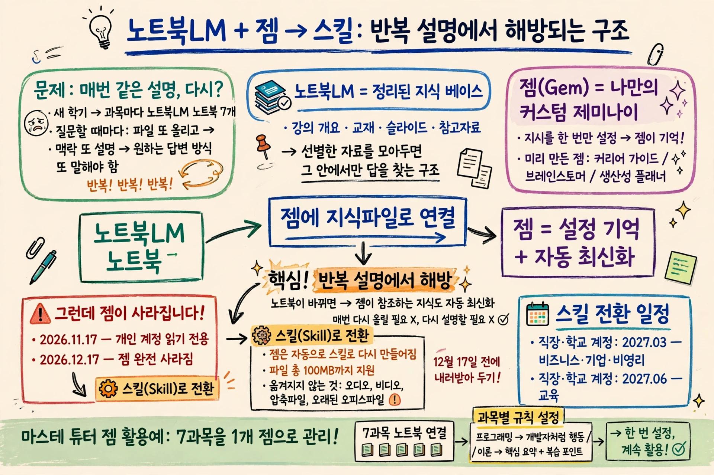
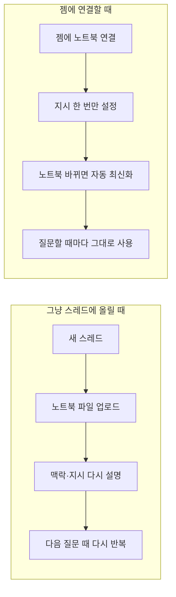
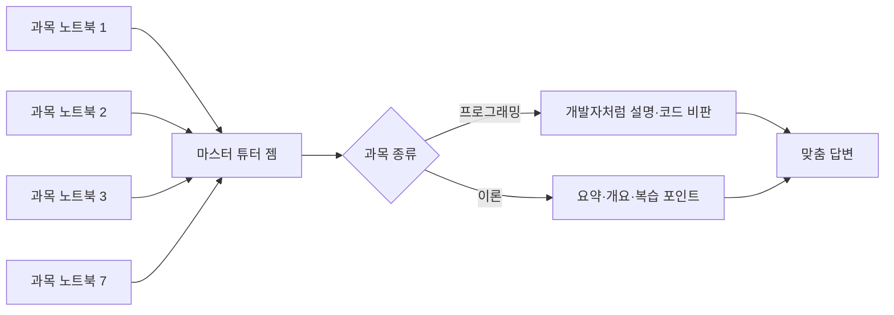
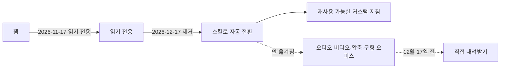

# 노트북LM에 제미나이 젬을 붙이면, 같은 설명을 매번 반복하지 않습니다

> **Summary**
> 노트북LM 노트북을 제미나이 젬에 연결하면 지시를 한 번만 설정해 두고, 자료가 업데이트될 때마다 최신 지식을 활용할 수 있습니다. 개인 계정의 젬은 2026년 11월 17일부터 읽기 전용이 되고 12월 17일 스킬로 전환되므로, 이전되지 않는 파일은 미리 내려받아야 합니다.

---

- 노트북LM 노트북은 정리된 지식 베이스입니다. 제미나이 젬에 물리면 매번 파일을 올리고 설명을 반복하지 않아도 됩니다.
- 젬은 지시를 한 번만 받아서 기억합니다. 노트북 내용이 바뀌면 젬이 참조하는 지식도 자동으로 최신이 됩니다.
- 다만 젬은 2026년 11월 17일부터 개인 계정에서 읽기 전용이 됐고, 12월 17일에 사라집니다. 이 방식은 스킬로 이어집니다.

## 매번 같은 설명, 다시 하고 있으시죠?

새 학기가 시작되면 과목마다 노트북LM 노트북을 만듭니다. 강의 개요, 교재, 슬라이드, 참고 자료까지 과목별로 정리해 두죠. 그런데 제미나이에 질문할 때마다 같은 일을 반복합니다. 노트북 파일을 올리고, 맥락을 설명하고, 원하는 답변 방식을 다시 말해줍니다. 다음에 또 질문하면 처음부터 다시요. 이런 적 있으시죠?

이 반복을 끊는 방법이 젬입니다. 한 번만 설정하면 됩니다!

🎥 [동영상 보기](https://www.youtube.com/watch?v=Qyl-yk6m2rk)

## 제미나이 젬, 도대체 뭘까요?

젬은 나만을 위해 커스텀한 제미나이입니다. 2024년 5월 구글 I/O에서 발표됐습니다. 매번 같은 지시를 새로 입력하는 대신, 지시를 한 번만 정해두면 젬이 기억합니다. 원하는 답변 형식과 방식을 저장해두고 매번 그대로 적용합니다.

처음부터 만들지 않아도 됩니다. 미리 만들어진 젬이 있습니다. `커리어 가이드`, `브레인스토머`, `생산성 플래너` 같은 젬을 바로 써보면서 감을 잡을 수 있습니다. 써보다가 반복하는 작업이 보이면 그때 나만의 젬을 만들면 됩니다.

## 노트북LM과 왜 묶어야 할까요?

노트북LM 노트북은 근거가 있는 지식 베이스입니다. 선별한 자료를 모아두면, 그 안에서만 답을 찾는 구조입니다. 여기에 젬을 붙이면 두 가지가 합쳐집니다. 내 자료의 정확성과 제미나이의 넓은 지식이요!

그냥 스레드에 노트북을 올리는 것과는 다릅니다. 새 스레드는 매번 백지입니다. 파일을 올리고 맥락을 설명해야 합니다. 젬은 다릅니다. 젬 설정에 노트북을 지식 파일로 연결해두면, 노트북 내용이 바뀌어도 젬이 참조하는 지식은 자동으로 최신이 됩니다. 다시 올릴 필요도, 다시 설명할 필요도 없습니다!

## 일곱 과목, 하나의 튜터로 묶으면?

한 학기에 일곱 과목을 듣는다면 노트북도 일곱 개입니다. 과목별로, 주제별로 노트북이 늘어나면 찾을 때마다 헤맵니다. 그래서 과목마다 젬을 만드는 대신, 젬 하나를 "마스터 튜터"로 만든 겁니다. 일곱 과목 노트북을 전부 연결하고, 과목 종류별로 규칙을 정해줬습니다.

프로그래밍 과목이면 개발자처럼 행동합니다. 개념을 쪼개서 설명하고, 코드를 비판해줍니다. 이론 과목이면 핵심을 요약하고, 구조화된 개요를 만들고, 복습 포인트를 짚어줍니다. 과목이 바뀌어도 지시를 반복하지 않습니다. 젬이 알아서 방식을 바꿉니다!

이 장면이 인상 깊었습니다. 노트북은 그대로인데, 질문하는 창구가 하나로 합쳐지니까 공부 흐름이 끊기지 않더라고요. 스튜디오 결과물(마인드맵, 오디오 개요, 슬라이드)이 필요할 땐 개별 노트북으로 가고, 웹 정보와 내 자료를 함께 쓸 땐 젬 하나로 충분했습니다.

## 그런데 젬이 사라집니다. 스킬로 이어집니다

여기서 꼭 짚을 변화가 있습니다. 젬은 2026년 11월 17일부터 개인 계정에서 읽기 전용이 됐습니다. 쓸 수도, 고칠 수도, 새로 만들 수도 없습니다. 12월 17일에는 젬이 완전히 사라집니다. 대신 스킬이 그 자리를 이어받습니다. 젬은 자동으로 스킬로 다시 만들어집니다.

스킬은 재사용 가능한 커스텀 지침입니다. 젬이 하던 일을 이어받습니다. 다만 파일 용량 제한이 있습니다. 스킬은 파일 총 100MB까지입니다. 젬이 그보다 크면 큰 파일부터 자동으로 빠집니다. 그리고 오디오, 비디오, 압축 파일, 오래된 오피스 파일(`.doc`, `.xls`, `.ppt`)은 옮겨지지 않습니다. 12월 17일 전에 젬에 넣어둔 파일을 내려받아 두는 게 안전합니다.

직장·학교 계정은 일정이 다릅니다. 비즈니스·기업·비영리 계정은 2027년 3월, 교육 계정은 2027년 6월에 전환됩니다. 개인 계정부터 바뀌는 셈입니다.

## 지시는 한 번만, 지식은 알아서 최신으로

노트북LM이 자료를 정리하고, 젬(그리고 이제 스킬)이 그 자료를 어떻게 쓸지 기억합니다. 설정은 한 번만 하면 됩니다. 노트북이 바뀌면 참조하는 지식도 알아서 바뀝니다. 반복 설명에서 해방되는 구조, 그게 이 조합의 핵심입니다!

