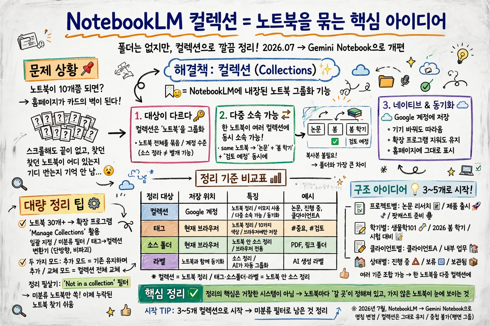
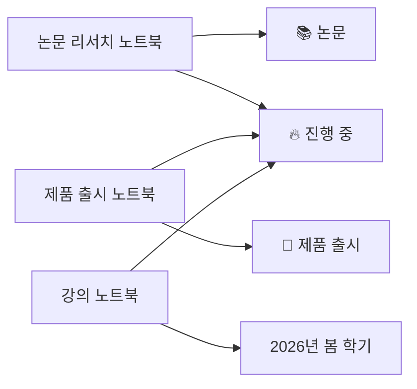
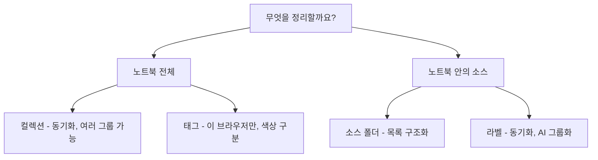
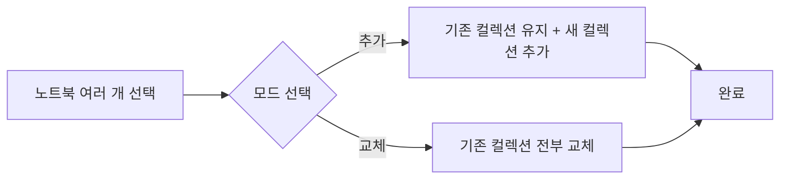

# 노트북이 수십 개면, 폴더가 아니라 컬렉션입니다. 한 노트북이 여러 그룹에 들어갑니다

> **Summary**
> NotebookLM 컬렉션은 노트북을 이름과 이모지로 묶는 계정 동기화 기능이며, 하나의 노트북을 여러 컬렉션에 넣을 수 있습니다. 미분류 필터와 일괄 추가·교체 기능으로 많은 노트북도 쉽게 정리할 수 있고, 기존 태그는 네이티브 컬렉션으로 변환할 수 있습니다. 컬렉션은 기기와 확장 프로그램에 관계없이 유지되지만 중첩은 지원하지 않습니다.

---

- 컬렉션은 NotebookLM 노트북을 그룹으로 묶는 네이티브 기능입니다. 이름과 이모지를 붙이고, 한 노트북을 여러 컬렉션에 동시에 넣을 수 있습니다.
- Google 계정에 저장돼 기기가 바뀌어도 따라오고, 확장 프로그램을 지워도 사라지지 않습니다.
- 수십 개를 일일이 지정하기 번거로우면, 무료 확장 프로그램의 일괄 지정과 미분류 필터, 태그 변환기로 몇 번의 클릭으로 정리합니다.

노트북이 열 개쯤 되면 홈페이지가 카드의 벽이 됩니다. 스크롤을 내려도 끝이 안 보이고, 찾던 노트북이 어디 있는지 기억이 안 납니다. 이런 적 있으시죠?

폴더가 있으면 될 텐데, NotebookLM에는 폴더가 없습니다. 대신 **컬렉션**이 있습니다. 이름만 다를 뿐, 노트북을 묶는 폴더처럼 작동합니다!

🎥 [동영상 보기](https://www.youtube.com/watch?v=NnTNGe4_j28)

## 컬렉션이란, 폴더와 뭐가 다를까요?

컬렉션은 NotebookLM에 내장된 노트북 그룹화 기능입니다. 각 컬렉션에는 이름과 선택적 이모지가 있습니다. 폴더 트리와 다른 점이 세 가지 있습니다.

첫째, **소스가 아니라 노트북을 그룹화합니다.** 컬렉션은 계정 수준에서 존재하고 노트북 전체를 정리합니다. 한 노트북 *안의* 소스를 정리하는 건 별개 기능의 일입니다.

둘째, **한 노트북이 여러 컬렉션에 속할 수 있습니다.** 같은 노트북이 "논문", "봄 학기", "검토 예정"에 동시에 들어갑니다. 복사본을 만들 필요가 없습니다. 이게 폴더와 가장 큰 차이입니다!

셋째, **네이티브이고 동기화됩니다.** 컬렉션은 브라우저가 아니라 Google 계정에 저장됩니다. 홈페이지에 그대로 표시되고, 기기를 바꿔도 따라오며, 확장 프로그램을 삭제해도 유지됩니다.

## 정리할 게 노트북인가요, 소스인가요?

NotebookLM의 정리 기능은 네 가지입니다. 두 가지는 네이티브, 두 가지는 확장 프로그램이 더합니다. 헷갈리기 쉬운데, 기준은 하나입니다. **정리할 대상이 노트북인가, 노트북 안의 소스인가?**

컬렉션과 태그는 노트북 라이브러리를 정리합니다. 소스 폴더와 라벨은 노트북 안의 소스를 정리합니다. 대상만 정하면 무엇을 쓸지 바로 정해집니다.

| 기능 | 정리 대상 | 동기화 | 표시 |
| --- | --- | --- | --- |
| 컬렉션 | 노트북 | Google 계정 | 이모지 |
| 태그 | 노트북 | 현재 브라우저만 | 10가지 맞춤 색상 |
| 소스 폴더 | 한 노트북 안의 소스 | 현재 브라우저만 | 폴더 아이콘 |
| 라벨 | 소스 | 노트북과 함께 동기화 | 컬러 칩 |

태그는 확장 프로그램의 로컬 기능이라 색상으로 구분하는 데는 편하지만, 다른 기기에서는 보이지 않습니다. 라벨은 네이티브라 동기화되고, AI가 소스를 그룹화한 카테고리라 공동 작업자와 공유할 수 있습니다.

## 컬렉션, 어떻게 만들까요?

노트북이 몇 개뿐이라면 홈페이지의 **Collections** 탭에서 직접 만들면 충분합니다. 이름과 선택적 이모지를 지정하는 게 전부입니다.

하지만 서른 개를 분류해야 한다면 이야기가 달라집니다. 하나씩 지정하다 보면 금방 지칩니다. 이럴 때 무료 확장 프로그램의 **Manage Collections** 페이지가 제값을 합니다. 왼쪽에는 모든 컬렉션이 검색·정렬과 함께 보이고, 오른쪽에서는 이름을 바꾸고 이모지를 정하고 노트북을 추가합니다. 여기서 하는 작업은 NotebookLM 계정에 곧바로 기록됩니다. 확장 프로그램에서 컬렉션을 만들면 홈페이지에 즉시 반영됩니다!

## 일괄 지정, 추가 모드와 교체 모드 중 뭐가 맞을까요?

노트북 대시보드에서 원하는 노트북을 여러 개 선택하고 **Add to Collection**을 누르면, 두 가지 모드가 나옵니다.

**추가 모드**는 선택한 노트북이 기존 컬렉션을 유지한 채 새 컬렉션에 추가됩니다. **교체 모드**는 선택한 노트북의 컬렉션이 새로 고른 컬렉션으로 완전히 교체됩니다. 오래된 구조를 한 번에 정리할 때 안성맞춤입니다.

한 학기 분량의 노트북을 분류하는 데 대화 상자를 서른 번 오갈 필요가 없습니다. 한 번의 선택과 한 번의 클릭이면 충분합니다.

## 안 보이는 노트북, 어떻게 찾을까요?

정리의 필살기는 **"Not in a collection"** 필터입니다. 아직 어디에도 분류하지 않은 노트북만 정확히 보여줍니다. 놓치는 노트북이 없습니다.

여러 컬렉션으로 동시에 필터링할 수도 있습니다. 그중 하나에라도 속하면 일치합니다. 홈페이지의 노트북 카드에는 각 노트북의 컬렉션이 작은 칩으로 표시되고, 이모지가 있으면 이모지도 함께 보입니다. 정리 상태가 확장 프로그램 안에서만이 아니라 실제로 작업하는 곳에서 보입니다.

컬렉션은 교차 노트북 검색에서도 정식 결과 유형입니다. 컬렉션 이름으로 검색하면 해당 컬렉션의 노트북으로 바로 이동할 수 있습니다.

## 태그로 정리해 왔다면, 다시 만들 필요가 있을까요?

없습니다. **태그 → 컬렉션 변환기**가 각 태그를 같은 노트북이 담긴 네이티브 컬렉션으로 만들어 줍니다. 단방향이고 비파괴적입니다. 태그는 그대로 유지되고, 변환기는 복사만 합니다. 태그 색상은 추천 이모지로 매핑되고, 실행 전에 태그별로 수정할 수 있습니다. 이름이 이미 컬렉션으로 존재하는 태그는 건너뛰므로, 다시 실행해도 안전합니다.

변환 후의 실질적인 차이는 이렇습니다. 그룹이 더 이상 한 브라우저에 갇히지 않고 Google 계정의 일부가 됩니다. 모든 기기에서 보이고, 확인하는 데 확장 프로그램이 필요 없습니다!

## 어떤 구조로 나누면 좋을까요?

정답은 작업 방식에 따라 다릅니다. 오래 검증된 패턴 몇 가지를 소개합니다.

프로젝트별로는 논문 리서치, 제품 출시, 팟캐스트 준비처럼 나눕니다. 강의나 학기별로는 생물학 101, 2026년 봄 학기, 시험 대비처럼 나눕니다. 클라이언트별로는 클라이언트 이름과 내부 업무로 나눕니다. 상태별로는 진행 중, 보류, 보관됨처럼 나눕니다.

한 노트북이 여러 컬렉션에 속할 수 있으니 여러 기준을 조합할 수 있습니다. 하나의 노트북이 클라이언트 그룹과 진행 중 그룹에 동시에 들어가는 식입니다. 우선 3~5개의 컬렉션으로 시작하고, 미분류 필터로 누락된 노트북을 챙기세요.

## 이름이 바뀌어도 컬렉션은 그대로입니다

Google은 2026년 7월 NotebookLM을 **Gemini Notebook**으로 이름을 바꿨습니다. 컬렉션은 그대로 이어졌습니다. 노트북 전체를 묶는 이름 있는 그룹으로, Google 계정에 저장되고 홈페이지에 표시됩니다. 이 글의 모든 내용은 Gemini Notebook에도 그대로 적용됩니다.

한 가지 알아둘 점이 있습니다. 컬렉션은 평면적인 그룹이라 중첩되지 않습니다. 컬렉션 안에 또 다른 컬렉션을 넣을 수는 없습니다. 그래도 노트북이 십여 개를 넘어가면, 평면적인 카드의 벽보다는 이름 있는 그룹이 훨씬 낫습니다.

## 모든 노트북에 자리를 만들어 주세요

노트북이 십여 개를 넘어가면 카드의 벽은 감당이 안 됩니다. 컬렉션은 라이브러리에 진짜 구조를 부여합니다. 네이티브이고, 동기화되며, 드디어 일괄 관리가 가능합니다.

정리의 핵심은 거창한 시스템이 아닙니다. 노트북마다 갈 곳이 정해져 있고, 안 간 노트북이 눈에 보이는 것, 그게 전부입니다. 미분류 필터를 켜고, 오늘 노트북 세 개만이라도 컬렉션에 넣어보세요. 라이브러리가 달라 보이기 시작할 겁니다!

