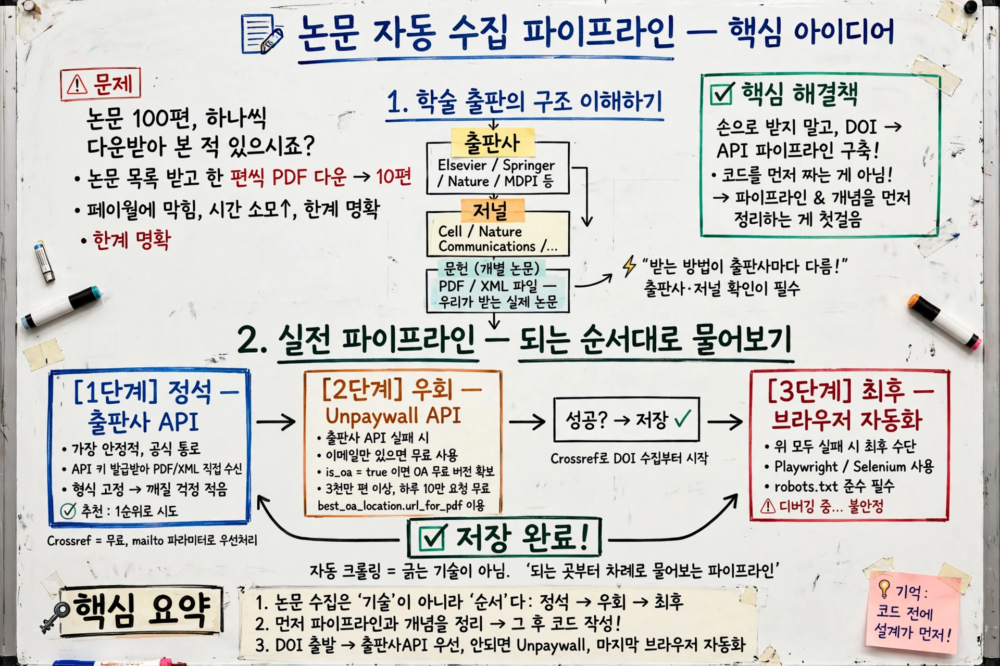
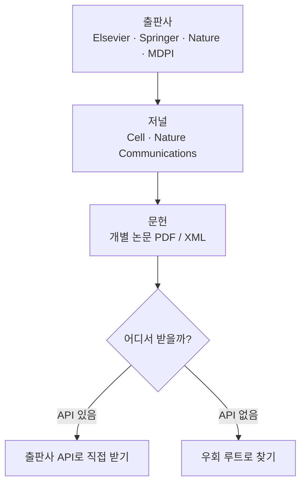
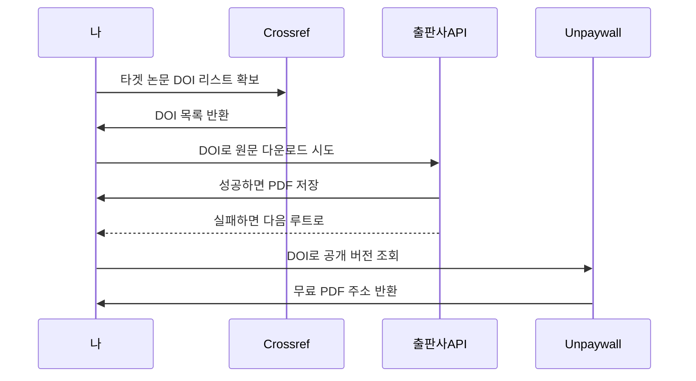

# 논문 수백 편, 손으로 받지 말고 DOI부터 API 순서대로 흘려보내면 됩니다

> **Summary**
> 논문 수백 편을 효율적으로 수집하려면 DOI를 출발점으로 삼아 Crossref에서 목록을 확보하고, 출판사 API를 먼저 시도한 뒤 Unpaywall로 공개 버전을 찾는 파이프라인을 구성합니다. 두 방법이 실패할 경우에만 robots.txt를 준수하며 브라우저 자동화를 사용하고, 코드를 작성하기 전에 전체 흐름과 개념을 먼저 정리하는 것이 중요합니다.

---

- 논문 수백 편을 손으로 받는 건 한계가 있습니다. DOI부터 API로 흘려보내는 파이프라인이 답입니다.
- 정석은 출판사 API, 우회는 Unpaywall, 최후 수단은 브라우저 자동화입니다. 되는 순서대로 물어보면 됩니다.
- 코드를 맡기기 전에 파이프라인과 개념을 먼저 정리하는 게, 자동화의 첫걸음입니다.

## 논문 100편, 하나씩 다운받아 본 적 있으시죠?

논문 목록을 받았는데, 한 편씩 사이트에 들어가 PDF를 받는 일. 처음 몇 편은 괜찮습니다. 그런데 열 편, 스무 편이 넘어가면 손이 먼저 지칩니다. 페이월에 막히는 것도 있고요. 이런 적 있으시죠?

그래서 자동 크롤링 시스템을 만든다는 발상입니다. 그런데 코드를 바로 짜는 게 먼저가 아닙니다. 파이프라인과 개념을 먼저 정리하는 게 먼저입니다!

🎥 [동영상 보기](https://www.youtube.com/watch?v=fTtc4QWMYzE)

## 먼저 알아야 할 구조, 출판사·저널·문헌은 어떻게 나뉠까요?

논문을 받으려면 먼저 학술 출판의 위계부터 알아야 합니다. 맨 위에는 출판사가 있습니다. `Elsevier`, `Springer`, `Nature`, `MDPI` 같은 곳입니다. 그 아래에 저널이 있습니다. `Cell`, `Nature Communications` 같은 학술지입니다. 맨 아래에 우리가 받는 문헌, 개별 논문의 PDF나 XML이 있습니다.

이 구조를 아는 게 왜 중요할까요? 받는 방법이 출판사마다 다르기 때문입니다. API를 주는 출판사도 있고, 주지 않는 출판사도 있습니다. 어디서 받아야 할지 알려면, 논문이 어느 출판사·저널 소속인지부터 알아야 합니다.

## 정석 루트, 출판사 API가 왜 먼저일까요?

가장 안정적인 방법은 출판사 API입니다. 각 출판사에서 API 키를 발급받아 PDF나 XML을 직접 받습니다. 절차가 귀찮은 곳도 있습니다. 심사가 필요한 출판사도 있습니다. 그런데 쿨하게 바로 내어주는 곳도 있습니다!

API가 정석인 이유는 단순합니다. 출판사가 직접 주는 길이라 가장 안정적입니다. HTML을 긁는 게 아니라 정해진 형식으로 받으니까, 형식이 바뀌어 깨질 걱정도 적습니다. 자동화의 출발점은 "공식 통로가 있는가"를 확인하는 것입니다.

## 실전 워크플로우, DOI가 출발점입니다

실전 흐름은 세 단계입니다. 먼저 DOI를 수집합니다. `Crossref` 같은 곳에서 타겟 논문의 DOI 리스트를 확보합니다. `Crossref`는 무료이고 키도 필요 없습니다. 이메일 주소를 `mailto` 파라미터로 함께 보내면 우선 처리를 받습니다.

다음으로 DOI를 출판사 API에 던집니다. 원문 다운로드를 시도합니다. 되면 저장하고, 안 되면 다음 루트로 넘깁니다. 이게 1차 시도입니다.

## 막히면 우회, Unpaywall은 이메일 하나면 됩니다

출판사 API 접근이 어렵다면? `Unpaywall` API를 씁니다. 이메일 주소만 있으면 됩니다. DOI 하나를 던지면, 합법적으로 공개된 OA 버전을 찾아줍니다.

원리가 단순합니다. `Unpaywall`은 5만 개가 넘는 공개 소스를 뒤집니다. 출판사 사이트, 프리프린트 서버, 대학 저장소, 저자 홈페이지까지요. `is_oa`가 참이면 무료 버전이 있다는 뜻이고, `best_oa_location`의 `url_for_pdf`가 받을 주소입니다. 3천만 편 이상을 커버하고, 하루 10만 요청까지 무료입니다!

재미있는 예외도 있습니다. `MDPI`는 완전 OA인데도 가끔 막히는 현상이 있습니다. 원인은 아직 파악 중입니다. 완벽한 우회로는 없다는 뜻이기도 합니다.

## 최후의 수단, 브라우저 자동화는 어떻게 쓸까요?

위 방법이 모두 실패하면 브라우저 자동화로 넘어갑니다. `Playwright`나 `Selenium`으로 브라우저를 직접 움직여 받는 방식입니다. 그런데 여기는 주의가 필요합니다. `robots.txt` 규약을 준수하면서, 정교하게 긁어오는 코드를 짜야 합니다.

이 단계는 아직 디버깅 중입니다. 다운로드 결과가 이상하게 나와서 원인을 찾고 있습니다. 자동화의 길은 멀고도 험난하다는 말, 괜히 나온 게 아닙니다!

## 코드를 맡기기 전에, 파이프라인부터 정리하면 됩니다

이 정리의 핵심은 코드가 아닙니다. 코드를 맡기기 전에 전체 파이프라인과 개념을 먼저 정리한 점입니다. 정석부터 우회, 최후 수단까지 순서가 정해져 있으니, 각 단계가 실패했을 때 다음으로 넘어가면 됩니다.

논문 자동 크롤링은 긁는 기술이 아니라 물어보는 순서입니다. 되는 곳부터 차례로 물어보는 파이프라인, 그게 이 시스템의 뼈대입니다!

