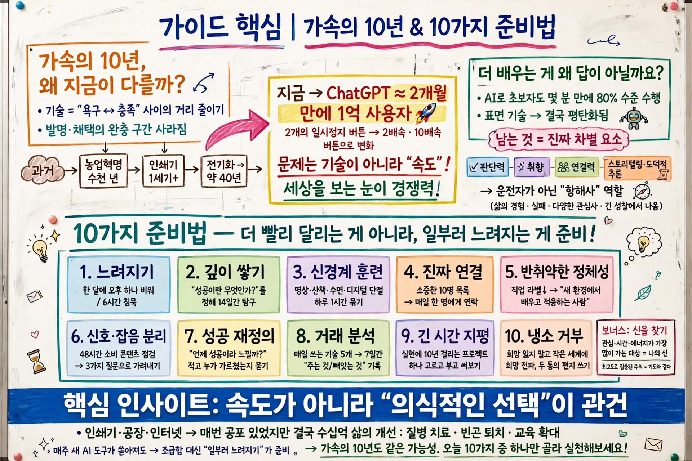
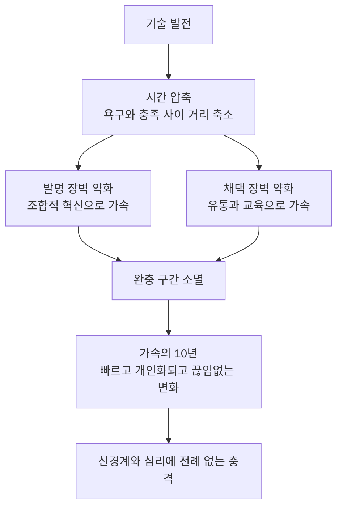
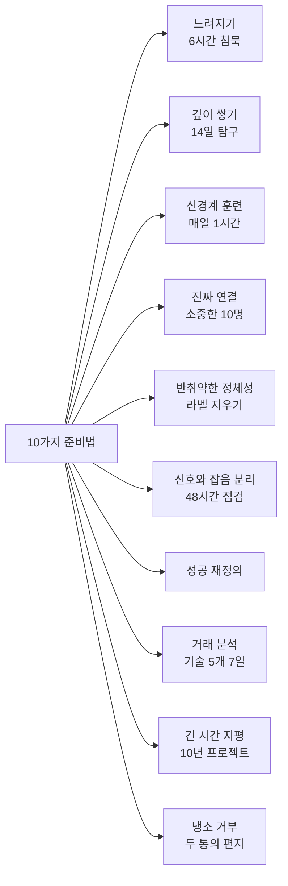
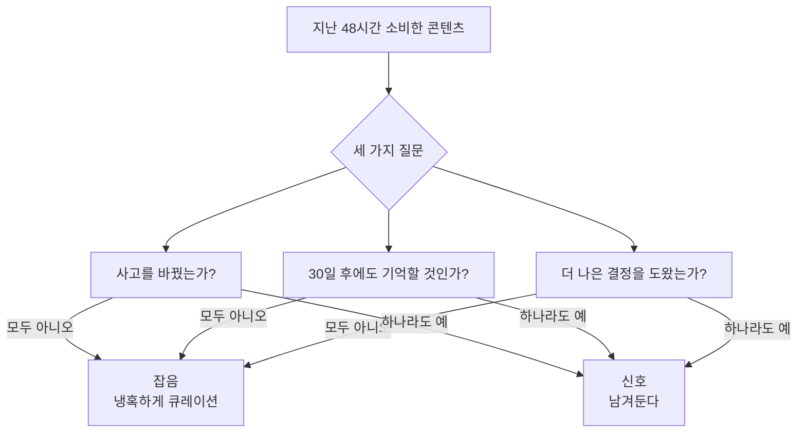

# 다가올 10년을 준비하는 법, 더 배우는 게 아니라 느려지는 겁니다

> **Summary**
> 다가올 10년의 빠른 기술 변화에 대비하려면 더 많이 배우기보다 의도적으로 속도를 늦추고, 판단력·취향·연결력 같은 깊은 역량을 길러야 합니다. 신경계를 돌보고, 정체성과 성공의 기준을 다시 살피며, 기술이 주는 것과 빼앗는 것을 점검하고, 긴 안목과 희망을 지키는 실천이 중요합니다.

---

- 기술이 욕구와 충족 사이의 거리를 줄이면서, 발명과 채택의 완충 구간이 사라진 '가속의 10년'이 시작됐습니다.
- 표면 기술은 AI가 몇 분 만에 80% 수준으로 따라잡으므로, 판단력·취향·연결력 같은 깊이가 진짜 차별 요소가 됩니다.
- 답은 더 빨리 배우는 게 아니라 느려지고, 신경계를 돌보고, 정체성과 성공의 정의를 다시 세우는 10가지 준비법입니다.

매주 새 AI 도구가 쏟아집니다. 어제 배운 게 오늘은 구식이고, 뒤처질까 봐 조급해지신 적 있으시죠? 그런데 이 글의 결론은 의외입니다. 더 빨리 달리는 게 아니라, 일부러 느려지는 게 준비라는 겁니다!

🎥 [동영상 보기](https://www.youtube.com/watch?v=tKt4p8WAWGg)

## 가속의 10년, 왜 지금이 다를까요?

기술의 본질은 시간 압축입니다. 원하는 것과 얻는 것 사이의 거리를 줄이는 겁니다. 과거에는 발명과 채택이라는 두 장벽이 완충 구간을 만들어줬습니다. 농업혁명은 수천 년, 인쇄기는 1세기 이상, 전기화는 약 40년이 걸렸습니다. 그런데 ChatGPT는 약 2개월 만에 1억 사용자에게 닿았습니다. 두 개의 일시정지 버튼이 2배속과 10배속 버튼으로 바뀐 셈입니다. 그래서 앞으로 10년은 인류 역사상 가장 불안정한 시기가 될 거라는 전망이 나옵니다. 문제는 기술 자체가 아니라 속도입니다.

## 더 배우는 게 왜 답이 아닐까요?

평생 배운 기술을 초보자가 AI로 몇 분 만에 80% 수준으로 수행하는 시대에 이미 들어섰습니다. 표면 기술은 결국 평탄해집니다. 그럼 뭐가 남을까요? 판단력, 취향, 분야 간 연결력, 스토리텔링, 도덕적 추론입니다. 운전자가 아니라 항해사의 역할에 가깝습니다! 이 역량은 삶의 경험과 실패, 다양한 관심사, 긴 성찰 시간에서 나옵니다. 이 대목이 저는 가장 와닿았습니다. 기술을 쌓는 속도가 아니라 세상을 보는 눈이 경쟁력이 된다는 점이요.

## 10가지 준비법, 뭐부터 하면 될까요?

준비법은 열 가지입니다. 하나씩 다 외울 필요는 없습니다. 핵심만 짚어보겠습니다.

### 1~3. 느려지고, 깊이를 쌓고, 신경계를 돌보기?

시속 100마일로 달리며 가속하는 차에서 할 일은 감속입니다. 효율성과 속도는 같지 않습니다! 실천법은 한 달에 오후 하나를 비워 6시간 침묵하는 겁니다. 말도, 글도, 기술도 없이 감각 소비를 최소화합니다. 두 번째는 깊이입니다. "성공이란 무엇인가?" 같은 질문 하나를 골라 14일간 철학·과학·역사·경험의 렌즈로 탐구합니다. 세 번째는 신경계 훈련입니다. 명상·산책·수면·디지털 단절을 매일 1시간 수련으로 묶는 겁니다. 신경계를 돌보는 데 필요한 것은 무료이고, 유일한 비용은 시간입니다.

### 4~6. 진짜 연결, 반취약한 정체성, 신호와 잡음?

온라인 연결만으로는 부족합니다. 소중한 10명의 목록을 만들고 매일 한 명에게 연락하는 게 실천법입니다. 정체성은 직업에 묶지 않는 게 좋습니다. "나는 변호사입니다" 대신 "나는 새 환경에서 배우고 적응하는 사람입니다"로 바꾸는 겁니다. 무질서에서 이익을 얻는 정체성이면 변화 자체가 이득이 됩니다! 잡음 분리는 48시간 동안 소비한 콘텐츠를 나열하고 세 가지를 묻는 겁니다. 사고를 바꿨는지, 30일 후에도 기억할지, 더 나은 결정을 도왔는지. 세 답이 모두 아니면 잡음입니다.

### 7~10. 성공 재정의, 거래 분석, 긴 지평, 냉소 거부?

성공을 다시 정의하지 않으면 원하지 않는 목표를 무의식적으로 좇게 됩니다. "언제 성공했다고 느낄 것인가"를 써보고, "누가 그게 중요하다고 가르쳤는가"를 물어보세요. 기술과의 거래도 따져봐야 합니다. 매일 쓰는 기술 5개를 7일간 지켜보며 "주는 것"과 "빼앗는 것"을 적는 겁니다. 과도한 AI 의존이 비판적 사고를 위축시킨다는 초기 연구도 있습니다. 아직 동료 심사를 거치지 않은 소규모 연구라는 점은 함께 적어둡니다. 긴 지평도 필요합니다. 실현에 10년 걸리는 프로젝트 하나를 고르고, 부고를 써보는 겁니다. 마지막은 냉소주의입니다. 희망을 잃지 말고, 작은 세계에서 희망을 전파하는 겁니다. 두 통의 편지가 실천법입니다. 하나는 최악의 10년을, 하나는 2036년의 나에게 보내는 편지입니다.

## 보너스가 있다고요? 신을 찾는다는 게 무슨 뜻일까요?

보너스 준비법은 "신을 찾기"입니다. 특정 종교를 말하는 게 아닙니다. 관심과 시간과 에너지가 가장 많이 흘러가는 대상이 곧 각자의 신이라는 뜻입니다. 요즘 사회에서는 돈과 지위가 그 자리를 차지하는 경우가 많습니다. 최고도로 집중된 주의는 기도와 같다는 말이 나옵니다. 탐색의 행위 자체에서 평화를 찾는다는 겁니다. 이 문장이 저는 가장 인상 깊었습니다. 무엇을 숭배하는지 살펴보는 일이야말로 더 나은 미래의 시작점이라는 점이요!

인쇄기·공장·인터넷이 나올 때마다 인류는 공포를 느꼈지만, 결국 수십억의 삶을 나아지게 했습니다. 가속의 10년도 질병 치료와 빈곤 퇴치, 교육 확대의 가능성을 품고 있습니다. 관건은 속도가 아니라 의식적인 선택입니다. 10가지 중 오늘 하나만 골라 실천해보는 건 어떨까요?

