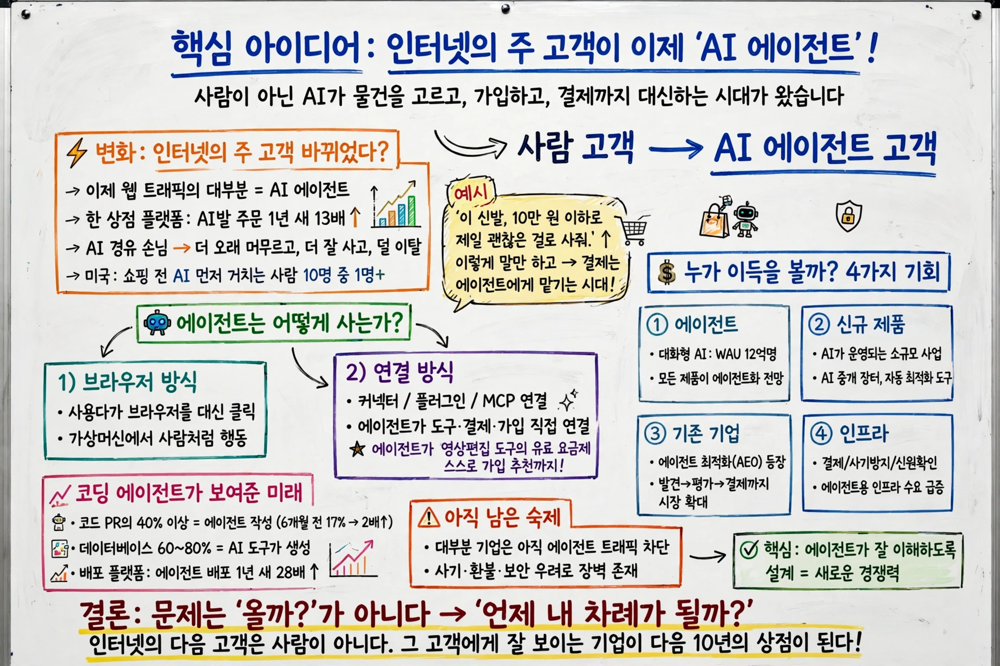
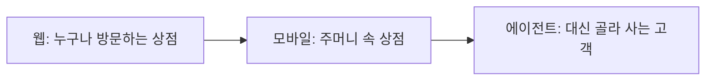

# 다음 고객은 사람이 아닙니다. AI 에이전트가 골라서 삽니다

> **Summary**
> 인터넷의 주된 사용자가 이제 사람이 아니라 AI 에이전트입니다. 에이전트가 물건을 고르고, 가입하고, 결제까지 대신합니다. AI에서 온 손님은 이미 사람보다 더 잘 삽니다. 한 상점 플랫폼에서는 AI발 주문이 1년 새 13배 가까이 늘었습니다. 그래서 기업들은 봇을 막던 벽을 허물고, 에이전트에게 잘 보이는 쪽으로 바뀌고 있습니다. 이 글은 그 변화가 무엇인지 정리했습니다.

---

- 인터넷의 주된 사용자가 이제 사람이 아니라 AI 에이전트입니다. 에이전트가 물건을 고르고, 가입하고, 결제까지 대신합니다.
- AI에서 온 손님은 이미 사람보다 더 잘 삽니다. 한 상점 플랫폼에서는 AI발 주문이 1년 새 13배 가까이 늘었습니다.
- 그래서 기업들은 봇을 막던 벽을 허물고, 에이전트에게 잘 보이는 쪽으로 바뀌고 있습니다. 이 글은 그 변화가 무엇인지 정리했습니다.

"이 신발, 10만 원 이하로 제일 괜찮은 걸로 사줘."

이렇게 말만 하고 결제는 에이전트에게 맡긴 적 있으시죠? 아직은 낯선 장면입니다. 그런데 그 장면이 쇼핑의 기본값이 되는 시대가 오고 있습니다!

🎥 [동영상 보기](https://www.youtube.com/watch?v=HaDsk-HiADE)

## 인터넷의 주 고객이 바뀌었습니다?

최근 한 투자사 뉴스레터는 이렇게 선언했습니다. 인터넷의 주된 사용자가 더 이상 사람이 아니라고요!

에이전트가 웹 트래픽의 대부분을 차지하고, 새로 발행되는 글의 절반 이상을 쓰고, 프로덕션에 올라가는 코드의 대부분을 만든다는 겁니다. 과장처럼 들리시죠? 그런데 숫자는 이미 움직이고 있습니다.

한 상점 플랫폼에서는 AI에서 온 트래픽이 1년 새 8배 늘었고, AI 검색에서 나온 주문은 13배 가까이 늘었습니다. 에이전트 브라우저 트래픽도 8월에서 10월 사이 8배로 뛰었고, 그중 60%는 한 에이전트 제품이, 30%는 다른 한 회사의 제품군이 차지했습니다. AI를 거쳐 온 손님은 사람보다 더 오래 머물고, 더 잘 사고, 덜 이탈한다고 합니다. 미국에서는 쇼핑을 하러 가기 전에 AI를 먼저 거치는 사람이 이미 10명 중 1명을 넘었습니다.

이건 단순한 유행이 아닙니다. 플랫폼이 바뀌는 초입의 모습입니다!

## 에이전트는 어떻게 사는 걸까요?

지금 에이전트가 사는 방식은 크게 두 가지입니다.

첫째, 브라우저를 직접 쓰는 방식입니다. 사용자의 브라우저를 이어받거나, 가상 머신에 브라우저를 띄워 사람처럼 클릭하며 일을 끝냅니다. 아직은 이 방식이 대부분입니다.

둘째, 연결 도구로 바로 붙는 방식입니다. 커넥터·플러그인·`MCP` 같은 연결 통로로 사이트와 도구에 직접 닿는 겁니다. 에이전트용 앱스토어가 스테로이드를 맞은 형태라고 표현되기도 했습니다. 이 장면이 저는 가장 인상 깊었습니다. 에이전트가 영상 광고를 만들면서, 영상 편집 도구의 유료 요금제를 스스로 권유해 가입까지 이어지게 했다는 대목이었습니다. 파는 쪽이 아니라 사는 쪽 에이전트가 업셀을 한 셈입니다!

결제도 점점 쉬워지고 있습니다. 신원을 빌려주는 로그인 방식이 등장했고, 기업용 채팅 서비스 안에서 기업이 직접 상품 정보를 올리는 기능도 나왔습니다. 결국 에이전트가 필요한 도구를 스스로 골라 연결하는 방향으로 가고 있습니다.

## 누가 이 변화에서 이득을 볼까요?

이 변화에서 기회를 잡을 쪽은 크게 네 갈래입니다.

첫째, 에이전트 자체입니다. 주간 활성 사용자 12억 명을 가진 대화 서비스가 대표적입니다. 모든 제품이 곧 에이전트처럼 동작하게 될 거라는 전망도 나왔습니다.

둘째, 에이전트 덕분에 새로 태어나는 제품입니다. 인터넷이 있어야 온라인 상점이 태어났고, 스마트폰이 있어야 차량 호출 서비스가 나왔듯이, 에이전트가 있어야 가능한 사업이 나올 거라는 겁니다. 스스로 돌아가는 작은 사업, AI가 중개하는 장터, 알아서 최적화해주는 도구가 예로 들었습니다.

셋째, 에이전트에 맞게 바뀌는 기존 기업입니다. 검색 노출을 노리는 최적화 산업이 이미 생겼습니다. 그런데 에이전트는 발견에서 멈추지 않습니다. 평가하고, 가입하고, 결제하는 선택까지 이어집니다. 시장이 더 크다는 뜻입니다.

넷째, 에이전트용 인프라입니다. 결제·사기 방지·신원 확인·메시지 같은 기반이 필요합니다. 아직 에이전트 수가 적은데도 결제·사기·신원 쪽에서는 이미 시스템에 무리가 오고 있다고 합니다.

## 코딩 에이전트가 먼저 보여준 미래

이 변화가 어떻게 흘러갈지, 이미 답을 보여준 분야가 있습니다. 바로 코딩 에이전트입니다!

2026년 9월 기준, 코드 저장소 풀 리퀘스트의 40% 이상이 에이전트가 쓴 초안에서 시작했습니다. 6개월 전에는 17%였습니다. 반년 만에 두 배 넘게 뛰었습니다.

에이전트가 도구를 고르는 모습도 숫자로 확인됐습니다. 한 데이터베이스 서비스에서는 새 데이터베이스의 60% 이상이 AI 도구에서 만들어졌고, 다른 곳에서는 80%가 에이전트 손에서 나왔습니다. 한 결제 서비스에서는 문서 트래픽의 40% 가까이, 명령줄 요청의 70%가 에이전트에서 왔습니다. 한 배포 플랫폼에서는 에이전트가 일으킨 배포가 1년 새 28배 늘었습니다.

이 수치가 보여주는 건 하나입니다. 에이전트는 도구를 고릅니다. 사람이 클릭해서 고르는 게 아닙니다!

## 아직 남은 숙제는 무엇일까요?

물론 넘어야 할 산이 있습니다. 대부분의 기업은 아직 에이전트 트래픽을 차단하고 있습니다. 사기나 환불 걱정이 크기 때문입니다.

그래서 이 글의 결론은 단순합니다. 에이전트는 이미 오고 있고, 숫자는 이미 움직이고 있습니다. 문제는 "올까?"가 아니라 "언제 내 차례가 될까?"입니다!

인터넷의 다음 고객은 사람이 아닐지도 모릅니다. 그 고객에게 잘 보이는 쪽이, 다음 10년의 상점이 됩니다!

