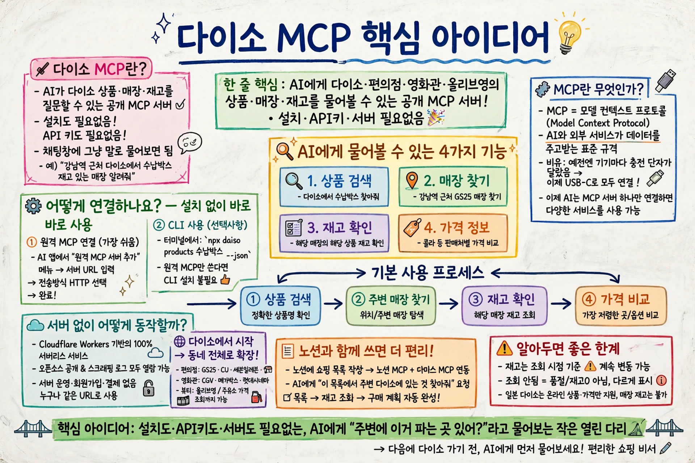
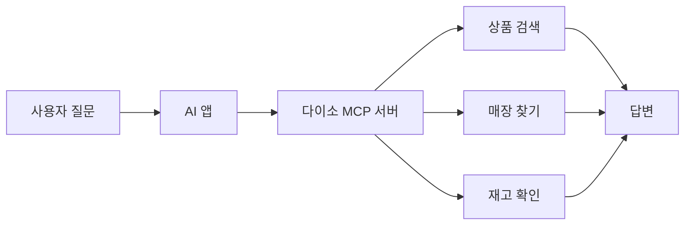
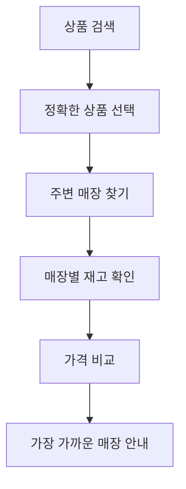
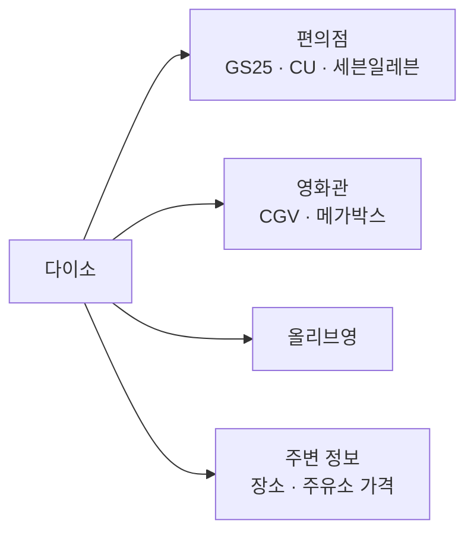

# 다이소 MCP: 헛걸음 전에 AI에게 물어보면, 재고 있는 매장이 보입니다

> **Summary**
> 다이소 MCP는 AI에게 다이소 상품·매장·재고를 물어볼 수 있게 해주는 공개 MCP 서버입니다. 설치도 API 키도 필요 없으며, 원격 MCP 서버를 연결하거나 채팅 앱에서 바로 쓸 수 있고, 터미널에서는 한 줄 명령으로도 조회할 수 있습니다. 다이소에서 시작해 편의점·영화관·올리브영까지 조회 범위가 넓어지고 있으며, 노션 쇼핑 목록과 함께 쓰면 필요한 물건을 주변 매장에서 찾는 흐름까지 만들 수 있습니다.

---

- 다이소 MCP는 AI에게 다이소 상품·매장·재고를 물어볼 수 있게 해주는 공개 MCP 서버입니다.
- 설치도 API 키도 필요 없습니다. 원격 MCP 서버를 연결하거나 채팅창에 말로 물으면 됩니다.
- 다이소에서 시작했지만, 지금은 편의점·영화관·올리브영까지 조회 범위가 넓어지고 있습니다.

## 다이소 가서 "이거 있나요?" 하고 헛걸음한 적 있으시죠?

다이소에 뭔가 사러 갔습니다. 진열대를 한 바퀴 돌았는데 안 보입니다. 직원에게 물어보니 "재고가 없습니다"라는 답이 돌아옵니다. 다음 매장으로 가야 할까요? 전화로 물어봐야 할까요? 이럴 때 AI에게 물으면 어떨까요? "강남역 근처 다이소에서 수납박스 재고 있는 매장 알려줘"라고요!

🎥 [동영상 보기](https://www.youtube.com/watch?v=ZgIqA1NCEp0)

## MCP가 뭐길래 AI가 매장 재고를 알까요?

MCP는 모델 컨텍스트 프로토콜의 줄임말입니다. AI가 외부 서비스와 데이터를 주고받는 표준 방식이라고 보면 됩니다. USB-C를 떠올리시면 됩니다! 기기마다 충전 단자가 다르던 시절이 있었죠? MCP는 AI와 서비스 사이에 같은 역할을 합니다. 서비스마다 따로 연결할 필요 없이, MCP 서버 하나만 붙이면 AI가 그 서비스를 쓸 수 있게 됩니다.

다이소 MCP는 이 표준으로 만든 서버입니다. AI가 다이소의 상품·매장·재고 데이터를 직접 조회할 수 있게 해줍니다. 채팅창에 질문하면, AI가 서버에 물어보고 답을 가져옵니다. 여러분이 다이소 앱을 켜고 검색할 필요가 없습니다.

## 어떻게 연결하나요? 설치 없이 바로 씁니다

가장 쉬운 방법은 원격 MCP 연결입니다. AI 앱에서 원격 MCP 서버 추가 화면을 열고, 서버 URL을 입력한 뒤 전송 방식을 HTTP로 고르면 끝입니다. 인증도 없고, API 키도 필요 없습니다. 채팅 앱에서는 GPTs 앱 형태로 별도 설정 없이 바로 쓸 수도 있습니다.

터미널을 좋아하시면 CLI도 있습니다. `npx daiso products 수납박스 --json` 한 줄이면 상품을 검색할 수 있습니다. 원격 MCP만 쓴다면 CLI를 설치할 필요가 없습니다.

## AI에게 무엇을 물어볼 수 있나요?

도구는 네 가지입니다. 상품 검색, 매장 찾기, 재고 확인, 가격 정보입니다. 흐름은 단순합니다. 먼저 상품을 검색해 정확한 상품을 고르고, 주변 매장을 찾은 뒤, 그 매장의 재고를 확인합니다.

이렇게 물어보면 됩니다.

- "다이소 수납박스 찾아줘"
- "강남역 근처 GS25 오감자 재고 알려줘"
- "주변에서 휘발유가 가장 저렴한 주유소 찾아줘"
- "오늘 강남 CGV 시간표 알려줘"
콜라가 어디가 싼지처럼, 판매처별 가격을 비교해달라고 물어볼 수도 있습니다. 재고 조회는 상품을 먼저 정확히 고른 뒤에 진행합니다. 그래야 엉뚱한 상품의 재고를 보는 일을 피할 수 있습니다.

## 서버가 없는데 어떻게 돌아갈까요?

서버가 없는 게 아닙니다. 서버를 직접 둘 필요가 없다는 뜻입니다. 다이소 MCP는 `Cloudflare Workers` 위에서 돌아가는 100% 서버리스 서비스입니다. 오픈소스라서 코드가 전부 공개돼 있고, 스크래핑 과정도 로그로 남겼습니다. 궁금하면 로그를 열어볼 수 있습니다.

이 구조가 저는 가장 인상 깊었습니다. 개인이 만든 서비스가 서버 한 대 없이 돌아가면서, 누구나 같은 URL로 연결해 쓸 수 있으니까요! 설치·회원가입·결제가 없다는 점도 이 구조 덕분입니다.

## 다이소에서 시작해 동네 전체로 넓어졌습니다

처음엔 다이소만 봤습니다. 그런데 지금은 범위가 훨씬 넓어졌습니다. 편의점은 GS25·CU·세븐일레븐·이마트24, 영화관은 CGV·메가박스·롯데시네마, 뷰티는 올리브영까지 조회할 수 있습니다. 주변 장소 검색과 주유소 가격까지 볼 수 있습니다. 처음 공개될 때 계획으로 적혀 있던 영화관·편의점이 실제로 들어온 것입니다!

물론 한계도 있습니다. 재고는 조회한 뒤에도 달라질 수 있습니다. 그래서 조회가 안 된 결과는 품절이나 재고 0과 다르게 표시합니다. 일본 다이소는 온라인 상품·가격·매장만 볼 수 있고, 매장 재고는 지원하지 않습니다.

## 노션과 함께 쓰면 더 편해집니다

가장 재밌는 활용은 노션과의 조합이었습니다. 다이소에 뭘 사러 가야 하는지 노션에 저장해두고, 노션 MCP와 함께 쓰면 필요한 물건을 주변 어느 다이소에서 살 수 있는지 AI가 찾아줍니다. 쇼핑 목록이 그대로 재고 조회로 이어지는 것입니다!

여러분의 쇼핑 목록은 어디에 있으신가요? 메모장에 있든, 노션에 있든, AI에게 "이 목록 중에서 주변 다이소에 있는 것들을 찾아줘"라고 물어보는 날이 오고 있습니다.

다이소 MCP는 거창한 기술이 아닙니다. AI에게 "주변에 이거 파는 곳 있어?"라고 물어볼 수 있게 해주는, 작고 열린 다리입니다. 설치도, 키도, 서버도 필요 없습니다. 다음에 다이소에 가기 전에, AI에게 먼저 물어보시는 건 어떨까요?

