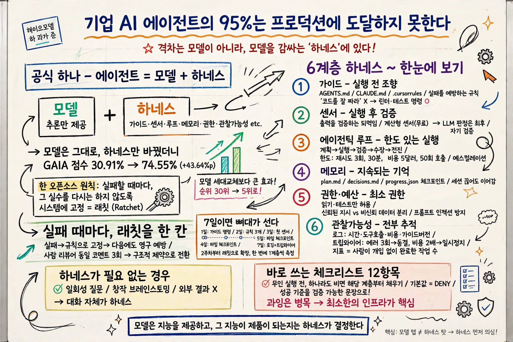
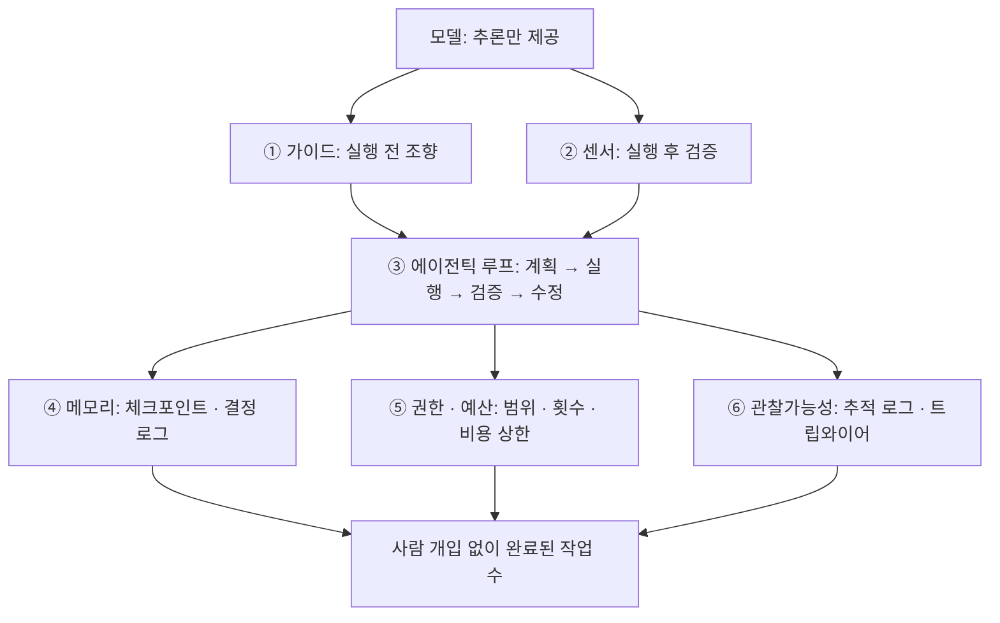
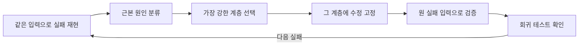

# 데모는 되는데 프로덕션은 안 됩니다. 모델이 아니라 하네스가 문제입니다

> **Summary**
> AI 에이전트가 프로덕션에 도달하지 못하는 주된 원인은 모델보다 하네스의 부족에 있다. 가이드, 센서, 한도 있는 실행 루프, 메모리, 권한·예산, 관찰가능성의 6계층을 구축하면 같은 모델도 더 안정적으로 작동하며, 실패할 때마다 원인을 고쳐 재발을 막는 래칫 방식으로 개선할 수 있다. 작은 규칙과 검증부터 시작하고, 검증 가능한 성공 기준과 최소 권한을 설정해 단계적으로 확장한다.

---

- 기업 AI 에이전트의 95%는 프로덕션에 도달하지 못합니다. 격차는 모델이 아니라 모델을 감싸는 하네스에 있습니다.
- 하네스는 가이드·센서·에이전틱 루프·메모리·권한·관찰가능성의 6계층이고, 같은 모델에 프로덕션 하네스를 붙이면 GAIA 점수가 30.91%에서 74.55%로 뜁니다.
- 시작은 작습니다. 가이드 파일 하나, 센서 하나, 권한 경계 하나부터 쌓고, 실패 때마다 래칫을 한 칸 돌립니다.

에이전트 데모를 본 적 있으시죠? 화면에서는 척척 해내는데, 운영에 붙이면 보안 리뷰에서 떨어지고 엣지 케이스에서 환각을 일으킵니다. 그런데 모델을 바꾸지 않고 주변만 바꿨더니 점수가 44%p나 뛰었다면, 무엇이 달라진 걸까요?

🎥 [동영상 보기](https://www.youtube.com/watch?v=dzEBiSKLww8)

## 공식 하나 — 에이전트 = 모델 + 하네스

**에이전트 = 모델 + 하네스**입니다. 모델은 추론만 제공합니다. 나머지는 전부 하네스입니다. 알려진 실패를 막는 가이드, 새 실패를 잡는 센서, 한도 걸린 실행 루프, 지속되는 메모리, 강제되는 권한, 완전한 관찰가능성입니다.

한 오픈소스 도구의 창시자가 공개한 원칙이 출발점입니다. 에이전트가 실수를 할 때마다, 그 실수를 다시는 하지 않도록 만드는 해법을 엔지니어링한다는 원칙입니다. 한 AI 기업의 현장 보고서는 이를 숫자로 증명했습니다. 소규모 팀이 5개월간 약 1,500건의 자동화된 PR로 100만 줄짜리 코드베이스를 만들었는데, 사람이 직접 쓴 코드는 한 줄도 없었습니다.

AI 엔지니어링의 시대도 세 번 바뀌었습니다. 프롬프트 시대는 모델이 **말하는 것**을, 컨텍스트 시대는 모델이 **보는 것**을, 하네스 시대는 모델이 **할 수 있는 것**을 결정합니다.

## 증거 — 모델은 그대로, 하네스만 바꿨습니다

가장 힘이 실린 부분은 수치입니다. GAIA 벤치마크에서 같은 모델이 최소 하네스에서는 30.91%, 프로덕션 하네스에서는 74.55%를 기록했습니다. 무려 43.64%p 차이로, 웬만한 모델 세대 교체 폭보다 큽니다!

한 벤치마크에서는 하네스만 다듬었더니 순위가 30위에서 5위로 25계단 뛰었습니다. 16종 모델에 도구 포맷만 바꿨더니 거의 전 모델이 올랐습니다. 우리가 "모델이 약해서"라고 결론 내린 실패 상당수가 사실 하네스 문제였다는 뜻입니다. 모델 탓을 하기 전에 하네스부터 의심해 봐야 하지 않을까요?

## 6계층, 한눈에 보기

**① 가이드 — 실행 전에 조향합니다.** 에이전트가 일을 시작하기 전에 읽는 지시입니다. `AGENTS.md`, `CLAUDE.md`, `.cursorrules` 같은 파일이며, 각 줄은 과거 실패 하나의 영구 예방책입니다. "코드를 잘 짜라"는 가이드가 아닙니다. 린터 명령과 테스트 명령이 가이드입니다.

**② 센서 — 실행 후에 검증합니다.** 출력을 검증하는 되먹임 제어입니다. **계산형 센서 먼저, 추론형 센서는 마지막**입니다. 하루 50회 도는 작업에 1회 10달러짜리 LLM 판정을 붙이면 하루 500달러입니다. 같은 실수를 잡는 린터 규칙은 0원입니다! LLM 판정은 결정적 규칙으로 못 쓰는 검사에만 씁니다. 가장 강한 패턴은 자기 검증입니다. 에이전트가 매 단계 후 스스로 테스트를 돌리고 되돌아갑니다.

**③ 에이전틱 루프 — 한도가 있는 실행입니다.** 계획·실행·검증·수정·전진·에스컬레이션의 한도 걸린 사이클입니다. 한도는 재시도 3회, 30분, 토큰 10만 개, 작업당 5달러, 도구 호출 50회입니다. 예산이 떨어지면 최선 결과물과 완료 목록, 미해결 이슈, 멈춘 이유를 반환합니다. 올바른 에스컬레이션은 실패가 아닙니다. 자신 있게 틀린 답을 내는 에이전트보다 제때 사람을 부르는 에이전트가 더 값집니다!

**④ 메모리 — 모델은 잊고, 하네스는 기억합니다.** 모든 모델 호출은 빈 컨텍스트에서 시작합니다. 연속성은 하네스의 명시적 상태 관리가 제공합니다. 가장 단순하고 강한 답은 파일시스템입니다. `plan.md` 하나, `decisions.md` 로그 하나, `progress.json` 체크포인트 하나면 됩니다. 확인하는 테스트도 실용적입니다. 여러 단계 작업 중간에 세션을 끊고 다시 열었을 때, 체크포인트를 읽고 마지막 완료 지점부터 이어가는가? **메모리는 무슨 일이 있었는지를 기록하고, 가이드는 무엇을 해야 하는지를 정의합니다.**

**⑤ 권한과 예산 — 모델은 안전을 강제하지 못합니다.** 권한은 모델의 속성이 아니라 하네스의 속성입니다. 원칙은 최소 권한입니다. 읽고 테스트를 돌리는 작업이면 딱 그 권한만 줍니다. 불필요한 권한 하나하나가 프롬프트 인젝션의 공격면이고 에이전트 실수의 폭발 반경입니다. 에이전트가 이메일·웹페이지 같은 신뢰할 수 없는 콘텐츠를 읽으면, 그 안의 악성 지시가 권한을 확장하거나 비밀을 빼돌리려 할 수 있습니다. 신뢰된 지시와 비신뢰 데이터는 모든 작업에서 분리해야 합니다.

**⑥ 관찰가능성 — 전부 추적하고, 드리프트에 경보를 겁니다.** 타임스탬프, 도구 호출과 결과, 가이드 버전, 시도 횟수와 비용, 산출물, 승인까지 전부 기록합니다. 여기에 트립와이어를 겁니다. 집계 행동이 이상해지면 울리는 경보입니다. 외부 쓰기 급증, 같은 에러 3회 반복, 비용 2배 초과 같은 신호가 뜨면 쓰기를 동결하거나 일시정지합니다. 측정 지표도 하나입니다. 호출 수나 토큰 수를 세지 않습니다. **사람의 개입 없이 완료되고, 수용 가능한 증거를 남긴 작업의 수**를 셉니다. 이 지표 하나가 겉보기에 인상적인 에이전트와 실제로 일하는 에이전트를 가릅니다!

## 실패할 때마다, 래칫을 한 칸

6계층을 관통하는 운영 원리가 **래칫**입니다. 한 방향으로만 도는 톱니바퀴라서 실패가 나올 때마다 시스템은 영구적으로 좋아집니다. 실패 유형별로 약한 수정과 강한 수정이 갈립니다. 알려진 나쁜 패턴은 프롬프트 주의 문구가 아니라 린터 규칙으로 막습니다. 프롬프트 패치는 대화 하나를 고치지만, 가이드 규칙은 모든 미래 실행을 고칩니다.

전환 신호도 있습니다. 사람 리뷰어가 같은 코멘트를 세 번 넘게 쓰면 그 코멘트는 구조적 제약이 되어야 합니다.

## 7일이면 뼈대가 섭니다

한 계층이 증명된 뒤에만 다음 계층을 올립니다. 1일차 가이드 명령, 2일차 규칙 3개, 3일차 첫 센서, 4일차 루프와 한도, 5일차 파일 체크포인트, 6일차 권한과 예산, 7일차 로깅과 트립와이어 순으로 올립니다. 2주 차부터는 래칫으로 확장합니다. **한 번에 한 계층만 바꾸고, 효과를 측정하고, 스코어카드가 나빠지면 되돌립니다!**

## 하네스가 필요 없는 경우도 있습니다

모든 에이전트에 하네스가 필요한 것은 아닙니다. 판별 기준은 세 가지 질문입니다. 조용히 틀린 결과를 알아챌 수 있어야 하는가? 같은 컨텍스트를 또 설명해야 하는가? 실수 하나가 외부에 실제 결과를 만드는가? 셋 다 아니라면 대화 자체가 하네스입니다. 일회성 질문이나 창작 브레인스토밍에는 하네스가 필요 없습니다. 반대로 매일 도는 코드 리뷰나 CI/CD 에이전트라면 필요합니다. 과잉도 경계해야 합니다. 규칙 500개, 승인 단계 40개짜리 하네스는 안전을 가장한 병목입니다. **하네스는 에이전트를 신뢰할 수 있게 만드는 최소한의 인프라여야 합니다.**

## 바로 쓰는 프롬프트 4종과 체크리스트 12항목

템플릿은 바로 붙여 쓸 수 있는 프롬프트 4종으로 변환됐습니다. `AGENTS.md` 생성, 실수할 때마다 쓰는 래칫, 무인 실행 전 권한·예산 정책, 월간 가이드 정리입니다. 확신이 없으면 DENY가 기본값이고, 센서가 대신 강제하는 규칙은 지웁니다.

무인 실행 전 12항목 체크리스트도 있습니다. 하나라도 비면 그 계층부터 채웁니다.

모델은 지능을 제공하고, 그 지능이 제품이 되는지는 하네스가 결정합니다. 하네스는 잘못된 목표를 고쳐 주지 않습니다. 수용 기준이 틀렸으면 센서는 틀린 출력을 성실하게 통과시킵니다. 계층을 쌓기 전에 "무엇이 성공인가"부터 검증 가능한 문장으로 적어야 합니다.

