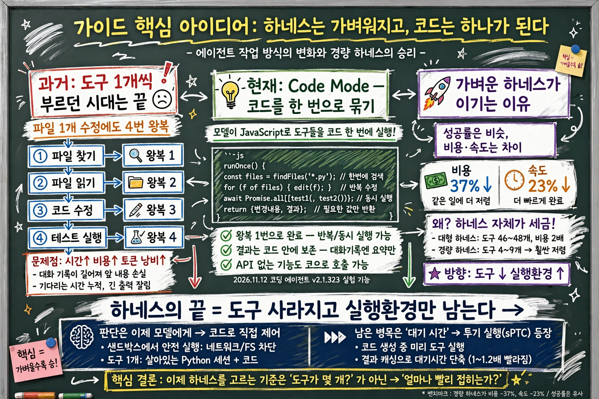
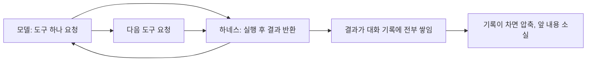
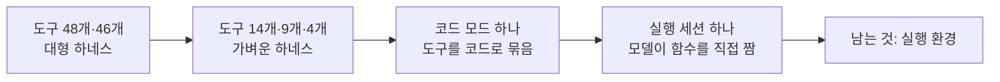

# 도구를 하나씩 부르던 시대가 끝났습니다. 이제 코드 한 번이면 됩니다

> **Summary**
> 에이전트가 도구를 하나씩 부르면 파일 하나 고치는 데도 찾기·읽기·수정·테스트까지 왕복이 네 번 생기고, 그 왕복이 곧 비용과 시간입니다. Code Mode는 도구를 코드 안의 함수로 바꿔 한 번에 묶어 실행하고 필요한 값만 모델에게 돌려주며, 샌드박스에서 돌아가 권한 검사와 훅으로 통제됩니다. 가벼운 하네스가 비싼 하네스를 이기는 이유는 성공률이 아니라 비용과 속도이며, 하네스의 끝은 도구 목록이 사라지고 실행 환경만 남는 쪽입니다.

---

- 에이전트가 파일 하나를 고치는 데 도구 호출을 네 번씩 왕복하던 시대가 끝나고 있습니다. 이제 모델은 코드 한 번으로 도구를 묶어 부릅니다.
- 가벼운 하네스가 비싼 하네스를 이기는 이유는 성공률이 아니라 비용과 속도입니다. 같은 일을 끝내는 데 드는 돈과 시간이 갈립니다.
- 하네스의 끝은 도구가 사라지는 것이 아니라 실행 환경만 남는 것입니다. 판단은 코드로 모델에게 넘어갑니다.

에이전트에게 파일 하나 찾아달라고 했는데, 엉뚱한 파일을 잔뜩 읽고 토큰이 줄줄 새는 걸 본 적 있으시죠? 파일 하나 고치는 일도 찾기, 읽기, 수정, 테스트까지 단계마다 모델과 오가야 했습니다. 그런데 최근 공개된 실험 기능 하나가 이 왕복 자체를 없애고 있습니다!

🎥 [동영상 보기](https://www.youtube.com/watch?v=k6VAUR5MoEk)

## 하네스가 뭐길래, 이렇게까지 줄이나요?

하네스는 모델을 감싼 소프트웨어입니다. 모델에게 도구를 쥐여주고, 실행 환경을 마련하고, 결과를 다시 모델에게 돌려주는 루프가 하네스의 본체입니다. 모델이 아무리 좋아도 하네스가 어떻게 짜였느냐에 따라 같은 일의 비용과 속도가 달라집니다. 그래서 하네스 엔지니어링이라는 말이 따로 생겼습니다.

그런데 하네스는 계속 가벼워지는 쪽으로 가고 있습니다. 도구를 잔뜩 쌓는 대신, 도구를 줄이고 실행 환경에 집중하는 방향입니다. 그 끝자락에 있는 것이 Code Mode입니다.

## 도구 하나씩 부르면 뭐가 문제였을까요?

지금까지 에이전트는 도구를 하나씩 불렀습니다. 모델은 한 번에 도구 하나만 요청하고, 하네스가 돌려준 결과를 읽은 뒤에야 다음 행동을 정했습니다. 파일 하나를 고치는 일도 단계마다 왕복이 생겼습니다.

- 파일 찾기 → 왕복 한 번
- 파일 읽기 → 왕복 한 번
- 코드 수정 → 왕복 한 번
- 테스트 실행 → 왕복 한 번
이 왕복은 작업이 길어질수록 그대로 비용이 됩니다. 기다리는 시간과 대화 기록에 쌓이는 결과가 함께 늘어나기 때문입니다. 단계마다 모델 응답을 기다리고, 읽은 결과가 전부 대화 기록에 쌓이고, 기록이 차면 압축되며 앞 내용이 사라집니다. 긴 출력은 일부만 잘려 들어오고, 도구로 만들어 두지 않은 기능은 쓰기 어렵습니다. 왕복이 곧 돈이고, 왕복이 곧 시간입니다!

## Code Mode는 무엇이 다른가요?

Code Mode는 도구 호출을 코드 한 번으로 묶습니다. 모델이 도구를 직접 부르는 대신 `JavaScript`를 작성하고, 도구는 코드 안에서 함수가 됩니다. 반복하고, 동시에 돌리고, 결과를 다음 호출에 넘길 수 있습니다. 파일 검색과 수정과 테스트를 코드 한 번에 실행하고, 여러 파일 수정은 반복문 하나로 처리하고, 서로 기다릴 필요 없는 명령은 동시에 실행합니다. 마지막에 필요한 값만 모델에게 반환합니다!

가장 큰 차이는 결과가 대화 기록 대신 코드 안에 머문다는 점입니다. 모델은 필요한 부분만 꺼내 읽으면 됩니다. 왕복 횟수가 줄고, 대화 기록에는 필요한 값만 들어가고, 긴 출력도 잘리지 않은 데이터로 받아 코드로 거릅니다. 도구 목록에 없는 기능도 코드 안 API로 부릅니다.

이 방식은 한 클라우드 업체가 처음 정의했습니다. 전체 API를 단 두 개의 도구(검색과 실행)로 제공해, 모델이 `JavaScript`로 API 명세를 탐색하고 필요한 호출만 골라 실행하는 구조입니다. 토큰 사용량이 99.9% 줄었다는 것이 업체 측 설명입니다. 한 AI 연구소도 같은 패턴을 독자적으로 탐구했습니다. 그리고 2026년 11월 12일, 코딩 에이전트 `v2.1.323`에 실험 기능으로 들어왔습니다. 환경 변수 하나로 켜는 선택 기능이고, 아직 실험 단계라 언제든 바뀌거나 사라질 수 있습니다.

## 코드는 어디에서 돌아가나요? 샌드박스가 답입니다

코드가 모델이 쓴 것이라고 해서 아무 데서나 돌릴 수는 없습니다. Code Mode의 코드는 하네스 쪽 샌드박스에서 돌아갑니다. 네트워크와 파일 시스템은 막혀 있고, 코드가 할 수 있는 일은 도구 호출뿐이며, 메모리 사용량에도 제한이 있습니다. 두뇌가 쓴 코드가 손을 움직이기 전에, 격리된 공간에서 먼저 검증받는 구조입니다.

그래서 실행을 통제하는 장치도 두 겹입니다. 코드를 실행하기 전과, 코드가 도구를 부를 때 두 번에 나눠 살펴봅니다. 권한 규칙과 훅은 도구 호출마다 적용되고, 자동 승인 분류기는 코드 전체를 검토합니다. 대화 화면에는 코드 대신 그 코드가 부른 도구 호출과 변경 내용이 보이고, 코드는 따로 열어 봅니다. 오래 걸리는 코드는 백그라운드로 실행됩니다. 코드가 자유로워진 만큼, 감시도 촘촘해진 것입니다.

## 가벼운 하네스가 비용과 속도에서 앞서고 있습니다

같은 모델과 같은 작업으로 21개 하네스를 비교한 벤치마크가 있습니다. 가벼운 하네스로 알려진 `Pi`가 순위 가장 앞부분에 위치했고, 기능이 많은 대형 하네스는 비용 20위와 속도 21위에 머물렀습니다. 작업의 성공률은 하네스 간에 크게 다르지 않았습니다. 차이는 같은 일을 끝내는 데 드는 비용과 시간에서 벌어졌습니다. 성공 1건당 비용은 37% 낮고, 시간은 23% 짧았습니다.

이 수치는 해당 벤치마크의 자체 측정입니다. 과제와 버전이 고정된 조건에서의 결과라 그대로 일반화할 수는 없습니다. 다만 방향은 다른 연구에서도 같습니다. 2026년 9월의 한 대규모 연구에서도, 같은 모델·같은 과제에서 대형 하네스의 비용이 가벼운 하네스의 약 2배였고 성공률은 거의 같았습니다. 비싼 하네스가 더 잘하는 것이 아니라, 더 비싸게 같은 일을 하는 것입니다. 하네스 세금이 따로 없습니다. 하네스 자체가 세금입니다!

## 도구 하나만 남긴 하네스가 나왔습니다

이 흐름의 끝에는 도구 목록 자체를 없앤 하네스가 있습니다. 계속 살아 있는 `Python` 세션 하나가 다른 도구를 모두 대신하는 구조입니다. 도구 목록 없이 실행 세션 하나만 두고, 모델이 필요한 함수를 직접 짜서 세션에 보관합니다. 대화 기록이 압축돼도 데이터와 함수는 세션에 남습니다. 모든 명령은 백그라운드에서 시작하고 끝나면 알림이 옵니다.

숫자로 보면 흐름이 더 또렷합니다. 한 하네스가 모델에게 쥐여주는 내장 도구 수는, 대형 제품이 48개와 46개, 중형이 31개와 26개와 14개, 가벼운 쪽이 9개와 4개, 그리고 이 하네스는 1개입니다. 그런데 이 하네스의 성능은 가벼운 하네스보다도 훨씬 높게 나타났습니다. 도구는 코드 모드 하나면 충분했다는 것일 수 있습니다. 물론 이 성능 수치도 해당 프로젝트 측의 발표라, 독립적인 검증이 더 필요합니다.

## 남은 병목은 기다림입니다. 그래서 투기 실행이 나왔습니다

도구를 하나로 줄이고 나니 남은 병목은 모델이 코드를 다 쓸 때까지 기다리는 시간이 되었습니다. 이에 대해 한 연구자가 `sPTC`라는 방식을 제안했습니다. 코드가 생성되는 도중에 도구 호출을 먼저 실행해 대기 시간을 줄이는 방법입니다. 생성 중인 코드에서 도구 호출을 미리 찾아 실행하고, 실제 코드가 같은 호출을 하면 저장된 결과를 바로 반환합니다. 부작용이 있는 도구는 미리 실행하지 않습니다.

이 방식의 효과도 제안자 본인의 측정입니다. 재귀 언어 모델 기준으로 실행 시간이 1~1.2배 빨라졌다고 합니다. 크지 않은 수치지만, 방향이 중요합니다. 하네스가 줄인 왕복 시간을, 이제는 코드 생성 시간 안에서 미리 당겨 쓰는 것입니다. CPU의 투기 실행과 같은 아이디어가 하네스 설계로 들어온 것입니다.

도구를 하나씩 부르던 하네스는 사실 모델이 할 일을 사람이 미리 정해 두는 구조였습니다. Code Mode는 그 모든 결정을 제한 없는 코드로써 모델에게 넘겼고, 다음 세대의 하네스는 실행 환경만 남기는 쪽으로 발전해 가고 있습니다. 올해 내내 계속해서 보여지는 모습이라 주목할 필요가 있습니다. 하네스를 고르는 기준도 바뀌고 있습니다. 도구가 몇 개인지가 아니라, 얼마나 빨리 접히는지입니다!

