# 동서양을 가르는 경계에 대하여 1 - 숲의 종교와 사막의 종교

> **Summary**
> 숲의 종교는 다양성과 상호관계를 강조하며, 사막의 종교는 엄격한 규칙과 절대적인 믿음을 중시한다. 동양의 숲의 종교는 자연의 순환과 조화, 윤회 사상을 통해 삶과 죽음의 연속성을 이해하며, 서양의 사막의 종교는 생존을 위한 강력한 공동체적 결속과 유일신 사상을 강조한다. 이러한 환경적 차이는 각 문화의 철학과 가치관에 깊은 영향을 미친다.

---

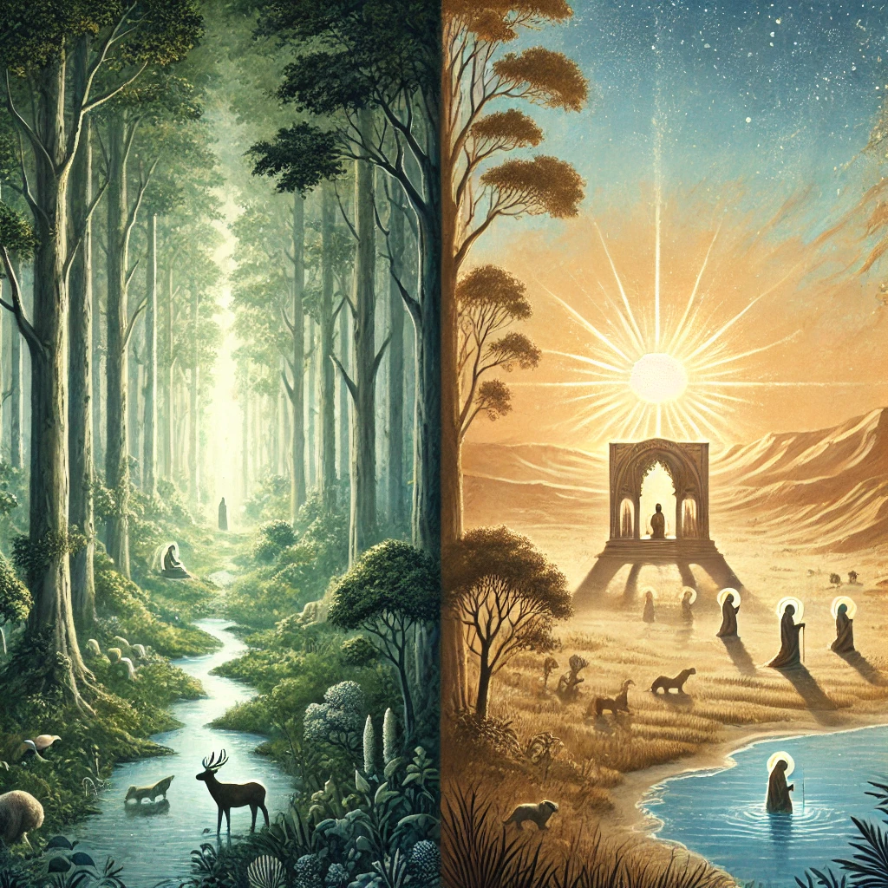

```plain text
서양과 동양을 가르는 경계는 어디서 오는가? 

그 기준은 거슬러올라가 자연이라는 인류가 절대로 초월할 수 없는 환경에서 기인한다.
```

# 서론

학부시절 1학년 때였나,,, 책이라곤 양판소와 삼국지, 신화책 말고는 제대로 읽어본 적 없던 내게 철학수업은 정말 센세이션 그 자체였다.

정답이 존재하지 않고 그저 내 생각을 말하면 되는 수업, 그리고 평소에 정리되지 않은 나의 생각들을 과거의 누군가들이 명쾌하게 정리해둔 철학이라는 수업은 내게 새로운 세계를 열어주었다.

아래 내용은 기억이 가물가물하지만, 아마 1학년때 인간학 수업에서 잠시 언급했던 숲의 종교와 사막의 종교에 대한 이야기다. 당시에 인상 깊게 들었고, 살아가면서 동양과 서양을 이해하는 과정에서 이 인사이트가 근간이 되어 많은 것들을 이해하게 된 것 같다. 이제 제대로 이해했는지 스스로 다시 정리해볼 겸, '동서양을 가르는 경계에 대하여'라는 시리즈로 머릿속에 혼재하던 생각들을 한번 정리해보려 한다.

CS를 전공한 분들이라면 공감하겠지만, 생각보다 CS에는 객체라던가.. 주체라던가.. 상당 부분 있어서 꽤나 철학적인 심오한 요소들이 존재한다. 그래서 가능하다면 그냥 인문학으로 끝나지 않고, 그래서 개발자 혹은 엔지니어로서, 우리는 이를 어떻게 우리의 라이프에 녹아들게 만들 수 있을까? 를… 함께 고민해보고자한다.

아마 내가 겉핥기식으로 이것저것 알고 있고, 합당한 근거 없이 조금씩 알고 있는 내용들을 어떻게든 이어보려는 글이 될 것 같다. 그래서 그냥 재미있는 인사이트 정도로만 읽어주면 감사하겠다…

자, 그러면 동서양을 가르는 첫번째 경계, 숲의 종교와 사막의 종교에 대하여 한번 알아보자…!


# Forest vs Desert ???

> **숲의 종교는 ****다양성****과 ****상호관계****를 강조하는 반면, 사막 종교는 ****엄격한 규칙****과 ****절대적인 믿음****을 강조한다…**

🎥 [동영상 보기](https://youtu.be/pML4y-wB9HI?si=Xn6ujiwhTcm5UpU0&t=292)

한글로 숲의종교와 사막의 종교를 검색하면 도통 만족할만한 내용이 나오지 않는다... 종교를 믿는 사람들이 과거에 적은 가독성 떨어지는 글이나, 너무나도 종교적으로만 해석한 글들로 가득하다…

그러던 도중, 유튜브에는 이 정체모를 아저씨가 꽤나 숲의 종교와 사막의 종교에 관하여 쉽게 정리해둔 영상이 있어 남겨둔다.

영상의 내용을 정리해보자면, "숲" 종교와 "사막" 종교의 차이점을 분석한다.

- **숲의 종교 특징:**대표적으로 힌두교, 불교 등이 있습니다
 다양한 생각과 믿음을 받아들입니다
 모든 것이 서로 연결되어 있다고 봅니다
 평화롭고 포용적인 성격을 가집니다
 새로운 생각과 변화를 잘 받아들입니다
- **사막의 종교 특징:**대표적으로 기독교, 이슬람교, 유대교가 있습니다
 엄격한 규칙과 하나의 절대적 신을 중요시합니다
 옳고 그름을 명확하게 구분합니다
 다른 믿음에 대해 배타적인 경향이 있습니다
 변화를 받아들이기 어려운 편입니다
즉, 숲의 종교는 다양성과 조화를 추구하고, 사막의 종교는 절대적 진리와 규칙을 중시한다. 이러한 차이는 각 종교가 생겨난 자연환경으로부터 기인한다.

그러면 이에대해 이야기와 함께 조금 더 알아볼까?

# 숲의 종교 - 숲과 윤회: 자연이 빚어낸 동양의 순환 철학

```plain text
동양에서 숲은 단지 나무의 집합이 아닌, 삶과 우주의 순환을 가르쳐주는 철학의 공간이었다. 

사계절의 명확한 변화, 계절마다 다른 음식을 먹는 식문화, 조상숭배와 윤회 사상은 모두 자연의 순환과 연결된다. 

숲을 통해 사람들은 삶과 죽음이 끝없이 이어지며 모든 존재가 결국 하나로 연결되어 있음을 깨달았다. 

이것이 동양의 '숲의 종교'가 가진 깊은 의미이다.
```

## >> 숲이 가지는 그 순환의 의미

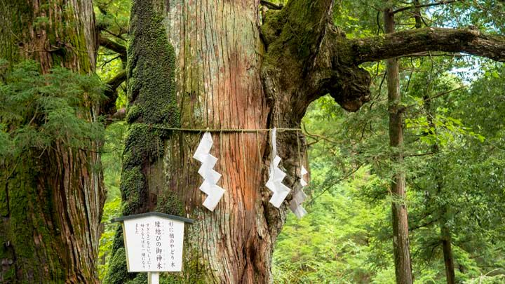

숲, 숲의 종교, 자연, 순환...

천천히 하나씩 떠올려보자.

동양의 숲을 떠올리면, 일본의 울창한 삼나무 숲이나, 한국의 오래된 당산나무가 있는 풍경들이 어렴풋이 떠오른다. 숲을 생각할 때면 이상하게도 마음이 차분해진다. 단지 나무가 많아서일까? 아니면 숲 그 자체가 지닌 어떤 깊은 의미 때문일까?

숲이라는 공간은 어쩌면 우리 동양인의 마음을 담고 있는 곳인지도 모르겠다.

계절이 분명한 동양에서는 자연이 아주 뚜렷한 리듬을 가지고 움직인다. 봄이 오면 새싹이 피어나고, 여름이면 생명이 무성해지다가, 가을이면 다시 열매를 맺고, 겨울이 오면 조용히 잠이 든다. 그리고 다시 봄이 온다.

이런 단순하지만 명확한 순환은 우리가 살아가는 인생과 별반 다르지 않다는 생각이 든다. 숲 속의 나무도 우리 인간도 결국 같은 흐름 속에서 살아가고 있다는 느낌이 든다.

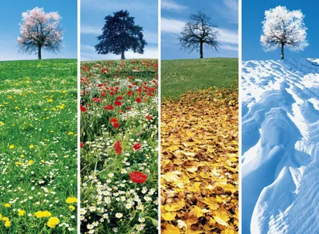

### >>>> 숲, 동양이 느끼던 우주.

그렇게 바라보면 숲이 왜 성스러운 곳으로 여겨졌는지 조금은 이해할 수 있을 것 같다.

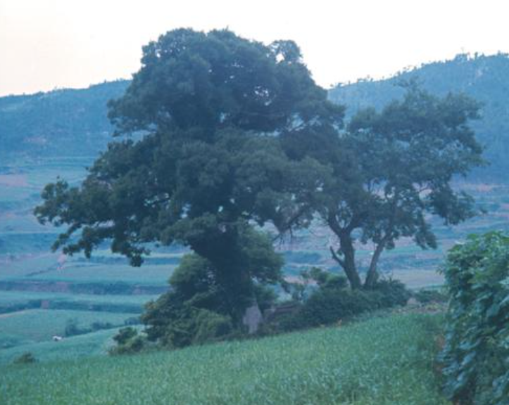

오래된 나무에 신이 머문다고 믿었던 일본의 신토나, 당산나무를 모시며 마을을 지키던 한국의 옛 사람들은 아마도 이 자연의 순환을 직감적으로 느꼈을 것이다. 나무는 한 곳에서 가만히 서 있지만, 매년 새롭게 살아나고, 성장하고, 또 죽었다가 다시 태어난다. 이 과정을 수백 년간 지켜본 사람들의 눈에는, 나무가 하나의 작은 우주처럼 보이지 않았을까?

우리가 동양에서 자라면서 자연스럽게 몸으로 익힌 사계절의 순환은 결국 우주가 돌아가는 원리와도 닮아 있다.

서양에서는 신이 세계를 한 번에 창조하고, 시간은 앞으로만 나아가는 직선이라 믿었지만, 동양에서는 오히려 시간이 끝없이 원을 그리며 되풀이된다고 생각했다. 삶은 끝이 아니라 또 다른 시작이었고, 죽음도 결국 새로운 생명으로 다시 돌아오는 과정일 뿐이었다.


### >>>> 비약일까? 식탁에도 숲의 철학이 담겨있다.

그런 생각을 하고 있으면 문득 음식이 떠오른다.

할머니께서는 지금도 철마다 나는 각종 나물들과 채소들을 잔뜩 선보인다. 봄에는 봄나물을, 여름에는 오이와 참외 그리고 수박을, 가을이면 밤이 들어간 송편을, 겨울이면 생굴과 곁들여 먹는 강릉식 김치를 먹곤 했다. 계절마다 제철 음식을 먹으며 자연의 흐름을 따르는 것은, 결국 인간이 자연 속 작은 부분이라는 사실을 매일 일깨워주는 일이 아니었을까? 우리의 식탁 위에도 숲의 철학이 있었던 셈이다.

그런데 이런 생각을 하다 보니 동양의 윤회 사상이 자연스럽게 이해된다.

윤회라는 개념이 인도에서 불교를 통해 들어왔지만, 사실 우리는 이미 그것을 알고 있었던 게 아닐까? 매년 반복되는 농사의 리듬 속에서, 끊임없이 이어지는 조상과 후손의 관계 속에서, 죽은 조상의 영혼이 다시 돌아온다고 믿으며 제사를 올리는 우리 문화는 결국 자연의 순환을 그대로 닮아 있다. 조상과 후손이 계속 이어지는 것은 결국 삶의 순환을 의미하는 게 아닐까?

숲과 산을 바라보면 동양의 옛사람들은 삶과 죽음을 넘어서 자연과 우주의 순환을 느꼈다. 그래서 나무 하나, 바위 하나에 신령이 있다고 믿었던 것일 테고, 그 신성한 숲 안에서 인간의 삶이 자연과 조화를 이루기를 바랐던 것이 아닐까 싶다.

그래서 결국 숲이라는 것은 그 자체로 커다란 윤회의 장소다.

티베트의 윤회의 수레바퀴처럼, 인간은 자연의 품 안에서 돌고 돌며, 죽음과 삶이 끊임없이 교차한다. 부처가 전생에 나무 정령으로 태어나 어린 나무들을 보호하려 했다는 아름다운 설화처럼, 모든 생명이 결국 연결되어 있음을, 우리는 오랜 세월 동안 숲을 통해 배워왔다.

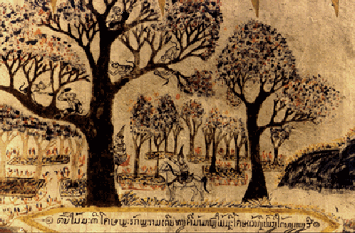

이렇게 바라보면, 숲은 단지 나무가 많은 장소가 아니다. 그것은 삶과 죽음, 인간과 자연, 나와 타인이 모두 연결된 순환의 원을 깨닫게 하는 거대한 철학의 장이다. 그래서 숲 속에 들어가면 우리는 자신도 모르게 경건한 마음이 드는지도 모르겠다.

어쩌면 숲의 고요함은, 우리에게 "모든 것은 결국 돌아온다"는 우주의 가장 큰 비밀을 들려주는 속삭임이 아닐까?

## >> 숲의 종교로 이해하는 동양의 문화

지금까지 이야기한 내용을 다시 살펴보니 핵심이 조금 더 명확해졌다.

동양의 숲의 종교를 이해하기 위해서는, 먼저 동양의 환경과 민족의 생활방식을 생각해야 하는 것 같다. 동양의 민족들은 오랜 기간 한 장소에 머무르며 농경을 중심으로 생활을 해왔다. 농경사회에서의 생활은 계절과 긴밀하게 연결된다. 봄에 씨를 뿌리고, 여름에 키우고, 가을에 수확하며, 겨울에는 쉬면서 다음 봄을 기다린다. 이런 생활의 리듬은 사람들에게 자연스럽게 ‘순환’이라는 관념을 심어줬을 것이다.

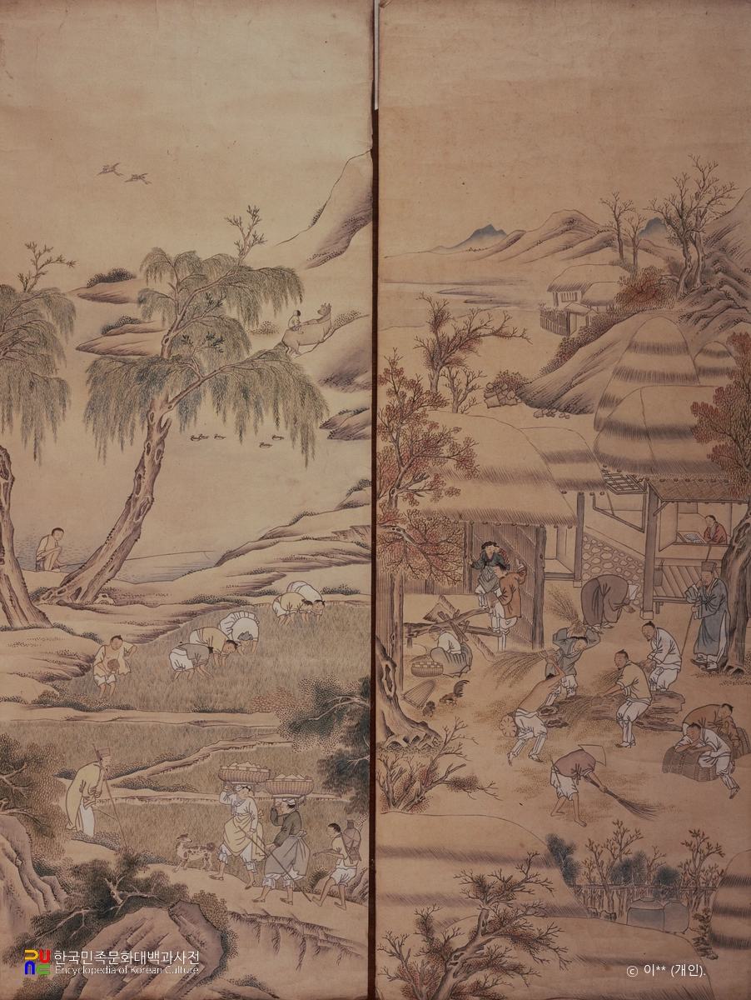

[https://encykorea.aks.ac.kr/Article/E0002945](https://encykorea.aks.ac.kr/Article/E0002945) - **백성의 생업인 농업과 누에치고 비단 짜는 일을 그린 풍속화.**

동양에서 뚜렷한 사계절은 생명과 죽음이 끊임없이 반복되는 과정을 그대로 보여주는 가장 강력한 교과서였을 것이다. 매년 나무가 잎을 틔우고, 열매를 맺고, 다시 낙엽을 떨어뜨리며 생을 마감하는 모습을 보며, 사람들은 삶과 죽음이 특별한 것이 아니라 자연스러운 현상이라는 것을 이해했을 것이다.

### >>>> 동양인들에게 삶과 죽음은 자연의 섭리였다.

이렇게 자연의 순환을 일상적으로 느끼다 보니, 동양인들에게는 윤회라는 사상이 쉽게 받아들여졌을 것이다. 죽음은 삶의 끝이 아니라, 다시 다른 형태로 돌아오는 과정일 뿐이라는 생각이 낯설지 않았던 것이다. 윤회는 인도에서 전래된 불교를 통해 더 정교하게 발전되었지만, 본질적으로는 이미 동양 사람들이 가지고 있던 세계관과 잘 맞았다.

여기서 더 중요한 건, 이런 자연 순환의 철학이 동양인의 삶과 태도에 어떤 영향을 주었는지다.

자연을 극복하거나 정복해야 하는 대상으로 보았던 서양과는 달리, 동양에서는 자연과 인간의 관계를 ‘조화’라는 관점에서 바라보았다. 인간은 자연의 한 부분이며, 자연을 극복하려 하기보다는 자연과 어우러져 살아가는 것이 더욱 자연스러운 태도였다. 이는 자연에서 얻는 곡식과 과일, 채소가 모두 농경이라는 집단적이고 협력적인 노동을 통해서만 얻어질 수 있다는 현실과도 맞물려 있다. 동양 사람들은 자연에서 필요한 것을 얻기 위해 서로 협력하며 공동체적이고 조화로운 삶의 방식을 발전시켰다.

### >>>> 벽과 기둥, 자연을 대하는 동서양의 차이.

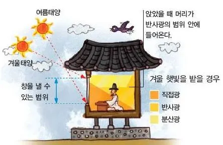

이러한 조화의 정신은 동양의 건축에서도 그대로 드러난다. 서양의 전통적 건축이 두꺼운 벽으로 안과 밖을 엄격히 구분하는 데 비해, 한국의 한옥이나 일본의 전통 가옥은 자연과 인간의 경계를 부드럽게 허물어 놓는다. 한옥의 마루와 처마는 집 내부와 외부의 경계를 모호하게 만들며, 자연과 생활 공간이 자연스럽게 연결된다. 이것은 인간이 자연과의 경계를 짓고 떨어져 있는 존재가 아니라, 자연과의 관계 속에서 존재한다는 철학을 보여주는 것이다.

그리고 이 모든 관념의 중심에 '숲'이 있었다.

숲은 동양인들에게 그 자체로 생명과 죽음, 순환과 재생의 상징이었다. 울창한 숲 속에서 사람들은 신을 발견했고, 나무와 돌 하나에도 신령이 깃들어 있다고 믿었다. 이는 곧 자연과 인간의 일체감을 느끼게 해주는 원천이었다. 숲의 종교라는 것은 결국 자연과 인간이 끊임없이 순환하고 연결된다는 깨달음에서 비롯된 것이다.

### >>>> 자연을 받아들인 동양인들의 삶의 태도

자연과 조화를 중시하는 동양인들에게, 숲은 극복해야 할 공간이 아니라 신성한 공간이었다. 숲과 인간의 관계는 대립이 아닌 공존이었다. 이러한 생각이 바탕이 되어 사람들은 자연을 있는 그대로 받아들이고, 자연 속에서 얻을 수 있는 것들에 감사하며 공동체적 삶을 추구했다.

결국 숲의 종교가 우리에게 알려주는 메시지는 분명하다.

자연과 인간은 별개의 존재가 아니라, 함께 순환하며 조화롭게 살아가는 관계라는 것이다. 이 순환과 조화의 정신은 단지 종교적 신념에 그치는 것이 아니라, 동양인의 삶과 건축, 문화 전체에 스며들었다.

숲은 그런 의미에서 단순한 자연적 공간이 아니다. 그것은 삶과 죽음, 그리고 자연과 인간이 만나는 조화의 공간이자, 순환의 철학을 깨닫게 해주는 거대한 가르침의 장소였다.

### >>>> 정복이 아닌 조화를 선택한 숲의 사람들.

동양에서 숲의 종교가 자연스럽게 발달한 이유는 오랜 기간 한 장소에 정착하여 농경을 해온 민족 특성과, 뚜렷한 사계절 속에서 삶과 죽음이 끊임없이 반복되는 자연 환경 때문이었다. 이런 환경에서 윤회 사상이 자연스럽게 형성되었고, 사람들은 자연을 정복해야 할 대상이 아니라 조화를 이루어야 하는 존재로 인식하게 되었다. 이러한 자연과의 조화는 동양 건축에서 벽을 통한 엄격한 구분이 아닌, 안과 밖의 모호한 경계를 이루는 형태로 나타났다. 숲의 종교는 결국 자연과 인간이 끊임없이 순환하고 연결된다는 철학적 깨달음을 담고 있는 것이다.

어쨌든 동양의 특성을 설명하며 부가적으로 철학적 논의를 설명하든, 불교의 이야기를 예시로 설명하든, 결과적으로 동양의 윤회 사상과 숲의 종교관이 우리에게 건네는 메시지는 한결같다. **“모든 것은 돌고 돌아 다시 만난다.”** 자연의 사계절처럼 우리의 삶도 흘러가 다시 돌아오고, 오늘 피어난 꽃은 언젠가 다른 모습으로 또 피어난다. 이러한 순환의 관점을 통해 동양 문화권 사람들은 **생명을 바라보는 깊은 공경심**과 **겸손한 태도**를 배워왔다. 

# 사막의 종교 - 선과 악의 명확한 구분

<details>
<summary>**해당 챕터 결론 스포일러 (토글 열기)**</summary>

```plain text
출애굽기의 사례처럼 유럽인들의 대이동 또한 환경적 요인과 생존의 필연성 때문에 시작되었고, 그 과정에서 강력한 집단 정체성과 극단적 신앙적·사상적 가치가 형성되었다. 이것이 바로 유럽인들의 독특한 역사적, 문화적 특성의 근본을 이루게 된 것이다.

지금의 유럽인들의 기원은 메소포타미아와 중앙아시아에서 시작되었으며, 그들은 환경적 요인과 생존의 필요성에 따라 끊임없는 대규모 이동을 거쳐 현재 유럽 대륙에 정착하게 되었다.

이러한 민족 대이동 과정은 출애굽기의 이야기처럼 극단적인 생존 상황에서 강력한 단결과 명확한 선과 악의 구분을 필연적으로 요구했고, 그 결과 유럽인들 특유의 명확하고 극단적인 가치관과 정체성이 형성된 것이 아닐까?
```

</details>

그렇다면, 서양의 `천국 아니면 지옥’ 과 같은 흑백논리적 세계관 형성은 과연 어디에서 기인했을까?

정답은 아니지만.. 나는 출애굽기를 통해 서양인들이 어째서 흑백논리를 통한 세계관을 구축하게 되었는지 설명하고자한다.. 굳이 출애굽기를 가져온 이유는, 내가 유치원부터 대학교까지 종교와 밀접한 교육기관에서 출애굽기를 접하며 자랐기 때문에… 종교는 없지만? 뭔가 출애굽기의 서사와 상징들이 이러한 이분법적 세계관의 토대가 되었다고 보기에, 출애굽기가 어떻게 서양의 문화와 사고방식을 형성했는지, 서양 문화의 핵심을 이해하는 열쇠로서 살펴 보고자 한다.

## >> **출애굽기와 유일신 사상의 연관성**

출애굽기를 통해 사막의 종교가 왜 숲의 종교와 다른 방향으로, 즉 극단적이고 유일신적 성향을 강하게 띠게 되었는지를 살펴보려 한다면, 우선 두 환경의 차이를 명확히 떠올리는 게 중요하다. 숲의 종교와 사막의 종교를 비교하면, 숲은 보통 생명이 풍부하고 다양성이 넘치는 공간이기에 자연스럽게 다신교적이고 다원적인 세계관이 발전하기 쉬웠을 것이다. 다양한 신들이 각자 역할을 맡아도 환경적 풍요가 그것을 허용하기 때문이다.

### >>>> 믿음도 자연환경에서 기인한다.

하지만 사막이라면 어떨까?

사막은 척박하다. 생명이 드물고 물과 식량이 절대적으로 부족하다. 사람들은 사막을 횡단하면서 하나의 분명한 목표, 즉 ‘생존’만을 추구하게 되었을 것이다. 이슬람이 돼지고기를 먹지 않는 이유는, 돼지가 신성해서라기보단, 돼지가 물을 상당히 많이 요구하는 가축이기 때문이다. 결국, 우리 인류의 종교 또한 자연환경에서 기인한다. 그렇다면, 신앙도 비슷한 양상을 보였겠지? 생존이 절박할수록 믿음의 대상도 더 명확하고 강력해야 했을 것이다. 숲의 종교처럼, 여러 신을 돌아가며 섬기고 여유롭게 다양한 신격을 받아들이는 건 사막의 환경에서는 너무 위험했을 것이다. 분산된 신앙은 곧 분산된 힘이 되고, 분산된 힘은 곧 죽음과 실패를 의미했을 테니까 말이다.

### >>>> 출애굽기와 유일신앙

자, 여기서 출애굽기의 이야기로 들어가 보자.

이스라엘 민족은 한때 애굽(현 이집트), 찬란한 문명의 그늘 아래 머물렀었다. 비록 노예의 신분이었지만, 풍요로운 땅에서 먹고 사는 데에는 큰 어려움이 없었다. 오히려 익숙한 삶, 어쩌면 안락함마저 느꼈을지도 모른다. 그러나 그들은 억압받는 존재였고, 자유를 향한 갈망은 그들의 마음속 깊은 곳에 자리 잡고 있었다.

그들의 간절한 기도에 응답이라도 하듯, 기적적인 힘이 그들을 애굽에서 해방시키게 된다. 나일 강이 핏빛으로 물들고, 끔찍한 전염병이 애굽을 휩쓸며, 하늘에서는 불덩이가 쏟아지는 재앙이 이어지게된다. 파라오는 더 이상 저항할 수 없었고, 이스라엘 민족은 마침내 쇠사슬을 끊고 자유를 찾아 떠나게 된다.

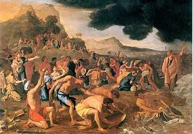

하지만 그들을 기다리고 있던 것은 약속된 풍요의 땅이 아닌, 메마르고 척박한 사막이었다. 애굽에서의 안정적인 삶은 뒤로하고, 이제 그들은 극한의 환경 속에서 생존을 위해 싸워야 했다. "젖과 꿀이 흐르는 땅"이라는 희망은 점점 희미해져 갔고, 현실은 끝없이 펼쳐진 모래 언덕과 작열하는 태양뿐이었다. 그들의 앞날에는 과연 무엇이 기다리고 있었을까? 신의 기적은 그들을 자유롭게 했지만, 동시에 험난한 여정의 시작을 알리는 신호탄이기도 했다.

물론, 그들에게 선택지가 아주 없었던 것은 아니다. 광야에서 끊임없이 불평하고, 모세를 원망하며, 심지어는 애굽의 노예 생활을 그리워하는 이들도 있었다. 그러나 눈앞의 현실은 절망적인 사막뿐이었다. 이 과정에서 이스라엘 백성에게는 선택지가 없었다. 믿음을 잃거나 멈추면 곧 죽음이었다. 생존하기 위해서는 공동체의 결속이 절대적으로 필요했고, 그 결속의 중심에는 강력한 신이 있어야 했다.


### >>>> 어쩌면 우리에게도 익숙할 선택과 집중.

그렇다면 왜 하필 '유일신'일까?

하나의 절대적 신이 아닌 다수의 신을 섬기는 방식이라면, 공동체의 구심점은 분산될 수밖에 없었을 것이다. 각자가 다른 신을 바라보고, 각자의 신이 다른 방향을 가리킨다면, 공동체는 단결되지 못하고 갈등과 혼란 속에서 생존 자체가 위협받게 된다. 이는 하나의 방향을 통해 힘을 합쳐서 가도 모자랄판에, 누구는 서쪽으로 가자하고, 누구는 동쪽으로 가자며 그 힘으 분산된다면, 불필요한 오버헤드와 인력의 분산에 의해 생존 확률은 더더욱 낮아지게 되겠지…  즉, 사막이라는 환경에서는 철저히 하나의 방향과 하나의 권위, 하나의 리더십이 절대적이어야 했을 것이다. 이런 맥락에서 출애굽기의 하나님은 다른 신들을 모두 무력화하고, 오직 자신만이 참된 신임을 증명하는 10가지 재앙을 통해 스스로 절대적인 유일신으로 드러나게 된다.

모세가 시내산에서 받은 십계명 중 첫 번째가 "너는 나 외에 다른 신들을 섬기지 말라"라는 명령이라는 것은 의미심장하다. 이 명령은 단순한 종교적 권고가 아니라, 사막에서 살아남기 위한 생존의 지침이었다고도 볼 수 있지 않을까? 오직 하나의 신, 오직 하나의 권위 아래에서만 그들은 결속하고 살아남을 수 있었으니 말이다.

출애굽기가 특별히 강조하는 사건들은 이런 점을 아주 명확히 드러낸다. 사막에서의 여정 중 조금이라도 믿음이 흔들리거나, 마음이 나뉘거나, 하나님이 아닌 다른 신을 향한 신앙이 나타날 때마다 심각한 대가를 치르게 되는 장면들이 등장한다. 

대표적으로 황금 송아지 사건이 그럴 것이다. 이스라엘 백성이 잠시 다른 신을 향해 신앙을 돌렸을 때, 그 대가는 매우 혹독했다. 공동체는 갈등하고 무너질 위기를 겪는다. 여기서 하나님은 자신을 떠난 신앙이 얼마나 위험한지 분명히 각인시키고, 강력한 유일신 사상을 강화한다.

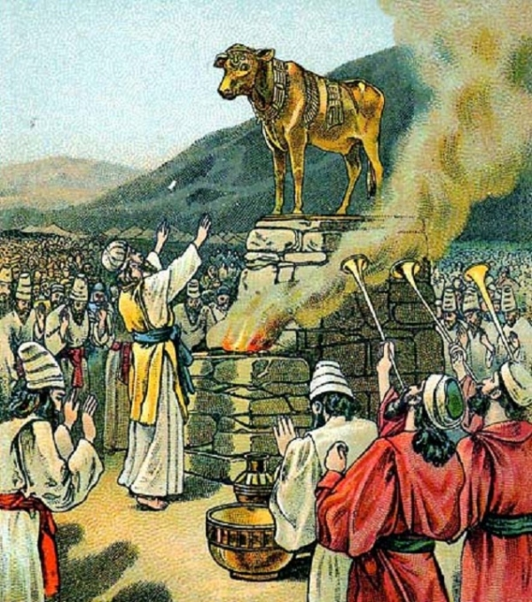

그러니까, 결국 사막이라는 환경이 종교를 극단적이고 유일신 중심으로 몰아가는 근본적 배경이 된 셈이다. 출애굽기는 그 과정을 아주 선명하게 드러낸다.

사막의 환경이 만들어낸 이 극단적 유일신 신앙은 단지 믿음의 문제에 그치지 않고, 생존과 결속, 그리고 공동체의 운명을 좌우하는 실질적이고도 생존적인 문제였던 것이다.

결국 숲과 같은 풍요로운 환경에서 나타난 종교들이 다양성과 유연성을 지닌다면, 사막이라는 생존이 걸린 극한 환경에서는 종교조차도 강력하고 배타적이며 극단적인 형태로 발전할 수밖에 없었다. 출애굽기는 이런 현상이 어떻게 역사적으로 전개되는지를 가장 잘 보여주는 이야기가 아닐까?

### >>>> 사막의 종교가 세계를 흑백으로 보는 이유

출애굽기의 이야기를 통해, 사막의 종교가 숲의 종교와 다르게 극단적이고 유일신 중심의 성격을 띠게 된 이유는 사막이라는 척박한 환경에서 생존과 결속을 유지하기 위해 반드시 하나의 절대적 권위와 강력한 공동체적 리더십이 필요했기 때문이다. 이 과정에서 다른 신들을 배제하고 하나의 신만을 철저히 섬기는 배타적이고 극단적인 유일신 사상이 발전하게 되었으며, 이는 출애굽기를 통해 이스라엘 민족의 역사적 경험과 함께 명확히 드러난다.

> 이처럼 사막의 척박한 환경은 생존을 위해 강력한 공동체적 연대와 절대적인 지도력을 요구했다. 
> 이러한 환경적 요인은 배타적인 유일신 사상을 강화하는 데 기여했고, 출애굽기에서 여호와가 이스라엘 민족의 생존과 구원을 직접적으로 주도하는 모습은 이러한 환경적 요구를 반영한다.
>
>

## >> 서양인, 그들의 기원

지금까지 우리는 출애굽기를 통해 사막 환경이 어떻게 극단적이고 배타적인 유일신 신앙을 형성했는지 이야기했다.

그런데 이제 그 출애굽기의 이야기를 다시 생각해 보면, 사실 이것이 유럽인들의 민족 이동을 이해하는 하나의 좋은 비유도 될 수 있지 않을까?

자, 그러면 질문을 하나 해보고싶다. 유럽인들은 과연 처음부터 유럽 대륙에 정착했던 걸까?

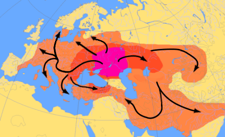

당연히 그렇지 않다. 역사적으로 볼 때, 유럽인들의 조상이라고 할 수 있는 민족들은 원래 지금의 중동 지역, 특히 메소포타미아 근방과 중앙아시아 초원 지대에서 시작되었다고 알려져 있다. 여기서 중요한 건, 이들이 동양의 민족들과는 다르게 한 곳에 머물러 있지 않고 끊임없이 이동하고 확장했다는 점이다.

### >>>> 자연을 극복하기 위한 인류의 사투.

자, 그럼 왜 이들은 고향을 떠나서 머나먼 유럽 지역까지 그렇게도 긴 여행을 했을까?

이동은 단순한 선택이라기보다는 생존의 필연성이었다. 인류 역사에서 자주 목격되는 현상이지만, 민족이 대규모 이동을 하게 되는 배경에는 대부분 환경적 요인이 있다. 사막화, 기후변화, 혹은 인구 증가로 인한 자원의 부족과 같은 상황이 발생했을 것이다. 이런 상황은 그들에게 선택지를 거의 주지 않았다. 이동하거나, 죽거나. 그 둘 중 하나였다.

이 점에서 방금 우리가 다뤘던 출애굽기의 이야기가 하나의 흥미로운 비유로 다시 떠오른다.

이스라엘 민족이 애굽이라는 풍요로운 곳을 떠나, 사막을 건너 젖과 꿀이 흐르는 약속의 땅으로 이동해야만 했던 그 긴박한 상황은, 어쩌면 유럽인들의 조상이 메소포타미아에서 현재 유럽 대륙까지 이동했던 과정과 상당히 닮았다. 실제로 민족 대이동이라는 역사적 사건들도 결국 비슷한 맥락을 가진다. 생존의 위협 앞에서 집단은 단합하여 이동할 수밖에 없고, 이 과정에서 명확한 목적지와 강력한 지도자, 그리고 단결을 유지하는 이념이나 신앙이 필요했을 것이다.

이 민족 대이동은 아주 오랜 기간에 걸쳐 일어난 일이다.

먼저 고대의 인도유럽어족으로 불리는 민족들이 메소포타미아와 중앙아시아 지역에서 기원을 두고 있다가 기후 변화와 자원 부족 등 여러 요인에 의해 점차 서쪽과 북쪽으로 이동을 시작했다. 이 과정에서 어떤 민족은 인도 방면으로, 어떤 민족은 페르시아로, 또 어떤 민족은 유럽 대륙으로 뻗어나가게 된다. 그중에서도 유럽으로 향한 민족들은 수백 년에 걸쳐 단계적으로 이동하고 정착하며, 서로 밀고 밀리면서 지금의 유럽 대륙 전체에 퍼지게 되었다.

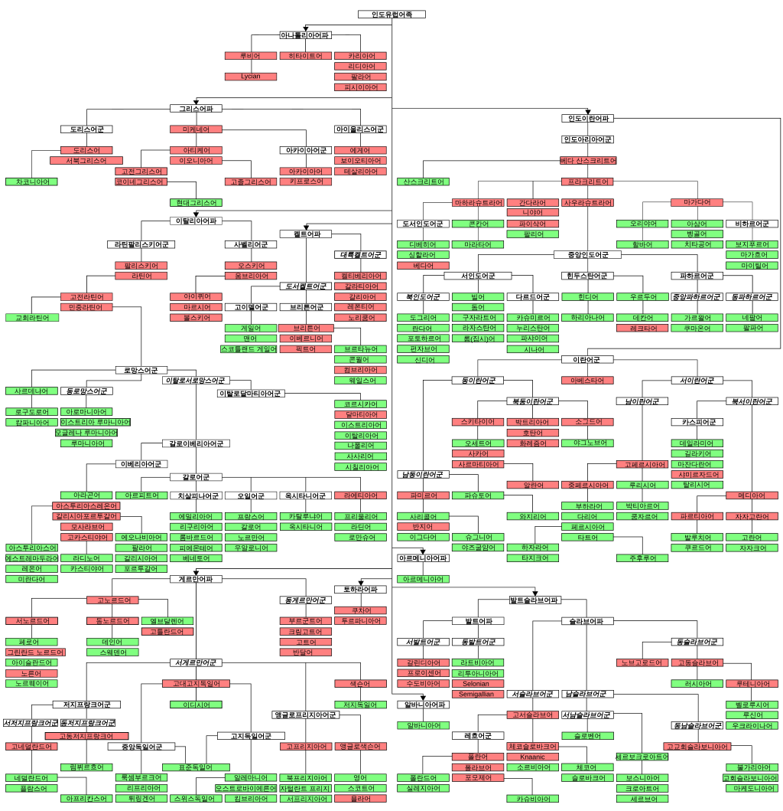

### >>>> 서양. 불안, 갈등과 이동의 정서.

여기서 중요한 점이 있다.

동양의 많은 민족들이 비교적 좁은 지역에서 안정적인 환경을 유지하며 오랜 기간 정착 생활을 하면서 공동체를 유지했다면, 유럽 민족들의 조상들은 계속 이동하고, 싸우고, 섞이면서 매우 역동적이고 불안정한 역사를 경험했다. 이런 역동성과 불안정성은, 다시 말해 끊임없는 이동과 전쟁, 그리고 서로의 영역을 둘러싼 지속적인 갈등을 의미했다.

이러한 과정에서 그들에게는 강력한 집단 정체성과 뚜렷한 가치관이 필요했다.

이 가치관은 복잡하거나 모호할 수 없었다. 이동 중에 집단의 정체성과 단결력을 유지하려면 명확하고 단순하며 강력한 기준이 필수적이었다. 바로 여기서 다시 사막에서의 종교가 보여주는 극단적이고 명확한 선과 악, 유일신의 개념이 비유로서 유효하게 적용될 수 있다. 유럽 민족들의 이동 과정에서도 '우리'와 '적'의 경계는 뚜렷했고, 선과 악은 분명히 나뉘었다. 명확한 기준 없이는 그들은 쉽게 분열되었을 것이고, 그 결과 살아남을 수 없었을 것이다.

즉, 유럽인들의 대이동 과정은 그 자체가 생존을 위한 필연적인 과정이었으며, 이동을 멈추거나 단결을 잃는 것은 곧 소멸을 의미했다. 이 과정에서 끊임없이 명확한 선과 악의 세계관이 형성되었고, 이는 이후 유럽 문명이 가진 명확하고 극단적인 사상적 특징들의 근본이 되었다고 볼 수 있지 않을까?

# 그래서 뭐 어쩌라고?

자, 이제 우리가 말하고자 하는 본질을 좀 더 명확히 정리할 필요가 있겠다.

지금까지 우리는 출애굽기에서 출발해 유럽 민족의 대이동을 거쳐, 결국 자연환경이라는 거대한 맥락에서 인간 역사를 바라보는 방식으로 나아왔다. 

결국 모든 이야기가 향하는 것은 "자연환경이 인간의 역사와 문명을 어떻게 결정짓는가" 하는 것이 핵심이었다.

이제 이 흐름을 현대의 이야기로 자연스럽게 연결시키려 한다.

바로 "북극항로"가 그 연결고리다.

## >> 바다를 지배하는 자, 세계를 지배하더라.

```plain text
최근 트럼프를 보며 역시 인류는 자연을 초월하지 못한다는 생각이 든다.

트럼프가 왜 러시아와 친하게 지내려고하고, 그린란드를 빼앗으려고 두 눈이 혈안이 되어있을까?

그 탐욕의 근원을 살펴보면, 현재의 세계지도를 다르게 볼 필요가 있다.
```


### >>>> <다른 중심>으로 세계지도를 살펴보자.

우리는 흔히 세계를 평면적이고 익숙한 "빈켈 트리펠 도법"의 세계지도 관점에서 바라본다. 하지만 실제 세계의 전략적 이해는 이런 고정된 시각에서 벗어날 필요가 있다. 북극투영법 지도를 보면, 우리가 익숙하게 보던 세계 질서와는 전혀 다른 그림이 보인다.

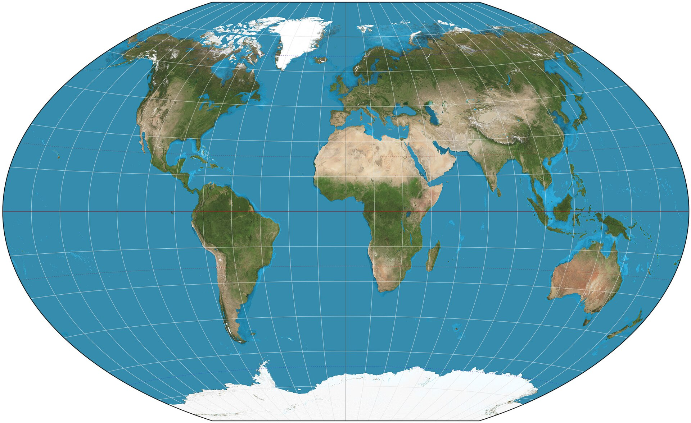

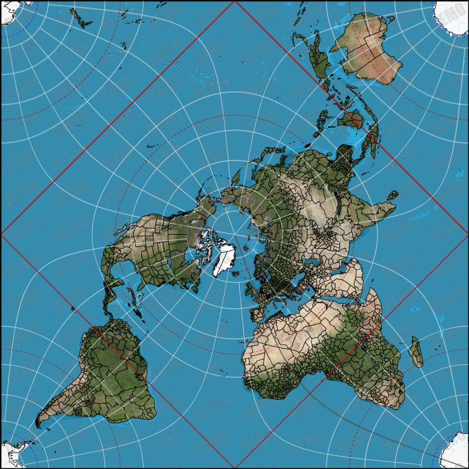

최근 트럼프가 러시아와 친밀히 하려고 하고 그린란드를 사고자 했던 이유를, 탐욕이라는 간단한 도덕적 판단으로만 보기에는 뭔가 부족하다. 여기엔 더 본질적인 전략적 이해가 있다. 트럼프는, 그리고 러시아의 푸틴은, 이미 변화하고 있는 자연환경을 누구보다 잘 이해하고 있는 듯 보인다.

나는 그 변화가 바로 "북극항로의 개방"이라고 생각한다.

지구 온난화로 인해 빙하가 녹으면서 북극해가 새로운 항로로 열리게 된다면, 기존의 세계 질서는 필연적으로 크게 흔들릴 수밖에 없다. 기존의 주요 항로들은 수백 년 동안 지중해와 대서양, 태평양을 중심으로 발전되어 왔다. 이는 유럽, 미국 등 서방 세계가 바다를 통해 세계를 지배할 수 있었던 배경이 되었다.

역사적으로 미노아 문명, 페니키아, 카르타고, 베네치아, 포르투갈, 대영제국, 그리고 현재의 미국에 이르기까지, 바다를 장악한 자는 항상 세계를 장악했다. 바다는 결국 인류의 재화(자원, 인력, 상품)를 이동시키는 가장 효율적인 수단이었고, 바다를 지배하는 국가는 이 흐름을 지배하면서 부와 힘을 축적했다.

그렇다면 이제 이 "바다의 판도"가 변화한다는 것은 무슨 의미일까?

지금까지 동양과 서양, 북과 남으로 구분되었던 세계의 지정학적 경계들이 재편될 수 있다는 것이다. 북극항로가 열리면, 러시아가 꿈꿔왔던 부동항의 의미가 재편되고, 러시아는 지리적으로 가장 유리한 위치를 점하게 된다. 이 변화는 자연환경이라는 가장 원초적이고 근본적인 요인이 인류의 문명과 권력 구조를 어떻게 다시 한 번 뒤흔들 수 있는지를 보여주는 중요한 사례가 된다.

그리고 이 지점에서 다시금 동양과 서양의 본질적인 차이를 우리는 재조명할 필요가 있다.

동양과 서양이 다른 이유는 결국 자연환경이 다르기 때문이고, 서로 다른 환경에서 형성된 세계관과 문명, 가치관은 본질적으로 다를 수밖에 없다. 그것이 좋은지 나쁜지, 옳은지 그른지를 논하는 것은 이 시점에서 무의미하다.

### >>>> 역사를 잊은 자에게 정말로 미래가 없을까?

과거 혼자 배낭여행을 다닐때, 그리스 산토리니에서 석양을 보기 위해 산을 오르며 루마니아의 베흐 아저씨가 했던 대화를 다시 떠올려본다.

> 나 : 우리나라에서는 역사를 잊은자에게는 미래는 없다는 말이 있다!

베흐 : 멍청한 소리네, 난 그말에 공감을 못하겠어.

나 : ??? 왜 그렇게 생각해?

베흐 : 역사란 누가 만드는데? 푸틴을 봐. 우리는 지금도 역사가 러시아에 의해 부정당하고있어. 역사란, 이긴놈이 만드는 가짜 이야기야!

본 주제와는 조금 동떨어진 비약일수도 있지만… 역사란 과연 무엇인가? 우리가 흔히 알고 있는 역사는 어쩌면 승자에 의해 편집된 이야기일 뿐, 절대적인 진실이 아닐 수 있다. 우리가 배운 역사는 언제나 편향과 왜곡의 가능성을 가지고 있다.

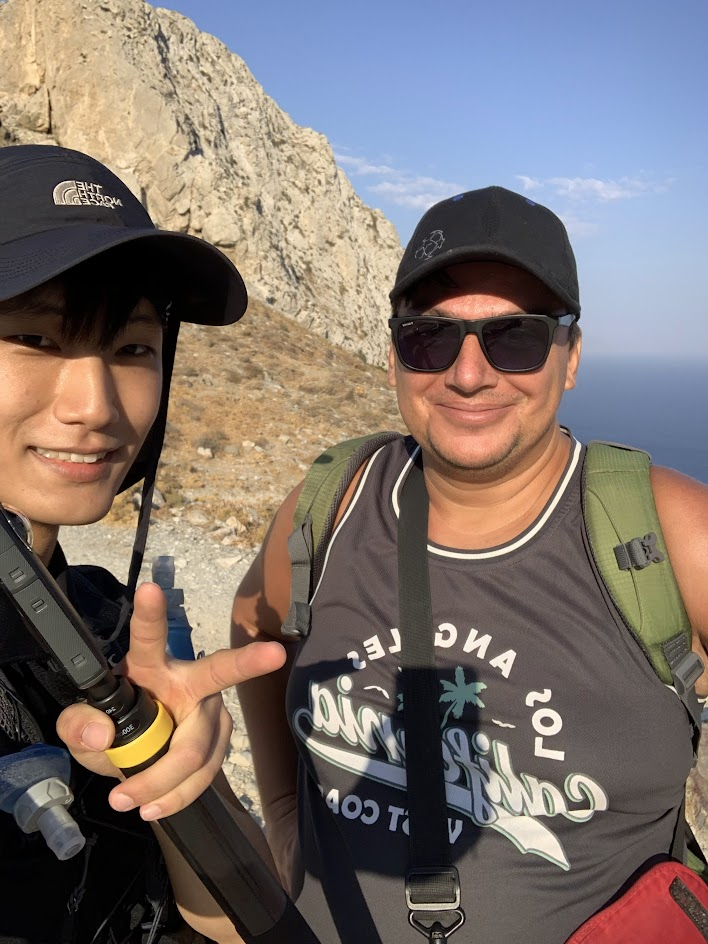

그렇다면 동과 서의 차이를 도덕적 잣대로 평가하기보다는 자연환경적이고 지정학적인 본질을 이해하는 것이 더욱 현명한 태도가 아닐까?

인류의 문명사는 결국 자연환경에서 출발하여 자연환경으로 되돌아간다. 현대에도 그 법칙은 크게 달라지지 않는다. 우리는 지금 그 문명의 전환점 앞에 다시 서 있는 것이다.

북극항로의 시대, 이 격변의 시대를 제대로 대비하기 위해서 우리는 도덕적 편견과 선입견을 넘어, 본질적이고 냉정한 자연환경의 맥락에서 다시 한 번 인류 역사를 바라볼 필요가 있다.

동서양의 경계를 통해 알아보는것이 무엇이 되었든, 결국 이 긴 이야기 끝에 우리가 도달하고자 했던 결론은 본질적으로 세계를 바라보기 위함이 아닐까?

### >>>> 잊지말자, 우리는 자연환경을 초월하지 못했다는 사실을.

인류의 역사는 언제나 자연환경에 의해 결정되었다. 과거 출애굽기와 유럽 민족의 대이동이 환경의 변화 속에서 이루어졌듯이, 오늘날 북극항로의 개방 또한 자연환경 변화가 만들어낸 새로운 역사적 전환점이다. 동양과 서양의 본질적인 차이 역시 이러한 환경적 요인에서 기인한다. 따라서 우리는 선악이나 도덕적 판단을 넘어, 환경이라는 본질을 통해 세계를 이해하고, 다가올 격변의 시대에 대비하는 자세가 필요하다.


---


# 참고자료

[유일신 신앙은 셈족계 종교들의 문명 신 신앙이 아니다 - Daum 카페](https://m.cafe.daum.net/ksunipar/QYM7/6?listURI=%2Fksunipar%2FQYM7)

[예언자와 유일신관 (Prophets and Monotheism) - 당당뉴스](http://m.dangdangnews.com/news/articleView.html?idxno=37290)

[세계 종교 탐구＜12＞ 유일신(唯一神)을 만든 과정에 대하여 - 신앙신보](https://theweekly.co.kr/%EC%84%B8%EA%B3%84-%EC%A2%85%EA%B5%90-%ED%83%90%EA%B5%AC-%EC%9C%A0%EC%9D%BC%EC%8B%A0%E5%94%AF%E4%B8%80%E7%A5%9E%EC%9D%84-%EB%A7%8C%EB%93%A0-%EA%B3%BC%EC%A0%95%EC%97%90-%EB%8C%80%ED%95%98%EC%97%AC/)

[IMS Focus _ 유대교 이해 > 포커스 | 지중해지역원](http://ims.or.kr/ims/focus/19)

[성경을 보면 "너희는 먼저 그의 나라와 그 의를 구하라 ..." - biblenara.org](http://www.biblenara.org/q&a/Q644.htm)

[[기민석의 성경 '속' 이야기] '유일신 사상'은 타 종교 증오가 아니라 ...](https://www.hankookilbo.com/News/Read/201711110433097121)

[최현민 연구실 > 그리스도교 연구 > 유일신삼교연구](http://www.setondialog.or.kr/sd/bbs/board.php?bo_table=choi_07&wr_id=8&page=)

[유대교, 다신론, 단일신론 그리고 유일신론 - 제이에스매거진](http://www.jsmagazine.net/567975)

[https://encykorea.aks.ac.kr/Article/E0002945](https://encykorea.aks.ac.kr/Article/E0002945) - **백성의 생업인 농업과 누에치고 비단 짜는 일을 그린 풍속화.**
[https://folkency.nfm.go.kr/topic/detail/1927](https://folkency.nfm.go.kr/topic/detail/1927)


