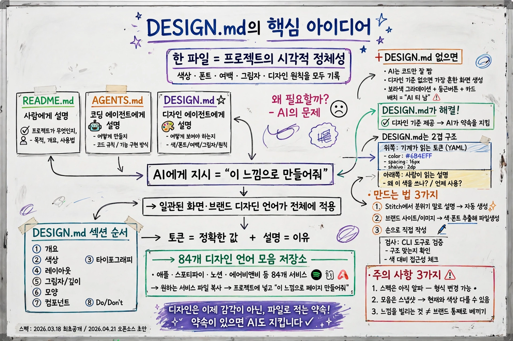
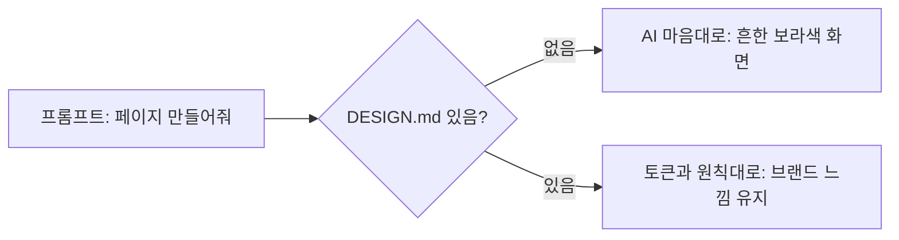
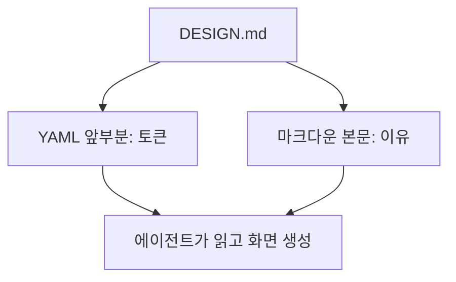
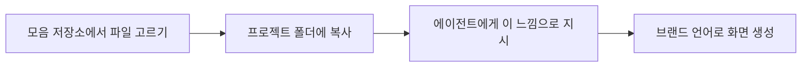

# 디자인 감각을 파일 하나로 적어두면, AI가 만든 화면이 달라집니다

> **Summary**
> DESIGN.md 파일은 색상, 폰트, 여백, 디자인 원칙을 정리해 AI가 일관된 브랜드 화면을 만들도록 돕습니다. Stitch로 생성하거나 직접 작성하고, 공식 도구로 구조와 접근성을 검사할 수 있습니다. 유명 서비스의 디자인 파일을 참고할 수 있지만, 스펙은 아직 알파 단계이므로 형식 변화와 브랜드 모방에 주의해야 합니다.

---

- `DESIGN.md`는 프로젝트의 시각적 정체성을 적어둔 마크다운 파일입니다. 색상, 폰트, 여백, 그림자, 디자인 원칙이 한 파일에 들어갑니다.
- 코딩 에이전트는 이 파일을 읽고 화면을 만듭니다. "이 느낌으로 만들어줘" 한 마디면, 브랜드의 디자인 언어가 화면 전체에 그대로 이어집니다.
- 유명 서비스들의 디자인 언어를 담은 파일 84개가 모음 저장소에 공개돼 있습니다. 복사해서 프로젝트 폴더에 넣으면 바로 쓸 수 있습니다.


AI한테 랜딩 페이지 하나 만들어달라고 했는데, 받아본 화면이 어딘가 낯익지 않으셨나요? 보라색 그라데이션, 둥근 버튼, 똑같은 카드 배치. 기능은 되는데, 어딜 봐도 'AI가 만든 화면' 티가 납니다! 왜 그럴까요? AI는 코드를 잘 짜지만, '어떻게 보여야 하는지'는 모르기 때문입니다. 디자인 기준이 없으면, AI는 자기가 본 적 있는 가장 흔한 화면을 내놓습니다.

🎥 [동영상 보기](https://www.youtube.com/watch?v=b0lwCDNOFUY)

## `DESIGN.md`는 뭘까요?

`DESIGN.md`는 구글의 AI 디자인 도구 Stitch에서 처음 나온 개념입니다. 프로젝트의 시각적 정체성을 마크다운 형식으로 정리한 파일입니다. 색상, 폰트, 여백, 그림자, 디자인 원칙까지, 화면의 느낌을 결정하는 것들이 전부 적혀 있습니다.

역할은 파일 세 개로 나누면 바로 이해가 됩니다. `README.md`는 사람에게 프로젝트가 뭔지 설명합니다. `AGENTS.md`는 코딩 에이전트에게 어떻게 만들지 알려줍니다. `DESIGN.md`는 디자인 에이전트에게 어떻게 보여야 하는지 알려줍니다. 코드 설명서 옆에 디자인 설명서를 하나 더 두는 셈입니다.



## 파일 안에 뭐가 들어 있을까요?

파일은 두 겹으로 돼 있습니다. 위쪽은 기계가 읽는 토큰입니다. YAML 앞부분에 색상 값, 폰트, 여백 크기, 모서리 둥글기, 컴포넌트별 토큰이 정확한 숫자로 적혀 있습니다. 아래쪽은 사람이 읽는 설명입니다. 왜 그 색을 쓰는지, 어떤 상황에서 쓰는지, 하지 말아야 할 것은 무엇인지가 문장으로 적혀 있습니다.

토큰이 정확한 값을 주고, 설명이 그 값의 이유를 알려줍니다. 그래서 에이전트는 색을 찍는 게 아니라, 색의 용도를 알고 고릅니다. 접근성 규칙과 대조해 스스로 검사할 수도 있습니다. 섹션 순서는 정해져 있습니다. 개요, 색상, 타이포그래피, 레이아웃, 그림자와 깊이, 모양, 컴포넌트, 해도 되는 것과 안 되는 것 순서입니다.



## 어떻게 쓰면 될까요?

만드는 방법은 세 가지입니다. Stitch 안에서 원하는 분위기를 말로 설명하면, 에이전트가 디자인 시스템을 만들고 파일로 정리해 줍니다. 브랜드 사이트 주소나 이미지를 주면, 거기서 색상과 폰트를 뽑아 파일을 만들 수도 있습니다. 손으로 직접 써도 됩니다. 정해진 섹션 순서만 지키면 특별한 문법은 필요 없습니다.

만든 파일은 검사도 할 수 있습니다. 공식 명령줄 도구로 구조가 맞는지, 토큰 참조가 끊어진 곳은 없는지, 색 대비가 접근성 기준을 만족하는지 확인합니다.

```bash
npx @google/design.md lint DESIGN.md
```

스펙은 2026년 3월 18일에 구글 글로 처음 공개됐고, 같은 해 4월 21일에 초안 스펙이 오픈소스로 풀렸습니다. 스펙 저장소는 2026년 11월 22일 기준으로 별 29,028개를 받았습니다. 아직 알파 단계라 형식은 바뀔 수 있습니다.

## 유명 서비스의 느낌, 그대로 가져오면 될까요?

유명 서비스들의 디자인 언어를 파일로 모아둔 모음 저장소가 있습니다. 애플, 스포티파이, 노션, 에어비앤비 같은 서비스들의 색상, 폰트, 여백, 컴포넌트 규칙이 파일 84개로 정리돼 있습니다. 2026년 11월 22일 기준으로 별 128,612개, 포크 14,186개를 받았습니다. 쓰는 방법은 간단합니다. 원하는 서비스의 파일을 골라 프로젝트 폴더에 넣고, 에이전트에게 "이 느낌으로 페이지를 만들어줘"라고 말하면 됩니다!



## 주의할 점은 없을까요?

세 가지는 알고 쓰는 게 좋습니다. 첫째, 스펙이 아직 알파라서 형식이 바뀔 수 있습니다. 둘째, 모음 저장소의 파일은 실제 사이트에서 뽑아낸 순간의 스냅샷이라, 색상 값이 지금과 조금 다를 수 있습니다. 셋째, 다른 브랜드의 느낌을 빌리는 것과 브랜드를 통째로 베끼는 건 다릅니다! 참고용으로 쓰고, 내 서비스에 맞게 고치는 게 맞습니다.

디자인은 이제 감각의 영역이 아니라, 파일로 적어두는 약속이 됐습니다. 약속이 있으면 AI도 그 약속을 지킵니다!

