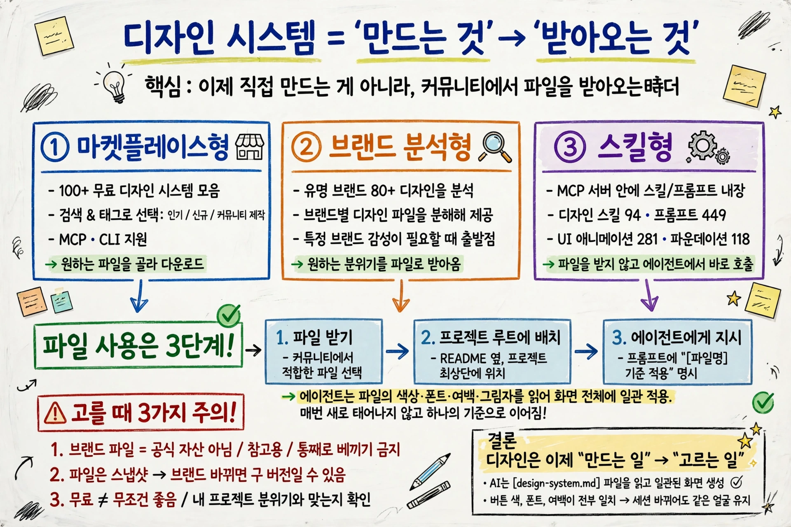
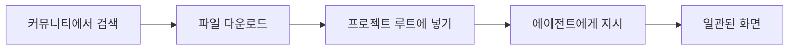
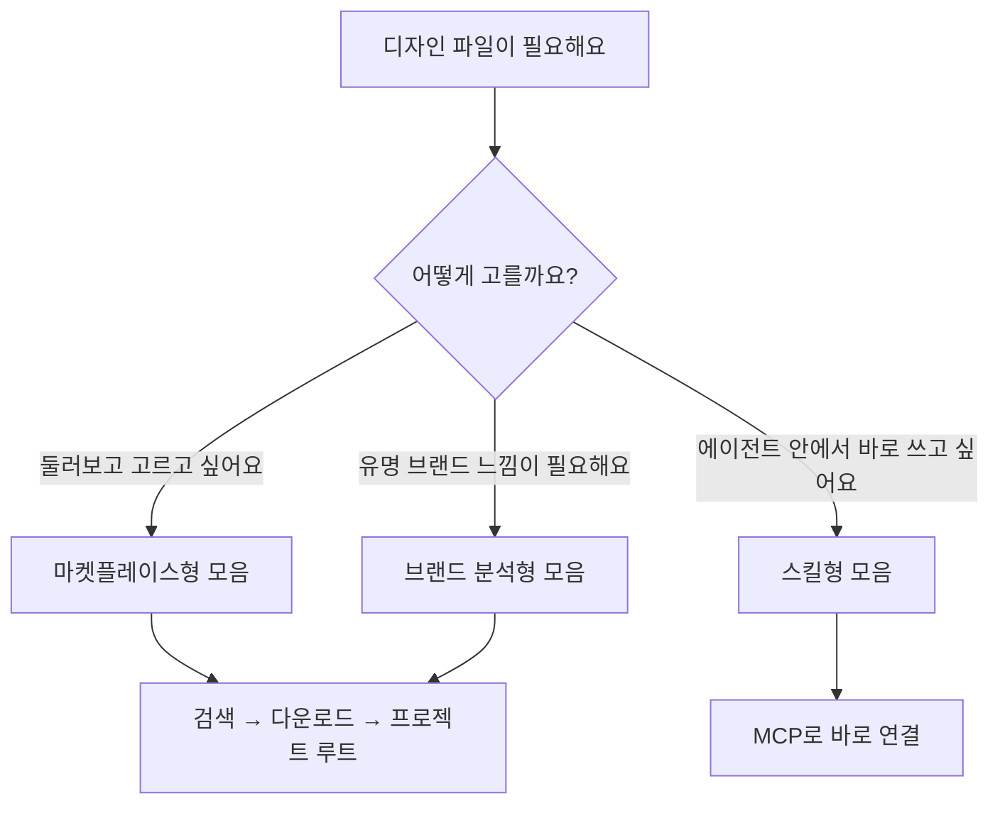

# 디자인 시스템은 직접 만들지 않습니다. 커뮤니티에서 받아오면 됩니다

> **Summary**
> AI 코딩 시대에는 색상, 폰트, 여백, 컴포넌트 규칙을 담은 디자인 시스템 파일을 커뮤니티에서 받아 프로젝트에 적용해 화면의 일관성을 유지할 수 있습니다. 마켓플레이스형, 브랜드 분석형, 스킬형 커뮤니티는 각각 파일 탐색, 브랜드 참고, 에이전트 내 활용에 적합하며, 파일의 출처와 최신성, 프로젝트와의 적합성을 확인하고 브랜드 자산을 그대로 복제하지 않도록 주의해야 합니다.

---

- 디자인 시스템은 이제 직접 만드는 게 아니라 커뮤니티에서 받아오는 파일이 됐습니다.
- 마켓플레이스형, 브랜드 분석형, 스킬형까지 세 갈래 커뮤니티가 각기 다른 방식으로 디자인 파일을 나눕니다.
- 검색해서 받고 프로젝트 루트에 넣은 뒤 에이전트에게 지시하면, 화면은 매번 새로 태어나는 대신 하나의 기준으로 이어집니다.

AI에게 랜딩 페이지 하나 만들어달라고 했는데, 버튼 색이 페이지마다 달랐던 적 있으시죠? "예쁘게 만들어줘"라고 했는데, 돌아온 화면은 매번 다른 얼굴이었습니다. 문제는 프롬프트가 아니었습니다. 기준이 없었던 겁니다. 색상, 폰트, 여백, 그림자까지 한 파일에 적어두면 에이전트는 그 기준을 따라갑니다. 그런데 그 파일을 어디서 구할까요? 직접 만들 수도 있습니다. 하지만 이미 커뮤니티에 수백 개가 모여 있습니다!

🎥 [동영상 보기](https://www.youtube.com/watch?v=kjoxVOzFHek)

## 디자인 시스템은 왜 설치하는 것이 됐을까요?

디자인 시스템은 원래 디자이너의 전유물이었습니다. 그런데 AI 코딩 시대에는 파일 하나가 됐습니다. 마크다운 파일 하나에 색상, 폰트, 여백, 컴포넌트 규칙을 적어두면, 에이전트가 그 파일을 읽고 화면을 만듭니다. 파일이 기준이 되니, 화면은 세션이 바뀌어도 같은 얼굴을 유지합니다. 그래서 사람들은 이제 디자인 시스템을 "만드는" 대신 "받아오는" 쪽으로 움직였습니다. 댓글에서는 "디자인 시스템의 npm"이라는 비유까지 나왔습니다. 패키지를 설치하듯 파일을 받아 프로젝트에 넣는 겁니다!

## 커뮤니티 3곳, 뭐가 다를까요?

세 곳은 같은 파일을 나누지만 방식이 다릅니다. 첫째는 마켓플레이스형 모음입니다. "AI 빌더를 위한 디자인 시스템 커뮤니티"를 내세우는 곳으로, 100개가 넘는 무료 시스템을 모아두고 검색과 태그로 고르게 합니다. 인기 있는 시스템과 새로 뜨는 시스템을 따로 보여주고, 커뮤니티가 직접 만든 시스템도 올라옵니다. MCP와 CLI까지 붙어 있어 에이전트가 직접 찾아오게 할 수도 있습니다.

둘째는 브랜드 분석형 모음입니다. 유명 브랜드 80개가 넘는 디자인을 하나하나 뜯어서 파일로 만든 곳입니다. 특정 브랜드의 느낌이 필요할 때 출발점이 됩니다. 다섯 가지 코딩 도구와 함께 쓸 수 있습니다.

셋째는 스킬형 모음입니다. MCP 서버 안에 디자인 스킬 94개, 프롬프트 449개, UI 애니메이션 281개, UI 파운데이션 118개를 넣어둔 곳입니다. 파일을 받는 대신 에이전트 안에서 바로 불러쓰는 방식입니다. 디자인 시스템 작업 공간과 브랜드 키트, UI 감사 기능까지 붙어 있습니다.

## 받아온 파일, 어떻게 쓰면 될까요?

방법은 세 단계로 끝납니다. 파일을 받고, 프로젝트 루트에 넣고, 에이전트에게 지시하면 됩니다. 루트에 넣는 위치가 핵심입니다. `README.md` 옆, 프로젝트 가장 위에 두는 겁니다. 그리고 프롬프트에 파일 이름을 적어줍니다. "이 파일을 기준으로 화면을 만들어줘"라는 한 줄이면 됩니다. 에이전트는 파일에 적힌 색상과 폰트, 여백을 읽고 화면 전체에 적용합니다. 이 장면이 저는 가장 인상 깊었습니다. 파일 하나가 디자인 회의 몇 번 분량의 결정을 대신하고 있으니까요!

## 고를 때 조심할 것은 없을까요?

있습니다. 세 가지입니다. 첫째, 유명 브랜드의 느낌을 담은 파일은 공식 자산이 아닙니다. 브랜드가 직접 내놓은 파일이 아니라 그 느낌을 재현한 파일입니다. 참고용으로 쓰고 통째로 베끼면 안 됩니다. 둘째, 숫자는 계속 바뀝니다. 클립이 "100개가 넘는다"고 했을 때와 지금은 개수가 다릅니다. 파일도 스냅샷이라 브랜드가 바뀌면 옛날 모습을 담고 있을 수 있습니다. 셋째, 무료라고 다 좋은 것은 아닙니다. 인기 있는 것부터 보고, 내 프로젝트 분위기와 맞는지를 먼저 확인하는 게 순서입니다.

디자인은 이제 만드는 일이 아니라 고르는 일이 됐습니다. 다음 프로젝트에서 화면을 만들기 전에, 커뮤니티에서 파일 하나를 먼저 골라보시면 어떨까요?

