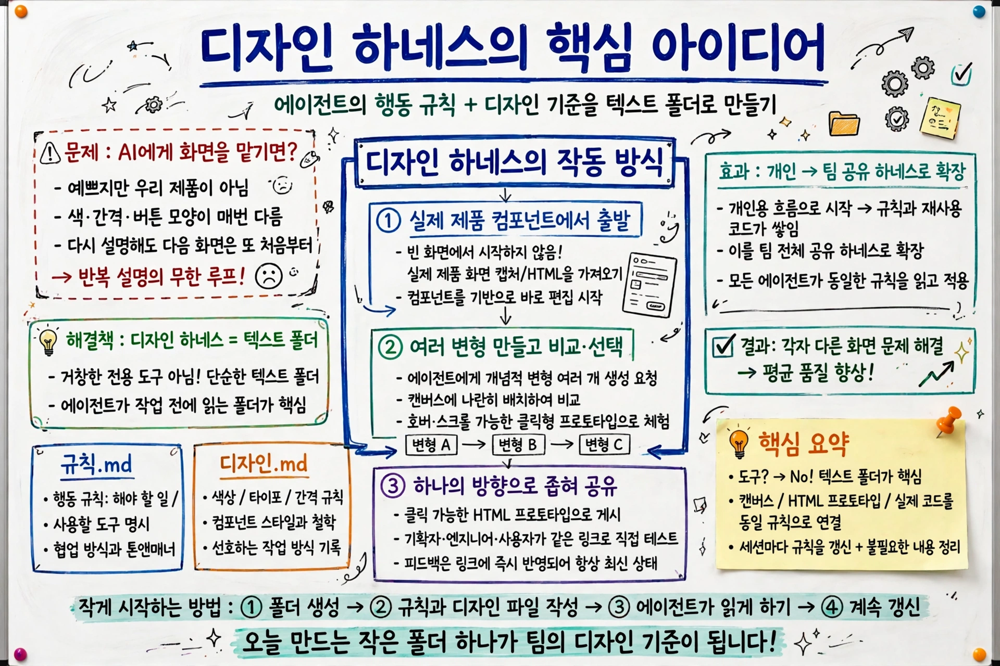
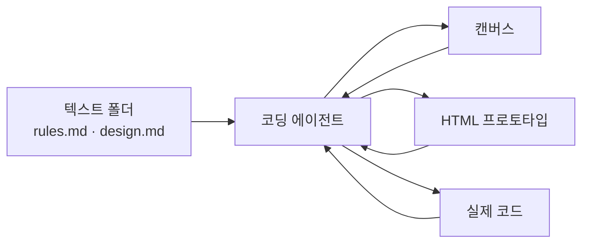
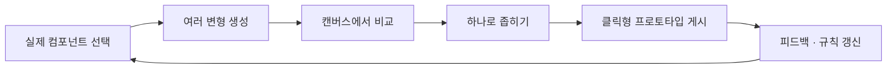

# 디자인 하네스는 거창한 도구가 아닙니다. 텍스트 폴더 하나와 실제 컴포넌트면 됩니다

> **Summary**
> 디자인 하네스는 에이전트의 행동 규칙과 디자인 기준을 텍스트 폴더에 적어두고, 캔버스와 HTML 프로토타입, 실제 코드를 오가며 작업하는 환경입니다. 빈 화면이 아니라 실제 제품 컴포넌트에서 출발해 여러 변형을 만들고, 클릭 가능한 프로토타입으로 호버와 스크롤을 직접 경험하며 하나의 방향으로 좁혀갑니다. 개인용 흐름으로 시작해 규칙과 참조 자료, 재사용 코드를 팀 전체가 읽는 공유 하네스로 넓히면, 에이전트가 만드는 화면의 평균 품질이 달라집니다.

---

- 디자인 하네스는 에이전트의 행동 규칙과 디자인 기준을 텍스트 폴더에 적어두고, 캔버스와 HTML 프로토타입, 실제 코드를 오가며 작업하는 환경입니다.
- 빈 화면이 아니라 실제 제품 컴포넌트에서 출발해 여러 변형을 만들고, 클릭 가능한 프로토타입으로 호버와 스크롤을 직접 경험하며 하나의 방향으로 좁혀갑니다.
- 개인용 흐름으로 시작해 규칙과 참조 자료, 재사용 코드를 팀 전체가 읽는 공유 하네스로 넓히면, 에이전트가 만드는 화면의 평균 품질이 달라집니다.

AI에게 화면 하나 만들어달라고 했더니, 예쁘기는 한데 우리 제품이 아닌 화면이 나온 적 있으시죠? 색도 다르고, 간격도 다르고, 버튼 모양도 처음 보는 모양입니다. 다시 설명하면 조금 나아지지만, 다음 화면에서는 또 처음부터 설명해야 합니다. 이 반복을 끊는 방법이 디자인 하네스입니다! 참고로 원문 공유 링크는 직접 열리지 않아서, 저장해 둔 정리 내용을 바탕으로 재구성했습니다.

🎥 [동영상 보기](https://www.youtube.com/watch?v=eEoeY42LY9s)

## 하네스, 도구가 아니라 텍스트 폴더입니다

디자인 하네스라고 하면 거창한 전용 도구를 떠올리기 쉽습니다. 그런데 핵심은 따로 있습니다. 에이전트가 작업 전에 읽는 일반 텍스트 폴더가 전부입니다! 별도 앱도, 플러그인도 아닙니다.

폴더 안에는 두 가지 파일이 들어갑니다. `rules.md`에는 행동 방식과 사용할 도구, 절대 하지 말아야 할 일을 적습니다. `design.md`에는 색상과 글자 크기 체계, 간격, 컴포넌트 스타일과 그 뒤에 깔린 철학, 선호하는 작업 방식을 담습니다. 머릿속에만 있던 취향을 파일로 옮기는 순간, 에이전트가 읽을 수 있는 기준이 됩니다.

이 폴더가 있으면 에이전트는 MCP로 연결된 캔버스와 HTML 프로토타입, 실제 코드 사이를 사고방식이나 앱을 바꾸지 않고 오갑니다. 어느 쪽에서 작업하든 같은 규칙을 봅니다. 시작은 어떻게 할까요? 첫 버전은 평소 쓰는 코딩 에이전트 하네스로 만들면 됩니다. 별도 허가도, 예산도, 플랫폼 팀도 필요 없습니다. 폴더를 만들고 게시 방법과 기본 맥락, 규칙을 정하는 것부터 시작하면 됩니다.

## 빈 화면이 아니라 실제 제품에서 출발합니다

새 화면을 만들 때 빈 화면에서 시작하면 어떻게 될까요? 에이전트는 학습 데이터의 평균적인 화면을 가져옵니다. 예쁘지만 우리 제품이 아닙니다. 그래서 디자인 하네스는 실제 제품 컴포넌트에서 출발합니다.

실제 화면을 가져오는 방법도 간단합니다. 확장 프로그램으로 실제 HTML이 담긴 스크린샷을 찍어 캔버스에 붙여 넣으면, 익숙한 단축키로 제품 화면을 바로 편집할 수 있습니다. 그런 다음 컴포넌트 하나를 고르고 에이전트에게 개념적 변형을 여러 개 만들어달라고 요청합니다. 캔버스에서 나란히 놓고 비교하고, 맞지 않는 부분은 직접 고치거나 덜어내면서 하나의 방향으로 좁혀갑니다. 변형 생성부터 선택, 다듬기까지 한나절 안에 끝낼 수 있습니다.

이 장면이 저는 가장 인상 깊었습니다. 빈 화면 앞에서 무엇을 그릴지 고민하는 시간이 사라지고, 있는 것을 골라 다듬는 일만 남으니까요!

## 목업이 아니라 클릭 가능한 프로토타입을 공유합니다

방향이 정해지면 결과는 공유 가능한 클릭형 HTML 프로토타입으로 게시합니다. 기획자는 휴대전화로 열고, 엔지니어는 살펴보고, 사용자는 직접 테스트합니다. 테스트와 피드백, 전달에 같은 링크를 쓰고, 다시 게시하면 그 링크의 결과물이 그대로 갱신됩니다.

정적인 목업과 뭐가 다를까요? 목업은 사용 경험을 상상해야 합니다. 사람마다 다르게 상상하니까 의견도 제각각입니다. 코드 수준의 충실도를 갖춘 프로토타입은 실제 호버와 스크롤, 전환을 제공합니다. 상상하는 단계를 없애고 직접 써본 뒤 무슨 일이 있었는지 피드백하게 합니다. 검토에서 탈락했을 방향도 실제로 가치를 입증할 기회를 얻습니다. 의도와 예외 상황, 상호작용을 클릭 가능한 코드에 구체화하면 프로덕션으로 옮기는 작업도 훨씬 쉬워집니다!

디자인용 바이브 코딩의 함정도 여기서 갈립니다. 결과는 정교해 보여도 실제 디자인 시스템 토큰과 맞지 않는 경우가 많습니다. 하네스를 조정하면 이 불일치를 바로잡을 수 있습니다. 같은 코드를 캔버스와 프로토타입, 프로덕션 코드베이스에서 쓰면 서로 다른 세 가지 충실도 사이를 번역하는 대신 하나의 결과물을 계속 발전시킬 수 있습니다.

## 규칙은 쌓을수록 좋아지나요?

세션이 끝날 때마다 교정한 내용을 바탕으로 에이전트에게 자신의 규칙을 갱신하도록 요청합니다. 잘 나온 코드는 다음 작업에서 복제해 시작할 수 있는 저장소에 보관합니다. 규칙과 재사용 코드가 누적되면서 이전 작업의 노력이 다음 작업의 출발점이 됩니다. 프롬프트를 덜 구체적으로 써도 결과가 개선되는 이유가 여기 있습니다!

그런데 쌓기만 하면 될까요? 아닙니다. 오래된 맥락은 결과를 악화시킵니다. 주기적으로 불필요한 내용을 삭제해야 합니다. 이 정리에는 `/human-review` 스킬을 활용할 수 있습니다. 규칙이 쌓이는 만큼 정리도 함께 굴러가야 하네스가 낡지 않습니다.

아이디어를 시도하는 데 몇 시간 대신 몇 분이 들면 더 많은 아이디어를 탐색할 수 있습니다. 매일 에이전트와 함께 작업하면서 신뢰할 수 있는 영역과 지시에서 벗어나는 지점, 필요한 지시 방식을 익히게 됩니다. 더 가벼운 형태도 있습니다. 프로젝트 설정이나 디자인 시스템 관리 부담 없이 코드로 아이디어를 탐색하는 개인용 실험 공간, 프로토타입 플레이그라운드입니다.

## 개인용에서 팀 공유 하네스로, 어떻게 넓힐까요?

지금까지는 개인용 작업 흐름이었습니다. 다음 단계는 팀의 규칙과 참조 자료, 코드 저장소를 담은 공유 계층으로 확장하는 것입니다. 디자이너 머릿속의 철학과 달리 파일에 적힌 규칙은 모든 팀원과 코딩 에이전트가 읽을 수 있습니다.

왜 공유가 필요할까요? 에이전트의 UI 코드 작성량을 디자인 검토가 따라가지 못하는 상황에서, 명시적 규칙이 없으면 각 에이전트는 학습 데이터의 평균적인 저품질 결과물을 만들게 됩니다. 규칙이 공유되면 에이전트마다 다른 화면을 만들던 문제가 줄어듭니다.

완성된 AI 작업 흐름을 기다릴 필요는 없습니다. 폴더를 만들고, 알고 있는 내용을 기록하고, 에이전트가 읽게 한 뒤 교정을 시작하면 됩니다. 작은 폴더 하나가 팀의 디자인 기준이 되는 길, 그 시작은 오늘 만드는 텍스트 폴더입니다.

