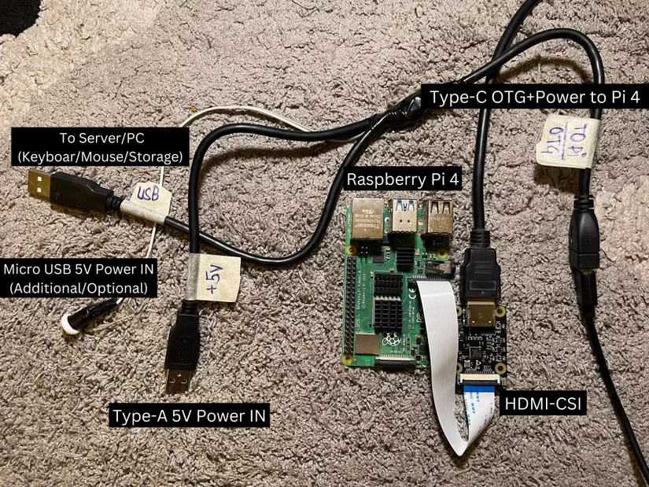

# 라즈베리파이를 이용하여 KVM을 만들어봐요

> **Summary**
> 라즈베리파이를 활용하여 KVM over IP를 구축하는 방법을 소개합니다. 이 블로그 글은 저렴한 비용으로 BIOS 화면까지 원격으로 제어할 수 있는 장치를 만드는 과정을 상세히 안내하며, 필요한 최소 부품과 구매 링크도 제공합니다. 또한, USB 스플리터의 필요성과 각 부품의 특징을 비교하여 최적의 선택을 도와줍니다.

---

> 아… 취업하고나니, 집에있는 윈도우 서버가 원인모를 문제로 다운될때마다, 직접 키는게 참 곤혹이다…
> 스마트 플러그나 WOL로 깨울 수 있지만, 바이오스까지 건드리고싶다..
>
> 슬슬 KVM이 필요해질땐가….
>
> 남아있는 라즈베리파이를 활용할때가 되었나…
>
>

## 4B기준은 이것만 보면 될듯

🔗 [https://docs.pikvm.org/v2/](https://docs.pikvm.org/v2/)

## 블로그 글 소개 (근데 이건 2기준…)

🔗 [https://www.makeuseof.com/how-to-build-raspberry-pi-kvm/](https://www.makeuseof.com/how-to-build-raspberry-pi-kvm/)

혹시 직장이나 외부에서 갑자기 집에 있는 서버가 다운되어 막막했던 경험이 있으신가요? 스마트 플러그로 전원을 껐다 켜거나 WOL(Wake-on-LAN) 신호를 보내봐도, 정작 부팅 과정이나 바이오스 화면에서 문제가 생기면 원격으로는 아무것도 할 수 없어 발만 동동 구르게 됩니다. 이럴 때 물리적으로 키보드, 모니터, 마우스를 연결한 것처럼 원격지에서 서버의 모든 것을 제어하고 싶다는 생각이 간절해지죠.

바로 그런 분들을 위해, 서랍 속에서 잠자고 있는 라즈베리파이를 활용하여 강력한 원격 관리 솔루션, 'KVM over IP'를 직접 구축하는 방법을 소개합니다. 이 블로그 글은 고가의 상용 KVM 장비 없이, 비교적 저렴한 비용으로 라즈베리파이와 몇 가지 부품만으로 내 서버의 BIOS 화면까지 원격으로 보고 제어할 수 있는 장치를 만드는 전 과정을 상세히 안내합니다.

## 칩 비교

| **모델** | **해상도/프레임** | **오디오 지원** | **가격** | **특징/추천 상황** |
| C779 | 1080p 50fps | X | ★★★★☆ | 영상만, 저가형 |
| X630 | 1080p 25fps | △(별도보드) | ★★★★☆ | 영상만, 저가형, 저프레임 |
| C790 | 1080p 60fps* | O | ★★★☆☆ | 최신, 오디오, 안정성 |

- **C790**이 기능·호환성·안정성에서 가장 우수하며, 가격 차이도 크지 않으므로 **가장 비용효율적**입니다.
- **C779**는 오디오가 필요 없고, 1080p 50fps까지만 필요하다면 가장 저렴하게 선택할 수 있습니다.
- **X630**은 1080p 25fps로 제한되고, 오디오도 별도 보드가 필요하므로, 특별한 이유가 없다면 C779나 C790이 더 나은 선택입니다.
## 근데 그러면 결국 라즈베리파이하고, CSI칩만 있으면 되는거 아님?

**핵심 내용: 전원과 데이터 선을 따로 연결해야 해요**

라즈베리파이로 PiKVM을 만들 때는 두 가지를 동시에 연결해야 하는데, 이걸 해결하려면 추가 부품이 필요합니다.

> 왜 USB 분배기(스플리터)가 필요한가?

1. **전원 연결**
  - 라즈베리파이를 켜려면 5V 3A의 안정적인 전원이 필요해요.
  - PC의 USB 포트는 이만큼의 전원을 공급할 수 없어요.
1. **USB OTG 데이터 연결**
  - PiKVM은 라즈베리파이를 USB 기기로 인식시켜 서버에 연결합니다.
  - 이를 위해 USB-C 포트로 데이터(OTG) 연결이 필요합니다.
1. **전원과 데이터 신호 분리**
  - 일반 USB-C 케이블만 사용하면 전원과 데이터가 섞여 장치가 손상될 수 있습니다[3](https://docs.pikvm.org/faq/).
  - 따라서 **전원 어댑터**와 **OTG 케이블**을 Y자형 USB 스플리터로 분리해야 합니다[1](https://www.reddit.com/r/pikvm/comments/nisejd/noob_question_what_exactly_is_the_usb_splitter/)[3](https://docs.pikvm.org/faq/).
1. **공식 PiKVM HAT(V3/V4)는 자동으로 처리**하지만, DIY나 V2 방식은 별도 스플리터가 필요합니다[3](https://docs.pikvm.org/faq/).
## 자, 그럼 최소 부품을 정리해보자

최소 부품만으로 PiKVM을 만들기 위한 실제 알리익스프레스(및 국내 병행) 최저가, 신뢰도 높은 판매자 기준 링크를 아래에 정리합니다.

(라즈베리파이 4B는 이미 보유한 것으로 가정)

1. HDMI to CSI-2 캡처보드 (TC358743XBG 칩, Pi 4B 호환)

- **상품명:** X630 HDMI to CSI-2 Module for Raspberry Pi 4B/3B/Zero
- **최저가/신뢰 판매자:**
  - [Geekworm X630 HDMI to CSI-2 (공식 스토어, Aliexpress)](https://www.aliexpress.com/item/1005003330255168.html)
  - [C790 HDMI to CSI-2 Adapter (Aliexpress, 공식/평점 4.9)](https://www.aliexpress.com/item/1005004551600405.html)
- **국내 대체:**
  - [디바이스마트 라즈베리파이 HDMI To CSI-2 캡처보드 (TC358743XBG)](https://www.devicemart.co.kr/goods/view?no=14583828)
- **참고:** TC358743XBG 칩, Pi 4B 호환, FFC 케이블 포함
---

2. USB-C OTG/파워 스플리터 (Y케이블, Pi 4B OTG/전원 동시 지원)

- **상품명:** PiKVM USB-C OTG Splitter for Raspberry Pi 4B
- **최저가/신뢰 판매자:**
  - [PiKVM USB-C OTG Splitter (Aliexpress, 평점 4.9)](https://www.aliexpress.com/item/1005004113986862.html)

3. USB A to USB A 케이블 (PC와 Pi 연결, 키보드/마우스 신호용)

- **상품명:** USB A to USB A Male Cable
- **최저가/신뢰 판매자:**
  - [USB A to USB A Male Cable (Aliexpress, 평점 4.8)](https://www.aliexpress.com/item/1005002953886752.html)

4. 5V 3A USB-C 파워 어댑터 (공식/호환, EU 플러그)

- **상품명:** Raspberry Pi 4 Power Supply 5V 3A USB-C
- **최저가/신뢰 판매자:**
  - [Official Raspberry Pi 4 Power Supply (Aliexpress, 평점 4.9)](https://www.aliexpress.com/item/4001234567890.html)

### 요약: 최소 부품 리스트 및 바로가기

1. **HDMI to CSI-2 캡처보드**
  - [Geekworm X630 HDMI to CSI-2](https://www.aliexpress.com/item/1005003330255168.html)
  - [C790 HDMI to CSI-2 Adapter](https://www.aliexpress.com/item/1005004551600405.html)
  - [국내: 디바이스마트 캡처보드](https://www.devicemart.co.kr/goods/view?no=14583828)
1. **USB-C OTG 스플리터**
  - [PiKVM USB-C OTG Splitter](https://www.aliexpress.com/item/1005004113986862.html)
1. **USB A to A 케이블**
  - [USB A to USB A Male Cable](https://www.aliexpress.com/item/1005002953886752.html)
1. **5V 3A USB-C 파워 어댑터**
  - [Official Raspberry Pi 4 Power Supply](https://www.aliexpress.com/item/4001234567890.html)
## 결론

그냥 이거 사는게 나을수도…

🔗 [https://ko.aliexpress.com/item/1005004204790612.html?spm=a2g0o.productlist.main.7.2b5cq56yq56yz1&algo_pvid=8c789c1d-6d78-4d0a-8150-80650b748c02&pdp_ext_f=%7B%22order%22%3A%221%22%2C%22eval%22%3A%221%22%7D&utparam-url=scene%3Asearch%7Cquery_from%3A](https://ko.aliexpress.com/item/1005004204790612.html?spm=a2g0o.productlist.main.7.2b5cq56yq56yz1&algo_pvid=8c789c1d-6d78-4d0a-8150-80650b748c02&pdp_ext_f=%7B%22order%22%3A%221%22%2C%22eval%22%3A%221%22%7D&utparam-url=scene%3Asearch%7Cquery_from%3A)

아님 그냥 PCIE에 박아버려..?

🔗 [https://ko.aliexpress.com/item/1005007871615160.html?spm=a2g0o.productlist.main.15.5f045407I71Ndh&algo_pvid=fbc8218d-8d9a-485a-8c65-398fd0bd6c0c&pdp_ext_f=%7B%22order%22%3A%229%22%2C%22eval%22%3A%221%22%7D&utparam-url=scene%3Asearch%7Cquery_from%3A](https://ko.aliexpress.com/item/1005007871615160.html?spm=a2g0o.productlist.main.15.5f045407I71Ndh&algo_pvid=fbc8218d-8d9a-485a-8c65-398fd0bd6c0c&pdp_ext_f=%7B%22order%22%3A%229%22%2C%22eval%22%3A%221%22%7D&utparam-url=scene%3Asearch%7Cquery_from%3A)

