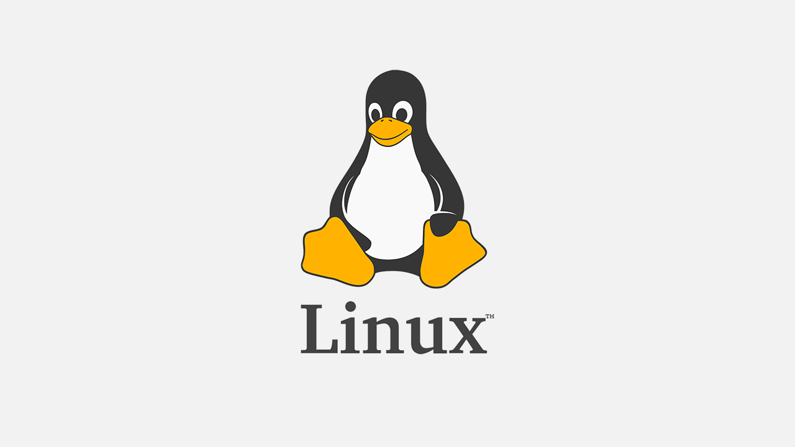

# 라즈베리파이에LineageOS를 설치해서 안드로이드 머신으로 써볼까요

> **Summary**
> 라즈베리파이에 LineageOS를 설치하여 안드로이드를 사용할 수 있으며, KonstaKANG이 개발한 LineageOS는 Raspberry Pi 4 모델 이상에서 저사양 스마트폰 수준의 성능을 제공합니다. 설치 과정은 LineageOS 이미지 다운로드, SD 카드에 플래싱, 초기 설정, Google Apps 설치로 구성되며, MindTheGapps 패키지가 권장됩니다. 또한, Revanced를 통해 Google Photos의 무제한 백업 기능을 활성화할 수 있는 방법도 안내됩니다.

---



# 라즈베리파이에서 안드로이드를 애초에 깔수가 있을까?

🔗 [https://ivonblog.com/posts/raspberry-pi-lineageos/](https://ivonblog.com/posts/raspberry-pi-lineageos/)

### Raspberry Pi에서 Android 사용하기

> LineageOS와 함께라면, 안될것 없다!

- Raspberry Pi는 Linux 외에도 Android를 실행할 수 있음
- KonstaKANG 개발자가 Raspberry Pi용 LineageOS Android 시스템을 유지보수하고 있음
- LineageOS Android에는 일반 버전과 Android TV 버전이 있어 용도에 맞게 선택할 수 있음
- Raspberry Pi 4 이후 모델은 저사양 Android 스마트폰 수준의 성능을 보유하고 있어 동영상 재생과 간단한 게임 구동이 가능함
### LineageOS Android의 추가 기능

- KonstaKANG이 LineageOS에 다양한 기능을 추가했음
  - 오디오 출력 전환, SSH 서버, VNC 원격 데스크톱, ADB 디버깅, FFMPEG 하드웨어 디코딩, DAC, CPU 오버클럭, GPIO 제어 등
- 이러한 추가 기능들로 인해 Raspberry Pi를 저전력 클라우드 폰이나 DIY Android TV 박스로 활용할 수 있음

> 오호, VNC 및 SSH를 기본적으로 OS단에서 지원하다니, 이거 안할 이유가 없다!

# 정보를 알아보자

> 국문으로는 어떤분이 4 환경에서 잘 정리해두신걸 찾을 수 있었다.

🔗 [https://makeutil.tistory.com/185](https://makeutil.tistory.com/185)

🔗 [https://makeutil.tistory.com/187?category=210045](https://makeutil.tistory.com/187?category=210045)

🔗 [https://konstakang.com/devices/rpi4/LineageOS22/](https://konstakang.com/devices/rpi4/LineageOS22/)

# 설치 & 세팅을 정리해보자

**KonstaKANG 공식 사이트에서 다운로드:** [https://konstakang.com/devices/rpi4/LineageOS20/](https://konstakang.com/devices/rpi4/LineageOS20/)

1. **LineageOS 20 이미지 파일**
  - `lineage-20.0-20240111-UNOFFICIAL-KonstaKANG-rpi4.zip`
  - 파일 크기: ~2GB
1. **Google Apps (GApps) 설치용**
  - [MindTheGapps-13.0.0-arm64](https://github.com/MindTheGapps/13.0.0-arm64/releases/latest)
1. **추가 도구**
  - [KonstaKANG-rpi-resize.zip](https://app.filen.io/#/d/359e14ab-fe03-4fa5-8382-d8bab79de308%23OcYCkizytCC8RXhUGHoeP1c3ejocPZDr) (SD카드 크기 조정용)
  - [KonstaKANG-rpi-magisk-v28.0.zip](https://app.filen.io/#/d/d74dc693-9ee2-40ee-9fa4-5a8849e775c8%238apHUATWC2xwkdPII1gnayb8zcoO0bde) (루팅용)
### **1.2 SD카드에 이미지 플래싱**

**참고 유튜브:** [Lineage OS 20 Android 13. Raspberry Pi 4 설치 가이드](https://www.youtube.com/watch?v=psPi6VLJn4E)

1. **Raspberry Pi Imager** 다운로드 및 설치
  - 공식 사이트: [https://www.raspberrypi.com/software/](https://www.raspberrypi.com/software/)
1. **이미지 플래싱**
```plain text
1. Raspberry Pi Imager 실행
2. "Use Custom" 선택
3. 다운로드한 lineage-20.0-xxx-rpi4.zip 파일 선택
4. SD카드 선택 (최소 32GB 권장)
5. Write 실행

```

### **1.3 첫 부팅 및 기본 설정**

1. **하드웨어 연결**
  - SD카드를 라즈베리파이에 삽입
  - HDMI, 키보드, 마우스 연결
  - 전원 연결
1. **Android 초기 설정**
  - 언어 설정
  - WiFi 연결
  - Google 계정 설정은 **일단 건너뛰기** (나중에 GApps 설치 후 진행)
**참고 블로그:** [라즈베리파이 4에 Android 11 설치하기](https://makeutil.tistory.com/185)

---

## 🔧 **2단계: Google Apps (GApps) 설치**

### O3 버전

🔗 [https://mindthegapps.com/](https://mindthegapps.com/)

Raspberry Pi 4 Model B에서 **Lineage OS 22 (Android 15)** 를 구운 뒤 최신 Google Apps(GApps)를 쓰려면, 현재 가장 안전한 선택은 **MindTheGapps 15.0.0 ARM64**이다. KonstaKANG의 비공식 Pi 4 빌드는 TWRP Recovery를 포함하고 있으며, FAQ에 “MindTheGapps-15.0.0-arm64.zip → TWRP에서 설치 → 즉시 Factory reset” 순서를 명시한다. LineageOS 공식 위키도 22 버전에는 MindTheGapps만을 권장한다. 대안으로는 Android 15까지 지원하는 NikGApps(여러 패키지 변형 제공)가 있다. OpenGApps는 Android 11 이후 사실상 개발이 멈춰 있어 22 빌드에서는 사용하지 않는다. 아래 절차에 따라 진행하면 된다.

---

## **1. 사전 확인**

| **항목** | **값** |
| --- | --- |
| 기기 | Raspberry Pi 4 B (또는 Pi 400/CM4) |
| ROM | Lineage OS 22.2 (Android 15) 비공식 KonstaKANG 빌드 |
| 아키텍처 | **ARM64** (Pi 4는 64-bit 전용) |
| Recovery | 빌드에 포함된 **TWRP 3.7 기반** |

---

## **2. GApps 패키지 선택**

| **패키지** | **지원 버전** | **특징** | **비고** |
| --- | --- | --- | --- |
| **MindTheGapps 15.0.0 ARM64** | Lineage 22 / Android 15 | 최소 구성(Play Store, Play Services, Setup Wizard 등) | 공식 위키·KonstaKANG 모두 추천 |
| **NikGApps Core~Full (2025-07-16)** | Android 10–16 | 변형 다수(Core, Basic, Omni, Stock, Full, Go) | 설치 스크립트 업데이트 활발 |
| OpenGApps | Android 4.4–11 | 오래된 패키지 | Android 12 이후 중단 |

> 권장

---

## **3. 다운로드 위치**

1. **MindTheGapps**
  - mindthegapps.com → *Android 15 (LineageOS 22) → ARM64* 항목 선택 후 GitHub 릴리스 다운로드.
1. **NikGApps**
  - nikgapps.com/downloads → *Latest Update – Android 10-16* → 원하는 변형 선택 후 SourceForge 링크에서 ZIP 획득.
다운로드한 ZIP은 MindTheGapps-15.0.0-arm64-YYYYMMDD_HHMM.zip 처럼 표시된다.

---

## **4. 설치 준비**

1. Lineage OS 22 이미지를 SD 카드(또는 USB/NVMe) 에 작성하고 첫 부팅까지 완료.
1. 부팅 직후 **전원 메뉴 → Reboot → Recovery**로 진입(TWRP).
  - KonstaKANG 빌드는 Advanced Reboot 옵션을 통해 쉽게 접근 가능.
1. PC와 Pi를 USB-C로 연결(ADB 사용 시).
---

## **5. 설치 단계**

### **방법 A – 기기 저장소/USB에서 플래시**

1. MindTheGapps ZIP을 /sdcard 혹은 외부 USB 저장장치에 복사.
1. TWRP > *Install* > ZIP 선택 > **Swipe to flash**.
1. **Wipe → Factory Reset**(데이터 초기화) – KonstaKANG FAQ 요구 사항.
1. *Reboot System*.
### **방법 B – ADB sideload**

1. TWRP > *Advanced* > *ADB Sideload* → Slide to start.
1. PC 터미널에서
```plain text
adb sideload MindTheGapps-15.0.0-arm64-YYYYMMDD.zip
```

1. 전송이 끝나면 TWRP에서 *Wipe → Factory Reset* 후 재부팅.
> 주의
> **반드시 다시 초기화 후 재설치**
>
>

---

## **6. 설치 후 확인**

1. 첫 부팅 Setup Wizard 진행 중 Google 계정 로그인이 나타나면 성공.
1. 설정 > 앱 > Google Play 서비스 버전이 “24.x.x (15)” 같이 Android 15 API 레벨을 가리키는지 확인.
1. OTA 업데이트 시 KonstaKANG 빌드는 addon.d 스크립트로 GApps를 자동 백업·복원한다.
---

## **7. 문제 해결 Q&A**

| **증상** | **조치** |
| --- | --- |
| Play 스토어가 열리지 않음 | ZIP 아키텍처(ARM64)·Android 버전(15) 일치 여부 재확인 후 재플래시. |
| OTA 후 앱 사라짐 | TWRP에서 adb shell ls /system/addon.d/ 로 스크립트 존재 확인; 없으면 GApps 재설치. |
| 설치 중 오류 70 (파티션 공간 부족) | NikGApps Core 같이 작은 패키지로 변경하거나, 파티션 크기 확장. |
| “signature verification failed” | TWRP > Settings > *Signature Verification* 체크 해제 후 재시도; XDA 보고 사례. |

---

## **8. 결론**

- **최신 Lineage OS 22(안드로이드 15) + Raspberry Pi 4B** 조합에서는 **MindTheGapps ARM64**가 사실상 표준이다.
- 설치는 *Lineage/ROM 플래시 → Recovery 진입 → GApps 플래시 → Factory Reset → 첫 부팅* 순서를 반드시 지킬 것.
- 대안이 필요하면 NikGApps(여러 변형)도 Android 15까지 지원하며 정상 동작한다.
- OpenGApps는 개발이 중단돼 더 이상 권장되지 않는다.
필요한 경우 추가 질문을 남겨 주시면 이어서 도와드리겠다.


### **2.1 TWRP 리커버리 부팅**

1. **고급 재시작 옵션 활성화**
```plain text
Settings → System → Buttons → Power menu → Advanced restart

```

1. **TWRP 리커버리 부팅**
  - 전원 버튼 → Recovery 선택
### **2.2 GApps 설치**

**참고 유튜브:** [How to setup Lineage OS Android 11 with Play store](https://www.youtube.com/watch?v=63oDtWbytGY)

1. **파일 복사**
  - MindTheGapps-13.0.0-arm64-xxx.zip 파일을 USB에 저장
  - 라즈베리파이에 USB 연결
1. **TWRP에서 설치**
```plain text
1. Install 선택
2. USB 드라이브에서 MindTheGapps zip 파일 선택
3. Swipe to confirm Flash
4. 완료 후 Wipe → Factory Reset (중요!)
5. Reboot System

```

### **2.3 Google Play 서비스 설정**

1. **Google 계정 로그인**
  - 재부팅 후 Google 계정으로 로그인
  - Google Play Store 실행 확인
---

## 2025년 7월 기준, Revanced로 구글 포토 무제한 업로드 활성화 가이드 (LineageOS 22 기준)

아래는 루팅이나 커스텀 롬 없이 **LineageOS 22**에서 최신 방법으로, 실제로 바로 따라 할 수 있는 Revanced 기반 ‘구글포토 무제한 원본 백업’ 가이드입니다.

## 준비물 다운로드 (모두 안전한 최신 공식/커뮤니티 배포처)

- **Revanced Manager 최신 버전**
  - 공식 깃허브: [ReVanced Manager 1.25.1 APK (2025.7 최신)](https://github.com/revanced/revanced-manager/releases)
- **MicroG (GmsCore) 앱**
  - 예시 다운로드: [MicroG 공식 GitHub](https://github.com/microg/GmsCore/releases) 또는 커뮤니티 빌드 제공 링크
<details>
<summary>microG(GmsCore) 다운로드/설치 가이드</summary>

## 어떤 파일을 받아야 하나요?

**LineageOS, GrapheneOS 등 커스텀 롬(안드로이드 계열)에서 구글 서비스 대체용으로 microG를 설치할 때는 아래 두 파일을 설치하면 됩니다.**

1. **GmsCore(필수) :**
  - 파일 이름: `com.google.android.gms-250932016.apk`
  - 용도: 구글 플레이 서비스 대체(MicroG 본체)
  - 다운로드 위치:
    [com.google.android.gms-250932016.apk (v0.3.8.250932)](https://github.com/microg/GmsCore/releases/download/v0.3.8.250932/com.google.android.gms-250932016.apk)

1. **FakeStore/Play Store 대체(선택, 일부 앱 요구) :**
  - 파일 이름: `com.android.vending-84022616.apk`
  - 용도: 구글 플레이스토어 API 훙내내기(실제 스토어 대신 앱 설치용, 일부 앱에서 필요)
  - 다운로드 위치:
    [com.android.vending-84022616.apk (v0.3.8.250932)](https://github.com/microg/GmsCore/releases/download/v0.3.8.250932/com.android.vending-84022616.apk)

## 설치 및 주의사항

- 위 두 파일을 **기기(안드로이드 폰/태블릿)에 복사 후, 파일 관리자에서 각각 설치**하세요.
- 설정 > 보안 > '알 수 없는 소스 허용(Unknown Sources)' 옵션을 미리 켜둬야 설치가 가능합니다.
- `org.microg.gms-250932016-user.apk` 파일은 개발 및 특수 환경 용이며, 일반 사용자/일반 목적 설치에는 **사용하지 않습니다**.
## 선택 기준

- **커스텀 롬 유저**:
  → `com.google.android.gms-250932016.apk` + `com.android.vending-84022616.apk`

- **화웨이 등 EMUI/Harmony 기반 원본OS**:
  → 파일명에 `-hw`가 포함된 버전을 사용합니다.

## 참고

- 구글 계정 로그인, 푸시, 위치, 사진 백업 등 구글 서비스가 필요한 앱 대부분은 위 두 개 설치로 작동합니다.
- microG는 지속적으로 업데이트되므로, **항상 최신 릴리스를 우선 설치**하는 것이 좋습니다.
- 기존 플레이서비스/스토어가 깔려 있다면 설치 전 제거 또는 비활성화가 필요합니다[1](https://github.com/microg/GmsCore/releases).
## 파일 요약표

| 용도 | 일반 커스텀롬용 파일 | 화웨이 등(h/w) 기기용 |
| --- | --- | --- |
| 구글서비스 대체 | com.google.android.gms-250932016.apk | com.google.android.gms-250932016-hw.apk |
| 플레이스토어 대체 | com.android.vending-84022616.apk | com.android.vending-84022616-hw.apk |

**파일명과 버전을 잘 확인하고, 본인 환경(커스텀 롬/화웨이 등)에 맞는 버전을 받아주세요.**

자주 묻는 질문 및 상세 설명:

- [microG Github 공식 릴리스 노트1](https://github.com/microg/GmsCore/releases)
---

*이 단계 이후 microG 설정 > Self-Check에서 항목 체크 및 계정 등록 등을 정상적으로 마칠 수 있습니다.*

[1](https://github.com/microg/GmsCore/releases)

1. [https://github.com/microg/GmsCore/releases](https://github.com/microg/GmsCore/releases)
1. [https://github.com/mar-v-in](https://github.com/mar-v-in)
1. [https://github.com/microg/GmsCore/tree/v0.3.8.250932](https://github.com/microg/GmsCore/tree/v0.3.8.250932)
1. [https://github.com/microg/GmsCore/commit/5cc4cd9e1173275225971349a5b259118](https://github.com/microg/GmsCore/commit/5cc4cd9e1173275225971349a5b259118)
</details>

- **Google Photos APK (Nodpi 권장, 최신 안정판)**
  - APKMirror나 공식 Patch 채널에서 Google Photos APK (예: v7.37.0.782944147, 2025.7)
  - Revanced 패치 적용이 잘 되는 버전인지 확인 필요
<details>
<summary>LineageOS 22 라즈베리파이4B에서 Google Photos APK 다운로드/설치 가이드</summary>

## Google Photos 7.37.0.782944147 다운로드

**라즈베리파이4B에 LineageOS 22를 설치하신 환경에서 Google Photos APK를 다운로드하고 설치하는 방법을 안내드립니다.**

## 권장 다운로드 위치 및 파일 선택

**1. APKMirror (가장 안정적, 2025년 7월 최신)**

- **추천 파일**: `Google Photos 7.37.0.782944147 (nodpi) (Android 6.0+)`[1](https://www.apkmirror.com/apk/google-inc/photos/google-photos-7-37-0-782944147-release/google-photos-7-37-0-782944147-6-android-apk-download/)[2](https://www.apkmirror.com/apk/google-inc/photos/google-photos-7-37-0-782944147-release/)
- **파일 크기**: 약 108MB
- **업로드 날짜**: 2025년 7월 16일
- **직접 다운로드 링크**:
  - APKMirror: [Google Photos 7.37.0.782944147 (x86_64) (nodpi)1](https://www.apkmirror.com/apk/google-inc/photos/google-photos-7-37-0-782944147-release/google-photos-7-37-0-782944147-6-android-apk-download/)
**2. 대안 다운로드 위치**

- **Uptodown**: [Google Photos 7.37.0.782944147 APK3](https://google-photos.kr.uptodown.com/android/download)[4](https://google-photos.kr.uptodown.com/android)
  - 파일 크기: 157.05MB
  - arm64-v8a 아키텍처
- **APKPure**: [Google Photos 7.37.0.782944147 APK](https://apkpure.net/kr/google-photos/com.google.android.apps.photos/download)[5](https://velog.io/@rungeun/raspberry-pi-4-install-android-13-via-usb)
## 라즈베리파이4B LineageOS 22에 설치하는 방법

**3. 설치 단계별 가이드**

1. **APK 파일 다운로드**
  - 위 링크 중 하나에서 `Google Photos 7.37.0.782944147 (nodpi)` 버전 다운로드
  - `nodpi`는 화면 해상도에 무관하게 설치 가능한 범용 버전
1. **라즈베리파이에 파일 전송**
  - USB 드라이브, 웹 브라우저 직접 다운로드, 또는 네트워크를 통해 APK 파일을 라즈베리파이로 전송
1. **LineageOS 22에서 설치**
  - 설정 > 보안 > '알 수 없는 출처 허용' 활성화
  - 파일 관리자에서 APK 파일 찾아 탭하여 설치
1. **Revanced 패치 호환성**
  - 이 버전(7.37.0.782944147)은 2025년 7월 기준 **ReVanced Manager와 호환 확인됨**[6](https://github.com/mentalblank/GPhotos-Revanced)
  - 무제한 백업 패치(`Spoof Unlimited Photos Backup`) 적용 가능
## 라즈베리파이 특이사항

**4. 라즈베리파이4B 환경 고려사항**

- **아키텍처**: 라즈베리파이4B는 ARM64 기반이므로, `arm64-v8a` 또는 `nodpi` 버전 선택[7](https://m.ruliweb.com/mobile/board/184992/read/111894)
- **성능**: Google Photos는 라즈베리파이4B에서도 기본 기능(사진 보기, 업로드) 정상 작동[8](https://www.apkmirror.com/apk/google-inc/photos/google-photos-7-37-0-782944147-release/google-photos-7-37-0-782944147-5-android-apk-download/)[9](https://www.linuxadictos.com/ko/como-instalar-android-11-en-la-raspberry-pi-usando-una-version-basada-en-lineageos.html)
- **저장소**: 무제한 백업 기능은 ReVanced 패치 적용 후 사용 가능
## 파일 정보 요약

| 항목 | 내용 |
| --- | --- |
| **파일명** | Google Photos 7.37.0.782944147 (nodpi) |
| **크기** | 108MB (nodpi), 157MB (arm64-v8a) |
| **호환성** | Android 6.0+ (LineageOS 22 지원) |
| **Revanced 패치** | 2025년 7월 기준 지원 |
| **다운로드** | APKMirror, Uptodown, APKPure |

**이 버전은 2025년 7월 20일 기준으로 최신이며, LineageOS 22 환경에서 정상 작동하고 ReVanced 패치와의 호환성도 확인되어 안전하게 사용할 수 있습니다.**

1. [https://www.apkmirror.com/apk/google-inc/photos/google-photos-7-37-0-782944147-release/google-photos-7-37-0-782944147-6-android-apk-download/](https://www.apkmirror.com/apk/google-inc/photos/google-photos-7-37-0-782944147-release/google-photos-7-37-0-782944147-6-android-apk-download/)
1. [https://www.apkmirror.com/apk/google-inc/photos/google-photos-7-37-0-782944147-release/](https://www.apkmirror.com/apk/google-inc/photos/google-photos-7-37-0-782944147-release/)
1. [https://google-photos.kr.uptodown.com/android/download](https://google-photos.kr.uptodown.com/android/download)
1. [https://google-photos.kr.uptodown.com/android](https://google-photos.kr.uptodown.com/android)
1. [https://velog.io/@rungeun/raspberry-pi-4-install-android-13-via-usb](https://velog.io/@rungeun/raspberry-pi-4-install-android-13-via-usb)
1. [https://github.com/mentalblank/GPhotos-Revanced](https://github.com/mentalblank/GPhotos-Revanced)
1. [https://m.ruliweb.com/mobile/board/184992/read/111894](https://m.ruliweb.com/mobile/board/184992/read/111894)
1. [https://www.apkmirror.com/apk/google-inc/photos/google-photos-7-37-0-782944147-release/google-photos-7-37-0-782944147-5-android-apk-download/](https://www.apkmirror.com/apk/google-inc/photos/google-photos-7-37-0-782944147-release/google-photos-7-37-0-782944147-5-android-apk-download/)
1. [https://www.linuxadictos.com/ko/como-instalar-android-11-en-la-raspberry-pi-usando-una-version-basada-en-lineageos.html](https://www.linuxadictos.com/ko/como-instalar-android-11-en-la-raspberry-pi-usando-una-version-basada-en-lineageos.html)
1. [https://www.apkmirror.com/apk/google-inc/google-photos-daydream/](https://www.apkmirror.com/apk/google-inc/google-photos-daydream/)
1. [https://www.androidp1.com/en/programs/photo/210-google-photos.html](https://www.androidp1.com/en/programs/photo/210-google-photos.html)
1. [https://www.apkmirror.com/apk/google-inc/photos/](https://www.apkmirror.com/apk/google-inc/photos/)
1. [https://revancedextended.cc/ko/manager/](https://revancedextended.cc/ko/manager/)
1. [https://www.apkmirror.com/apk/google-inc/photos/variant-%7B%22arches_slug%22:%5B%22x86_64%22%5D%7D/](https://www.apkmirror.com/apk/google-inc/photos/variant-%7B%22arches_slug%22:%5B%22x86_64%22%5D%7D/)
1. [https://revanced-extended.kr.uptodown.com/android](https://revanced-extended.kr.uptodown.com/android)
1. [https://www.apkmirror.com/apk/google-inc/photos/variant-%7B%22dpis_slug%22:%5B%22nodpi%22%5D%7D/](https://www.apkmirror.com/apk/google-inc/photos/variant-%7B%22dpis_slug%22:%5B%22nodpi%22%5D%7D/)
1. [https://apkpure.net/kr/youtube-revanced/app.revanced.android.youtube/versions](https://apkpure.net/kr/youtube-revanced/app.revanced.android.youtube/versions)
1. [https://google-photos.kr.uptodown.com/android/versions](https://google-photos.kr.uptodown.com/android/versions)
1. [https://c920685.tistory.com/1512](https://c920685.tistory.com/1512)
1. [https://www.apkmirror.com/apk/google-inc/photos/variant-%7B%22dpis_slug%22:%5B%22160%22,%22213%22,%22240%22%5D%7D/](https://www.apkmirror.com/apk/google-inc/photos/variant-%7B%22dpis_slug%22:%5B%22160%22,%22213%22,%22240%22%5D%7D/)
1. [https://apkcombo.com/ko/google-photos/com.google.android.apps.photos/](https://apkcombo.com/ko/google-photos/com.google.android.apps.photos/)
1. [https://rkdrlgh22.tistory.com/216](https://rkdrlgh22.tistory.com/216)
1. [https://www.apkmirror.com/apk/google-inc/photos/variant-%7B%22dpis_slug%22:%5B%22320%22%5D%7D/](https://www.apkmirror.com/apk/google-inc/photos/variant-%7B%22dpis_slug%22:%5B%22320%22%5D%7D/)
1. [https://foto-google.en.aptoide.com/app](https://foto-google.en.aptoide.com/app)
1. [https://21tos.tistory.com/399](https://21tos.tistory.com/399)
1. [https://www.youtube.com/watch?v=Mkpus60QJd0](https://www.youtube.com/watch?v=Mkpus60QJd0)
1. [https://makeutil.tistory.com/187](https://makeutil.tistory.com/187)
1. [https://apkpure.net/kr/google-photos/com.google.android.apps.photos/download](https://apkpure.net/kr/google-photos/com.google.android.apps.photos/download)
1. [https://www.youtube.com/watch?v=qp13U3sZQH4](https://www.youtube.com/watch?v=qp13U3sZQH4)
1. [https://makeutil.tistory.com/185](https://makeutil.tistory.com/185)
1. [https://www.apkmirror.com/apk/google-inc/photos/variant-%7B%22arches_slug%22:%5B%22arm64-v8a%22%5D%7D/](https://www.apkmirror.com/apk/google-inc/photos/variant-%7B%22arches_slug%22:%5B%22arm64-v8a%22%5D%7D/)
</details>

## 단계별 설치 및 패치 방법

1. **기존 Google Photos 앱 제거 또는 비활성화**
  - 시스템 앱일 경우 `설정 > 앱 > Google 포토`에서 비활성화.
1. **Revanced Manager 설치**
  - 위에서 받은 revanced-manager-1.25.1.apk 설치.
1. **Google Photos APK 다운로드**
  - APKMirror 또는 공식 제공처에서 최신 APK 파일(nodpi 권장)을 다운로드.
  - 예시: Google Photos 7.37.0.782944147 (2025년 7월 기준 최신)[1](https://vanced.to/revanced-google-photos)[2](https://www.youtube.com/watch?v=b0wI5_nbMY0)[3](https://github.com/revanced/revanced-manager/releases).
1. **MicroG(GmsCore) 설치**
  - Google 계정 로그인을 위해 MicroG 앱(최신 안정판) 설치[2](https://www.youtube.com/watch?v=b0wI5_nbMY0)[4](https://www.youtube.com/watch?v=Mdv_bceH-Ls).
1. **Revanced Manager에서 Google Photos 패치**
  - Revanced Manager 실행 > “패치 > 저장소에서 앱 선택 > Google Photos APK 선택”
  - 패치 목록에서 “Unlimited Photos Backup” 또는 “Spoof Unlimitied Backup” 활성화
  - 필요하다면 DCIM 자동 백업 비활성화 패치 등도 선택[1](https://vanced.to/revanced-google-photos)[5](https://github.com/Unofficial-Life/revanced-gphotos-build)[2](https://www.youtube.com/watch?v=b0wI5_nbMY0)[4](https://www.youtube.com/watch?v=Mdv_bceH-Ls).
1. **패치 진행 및 APK 설치**
  - Revanced Manager에서 패치 완료 후, 생성된 패치된 Google Photos APK를 설치.
1. **최초 실행 및 로그인**
  - 패치된 Google Photos 앱 실행 후 MicroG 계정으로 로그인 진행.
  - 최초 1회 미디어 접근 권한, 디폴트 백업 폴더(DICM 등) 설정.
  - 참고: 앱 실행 시마다 구글 계정 선택을 다시 요구받을 수 있음(현재까지 알려진 버그).
## 실사용 중 주의사항 및 한계

- **AI 편집 기능(Magic Editor 등)는 지원되지 않음.**
- **계정 선택 팝업 반복됨** (실제 사용에는 큰 지장 없음).
- 앱이 Google Play 서비스 대신 MicroG로 작동하므로 Gpay·드라이브 등 일부 기능 미지원.
- Google 약관상 공식 승인된 이용 방식은 아니며, 개인 데이터 보호와 보안 책임은 사용자에게 있음[5](https://github.com/Unofficial-Life/revanced-gphotos-build)[2](https://www.youtube.com/watch?v=b0wI5_nbMY0)[4](https://www.youtube.com/watch?v=Mdv_bceH-Ls).
## 참고/공식 문서

- Revanced 공식 깃허브: [ReVanced Manager 최신 릴리즈](https://github.com/revanced/revanced-manager/releases)
- 비공식 Google Photos Revanced 빌드: [Unofficial-Life/revanced-gphotos-build](https://github.com/Unofficial-Life/revanced-gphotos-build)
- 설치 및 버그 안내: [Revanced Reddit/공식 Discussion](https://www.reddit.com/r/revancedapp/)
| 준비물 | 설명 | 주요 링크 |
| --- | --- | --- |
| Revanced Manager | APK 설치 및 패치 툴 | ReVanced 공식[3](https://github.com/revanced/revanced-manager/releases) |
| MicroG (GmsCore) | Google Play Service 대체, 계정 로그인 지원 | MicroG 공식, 영상 안내[2](https://www.youtube.com/watch?v=b0wI5_nbMY0)[4](https://www.youtube.com/watch?v=Mdv_bceH-Ls) |
| Google Photos APK | 최신 패치 호환성 APK | Vanced/공식 미러팀, 최신 릴리즈[1](https://vanced.to/revanced-google-photos)[5](https://github.com/Unofficial-Life/revanced-gphotos-build)[2](https://www.youtube.com/watch?v=b0wI5_nbMY0)[4](https://www.youtube.com/watch?v=Mdv_bceH-Ls)[3](https://github.com/revanced/revanced-manager/releases) |

## 요약

**2025년 7월 최신 Revanced & MicroG 기반 ‘구글 포토 무제한 업로드’ 솔루션은 루팅 없이 안전하게, 누구든지 10분 이내 내 폰에서 구축이 가능합니다.** 모든 자료와 최신 버전은 공식 깃허브 또는 검증된 커뮤니티 링크만 사용하세요.

[1](https://vanced.to/revanced-google-photos)[5](https://github.com/Unofficial-Life/revanced-gphotos-build)[2](https://www.youtube.com/watch?v=b0wI5_nbMY0)[4](https://www.youtube.com/watch?v=Mdv_bceH-Ls)[6](https://www.reddit.com/r/revancedapp/comments/1lx59p4/how_to_patch_google_photos/)[3](https://github.com/revanced/revanced-manager/releases)

1. [https://vanced.to/revanced-google-photos](https://vanced.to/revanced-google-photos)
1. [https://www.youtube.com/watch?v=b0wI5_nbMY0](https://www.youtube.com/watch?v=b0wI5_nbMY0)
1. [https://github.com/revanced/revanced-manager/releases](https://github.com/revanced/revanced-manager/releases)
1. [https://www.youtube.com/watch?v=Mdv_bceH-Ls](https://www.youtube.com/watch?v=Mdv_bceH-Ls)
1. [https://github.com/Unofficial-Life/revanced-gphotos-build](https://github.com/Unofficial-Life/revanced-gphotos-build)
1. [https://www.reddit.com/r/revancedapp/comments/1lx59p4/how_to_patch_google_photos/](https://www.reddit.com/r/revancedapp/comments/1lx59p4/how_to_patch_google_photos/)
1. [https://www.reddit.com/r/revancedapp/comments/1jb6b54/whats_the_plan_for_google_photos_support_in/](https://www.reddit.com/r/revancedapp/comments/1jb6b54/whats_the_plan_for_google_photos_support_in/)
1. [https://xdaforums.com/t/unlimited-google-photos-solved.4704199/](https://xdaforums.com/t/unlimited-google-photos-solved.4704199/)
1. [https://github.com/CreepsoOff/GooglePhotosRevanced](https://github.com/CreepsoOff/GooglePhotosRevanced)
1. [https://github.com/revanced/revanced-manager/blob/main/docs/1_installation.md](https://github.com/revanced/revanced-manager/blob/main/docs/1_installation.md)
1. [https://apkpure.net/revanced-manager/app.revanced.manager.flutter/download](https://apkpure.net/revanced-manager/app.revanced.manager.flutter/download)
1. [https://www.threads.com/@yasin.suzon/post/DLl7tiIhfst/its-not-hard-to-enable-unlimited-photos-backup-in-google-photos-took-me-like-5-m](https://www.threads.com/@yasin.suzon/post/DLl7tiIhfst/its-not-hard-to-enable-unlimited-photos-backup-in-google-photos-took-me-like-5-m)
1. [https://www.reddit.com/r/revancedapp/comments/1jy63ql/finally_gphotos_patching_on_android_works_thanks/](https://www.reddit.com/r/revancedapp/comments/1jy63ql/finally_gphotos_patching_on_android_works_thanks/)
1. [https://blindhelp.net/software/revanced-manager](https://blindhelp.net/software/revanced-manager)
1. [https://vanced.to/posts/new-build-for-revanced-google-photos](https://vanced.to/posts/new-build-for-revanced-google-photos)
1. [https://github.com/ReVanced/revanced-patches/issues/3622](https://github.com/ReVanced/revanced-patches/issues/3622)
1. [https://github.com/athuld/revanced-gphotos](https://github.com/athuld/revanced-gphotos)
1. [https://github.com/ReVanced/revanced-manager/issues/2137](https://github.com/ReVanced/revanced-manager/issues/2137)
1. [https://revanced-manager.techylist.com](https://revanced-manager.techylist.com/)
1. [https://www.youtube.com/watch?v=g_o9Jdoih4Q](https://www.youtube.com/watch?v=g_o9Jdoih4Q)
---

## 📚 **추가 참고 자료**

### **한국어 블로그 가이드**

- [라즈베리파이 4 Android 11 설치 가이드](https://makeutil.tistory.com/185)
- [안드로이드 13 설치 가이드](https://ssafy.tistory.com/16)
### **YouTube 튜토리얼**

- [디바이스마트 - 라즈베리파이 4 안드로이드 OS 설치](https://www.youtube.com/watch?v=Mkpus60QJd0)
- [LineageOS 20 설치 가이드](https://www.youtube.com/watch?v=psPi6VLJn4E)
- [ReVanced Photos 무제한 스토리지](https://www.youtube.com/watch?v=yipSKsD4rRs)
### **GitHub 프로젝트**

- [ReVanced Google Photos Build](https://github.com/Unofficial-Life/revanced-gphotos-build)
- [Free Unlimited Google Cloud Backup](https://github.com/VehanRajintha/Free-Unlimited-Google-Cloud-Backup-Magisk-Module)
---

## ⚠️ **주의사항**

1. **법적 고지**: 이 방법은 교육 목적으로만 사용하세요
1. **데이터 백업**: 중요한 데이터는 별도 백업 권장
1. **안정성**: 비공식 빌드이므로 일부 기능 제한 가능
1. **업데이트**: 정기적인 보안 업데이트 확인 필요
**🎯 성공적으로 완료되면 라즈베리파이 4B에서 무제한 Google Photos 백업이 가능한 완전한 시스템을 구축할 수 있습니다!**

