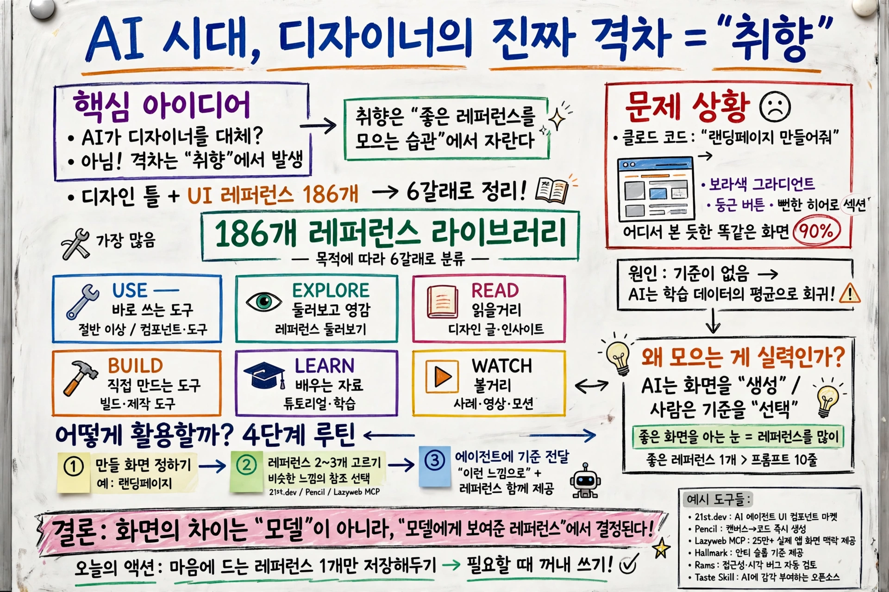
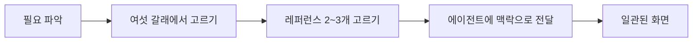
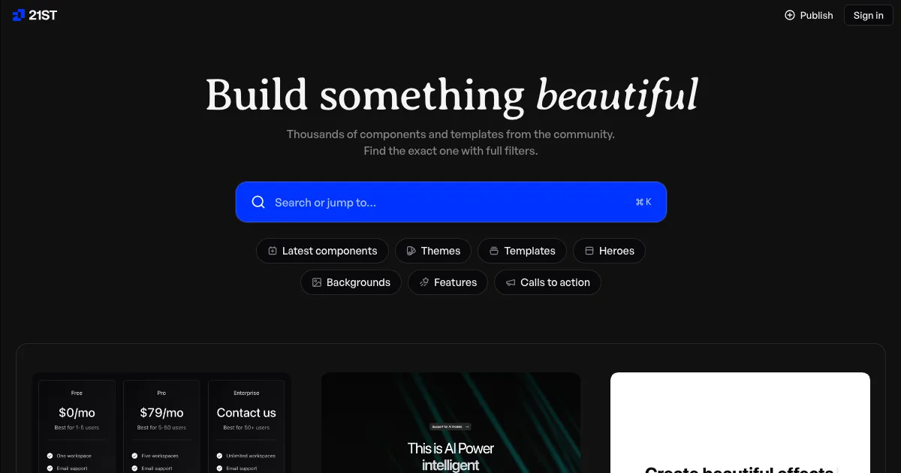
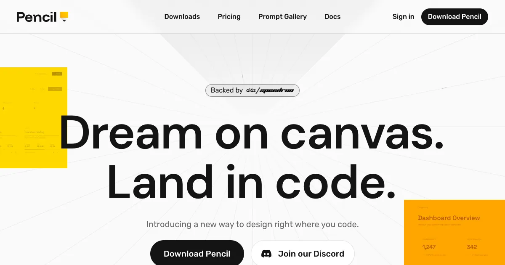
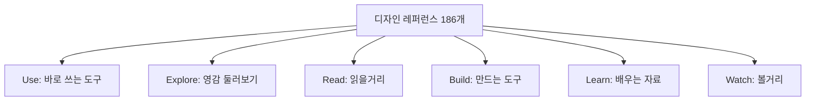
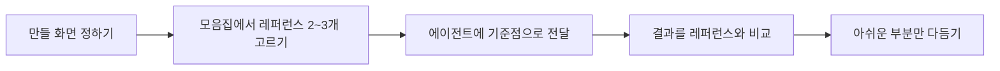

# 레퍼런스 186개를 모아두면, AI가 만든 화면이 달라집니다

> **Summary**
> AI 시대에 디자이너가 사라진다는 말과 달리, 진짜 격차는 취향에서 나옵니다. 디자인 툴과 UI 레퍼런스 186개가 Use·Explore·Read·Build·Learn·Watch 여섯 갈래로 한 페이지에 정리된 모음집은, AI 코딩 에이전트에게 보여줄 기준점을 모아둔 재료 창고입니다. 레퍼런스 두세 개를 골라 에이전트에 함께 건네면 대량 생산되는 평범한 화면 대신 일관된 디자인이 나오고, 목록은 계속 바뀌니 필요할 때마다 열어보는 습관이 중요합니다.

---

- AI 시대에 디자이너가 사라진다는 말과 달리, 진짜 격차는 취향에서 나옵니다. 취향은 좋은 레퍼런스를 모으는 습관에서 자랍니다.
- 디자인 툴과 UI 레퍼런스 186개가 Use·Explore·Read·Build·Learn·Watch 여섯 갈래로 한 페이지에 정리돼 있습니다.
- AI 코딩 에이전트에 레퍼런스를 먹이면 대량 생산되는 평범한 화면 대신 일관된 디자인이 나옵니다. 저장해두고 필요할 때 꺼내 쓰면 됩니다.

클로드 코드에 "랜딩 페이지 하나 만들어줘"라고 했더니, 보라색 그라디언트에 둥근 버튼, 어디서 본 듯한 히어로 섹션이 나온 적 있으시죠? 기능은 멀쩡한데, 화면만 보면 열 개 중 아홉 개가 똑같습니다. 왜 그럴까요? 에이전트에게 보여준 기준이 없어서 그렇습니다. 기준이 없으면 모델은 학습 데이터의 평균으로 돌아가거든요!

🎥 [동영상 보기](https://www.youtube.com/watch?v=zsCGS-Yzjnw)

## 이 라이브러리, 뭐가 들어 있나요?

디자인 툴과 UI 레퍼런스 186개를 한 페이지에 모아둔 라이브러리입니다. 그냥 링크를 늘어놓은 게 아닙니다. 목적에 따라 여섯 갈래로 나뉩니다. 바로 쓰는 도구는 Use, 둘러보며 영감을 얻는 곳은 Explore, 읽을거리는 Read, 직접 만드는 도구는 Build, 배우는 자료는 Learn, 볼거리는 Watch입니다. 가장 많은 갈래는 Use입니다. 절반 가까이가 당장 프로젝트에 끼워 쓸 수 있는 도구와 컴포넌트입니다.

## 어디서부터 보면 좋을까요?

전체를 다 볼 필요는 없습니다. 지금 필요한 것부터 하나씩 꺼내면 됩니다.

**바로 쓰는 도구부터 시작하면 어떨까요?** `21st.dev`는 AI 에이전트 레지스트리와 UI 컴포넌트 마켓플레이스입니다. 컴포넌트를 골라 에이전트에게 넘기면, 처음부터 만드는 대신 검증된 부품을 조립합니다. `Pencil`은 IDE를 벗어나지 않고 캔버스에서 아이디어를 그려 바로 코드로 바꾸는 도구입니다. `Lazyweb MCP`는 25만 7천 개가 넘는 실제 앱 화면을 기반으로 설계 맥락을 에이전트에게 건네줍니다. 실제 화면을 본 에이전트는 추측이 아니라 패턴으로 만듭니다.

**영감은 둘러보는 데서 옵니다.** 유명 서비스의 디자인 스타일을 `DESIGN.md` 한 파일로 뽑아주는 모음집이 있습니다. 브랜드나 URL을 검색하면 색상, 타이포, 여백이 정리된 파일이 나옵니다. 이 파일을 프로젝트에 넣으면 에이전트가 그 느낌에 맞춰 화면을 만듭니다. 애니메이션 디테일은 `Motion`에서, 로고는 1,000개가 넘는 라이브러리에서 찾으면 됩니다. 브랜드, 타이포그래피, 컴포넌트, UI 패턴까지 통째로 공개된 제품 디자인 시스템 사례도 있습니다.

**감각을 가르치는 자료도 있습니다.** `Taste Skill`은 AI 에이전트에 감각을 주는 오픈소스 기술 파일 모음입니다. 대량 생산되는 평범한 화면을 멈추는 게 목표입니다. `Hallmark`는 타이포그래피, 색상, 레이아웃, 모션에 대한 안티 슬롭 기준을 에이전트에게 건네줍니다. `Rams`는 AI가 만든 코드의 접근성 문제와 시각적 버그를 자동으로 검토합니다. 만드는 쪽과 검수하는 쪽이 따로 있으면, 화면 품질은 저절로 올라갑니다!

배우는 자료도 있습니다. A/B 테스트 사례 갤러리에서는 제품 행동을 바꾸는 요소를 사례로 배울 수 있고, 실제 제품 UI를 세분화해 디자인 원칙과 의도를 설명하는 분석 갤러리도 있습니다. 한국어 제품 인터페이스를 위한 시스템 서체도 Build 갈래에 들어 있습니다.

## 왜 모으는 게 실력일까요?

AI가 화면을 잘 만드는 시대에, 사람의 일은 뭘까요? 기준을 고르는 일입니다. 어떤 화면이 좋은지, 어떤 느낌이 이 제품에 맞는지를 아는 눈이 기준이 됩니다. 그리고 그 눈은 레퍼런스를 많이 본 사람에게 생깁니다. "디자이너가 사라진다"는 말과 달리, 취향이 넘치는 사람의 잠재력은 오히려 커집니다. 전문가들이 쓰고 공유하는 것을 조용히 모아왔고, 혼자 보기 아까워서 전부 공개했다는 모음집의 취지와 똑같습니다.

> 좋은 레퍼런스 하나가, 프롬프트 열 줄보다 화면을 더 바꿉니다!

한 가지 정직하게 짚을 점이 있습니다. 이 모음집은 살아 있는 목록입니다. 새 도구가 계속 추가되고, 링크가 바뀌기도 합니다. 2026년 트렌드 리포트까지 들어 있는 지금의 목록이 내년에도 똑같지는 않습니다. 그래서 저장만 해두고 끝내면 안 됩니다. 필요할 때마다 열어보고, 지금 내 프로젝트에 맞는 것을 골라 쓰는 습관이 중요합니다.

## 이렇게 쓰면 됩니다

거창하게 시작할 필요는 없습니다. 오늘 화면 하나를 만들 때, 이 순서로 해보면 됩니다.

먼저 만들 화면을 정합니다. 그다음 모음집에서 비슷한 느낌의 레퍼런스 두세 개를 고릅니다. 에이전트에게 "이런 느낌으로"라고 기준점을 함께 건네면 됩니다. 결과가 나오면 레퍼런스와 나란히 놓고 비교합니다. 아쉬운 부분만 다듬으면, 처음부터 다시 만드는 일은 줄어듭니다. 이 과정을 몇 번만 반복하면, 어떤 레퍼런스가 내 취향인지 감이 잡힙니다!

화면의 차이는 모델이 아니라, 모델에게 보여준 레퍼런스에서 나옵니다! 오늘 하나만 저장해두면 됩니다.

