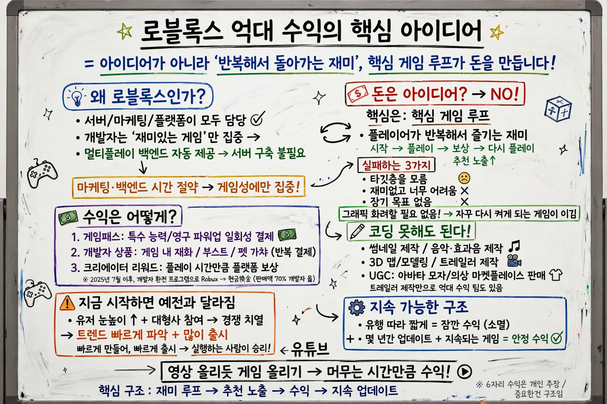
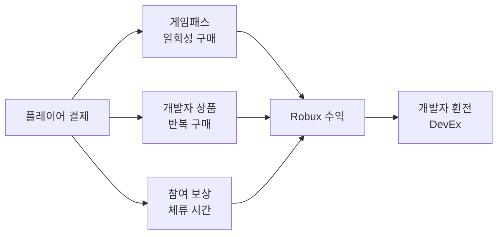
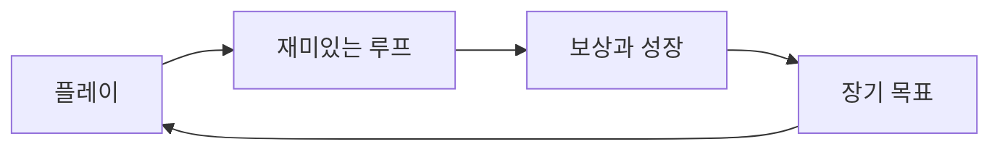
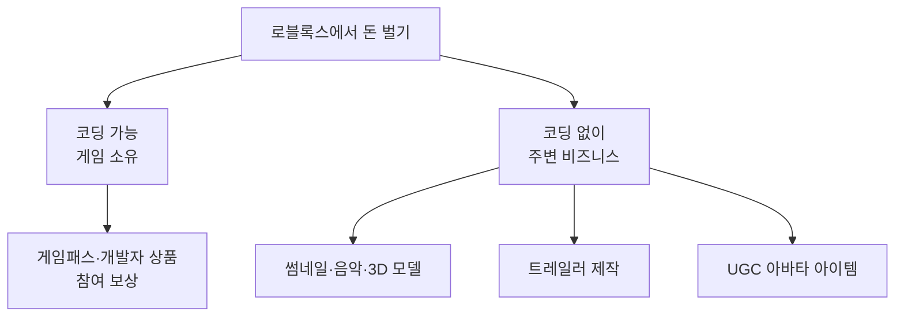

# 로블록스 하나로 억대 연봉, 비결은 아이디어가 아니라 반복되는 재미입니다

> **Summary**
> 로블록스로 억대 수익을 올린 전업 개발자의 답은 단순합니다. 아이디어가 아니라 반복해서 돌아가는 재미, 핵심 게임 루프가 돈을 만듭니다. 서버도 마케팅도 플랫폼이 맡습니다. 개발자는 재미있는 게임만 빠르게 만들어 내놓으면 됩니다. 그래픽이 예쁠 필요는 없습니다. 타깃층을 알고, 오래 붙잡아 두는 목표를 설계한 게임이 살아남습니다.

---

- 로블록스로 억대 수익을 올린 전업 개발자의 답은 단순합니다. 아이디어가 아니라 반복해서 돌아가는 재미, 핵심 게임 루프가 돈을 만듭니다.
- 서버도 마케팅도 플랫폼이 맡습니다. 개발자는 재미있는 게임만 빠르게 만들어 내놓으면 됩니다.
- 그래픽이 예쁠 필요는 없습니다. 타깃층을 알고, 오래 붙잡아 두는 목표를 설계한 게임이 살아남습니다.

"게임을 만들어 돈 번다"는 말, 한 번쯤 들어보셨죠? 그런데 막상 해보려면 서버는 어떻게 세우고, 마케팅은 어떻게 하고, 결제는 어떻게 받는지부터 막막합니다. 2012년 플레이어로 시작해 8개가 넘는 게임을 출시하고 연 6자리 수, 우리 돈으로 억 대 수익을 올렸다는 전업 개발자의 답은 뜻밖이었습니다. 비결은 기술이 아니라 순서였습니다!

🎥 [동영상 보기](https://www.youtube.com/watch?v=LZOohZHsJus)

## 왜 로블록스인가요?

"유니티로 만들어 스팀에 내면 되지 않나요?"라는 질문에 답은 단호했습니다. 한 번도 생각해 본 적이 없다고 합니다. 로블록스는 타깃 유저층과 멀티플레이어 백엔드를 기본으로 제공합니다. 별도 네트워크 서버를 구축할 필요가 없습니다. 그냥 작동합니다.

그래서 마케팅과 백엔드에 쓸 시간을 아껴 오직 재미있는 게임성에만 집중할 수 있습니다. 스팀에서 먹히지 않는 장르도 로블록스에서는 잘 됩니다. "애플이 최고의 폰을 만든다면, 로블록스는 최고의 플랫폼을 만든다"는 말이 인상 깊었습니다. 플랫폼이 무거운 일을 대신 들어주니, 개발자는 가벼워지는 겁니다.

## 돈은 아이디어에서 나오나요?

많은 사람이 착각한다고 합니다. 돈은 아이디어에서 나오는 게 아닙니다. 핵심 게임 루프에서 나옵니다! 플레이어가 반복해서 즐길 수 있는 재미와 탄탄한 수익화 설계가 핵심입니다. 아이디어가 막히면 산책을 하거나 여행을 떠나 신선한 공기를 마시며 브레인스토밍을 한다고 합니다.

루프가 확실하면 추천 정렬에 노출되고 성공할 확률이 커집니다. 반대로 초보 개발자가 자주 하는 실수는 세 가지입니다. 핵심 타깃층을 모르는 것, 너무 어렵거나 객관적으로 재미없는 게임을 만드는 것, 오래 붙잡아 둘 장기 목표를 설계하지 않는 것입니다.

그래픽이 화려하거나 예쁠 필요는 없습니다. 그래픽이 다소 아쉬워도 루프가 명확하면 충분히 큰돈을 벌 수 있습니다. 이 대목이 저는 가장 와닿았습니다. 예쁜 게임이 아니라, 자꾸 다시 켜게 되는 게임이 이깁니다!

## 수익은 어떻게 들어오나요?

주 수익원은 크게 두 가지입니다. 첫째는 게임패스입니다. 특수 능력이나 영구 파워업을 해금하는 일회성 결제입니다. 둘째는 개발자 상품입니다. 게임 내 재화 구매, 일시적 부스트, 펫 가챠처럼 반복해서 결제하는 소모성 상품입니다.

여기에 플레이어가 게임 안에 오래 머물면 플랫폼에서 직접 일일 참여 보상을 지급합니다. 게임 내 판매액의 70%는 개발자 몫이고, 번 `Robux`는 개발자 환전 프로그램으로 현금으로 바꿉니다. 단, 참여 보상 제도는 2025년 7월 이후 크리에이터 리워드로 바뀌었으니, 지금 시작한다면 최신 제도를 확인해야 합니다.

## 코딩을 못 해도 돈을 버나요?

물론입니다. 직접 게임을 소유하지 않아도 로블록스 주변에는 부업 생태계가 넓게 펼쳐져 있습니다. 게임 썸네일 제작, 음악과 효과음 제작, 3D 맵과 모델링, 트레일러와 홍보 영상 제작이 대표적입니다. 트레일러 제작만으로 억대 수입을 올리는 팀도 있다고 합니다.

아바타용 모자나 의상 같은 3D 액세서리를 만들어 마켓플레이스에 파는 UGC 방식도 있습니다. 다만 UGC는 게임보다 어렵다고 여겨집니다. 코딩이 전부가 아니라는 점, 이게 이 생태계의 진짜 매력 아닐까요?

## 지금 시작하면 예전과 다릅니다

과거에는 초창기 이점 덕분에 투박한 게임으로도 팬층을 모으기 쉬웠습니다. 첫 게임은 동시 접속자 몇백 명 수준이었는데, 당시에는 그 정도도 꽤 큰 규모였습니다. 그런데 지금 그 옛날 게임들의 동시 접속자는 0명입니다. 유저들의 눈높이가 대폭 올랐고, 대형 브랜드와 전문 개발사들이 들어오면서 경쟁이 훨씬 치열해졌습니다.

그래서 지금 시작한다면 트렌드를 민감하게 읽는 게 필수입니다. 유행하는 장르와 게임 루프를 보고, 홈 화면 추천 정렬과 자체 광고를 효율적으로 활용해야 합니다. "더 빠르게 만들고, 더 많이 출시하라"는 조언이 그래서 나옵니다. 빠르게 시도하고 실행하는 사람이 결국 이깁니다!

유행만 따라다니며 짧게 만들고 버리는 게임도 수익은 납니다. 하지만 오래가지 못합니다. 답변자는 몇 년 동안 업데이트와 함께 지속되는 게임을 소유하는 쪽을 선호한다고 합니다. 몇 달 만에 지쳐버리는 게임보다요.

## 안전성 질문은 피하지 않았습니다

어린이 이용자가 많은 플랫폼에서 일하는 것에 대한 질문도 나왔습니다. 답변자는 안전한 경험을 만들기 위해 노력하고, 플랫폼이 더 안전해지도록 하는 작업을 신뢰한다고 답했습니다. 도덕적으로 어렵다는 점도 인정했습니다. 개발자가 자기 역할을 책임감 있게 하고, 나머지는 플랫폼이 처리해야 한다는 입장입니다.

그 밖에 인상 깊었던 답도 있습니다. 만든 게임의 이름은 익명으로 남기고 싶다고 했습니다. 여러 게임이 상위 200 수익 정렬에 올랐다 내렸다고만 밝혔습니다. 암호화폐는 전혀 보유하지 않고, 믿는 개별 주식과 `S&P500`에 투자한다고 합니다. 비상금도 모아두었고, 만약 플랫폼이 문을 닫는다면 가진 기술로 앱을 만들거나 의류 브랜드를 시작하고 싶다고 했습니다.

로블록스를 뭐라고 설명할까요? 답변자의 비유는 단순합니다. 게임을 위한 유튜브입니다. 영상을 올리듯 게임을 올리고, 사람들이 머무는 만큼 수익이 따라옵니다. 단, "6자리 수 수익"은 어디까지나 답변자 본인의 주장이라는 점은 분명히 밝혀둡니다. 숫자가 아니라 구조를 보셔야 합니다. 재미있는 루프, 빠른 출시, 오래 붙잡아 두는 설계가 그 구조입니다.

