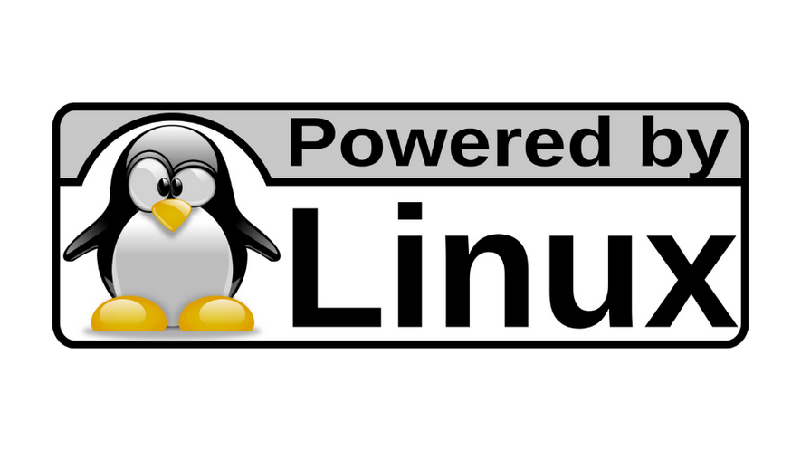

# 리눅스에서 Intel CPU인데 왜 AMD64 를 사용할까?

> **Summary**
> 리눅스를 설치할 때 AMD64 아키텍처를 사용하는 이유는 인텔의 IA-64 아키텍처와의 호환성 문제를 해결하기 위해 AMD가 개발한 AMD64가 32비트 IA-32와 호환되면서도 64비트를 지원하기 때문입니다. 인텔은 AMD64를 라이선스 받아 자사 CPU에 탑재하며, 이로 인해 amd64라는 이름이 널리 사용됩니다. 결론적으로, IA-32는 32비트를, amd64는 64비트를 나타냅니다.

---

🔗 [https://xetown.com/topics/1531860](https://xetown.com/topics/1531860)

리눅스를 설치하거나 유지보수하다보면 여러 아키텍처 이름을 접하곤 합니다.

i386, i686, x86, x86_64, amd64, arm, armv7l, arm64, mips, 등등... 상당히 많은 아키텍처가 있죠. 아마 이중 몇몇개는 익숙하실겁니다. 하지만 대부분 막연히 32비트/64비트만으로 구분하거나, 잘못 구분하곤 합니다.(특히 amd64는 잘못 생각하면 라이젠 등 AMD CPU 전용으로 착각하기 쉽습니다)

그래서 이참에 저도 관련 자료 찾아보면서 자주 보이는 아키텍처를 정리해 봤습니다. 다만 여기서는 arm이나 mips 등은 다루지 않습니다.

우선, 32비트 인텔 계열입니다. 여기엔 x86, i386, i686 등이 속해 있습니다. 사실상 모두 같은 아키텍처를 가리키는 단어입니다만, 명목상 x86(인텔 8086 시리즈) 아키텍처 안에 i386(인텔 80386 호환)이나 i686(인텔 펜티엄 2 이상 호환)이 속한 것으로 볼수 있습니다. 즉 호환 CPU에 따라 숫자가 달라지는 것으로 볼수 있습니다(x86의 범위는 넓습니다. 심지어 이후 설명할 AMD64 역시 x86에 속합니다) 이는 IA-32(인텔 아키텍처-32)나 x32(단순히 32비트니까 32를 붙임)라고 부르기도 합니다.

64비트쪽으로 넘어오면 아키텍처가 복잡해집니다. x86_64나, amd64가 자주 보이지만 CPU 명령어셋으로는 EM64T,IA-32e,Intel64라고도 부릅니다. 이건 기본적으로 인텔이 64비트 관련 뻘짓을 한 영향이 큽니다.

인텔은 16비트 프로세서용 아키텍처인 IA-16, 32비트용 IA-32 다음 버전으로 IA-64(아이테니엄이라 부릅니다)라는 아키텍처를 출시합니다. 아이테니엄의 특징으로는 32비트인 IA-32와 호환성이 전혀 없었다는 것입니다. 그 바람에 에뮬레이션을 거쳐야 했는데, 당연히 그대로 실행하는것에 비해 성능 저하가 발생합니다. 그나마 요즘처럼 64비트 프로그램이 많았다면 모를까, 당시 대다수 프로그램은 여전히 32비트였으므로 성능 저하는 필연적이였던 것인데요, 이를 AMD에서 AMD64라는 이름으로, 기존 IA-32와 호환되면서도 64비트인 아키텍처를 출시합니다. 당연히 기존 32비트를 속도 하락 없이 구동하며 64비트 명령어를 사용할수 있으니 이는 64비트의 사실상 표준이 됩니다.

인텔은 지속적으로 IA-64를 지지했으나, 당연히 실패합니다.(성공했다면 AMD64도 없었겠죠) 그리고 AMD가 개발한 AMD64를 라이선스받아 자사 CPU에 탑재하기에 이릅니다. 이때 당연히 AMD라는 이름은 쓸수 없었으므로 IA-32e, EM64T, Intel64 등 여러 명칭으로 부릅니다. 하지만 어쨌건 AMD가 만든 것은 변하지 않으므로 인텔의 호칭 대신 대부분 amd64라는 이름을 사용하는 것입니다. 이외 x86_64(_ 대신 -를 쓰기도 합니다)는 x86 명령어셋을 64비트로 확장했다는 의미로 붙은 이름이며, x64는 (당연히) 64비트라는 의미에서 붙은 이름입니다.

즉 결론은

IA-32 = x86 = x32 = i386 = i686 = 32비트

amd64 = x86_64 = x64 = 64비트

라는 것입니다.

