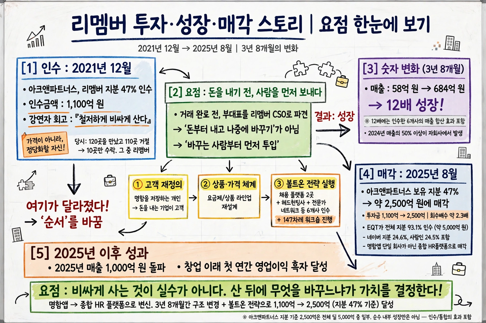
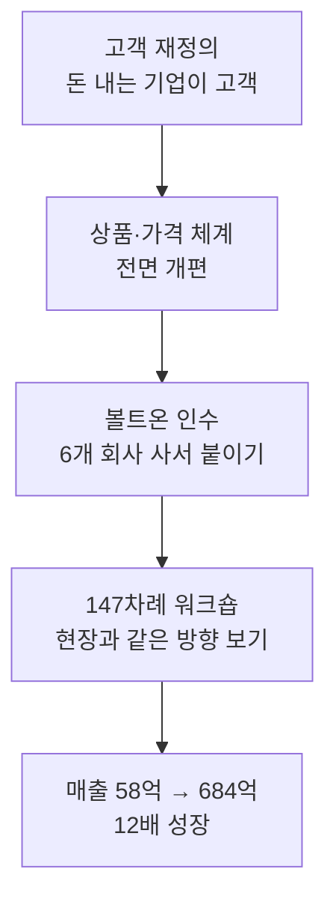
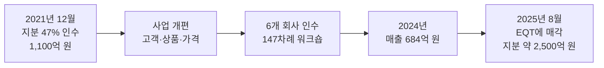
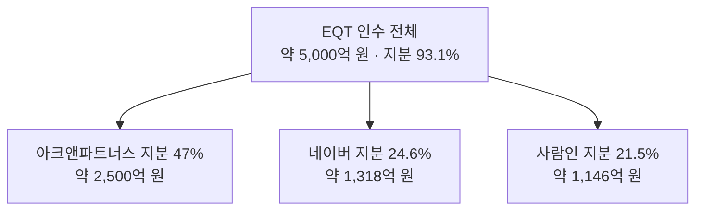

# 리멤버를 1,100억에 사고 2,500억에 팔았습니다. 비싸게 산 게 아니라 비싸게 만든 겁니다

> **Summary**
> 아크앤파트너스는 2021년 리멤버 지분 47%를 1,100억 원에 인수했고, 강연자는 당시를 '철저하게 비싸게 샀다'고 돌아봤습니다. 그런데 3년 8개월 뒤 그 지분은 약 2,500억 원에 팔렸고, 매출은 58억 원에서 684억 원으로 12배가 됐습니다. 비결은 가격이 아니라 순서였습니다. 돈을 내기 전에 사람을 보내 사업부터 바꿨고, 부족한 조각은 6개 회사를 사서 붙였습니다.

---

- 아크앤파트너스는 2021년 리멤버 지분 47%를 1,100억 원에 인수했습니다. 강연자는 당시를 "철저하게 비싸게 샀다"고 돌아봤습니다.
- 그런데 3년 8개월 뒤 그 지분은 약 2,500억 원에 팔렸습니다. 매출은 58억 원에서 684억 원으로 12배가 됐습니다.
- 비결은 가격이 아니라 순서였습니다. 돈을 내기 전에 사람을 보내 사업부터 바꿨습니다.

명함 앱 하나가 5,000억 원짜리 회사가 된다고 하면 믿으시겠어요? 명함 사진 찍어 저장하는 앱, 그게 전부였던 회사가 종합 HR 플랫폼이 돼서 글로벌 사모펀드에 팔렸습니다. 그것도 3년 8개월 만에요.

🎥 [동영상 보기](https://www.youtube.com/watch?v=ZzI6A4AeyN0)

## "철저하게 비싸게 샀다"고요?

강연자의 첫 마디가 이랬습니다. 1,100억 원에 샀는데, 철저하게 비싸게 샀다고요. 보통은 싸게 샀다고 자랑하지 않나요? 그런데 이 고백이 오히려 이야기의 출발점입니다.

첫 펀드를 만들 때 120곳을 만났고, 110곳에서 거절당했습니다. 10곳만 문을 열어줬다는 뜻입니다. 그 10곳 중 하나가 리멤버였습니다. 비싸게 샀다는 말은 가격이 잘못됐다는 뜻이 아닙니다. 가격을 정당화할 자신이 있었다는 뜻에 가깝습니다!

## 돈부터 냈을까요? 사업부터 바꿨을까요?

여기서 순서가 갈립니다. 거래가 끝나기도 전에 부대표를 리멤버 CSO로 보냈습니다. 돈부터 내고 나중에 바꾸는 게 아니라, 바꾸는 사람부터 보낸 겁니다. 이 대목이 저는 가장 인상 깊었습니다. 인수는 서류로 끝나는 게 아니라, 사람이 들어가서야 시작된다는 게 증명되니까요!

바꾼 건 세 가지였습니다. 첫째, 고객을 다시 정의했습니다. 명함을 저장하는 개인이 아니라, 돈을 내는 기업이 고객이 됐습니다. 둘째, 상품과 가격 체계를 전면 개편했습니다. 셋째, 부족한 조각은 사서 붙였습니다. 채용 플랫폼 2곳, 헤드헌팅사, 전문가 네트워크 기업까지 6개 회사를 인수했습니다. 여기에 147차례 워크숍이 따라붙었습니다.

## 12배는 어떻게 나왔을까요?

숫자로 보면 단순합니다. 매출 58억 원이 684억 원이 됐습니다. 12배입니다. 그런데 12배 뒤에는 인수한 회사들의 매출이 합쳐진 효과도 있습니다. 자회사들이 커지면서 그룹 전체가 커진 겁니다. 실제로 2024년 매출의 절반 이상이 자회사에서 나왔다는 분석도 있습니다.

그래서 묻고 싶습니다. 12배가 순수한 성장일까요? 아닙니다. 성장을 사서 붙이고, 붙인 회사를 키우는 방식이었습니다. 이걸 두고 볼트온 전략이라고 부릅니다. 작은 회사를 사서 본체에 붙이면, 본체는 더 커지고, 커진 본체는 다시 다음 회사를 살 수 있습니다. 선순환이 도는 구조입니다!

## 2,500억이면 끝일까요? 이제 시작입니다

매각 이야기는 여기서 한 번 더 커집니다. 강연에서 말한 2,500억 원은 아크앤파트너스가 가진 지분 47%의 값입니다. EQT가 사들인 건 그뿐만이 아니었습니다. 네이버 지분 24.6%, 사람인 지분 21.5%까지 함께 사들여서, 전체 딜 규모는 약 5,000억 원, 지분은 93.1%에 달했습니다. 보도 기준 수치입니다.

그리고 강연 이후에 나온 소식도 있습니다. 리멤버는 2025년 매출 1,000억 원을 넘겼고, 창업 이래 처음으로 연간 영업이익 흑자를 냈습니다. 1,100억 원이 2,500억 원이 됐으니 회수 배수는 2.3배입니다. 첫 펀드에서 110곳에 거절당했던 팀이, 두 번째 펀드는 5,000억 원 규모로 키우고 있습니다.

정직하게 짚을 점도 있습니다. 1,100억 원과 2,500억 원은 강연자가 전한 수치이고, EQT 딜 전체 규모는 보도된 수치입니다. "2,500억 원에 팔았다"는 아크앤파트너스 지분 기준이라는 점을 헷갈리면 안 됩니다. 그리고 12배 성장에는 인수한 회사들의 매출이 합쳐진 몫이 큽니다. 순수한 내부 성장만으로 12배가 난 건 아닙니다.

그런데도 결론은 분명합니다. 비싸게 사는 게 실수가 아닙니다. 산 뒤에 무엇을 바꾸느냐가 가격을 정합니다. 명함 앱을 HR 플랫폼으로 바꾼 3년 8개월, 그 시간이 1,100억 원을 2,500억 원으로 만든 겁니다!

