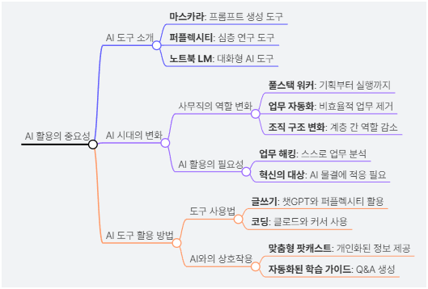

# 마스카라-퍼플렉시티-노트북LM 콤보 ‘나는 왜 AI를 써도 좋은 보고서가 안 나올까?’ (김덕중 Firb AI연구소장)

> **Summary**
> AI 도구인 마스카라, 퍼플렉시티, 노트북 LM을 활용하여 업무 효율성을 극대화할 수 있다. 마스카라는 심층 연구를 위한 프롬프트를 생성하고, 퍼플렉시티는 자동으로 보고서를 작성하며, 노트북 LM은 자료를 통합하고 학습 효과를 높인다. AI 도구의 활용은 직장인의 경쟁력을 강화하고 혁신을 이끌어낼 필수 요소가 된다.

---

🎥 [동영상 보기](https://www.youtube.com/watch?v=Mpk4LNZ_P4c&t=994s)

🔗 [https://lilys.ai/digest/3652502/2275890?s=1&nid=2275890](https://lilys.ai/digest/3652502/2275890?s=1&nid=2275890)

마스카라

[https://month-thousand.tistory.com/12](https://month-thousand.tistory.com/12)

AI 도구를 활용한 업무 혁신: 마스카라, 퍼플렉시티, 노트북 LM 활용 방안 심층 분석

1. 서론: AI 시대, 사무직의 변화와 AI 도구 활용의 중요성
AI 기술의 발전은 사무직의 업무 방식을 근본적으로 변화시키고 있습니다. 과거에는 상상하기 어려웠던 생산성 향상과 업무 효율성 증대가 AI 도구를 통해 현실화되고 있습니다. 김덕중 소장은 링크드인에서 AI 툴 활용 팁을 공유하며 많은 직장인들에게 실질적인 도움을 제공하고 있습니다. AI 도구를 활용하지 못하면 혁신의 대상이 될 수 있다는 점에서, 적극적인 AI 도구 활용은 선택이 아닌 필수가 되었습니다.
1. 마스카라: 프롬프트 생성을 돕는 AI 도구
**마스카라**

는 프롬프트 작성을 어려워하는 사용자를 위해 AI가 프롬프트를 생성해주는 툴입니다.

- 마스카라는 무료로 간단하게 회원 가입 후 사용할 수 있습니다.
- 사용자가 특정 주제에 대해 심층 연구를 하고 싶을 때, 마스카라는 질문을 통해 맥락을 파악합니다.
  - 예를 들어, "미국의 관세 정책으로 인해 국내 제조업이 어떤 영향을 받을지 심층 연구를 하고 싶다"와 같은 질문을 입력할 수 있습니다.
  - 마스카라는 연구 목표, 대상 산업, 예상 독자 등을 상세한 질문을 통해 구체화합니다.
- 마스카라는 사용자의 답변을 바탕으로 심층 연구를 위한 **프롬프트**를 생성합니다.
  - 생성된 프롬프트는 사용자의 요구를 최대한 충족하도록 설계되었습니다.
  - AI는 사용자가 짧게 물어본 내용도 구체화하여 프롬프트로 만들어냅니다.
- 마스카라에서 생성된 프롬프트는 **퍼플렉시티**와 같은 다른 AI 도구에서 활용할 수 있습니다.
  - 마스카라가 업무 지시서 역할을 수행하여, 사용자는 퍼플렉시티에서 원하는 결과를 얻기 위해 특별한 노력을 기울이지 않아도 됩니다.
  - 생성된 프롬프트를 수정하여 특정 요구사항에 맞게 조정할 수도 있습니다.
  - 예를 들어, 특정 청중을 고려하지 않고 개인 학습용으로 사용하고 싶다면 프롬프트를 수정할 수 있습니다.
1. 퍼플렉시티: AI 기반 보고서 작성 도구
| **기능** | **무료 버전** | **유료 버전** |
| 심층 연구 | 하루 5회 시도 가능 | 제한 없음 |
| 링크 정보 | 양질의 링크 제공 | 양질의 링크 제공 |
| PDF 파일 지원 | PDF 파일 내용 분석 및 답변 제공 | PDF 파일 내용 분석 및 답변 제공 |

**퍼플렉시티**

는 AI 기반의 보고서 작성 도구로, 사용자가 입력한 프롬프트에 따라 보고서를 자동으로 생성합니다.

- 퍼플렉시티는 무료 버전과 유료 버전을 제공하며, 무료 버전도 충분히 유용한 기능을 제공합니다.
  - 심층 연구 기능은 하루 5회까지 무료로 사용할 수 있습니다.
  - 기업에서 사무직으로 근무하는 경우, 무료 버전으로도 충분히 좋은 결과를 얻을 수 있습니다.
- 마스카라에서 생성된 프롬프트를 퍼플렉시티에 입력하면, 사용자는 별도의 노력 없이도 보고서를 작성할 수 있습니다.
  - 퍼플렉시티는 프롬프트에 따라 답을 생성하며, 2025년 미국 관세 정책 현황과 같은 최신 정보도 실시간으로 검색하여 보고서에 반영합니다.
  - 퍼플렉시티는 한국어로 질문해도 한국어로 답변을 제공하며, 필요한 경우 영어로 된 프롬프트도 이해하고 한국어로 결과를 출력합니다.
- 퍼플렉시티는 보고서와 함께 **양질의 링크 정보**를 제공합니다.
  - 이 링크들은 보고서 내용의 출처를 제시하며, 사용자는 링크를 통해 추가 정보를 얻을 수 있습니다.
  - 퍼플렉시티는 PDF 파일까지 읽어서 답변을 제공하므로, 사용자는 PDF 파일 내용을 직접 확인하지 않아도 됩니다.
- 퍼플렉시티에서 생성된 보고서는 MS 워드와 같은 문서 편집기에 복사하여 사용할 수 있습니다.
  - 보고서에 포함된 링크 정보는 사용자가 추가 연구를 수행하거나 정보의 신뢰성을 검증하는 데 유용합니다.
  - 퍼플렉시티 보고서와 링크 정보를 **노트북 LM**과 같은 다른 AI 도구와 연계하여 활용하면 더욱 심도 있는 분석이 가능합니다.
1. 노트북 LM: 자료 통합 및 학습 효과 극대화 도구
**노트북 LM**

은 다양한 자료를 통합하고 학습 효과를 극대화하는 데 유용한 도구입니다.

- 노트북 LM은 웹사이트 링크와 PDF 파일을 통합하여 관리하고, AI와 대화하며 학습할 수 있는 환경을 제공합니다.
  - 사용자는 웹사이트 링크와 PDF 파일을 노트북 LM에 추가하여 특정 주제에 대한 정보를 통합할 수 있습니다.
  - PDF 파일을 다운로드하여 첨부할 필요 없이, URL만으로도 PDF 파일 내용을 불러올 수 있습니다.
  - 통합된 정보를 바탕으로 AI와 대화하며 특정 질문에 대한 답변을 얻을 수 있습니다.
- 노트북 LM은 학습 가이드 및 팟캐스트 생성 기능을 제공하여 학습 효과를 높입니다.
  - 사용자는 노트북 LM에 연결된 소스를 기반으로 학습 가이드를 생성하여 Q&A 퀴즈를 만들 수 있습니다.
  - 생성된 퀴즈는 사용자가 내용을 제대로 이해했는지 확인하는 데 유용합니다.
  - 노트북 LM은 팟캐스트 생성 기능을 통해 학습 내용을 음성으로 변환하여 이동 중에도 학습할 수 있도록 지원합니다.
- 노트북 LM은 **크롬 익스텐션**을 통해 웹 브라우징 중에도 쉽게 정보를 수집하고 통합할 수 있도록 지원합니다.
  - 크롬 웹 임포터 익스텐션을 설치하면, 웹 페이지 내용을 드래그 앤 드롭하거나 URL을 복사할 필요 없이 노트북 LM으로 바로 가져올 수 있습니다.
  - 웹 페이지에서 "노트북 웹 임포터"를 클릭하고 원하는 노트를 선택하면 해당 URL이 자동으로 추가됩니다.
1. AI 도구 활용 사례: 업무 효율성 향상 및 학습 혁신
마스카라, 퍼플렉시티, 노트북 LM을 연계하여 활용하면 업무 효율성을 획기적으로 향상시킬 수 있습니다. 예를 들어, 마스카라를 사용하여 심층 연구를 위한 프롬프트를 생성하고, 퍼플렉시티를 통해 보고서를 작성한 후, 노트북 LM을 사용하여 관련 정보를 통합하고 학습하는 방식으로 업무를 진행할 수 있습니다. 멀티미디어를 활용할 수 있는 능력은 AI 시대에 더욱 중요해지고 있으며, 다양한 도구를 통해 정보를 가공하고 활용하는 능력은 학습 효과를 극대화하는 데 기여합니다.
1. 결론: AI 도구 활용의 미래와 직장인의 경쟁력 강화
AI 도구는 앞으로 더욱 발전하여 직장인의 업무 방식을 혁신할 것입니다. 지속적인 학습과 AI 도구 활용 능력 개발은 직장인의 경쟁력 강화에 필수적입니다. AI 도구 활용 능력을 키우고, 자신의 업무에 맞게 AI 도구를 적용하는 것은 AI 시대에 도태되지 않고 혁신의 주체가 되는 방법입니다.
