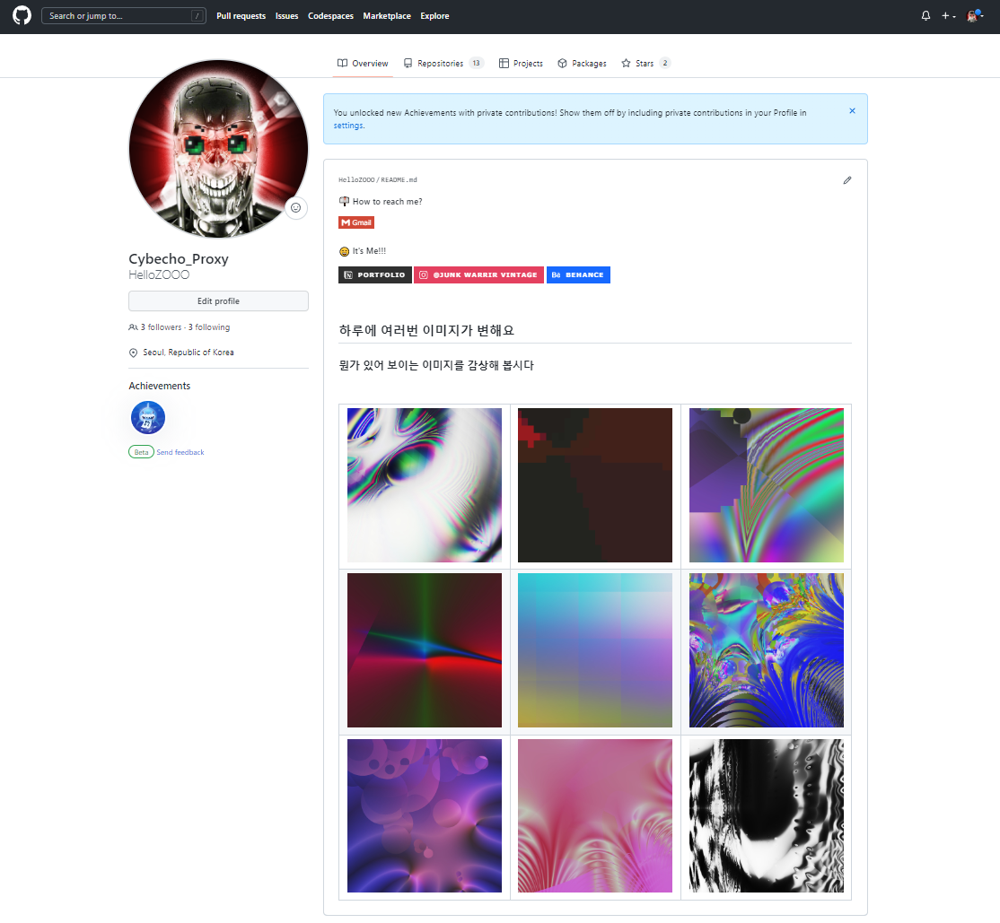
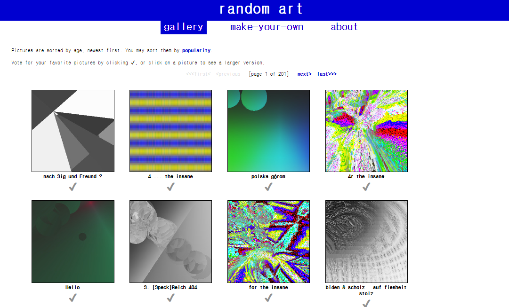
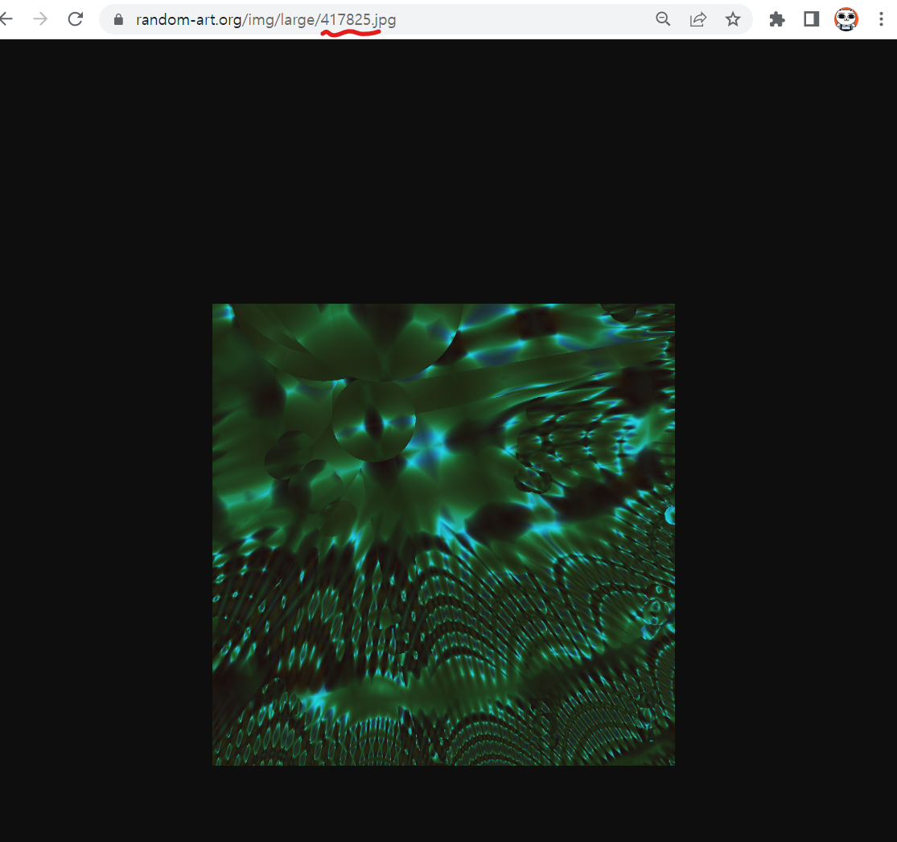
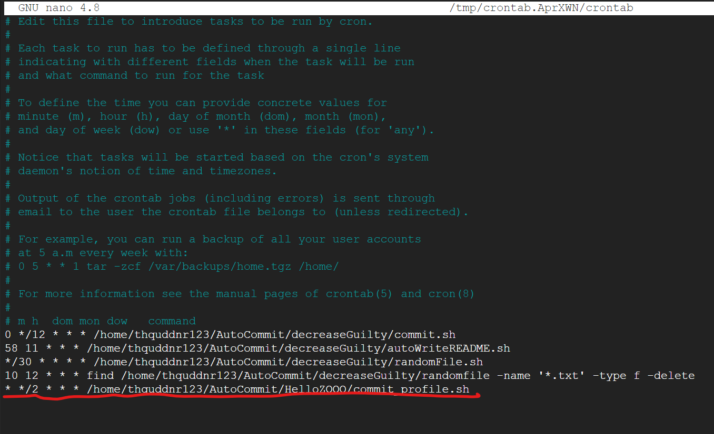
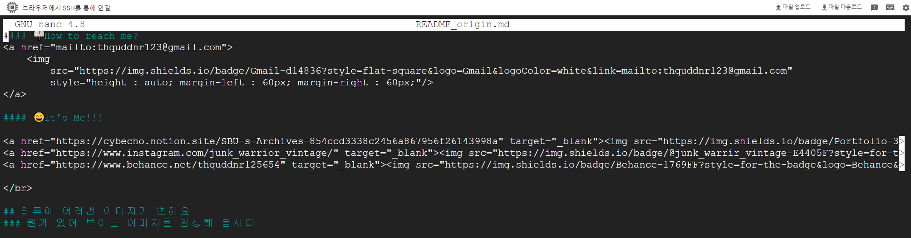
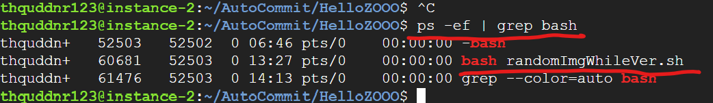

# 매일 변하는 이미지를 git profile 에 임베드하기 1

> **Summary**
> 서버에서 랜덤 이미지를 불러와 git 프로필에 자동으로 커밋하는 방법을 설명합니다. 여러 이미지 소스와 API를 활용하여 이미지를 가져오고, Node.js와 Puppeteer를 사용하여 웹 페이지에서 이미지를 선택하는 스크립트를 작성합니다. 또한, crontab을 통해 주기적으로 커밋을 자동화하는 방법과 while 문을 활용한 스케줄링 방법도 다룹니다.

---




> 📚 **목차**
>

> ⚠️ **[github 커밋 자동화 프로그램](https://app.notion.com/p/de7dbe887e274d6493b646269b476e7d) **
> 위 게시물과 연결되는 내용입니다.
>
> 먼저 이 게시물 먼저 읽고 와주세요.
>
>


기존에 작성했던 커밋 자동화 프로그램은 성능은 참 좋은데 뭔가 시각적으로 아쉬워서, 겉멋 강화버전을 가져왔다.


특정 시간마다 서버에서 이미지url을 불러와 commit

# 1. 랜덤이미지를 가져올 수 있는 사이트들

🔗 [https://picsum.photos/](https://picsum.photos/)

🔗 [https://artsandculture.google.com/](https://artsandculture.google.com/)

🔗 [https://www.random-art.org/](https://www.random-art.org/)


Random art gallery의 작품들이 뭔가 있어보여서 해당 링크 기준으로 작업할겁니다.





다음과 같은 사이트화면이 보일겁니다. make yout own 부분에서 직접 작품을 제작해 업로드할수도 있습니다. 재미있는 사이트네요




아무 이미지나 클릭해서 들어가면 규칙이 일관된 이미지 URL 정보를 확인할 수 있습니다.


URL구조가 가장 단순하여 따로 서버에 요청하여 이미지를 불러오는것이 아니라, 단순하게 shell script 로 난수를 생성하여 랜덤으로 이미지를 불러오는 작업을 할겁니다. 


서버에 js를 깔고 직접 서버에 요청하고싶다면 다음 방법을 참고해주세요 (정리안됨 사실 잘 모름 나도)

<details>
<summary>메모 (API 를 활용한 업데이트 방법)</summary>

🔗 [https://github.com/TimothyYe/bing-wallpaper](https://github.com/TimothyYe/bing-wallpaper)

혹은 Bing Wallpaper API를 활용해 이미지를 저장할 수 있습니다.

1. Bing Wallpaper API를 호출합니다.
1. 반환된 JSON 데이터에서 이미지 URL을 추출합니다.
1. 추출한 이미지 URL을 이용하여 이미지를 다운로드합니다.
1. 다운로드한 이미지를 서버에 저장합니다.

이미지를 저장하는 방법은 다음과 같습니다.

1. Bing Wallpaper 웹 페이지에 접속합니다.
1. 원하는 이미지를 클릭하여 상세 페이지로 이동합니다.
1. 상세 페이지에서 이미지를 다운로드합니다.
1. 다운로드한 이미지를 서버에 저장합니다.

Ubuntu 20 환경에서 웹 페이지의 이미지를 가져오려면 다음과 같이 Node.js와 Puppeteer를 사용할 수 있습니다.


Node.js 설치

Ubuntu에서는 다음 명령어를 사용하여 Node.js를 설치할 수 있습니다.

```shell
sudo apt-get update
sudo apt-get install nodejs
sudo apt update
sudo apt install npm
```


Puppeteer 설치

Puppeteer는 Node.js에서 사용할 수 있는 Headless Chrome API입니다. 다음 명령어를 사용하여 Puppeteer를 설치할 수 있습니다.

```shell
npm install puppeteer
```


JavaScript 코드 작성


Puppeteer를 사용하여 웹 페이지를 로드하고, 해당 이미지 요소를 선택하고, 이미지의 URL을 가져오는 JavaScript 코드를 작성합니다.

```shell
const puppeteer = require('puppeteer');

(async () => {
  const browser = await puppeteer.launch();
  const page = await browser.newPage();
  await page.goto('https://www.random-art.org/?page=1&liked=0&sort=time');
  const imgUrl = await page.evaluate(() => {
    let imgElement = document.querySelector('#content > div.gallery > div:nth-child(9) > a > img');
    return imgElement.src;
  });
  console.log(imgUrl);
  await browser.close();
})();
```


위 코드는 Puppeteer를 사용하여 해당 웹 페이지를 열고, 이미지 요소를 선택한 후, src 속성 값을 가져와서 imgUrl 변수에 저장합니다. 마지막으로 console.log()를 사용하여 imgUrl 값을 출력합니다.


터미널에서 위의 JavaScript 파일을 실행합니다.

```shell
node <파일명>.js
```

위 명령어를 실행하면 해당 웹 페이지의 9번째 이미지 URL이 출력됩니다.


puppeteer 코드의 반환 값을 autoWriteREADME.sh 스크립트에 삽입하려면 다음과 같이 스크립트를 수정하면 됩니다

```shell
#!/bin/bash

# Launch Puppeteer and get the image URL
imgUrl=$(node /path/to/puppeteer-script.js)

# Append the image URL to README.md file
echo "$(date) - $(openssl rand -hex 5) <br/> $imgUrl <br/>" >> /home/thquddnr123/AutoCommit/decreaseGuilty/README.md
```

이 수정된 스크립트에서 node /path/to/puppeteer-script.js 명령은 Puppeteer 스크립트를 시작하고 이미지 URL을 가져오는 데 사용됩니다. $imgUrl 변수는 echo 명령을 사용하여 [README.md](http://readme.md/) 파일에 날짜 및 임의의 문자열과 함께 이미지 URL을 추가하는 데 사용됩니다. >> 연산자는 출력을 파일 끝에 추가하는 데 사용됩니다.

/path/to/puppeteer-script.js를 Puppeteer 스크립트의 실제 경로로 바꾸십시오. 또한 [README.md](http://readme.md/) 파일의 경로를 시스템의 올바른 경로로 바꾸십시오.

</details>


# 2. git clone 으로 README.md 프로필 불러오기

혹시 프로필 README.md 가 생성되지 않으셨다면 다음 글에서 

> Step 01. Repositories 생성 

부분까지만 하고 오시길 바랍니다.

🔗 [https://velog.io/@somm/Github-readme-꾸미기](https://velog.io/@somm/Github-readme-꾸미기)


서버에 접속해줍시다 (전 구글 클라우드 Ubuntu20 환경 사용중)


원하는 디렉토리로 이동하여 다음 코드를 입력해줍시다.

`username` 부분을 당신의 github username으 바꿔주는거 잊지 마세요.

```shell
git clone https://github.com/username/username.git 
```

   

새로운 git 디렉토리기 때문에, 자동으로 커밋해주는 스크립트를 또 생성해줘야합니다.

`cp 복사할파일이름 이동위치`를 이용하여 기존의 [commit.sh](http://commit.sh/) 현재 폴더로 복사해줘도 좋지만, 그냥 새롭게 작성하겠습니다. 


클론한 디렉토리로 이동 후, 스크립트 파일을 만들어주고 git 을 커밋해주는 스크립트를 작성해줍시다.

```shell
nano commit.sh
```

```shell
#!/bin/bash
cd **/input/your/dir**
git add .
git commit -m "Automated commit $(date)"
git push origin main
```


코드를 작성했다면 다음 코드로 커밋이 잘 되는지 확인해주세요

```shell
bash commit.sh
```


커밋이 정상적으로 작동되는것을 확인했다면, `crontab -e` 의 맨 아래에 다음 코드를 입력하여 `commit.sh` 를 스케듈링 해줍시다. 2시간에 한번씩 커밋해주겠다는 의미입니다.
(시간은 자유롭게 설정하셔도 됩니다)

```shell
crontab -e
```

```shell
* */2 * * * **/input/your/dir**/commit_profile.sh
```



`ctrl + x` → `y` → `enter` 를 순로 입력하여 저장하고 `crontab -e` 에서 나옵시다


# 3. README_origin 작성


다음은 유저가 직접 작성한 코드를 보관하는 README_origin.md 파일을 생성할것입니다. README.md 냅두고 이게 뭐하는짓인가 싶으시겠지만, 랜덤으로 이미지를 불러올때마다 본문내용을 전부 삭제하고 새로 파일을 작성하기 때문에, 유저가 따로 마크업언어로 수정한 기본 데이터를 따로 만들어서 README를 새롭게 작성할때마다 유저가 작성한 README_origin.md 를 불러와 유저가 작성한 데이터를 보호할겁니다.


README_origin.md 를 따로 생성해줍시다.

```shell
nano README_origin.md
```

README_origin.md 내부엔 자신의 기존 README.md 를 그대로 복사해주면 됩니다.



마찬가지로 `ctrl + x` → `y` → `enter` 를 순로 입력하여 저장하고 나옵시다.

# 4. While문을 활용한 스케듈링


저번엔 특정 스크립트를 crontab -e 으로 스케듈링하여 실행했다면, 오늘은 그 방법보단 덜 효율적인 while 문을 활용하여 특정 주기마다 한번씩 스크립트를 실행시킬겁니다.


이미지를 불러오는 부분은 웹사이트의 리스트를 랜덤으로 불러오는 코드인데, 네.. 하드코딩입니다. 다음에 웹사이트에서 호출을해서 받아오는 코드로 업그레이드 할 예정입니다.


코드를 짜기 위해 스크립트를 생성해줍니다

```shell
nano randomImgWhileVer.sh
```

그리고 바로 다음 코드를 입력해줍시다

```shell
#!/bin/bash 
source /home/**yourname**/.bashrc 
cd /home/**yourname**/**yourdir**/**yourdir**/ 

while true; do
    # copy origin README 
    cat ./README_origin.md > ./README.md

    # Generate random value and add to URL
    echo "<table>" > ./table.html
    for i in {1..3}; do
        echo "<tr>" >> ./table.html
        for j in {1..3}; do
            rand_num=$(( $RANDOM % 2001 + 415500 ))
            echo "<td></td>" >> ./table.html
        done
        echo "</tr>" >> ./table.html
    done
    echo "</table>" >> ./table.html

    # Paste file info on README.md
    echo " $(echo -e "<br/>") $(cat table.html)" >> ./README.md

    sleep 7200 # 2시간 대기
done
```


백그라운드에서 코드가 돌아야하기 때문에, 커맨드 마지막에 `&` 를 추가해줘야 백그라운드로 구동되면서 다른 코드도 입력할 수 있습니다.

```shell
bash randomImgWhileVer.sh &
```


프로세스가 실행중인것을 확인하는 방법은 다음과 같습니다.

둘 다 프로세스를 확인하는 커맨드입니다.

```shell
ps -ef | grep bash

# 혹은

ps aux | grep randomImgWhileVer.sh
```



다음과 같이 생성한 스크립트 코드가 bash 상태로 프로세스가 실행되어있을경우, while문은 계속 작동하며 README.md 수정할것입니다.


<details>
<summary>나중에 코드를 종료시키고 싶다면, 다음 커맨드를 입력하면 됩니다. (토글열기)</summary>

```shell
**pkill -f** randomImgWhileVer.sh
```

</details>


이제 while문으로 설정한 시간에 따라 이미지를 새롭게 로드하고, crontab -e 에서 스케듈링한 commit에 따라 일정주기마다 이미지가 변할것입니다.


[http://www.lomando.com/pimg/bettyeye.gif](http://www.lomando.com/pimg/bettyeye.gif)

