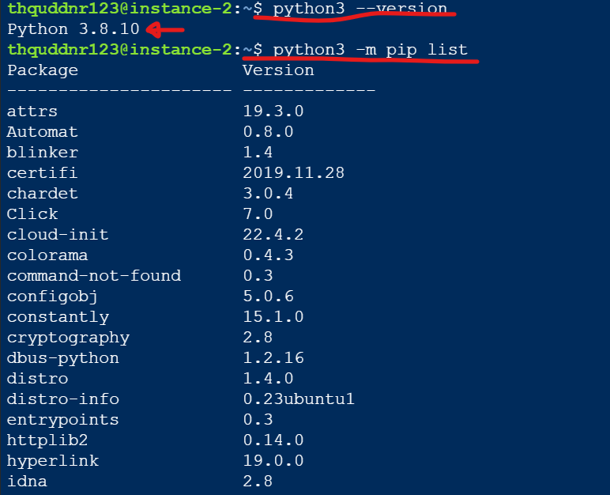
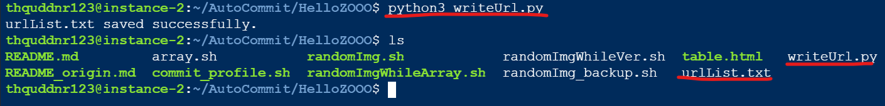
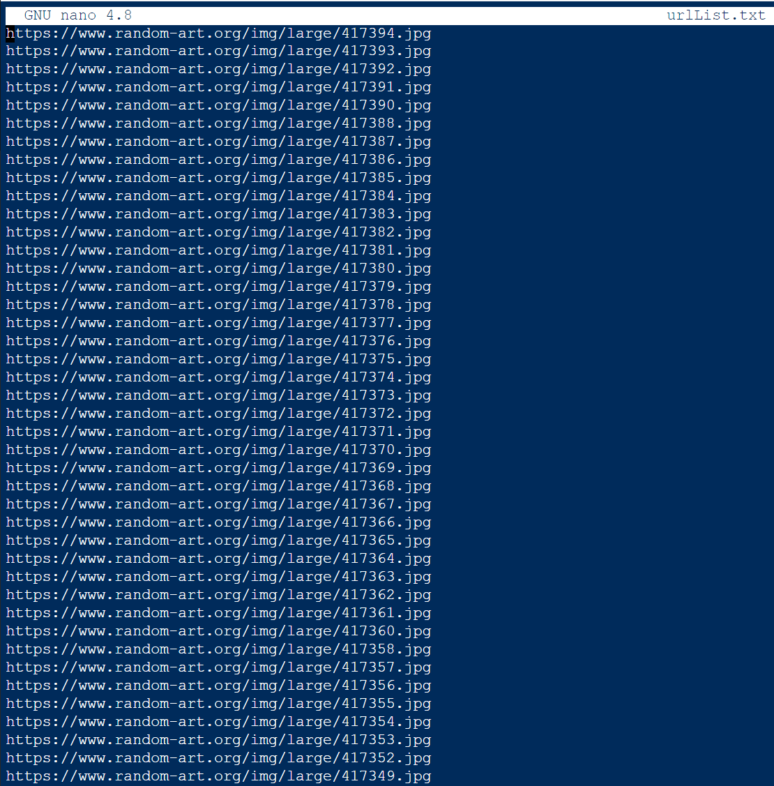

# 매일 변하는 이미지를 git profile 에 임베드하기 2

> **Summary**
> 파이썬을 사용하여 웹사이트에서 이미지 URL을 크롤링하고, 이를 README.md 파일에 임베드하는 방법을 설명합니다. Ubuntu에 파이썬과 pip를 설치하는 과정과 beautifulsoup4 라이브러리를 이용한 이미지 크롤링 코드 작성법, 그리고 crontab을 이용한 스케줄링 방법을 다룹니다. 또한, 이미지 URL을 저장할 때 'small'을 'large'로 변경하는 방법도 포함되어 있습니다.

---


> 📚 **목차**
>

> ⚠️ **[매일 변하는 이미지를 git profile 에 임베드하기 1](https://app.notion.com/p/c2f950c741a8429b9d7bdfc4cc470d67) **
> 위 게시물과 연결되는 내용입니다.
>
> 먼저 이 게시물 먼저 읽고 와주세요.
>
>


# 1. 들어가기 전 코드를 수정하는 이유

기존 코드는 특정한 구간에서 난수를 발생시켜 고정된 주소로 들어가는 시스템이었습니다.

하지만 그러다보니 존재하지 않는 url을 가지는 경우가 많아서, 사이트가 가지고 있는 이미지 url 정보를 기반으로 코드를 업데이트 하고자 합니다.

크롤링할떄 많이 쓰는 beautifulsoup4 를 이용해 웹사이트에서 정보를 크롤링해오고, 그 크롤링정보를 리스트화시켜 [README.md](http://readme.md/) 에 임베드 시킬겁니다.

덤으로 서버환경에서 파이썬을 설치하고 사용하는 방법도 배워볼겁니다.

# 2. 파이썬 Ubuntu에 설치

> 💡 ****ubuntu 20 에 python을 설치하는 방법****
>
> 우선 beautifulsoup4을 쓰기 전에 서버상에 파이썬부터 설치해야겠죠?
>
> Ubuntu 에서 Python 을 설치하는 방법은 아래의 방법 중 하나를 선택하시면 됩니다.
>
>
> <details>
> <summary>소스 코드를 다운로드 받아서 설치하는 방법 (토글 열기)</summary>
>
> ```shell
> wget https://www.python.org/ftp/python/3.11.2/Python-3.11.2.tgz
> tar -xvf Python-3.11.2.tgz
> cd Python-3.11.2/
> ./configure --enable-optimizations
> make -j 4
> sudo make altinstall
>
> ```
>
> </details>
>
> **터미널을열고 아래의 명령어를 입력하여 설치하는 방법 (권장)**
>
> ```shell
> sudo add-apt-repository ppa:deadsnakes/ppa
> sudo apt update
> sudo apt install python3.11
> ```
>
>
> **기본 명령어 파이썬 3.11 로 변경하는 방법**
>
> `nano` 혹은 `vim` 편집기로 터미널 설정을 열어준다
>
> ```shell
> nano ~/.bashrc
> ```
>
> ```shell
> nano ~/.zshrc
> ```
>
> 그리고 맨 아래에 다음 명령어를 추가해준다
>
> ```shell
> alias python="python3.11"
> ```
>
>
> 그리고 다음 명령어로 설정을 적용해준다 (둘 중 하나 사용하는 터미널로)
>
> ```shell
> source ~/.bashrc
> ```
>
> ```shell
> source ~/.zshrc
> ```
>
>
>
> Python 을 설치하실 때 특정 디렉토리에 설치하실 필요는 없습니다. 
>
> 위에서 안내드린 명령어를 입력하시면 자동으로 시스템에 설치됩니다.
>
>

# 3. 파이썬 pip설치

> 💡 ****ubuntu 에서 beautifulsoup4 를 설치하는 방법****
>
> 일단 pip부터 설치합시다
>
> ```shell
> curl -O https://bootstrap.pypa.io/get-pip.py
> python3 get-pip.py --user
> pip install awsebcli --upgrade --user
> ```
>
>
> Ubuntu 20 에서 Python 3.11 을 설치하신 후에는 pip3 를 이용하여 beautifulsoup4 를 설치하실 수 있습니다. 아래의 명령어를 터미널에서 실행해보세요.
>
> ```shell
> sudo apt-get install python3-pip
> sudo pip3 install beautifulsoup4
> sudo pip3 install requests
> ```
>
> 혹은 다음과 같이 진행합니다
>
> ```bash
> python -m pip install beautifulsoup4
> python -m pip install requests
> ```
>
>
> 우분투에 파이썬과 pip를 모두 설치하면 다음 명령어로 설치를 확인해봅시다
>
> ```shell
> python3 --version
> python3 -m pip list
> ```
>
> 
>
>
> <details>
> <summary>ubuntu에서 파이썬을 3.11 을 설치했는데, python3 --version 을 입력하니 python 3.8.10 이 등장하는 이유가 뭘까?</summary>
>
> > 💡 **→. 우분투에서는 기본적으로 python3 명령어를 python 3.8 버전으로 링크하고 있습니다. 따라서 python3 --version 을 입력하면 python 3.8 버전이 출력됩니다.**
> >
> >  → python 3.11 버전을 사용하시려면 그냥 기존과 동일하게 python3.11 명령어를 사용하시면 됩니다.
> >
> >
>
> </details>
>
>
>


# 4. 크롤링 파이썬 코드 작성

> 💡 **웹사이트에서 이미지 정보를 크롤링하기 위해 `writeUrl.py` 를 작성해줍니다**
> ```shell
> nano writeUrl.py
> ```
>
>
> `writeUrl.py`의 소스코드는 다음과 같습니다
>
> ```python
> #writeUrl.py
>
> import random
> import requests
> from bs4 import BeautifulSoup
>
> base_url = 'https://www.random-art.org/?page='
> jpg_urls = []
> pageRange = random.randrange(1,180)
>
> # Loop page contents
> for page in range(pageRange, (pageRange + 5)):  # 랜덤으로 생성된 페이지에서 5개 페이지까지만 포함시킵니다.
>     url = base_url + str(page) + '&liked=0&sort=time'
>     response = requests.get(url)
>     soup = BeautifulSoup(response.content, 'html.parser')
>
>     # Find all img tags with .jpg extension
>     images = soup.find_all('img', src=lambda src: src.endswith('.jpg'))
>
>     # replace "small" string to "large"
>     for img in images:
>         jpg_url = img['src'].replace('/small/', '/large/')
>         jpg_urls.append(jpg_url)
>
> # Save the list of .jpg URLs to a txt file
> with open('urlList.txt', 'w') as file:
>     for url in jpg_urls:
>         file.write('https://www.random-art.org' + url + '\n')
>
> print('urlList.txt saved successfully.')
> ```
>
> 작성한 코드를 실행해보면, 크롤링이 시작되며 크롤링이 종료되면 urlList.txt가 정상적으로 생성되는것을 알 수 있습니다.
>
>
> 새로 생성된 urlList.txt 를 확인하면 정상적으로 url을 불러온것을 알 수 있습니다.
>
> 
>
> 
>
>
> > 💡 **`chmod +x` 권한부여 항상 잊지말아요**
>
> `writeUrl.py`를 `crontab -e` 으로 스케듈링하여 관리할 것이기 때문에 `chmod` 로 권한을 부여하도록 합니다. 
>
> `ls -l` 을 입력해 권한이 제대로 `-rwxrwxr-x` 상태인지 확인해줍시다.
>
> ```shell
> chmod +x writeUrl.py
> ```
>
>
> 그리고 `crontab -e` 을 입력해 [`writeUrl.py`](http://writeurl.py/) 를 스케듈링해봅시다.
>
>
>


> 💡 **기존 코드` randomImg.sh `수정**
> `writeUrl.py` 에서 생성한 ` imgList.txt` 를 불러와 줄바꿈을 기준으로 배열을 만들고
>
> 그 배열을 `shuf`으로 섞어서 img src에 섞인 이미지가 삽입되도록 합니다.
>
> 고로 기존 `randomImg.sh` 에서 무작위로 난수를 생성하여 url을 수정하고자합니다.
>
>
> 또 이전 게시물이었던
> [매일 변하는 이미지를 git profile 에 임베드하기 1](https://app.notion.com/p/c2f950c741a8429b9d7bdfc4cc470d67) 
>
> 에서는 `randomImg.sh` 를 while문과 sleep을 이용해 이미지를 랜덤하게 일정 주기마다 불러왔는데, 개선버전인만큼 crontab 을 이용해 코드를 스케듈링 하고자 합니다.
>
> while과 sleep 으로 이루어진 매크로 코드도 사용할만은 하지만, 매번 pkill 로 종료하고 실행하는 과정이 번거롭기 때문입니다.
>
>
> 위 두가지 이유로 기존 `randomImg.sh` 코드를 다음과 같이 수정합니다
>
> ```shell
> #!/bin/bash
> source /home/thquddnr123/.bashrc
> cd /home/thquddnr123/AutoCommit/HelloZOOO/
>
> **realtimeUrls=($(cat ./imgList.txt))
>
> sh_realtimeUrls=($(shuf -e "${realtimeUrls[@]}"))
> indx=0**
>
> # copy origin README 
> cat ./README_origin.md > ./README.md
>
> # Generate random value and add to URL
>     echo "<table>" > ./table.html
>     for i in {1..3}; do
> 	echo "<tr>" >> ./table.html
>         for j in {1..3}; do
>             echo "<td><a href=''></a></td>" >> ./table.html
>             indx=$((indx+1))
>         done
>         echo "</tr>" >> ./table.html
>     done
>      echo "</table>" >> ./table.html
>
> # Paste file info on README.md
> echo "  $(echo -e '<br/>') $(cat ./table.html)" >> ./README.md
> ```
>
> ctrl + x 누르고 저장하고 나옵시다
>
>
> <details>
> <summary>.txt 파일을 줄바꿈을 기준으로 .txt 내부의 요소들을 배열로 선언한 방법. 
> (궁금하면 토글 펼치쇼)</summary>
>
> ```shell
> array=($(cat file.txt))
> ```
>
> ```shell
> for element in "${array[@]}"
> do
>     echo $element
> done
> ```
>
> ```shell
> #!/bin/bash
> source /home/thquddnr123/.bashrc
> cd /home/thquddnr123/AutoCommit/test/
>
> array=($(cat ./test.txt))
>
> for element in "${array[@]}"
> do
>     echo $element
> done
> ```
>
> </details>
>
>
> 그리고 스케듈링도 다음 명령어를 입력하고, 에디터에 아래 코드를 입력해줍시다.
>
> 디렉토리는 제 기준이기때문에 각자 스크립트파일과 파이썬파일이 존재하는 디렉토리로 설정하시길 바랍니다.
>
> 자신의 디렉토리 확인 방법은 `pwd` 명령어를 입력하면 됩니다.
>
> ```shell
> crontab -e
> ```
>
> ```bash
> */30 * * * * /home/thquddnr123/AutoCommit/HelloZOOO/randomImg.sh
> * */6 * * * cd /home/thquddnr123/AutoCommit/HelloZOOO && /usr/bin/python3 writeUrl.py
> ```
>
>

<details>
<summary>AI도움!</summary>

> 💡 **[https://www.random-art.org/](https://www.random-art.org/) 이 웹사이트에 .jpg 가 포함된 url을 전부 리스트로 가져오는 방법**
> Beautiful Soup 또는 Scrapy와 같은 웹 스크래핑 도구를 사용하여 웹사이트 [https://www.random-art.org/에서](https://www.random-art.org/%EC%97%90%EC%84%9C) .jpg 확장자를 가진 모든 URL을 추출할 수 있습니다. 다음은 Python에서 Beautiful Soup을 사용하는 예제 코드입니다.
>
> ```python
> import requests
> from bs4 import BeautifulSoup
>
> url = "https://www.random-art.org/"
>
> response = requests.get(url)
> soup = BeautifulSoup(response.content, 'html.parser')
>
> for link in soup.find_all('a'):
>     href = link.get('href')
>     if href.endswith('.jpg'):
>         print(href)
> ```
>
>
> 이 코드는 웹사이트에 GET 요청을 보낸 다음 Beautiful Soup을 사용하여 HTML 응답에서 모든 앵커 태그(<a>)를 추출합니다. 각 앵커 태그에 대해 href 속성이 '.jpg'로 끝나는지 확인하고 그럴 경우 URL을 인쇄합니다.
>
>

> 💡 **[https://www.random-art.org/?page=1&liked=0&sort=time](https://www.random-art.org/?page=1&liked=0&sort=time) 이 사이트의 모든 페이지에 포함된 모든 .jpg URL을 나열하는 방법입니다.**
> ```python
> import requests
> from bs4 import BeautifulSoup
>
> base_url = 'https://www.random-art.org/?page='
> jpg_urls = []
>
> # Loop through all pages
> for page in range(1, 10):  # Change 10 to the number of pages you want to scrape
>     url = base_url + str(page) + '&liked=0&sort=time'
>     response = requests.get(url)
>     soup = BeautifulSoup(response.content, 'html.parser')
>
>     # Find all img tags with .jpg extension
>     images = soup.find_all('img', src=lambda src: src.endswith('.jpg'))
>
>     # Extract the URLs and append to the list
>     for img in images:
>         jpg_urls.append(img['src'])
>
> # Print the list of .jpg URLs
> print(jpg_urls)
> ```
>
> 이 코드는 URL의 페이지 번호를 변경하여 웹 사이트 페이지를 순환한 다음 BeautifulSoup을 사용하여 페이지 소스에서 .jpg 확장자를 가진 img 태그를 모두 찾습니다. 이러한 이미지의 URL이 추출되어 목록에 추가됩니다. 마지막으로 모든 .jpg URL 목록이 인쇄됩니다. 코드는 처음 9페이지만 스크랩합니다. for 루프에서 range 매개변수를 변경하여 스크랩할 페이지 수를 변경할 수 있습니다.
>
>

> 💡 **텍스트가 저장될때마다 문자열 앞에 [https://www.random-art.org](https://www.random-art.org/) 가 포함된 상태로 .txt에 저장되었으면 좋겠습니다.**
> ```python
> import requests
> from bs4 import BeautifulSoup
>
> base_url = 'https://www.random-art.org/?page='
> jpg_urls = []
>
> # Loop through all pages
> for page in range(1, 5):  # Change 10 to the number of pages you want to scrape
>     url = base_url + str(page) + '&liked=0&sort=time'
>     response = requests.get(url)
>     soup = BeautifulSoup(response.content, 'html.parser')
>
>     # Find all img tags with .jpg extension
>     images = soup.find_all('img', src=lambda src: src.endswith('.jpg'))
>
>     # Extract the URLs and append to the list
>     for img in images:
>         jpg_urls.append('https://www.random-art.org/' + img['src'])
>
> # Save the list of .jpg URLs to a text file
> with open('random-art-urls.txt', 'w') as f:
>     f.write('\n'.join(jpg_urls))
> ```
>
> 하지만 지금은 [https://www.random-art.org/img/small/417864.jpg](https://www.random-art.org/img/small/417864.jpg) 형식으로 txt에 저장됩니다. 저는 small이라는 글자를 large로 변경한 상태로 txt파일에 저장하고싶습니다.
>
> ```python
> import requests
> from bs4 import BeautifulSoup
>
> base_url = 'https://www.random-art.org/?page='
> jpg_urls = []
>
> # Loop through all pages
> for page in range(1, 5):  # Change 10 to the number of pages you want to scrape
>     url = base_url + str(page) + '&liked=0&sort=time'
>     response = requests.get(url)
>     soup = BeautifulSoup(response.content, 'html.parser')
>
>     # Find all img tags with .jpg extension
>     images = soup.find_all('img', src=lambda src: src.endswith('.jpg'))
>
>     # Extract the URLs, replace "small" with "large", and append to the list
>     for img in images:
>         jpg_url = img['src'].replace('/small/', '/large/')
>         jpg_urls.append(jpg_url)
>
> # Save the list of .jpg URLs to a txt file
> with open('random-art-large.txt', 'w') as file:
>     for url in jpg_urls:
>         file.write('https://www.random-art.org' + url + '\n')
>
> print('File saved successfully.')
> ```
>
>

> 💡 **crontab -e에서 py 파일 실행이 안됩니다**
> cron을 통해 예약할 때 스크립트가 올바르게 실행되지 않는 몇 가지 이유가 있을 수 있습니다.
>
> Cron이 Python 인터프리터를 찾지 못할 수 있습니다. 스크립트 명령 앞에 crontab 파일에서 Python 인터프리터의 전체 경로를 추가합니다. 
>
> `→ 예: /usr/bin/python3 /home/thquddnr123/AutoCommit/HelloZOOO/writeUrl.py`
> 작업 디렉토리가 올바르게 설정되지 않았을 수 있습니다. Cron이 수동으로 실행한 동일한 디렉토리에서 스크립트를 실행하지 않을 수 있습니다. 이 문제를 해결하려면 crontab 파일에서 스크립트의 작업 디렉토리를 지정하십시오. 
>
> `→ 예: * 7 * * * cd /home/thquddnr123/AutoCommit/HelloZOOO && /usr/bin/python3 writeUrl.py`
>
>
> 스크립트가 자동으로 실패할 수 있습니다. 표준 출력 및 오류를 파일로 리디렉션하여 오류를 디버깅합니다. 
>
> `→ 예: * 7 * * * cd /home/thquddnr123/AutoCommit/HelloZOOO && /usr/bin/python3 writeUrl.py >> /tmp/writeUrl.log 2>&1`
>
>
>

</details>

