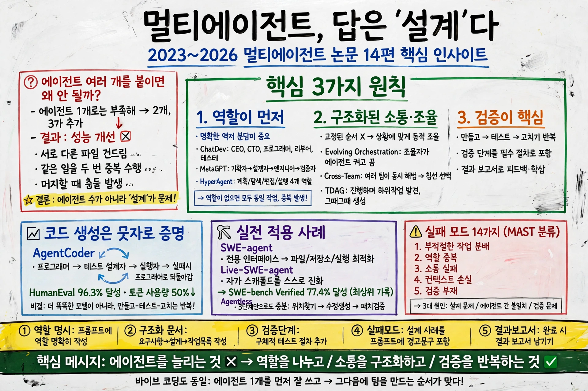
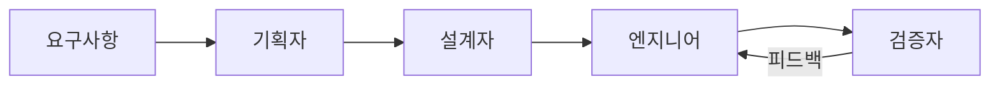
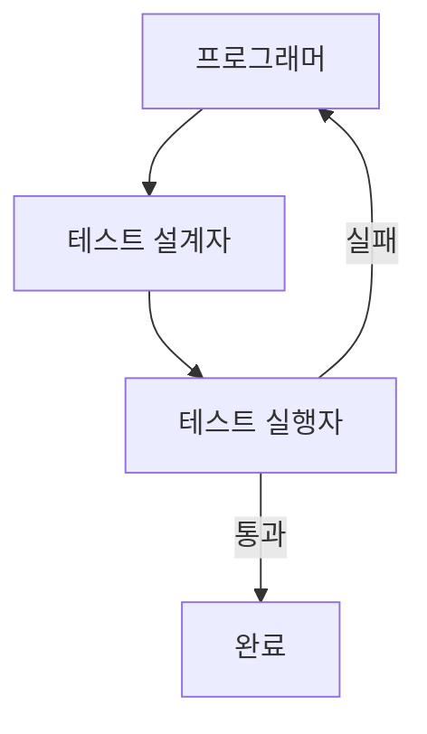
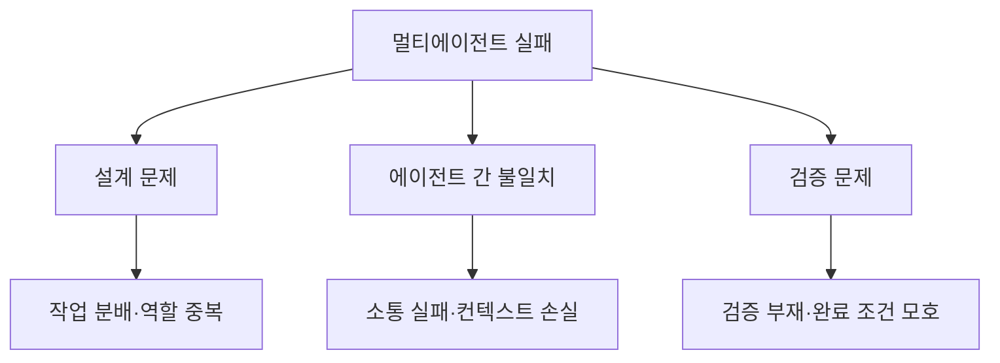

# 멀티에이전트 논문 14편, 에이전트 수가 아니라 역할과 검증이 답이다

> **Summary**
> 멀티에이전트 성능은 에이전트 수보다 명확한 역할 분담, 구조화된 소통, 반복적인 검증에 좌우됩니다. 코드 생성과 소프트웨어 엔지니어링 사례는 테스트와 피드백의 효과를 보여주며, 파일 소유권과 고유한 목표를 정하고 작업에 필요한 만큼만 조율하는 것이 중요합니다.

---

- 2023~2026년 멀티에이전트 논문 14편을 정리했더니, 답은 하나였습니다.
- 에이전트를 많이 붙이는 게 아니라, 역할·구조화된 소통·검증이 성능을 가릅니다.
- 코드 생성은 AgentCoder가 HumanEval 96.3%, 자기 진화 에이전트는 SWE-bench 77.4%를 기록했습니다.

## 에이전트 여러 개를 붙이면 왜 안 될까요?

바이브 코딩으로 기능을 만들다 보면 이런 순간이 있습니다. 에이전트 한 개로는 부족한 것 같아서, 두 개, 세 개를 붙여봅니다. 그런데 결과는 더 좋아지지 않습니다. 오히려 서로 다른 파일을 건드리고, 같은 일을 두 번 하고, 머지할 때 충돌이 납니다. 왜 그럴까요? 2023년부터 2026년까지 나온 멀티에이전트 논문 14편을 정리한 문서가 그 답을 보여줬습니다. 결론부터 말하면, 에이전트 수가 아니라 설계가 문제였습니다!

🎥 [동영상 보기](https://www.youtube.com/watch?v=QmkDvhwWOXQ)

## 역할이 먼저입니다

가장 먼저 눈에 띈 건 역할이었습니다. ChatDev는 가상 소프트웨어 회사를 만듭니다. CEO, CTO, 프로그래머, 리뷰어, 테스터, 디자이너가 대화로 일합니다. 설계, 코딩, 테스팅, 문서화 4단계를 순서대로 돕니다. MetaGPT는 같은 일을 문서로 합니다. 기획자가 요구사항 문서를 쓰고, 설계자가 시스템 설계서를 쓰고, 엔지니어가 코드를 씁니다. 조립 라인처럼요. HyperAgent는 4개 역할로 줄였습니다. 계획, 탐색, 편집, 실행. 역할이 명확하면 에이전트는 자기 일만 합니다. 역할이 없으면 다들 같은 일을 합니다. 이게 첫 번째 교훈입니다!

## 오케스트레이션은 어떻게 조율할까요?

역할을 정했으면, 다음은 조율입니다. Evolving Orchestration은 조율자를 강화학습으로 학습시킵니다. Puppeteer라는 조율자가 작업 상태에 따라 에이전트를 켜고 끕니다. 고정된 순서가 아니라, 상황에 맞는 순서를 만드는 겁니다. Cross-Team은 정반대 접근입니다. 여러 팀이 동시에 다른 해법을 만들고, 서로의 결과를 교환해서 가장 좋은 것을 고릅니다. AgentOrchestra는 도구·환경·에이전트를 각각 일급 자원으로 관리하고, GAIA 벤치마크에서 89.04%를 기록했습니다. TDAG는 작업을 미리 나누지 않습니다. 진행하면서 하위 작업을 발견하고, 그때그때 맞는 에이전트를 새로 만듭니다. 조율 방식은 달라도, 공통점은 하나입니다. 정해진 순서가 아니라 상황에 따라 바뀌는 구조가 이긴다는 겁니다.

## 코드 생성은 숫자로 증명됐습니다

코드 생성 분야는 숫자가 가장 분명합니다. MapCoder는 검색, 계획, 코딩, 디버깅 4단계를 돌면서 HumanEval 93.9%를 기록했습니다. AgentCoder는 더 단순합니다. 프로그래머가 코드를 만들고, 테스트 설계자가 테스트를 만들고, 실행자가 돌립니다. 실패하면 다시 프로그래머에게 돌아갑니다. 이 반복만으로 HumanEval 96.3%, 토큰은 절반 이하로 줄었습니다. 코드가 좋아진 비결은 더 똑똑한 모델이 아니었습니다. 만들고, 테스트하고, 고치는 반복이었습니다!

## 실전에서는요?

실전 소프트웨어 엔지니어링에서는 SWE-agent가 출발점입니다. 핵심 통찰은 에이전트에게 인간용 UI가 아니라 전용 인터페이스가 필요하다는 겁니다. 파일 생성, 저장소 탐색, 프로그램 실행에 최적화된 인터페이스를 주면 성능이 달라집니다. Live-SWE-agent는 한 걸음 더 나아갑니다. 기본적인 도구만 가진 채로 시작해서, 문제를 풀면서 자기 스캐폴드를 스스로 진화시킵니다. 결과는 SWE-bench Verified 77.4%입니다. 독점 솔루션까지 포함한 전체 에이전트 중 최고 기록입니다. 자기 스캐폴드를 스스로 진화시킨다는 대목에서 저는 잠깐 멈췄습니다. 에이전트가 도구를 배우는 게 아니라, 자기 일하는 방식을 고친다는 거니까요. 그런데 Agentless는 반대쪽을 보여줍니다. 위치 찾기, 수정 생성, 패치 검증 3단계만으로 충분한 경우도 많다는 겁니다. 모든 작업에 복잡한 오케스트레이션이 필요한 건 아닙니다. 이 판단이 중요하다는 게, 이 문서가 주는 또 하나의 메시지였습니다.

## 실패는 왜 일어날까요?

실패 분석도 있습니다. MAST는 7개 프레임워크에서 1,600개가 넘는 실행 기록을 모아 14가지 실패 모드로 분류했습니다. 부적절한 작업 분배, 역할 중복, 소통 실패, 컨텍스트 손실, 검증 부재. 세 가지 큰 갈래로 묶입니다. 설계 문제, 에이전트 간 불일치, 검증 문제. 그런데 이걸 알면 방어가 가능합니다. 파일 소유권을 명확히 나누고, 각 에이전트에 고유한 목표를 주고, 검증 단계를 프롬프트에 필수로 넣는 겁니다. 실패를 아는 게 곧 설계가 됩니다!

## 그래서 뭘 가져가면 될까요?

이 문서가 정리한 적용 아이디어는 열 가지입니다. 당장 쓸 수 있는 것부터 정리하면 이렇습니다. 첫째, 에이전트 프롬프트에 명시적인 역할을 적습니다. 둘째, 계획 산출물을 구조화된 문서로 만듭니다. 요구사항, 설계, 작업 목록 순서로요. 셋째, 검증 단계를 구체적인 테스트 절차로 바꿉니다. 넷째, 실패 모드를 경고 문구로 프롬프트에 넣습니다. 다섯째, 에이전트가 끝나면 결과 보고서를 남기게 합니다. 중기적으로는 교차 검증과 동적 재할당, 장기적으로는 자기 진화하는 조율자가 나옵니다. 한 번에 다 할 필요는 없습니다. 역할부터, 검증부터, 하나씩 붙이면 됩니다.

14편의 논문이 가리키는 방향은 분명합니다. 에이전트를 늘리는 게 아니라, 역할을 나누고, 소통을 구조화하고, 검증을 반복하는 겁니다. 바이브 코딩도 마찬가지입니다. 에이전트 한 개를 잘 쓰는 것부터, 그다음에 팀을 만드는 순서가 맞습니다!

