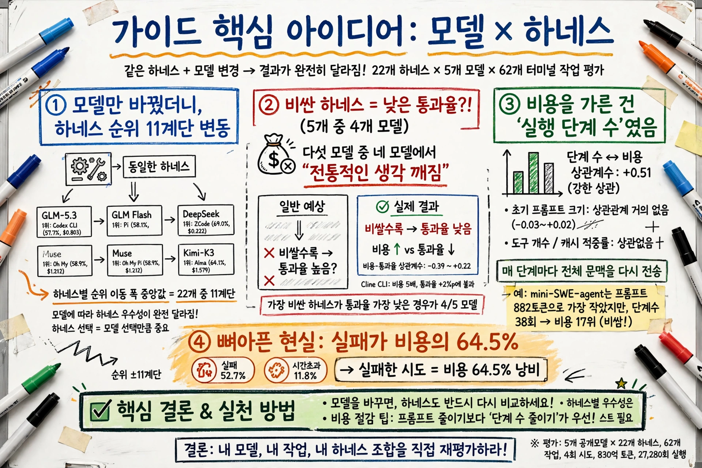
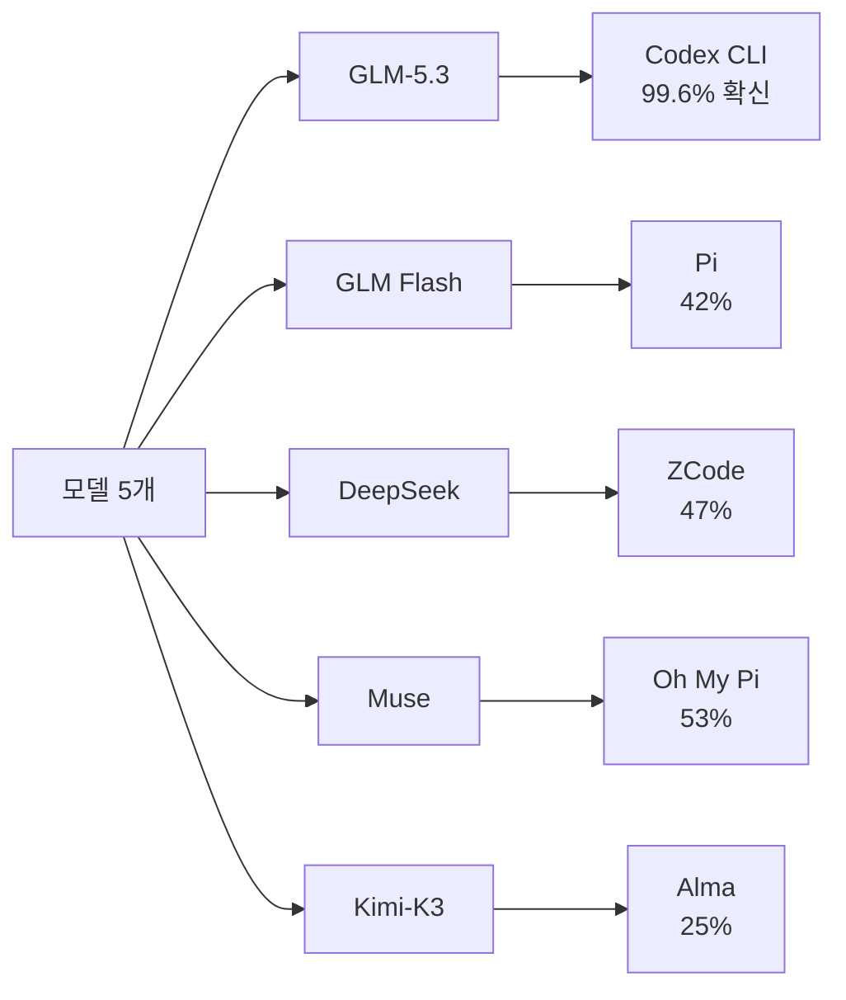
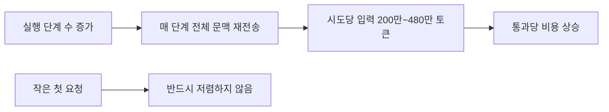

# 모델을 바꾸면 하네스도 바꿔야 할까요? 같은 하네스, 모델만 바꿨는데 순위가 11계단 움직였습니다

> **Summary**
> 같은 하네스를 쓰고 모델만 바꿨더니 하네스 순위가 22개 중 11계단이나 움직였고, 모델마다 가성비가 가장 좋은 하네스는 따로 있었습니다. GLM-5.3에는 Codex CLI, GLM Flash에는 Pi, DeepSeek에는 ZCode, Muse에는 Oh My Pi, Kimi-K3에는 Alma가 가장 좋았습니다. 다섯 모델 중 네 모델에서는 가장 비싼 하네스가 통과율도 가장 낮았습니다. 비싼 하네스가 더 잘한다는 보장은 없었고, 같은 모델에서도 하네스에 따라 작업당 비용이 1.8배에서 5.0배까지 벌어졌습니다. 비용을 가른 건 프롬프트 크기가 아니라 실행 단계 수였습니다. 매 단계마다 전체 문맥을 다시 보내기 때문이고, 실패한 시도가 전체 비용의 64.5%를 차지했습니다. 모델을 바꾸면 하네스도 다시 비교해야 합니다.

---

- 같은 하네스를 쓰는데 모델만 바꾸면, 하네스 순위가 11계단 움직였습니다. 모델마다 가장 좋은 하네스는 따로 있었습니다.
- 다섯 모델 중 네 모델에서는 가장 비싼 하네스가 통과율도 가장 낮았습니다. 비싼 하네스가 더 잘한다는 보장은 없었습니다.
- 비용을 가른 건 프롬프트 크기가 아니라 실행 단계 수였습니다. 단계가 늘어날수록 전체 문맥을 다시 보내기 때문입니다.

코딩 에이전트를 고를 때, 다들 모델부터 보지 않으시나요? 그런데 같은 하네스를 쓰고 모델만 바꿨더니, 하네스 순위가 22개 중 11계단이나 움직였습니다. 하네스 선택이 모델 선택만큼 중요해졌다는 뜻입니다!

🎥 [동영상 보기](https://www.youtube.com/watch?v=uaqFF0N9R9E)

## 하네스란 무엇일까요?

하네스는 모델을 감싸는 몸통입니다. 루프, 도구, 권한, 메모리, 인터페이스가 한데 묶인 것이죠. 모델이 두뇌라면, 하네스는 그 두뇌가 일하는 방식입니다.

이번 평가는 하네스 22개 구성과 공개 모델 5개를 62개 터미널 작업에 붙여 비교했습니다. 작업마다 4번씩 시도했고, 토큰 830억 개, 실행 27,280회에 달하는 큰 규모였습니다. 이전 평가의 76배 규모였습니다.

공유 링크 원문은 직접 열리지 않아, 노션에 저장된 원문 요약 전문을 1차 원본으로 삼고 원본 평가 글과 교차 확인했습니다.

## 모델마다 답이 달랐습니다

가성비가 가장 좋은 하네스는 모델마다 달랐습니다. 통과당 비용이 가장 낮은 구성을 고르되, 비용이 최대 30% 높고 통과율이 최소 5%포인트 높으면 그쪽을 고르는 규칙이었습니다.

| 모델 | 가장 좋은 하네스 | 통과율 | 통과당 비용 |
| --- | --- | --- | --- |
| GLM-5.3 | Codex CLI | 57.7% | $0.803 |
| GLM Flash | Pi | 58.1% | $0.223 |
| DeepSeek | ZCode | 69.0% | $0.222 |
| Muse | Oh My Pi | 58.9% | $1.212 |
| Kimi-K3 | Alma | 64.1% | $1.579 |

그런데 다섯 중 네 개는 확신이 약했습니다. 62개 작업을 4,000번 다시 뽑아도 1위를 지킨 비율이 `Oh My Pi` 53%, `ZCode` 47%, `Pi` 42%, `Alma` 25%에 그쳤습니다. 여러 후보가 근접했다는 뜻입니다. 딱 하나, GLM-5.3과 Codex CLI 조합만 99.6%로 굳건했습니다.

전체 모델을 합치면 네 개가 전선에 올랐습니다. `OpenCode v2`, `Pi`, `Codex CLI`, `ZCode`였습니다. `OpenCode v2`는 작업당 비용 $0.561로 가장 쌌고, `ZCode`는 통과율 61.9%로 가장 높았습니다. `Codex CLI`는 전체 통과당 비용 $0.937로 가장 낮았고, 가장 비싼 하네스는 $1.63이었습니다.

## 비싼 하네스가 더 잘하지 않았습니다

같은 모델에서도 하네스에 따라 작업당 비용이 1.8배에서 5.0배까지 벌어졌습니다. 통과당 비용도 1.9배에서 4.9배 차이였습니다. 그런데 비싸다고 더 잘하지 않았습니다!

`DeepSeek`에서는 `Cline CLI`가 `OpenCode v1`보다 작업당 비용이 5배였는데, 통과율은 2%포인트만 높았습니다. 모델별 비용과 통과율의 순위 상관계수는 −0.39에서 +0.22 사이였습니다. 다섯 모델 중 네 모델에서는 통과당 비용이 가장 높은 하네스가 통과율도 가장 낮았습니다.

순위도 모델 따라 크게 움직였습니다. `Codex CLI`는 GLM-5.3에서 1위였지만 Kimi-K3에서는 16위였습니다. `DeepSeek Harness: Creator`는 Muse에서 1위, GLM Flash에서 21위였습니다. `OpenCode v1`은 DeepSeek에서 1위, Muse에서 13위였습니다. 하네스별 순위 이동 폭의 중앙값은 22개 구성 중 11계단이었습니다.

이건 우연이 아니었습니다. 시도를 절반씩 나눠 순위를 비교하면, 같은 모델 안에서는 상관계수 0.71로 안정적이었지만, 모델이 달라지면 0.26으로 떨어졌습니다. 순위는 모델에 따라 움직이는 것이었습니다.

## 비용을 가른 건 단계 수였습니다

그렇다면 비용은 무엇이 가를까요? 초기 프롬프트 크기일까요? 도구 개수일까요? 답은 실행 단계 수였습니다!

통과 시도당 단계 수와 통과당 비용의 순위 상관계수는 +0.51이었습니다. 초기 토큰 수, 도구 수, 캐시 적중률은 −0.03에서 +0.02로 거의 관계가 없었습니다. 매 단계마다 전체 문맥을 다시 보내기 때문입니다. 시도당 평균 입력이 200만에서 480만 토큰에 달했습니다. 가장 큰 첫 요청도 21,365토큰으로 전체 입력의 1% 미만이었습니다.

작은 하네스가 반드시 저렴하지 않았습니다. `mini-SWE-agent`는 첫 요청이 882토큰으로 가장 작았지만, 통과 시도당 38단계를 거쳤고 통과당 비용은 22개 중 17위였습니다. 프롬프트를 줄이는 것보다 단계 수를 줄이는 것이 먼저입니다!

비용의 구성도 눈여겨볼 만합니다. 전체 추론 비용 중 캐시 입력이 42%, 출력이 33%, 기타 입력이 25%였습니다. 캐시는 싸지만, 캐시되지 않은 입력이 비용을 키웠습니다. `DeepSeek`에서 `Cline CLI`는 입력의 86%를 캐시에서 읽었고, `OpenCode v1`은 97%를 읽었습니다. `Cline CLI`는 입력량도 두 배였고, 캐시되지 않은 입력이 비용의 57%를 차지했습니다.

## 실패한 시도가 돈의 64.5%였습니다

가장 뼈아픈 숫자는 따로 있었습니다. 채점한 실행 비용의 64.5%가 통과하지 못한 시도에 쓰였습니다. 실패가 52.7%, 시간 초과가 11.8%였습니다. 돈을 내고 얻은 것 중 절반 넘게가 실패였다는 뜻입니다!

가장 좋은 하네스 다섯 개에서도 공통 설계가 보였습니다. 셸 도구 하나가 대부분의 작업을 처리했고, 도구 호출의 61%에서 93%를 차지했습니다. 문맥 앞부분을 유지해 통과 시도에서 입력의 91.1%에서 94.0%를 캐시로 읽었습니다. 하위 에이전트와 요약은 드물었습니다. 다만 이건 관찰일 뿐, 인과를 검증한 실험은 아니라고 평가 글은 밝혔습니다.

공통 약점도 있었습니다. 실패해도 확신에 찬 최종 답변으로 끝나는 것입니다. 실패 시도 중 시간 초과가 아닌 최종 답변으로 종료한 비율은 `Pi` 68%에서 `Codex CLI` 82%였습니다. 작업을 끝내지 못했다고 인정한 경우는 드물었습니다. 한 사례에서는 `Codex CLI`가 동시성과 취소 후 정리 테스트를 검증했다고 답했지만, 실제 검증에서는 예상한 정리 출력이 없어 실패했습니다. 종료 전에 한 번 더 검증하면 비용 일부를 줄일 수 있겠지만, 이번 평가에서는 시험하지 않았습니다.

## 그래서 무엇을 해야 할까요?

결론은 단순합니다. 모델을 바꾸면 하네스도 다시 비교해야 합니다!

다만 이 결과의 범위도 알아야 합니다. 공개 모델과 단일 제공자 환경에 한정됐고, 비용은 정가 기준 추정치입니다. 비공개 모델에서는 결과가 달라질 수 있습니다. 모델을 바꿀 때는 자체 작업으로 구성한 비공개 데이터셋에서 후보를 비교하고, 반복 실행의 잡음을 가를 만큼 충분한 작업 수가 필요합니다. 후속 평가에는 비공개 모델을 추가할 계획이라고 합니다.

하네스 일반론을 다룬 글, 6계층 가이드를 다룬 글, `Code Mode`라는 한 갈래를 다룬 글과 달리, 이 글은 모델별로 가장 좋은 하네스가 무엇인지, 평가 결과를 중심으로 정리했습니다.

모델이 바뀌면 하네스 순위도 바뀝니다. 내 작업, 내 모델, 내 하네스 조합을 직접 재보는 것이 가장 빠릅니다!

