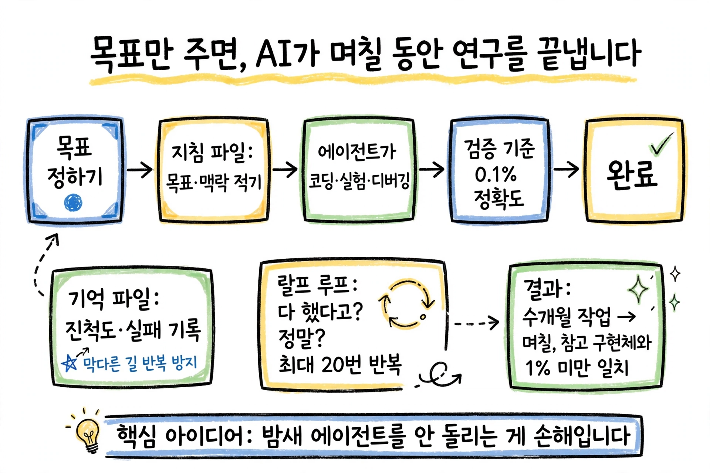
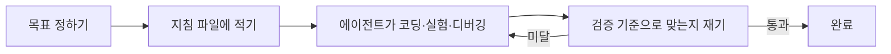
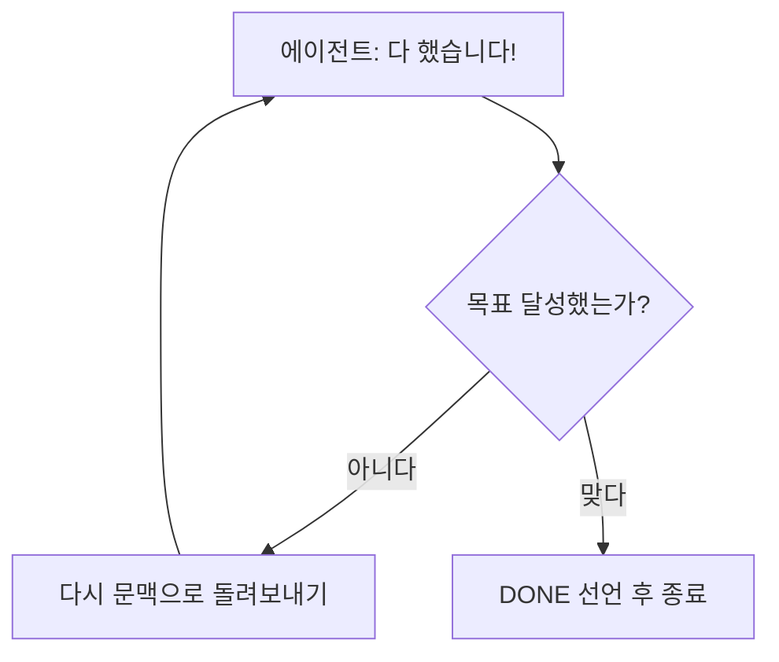
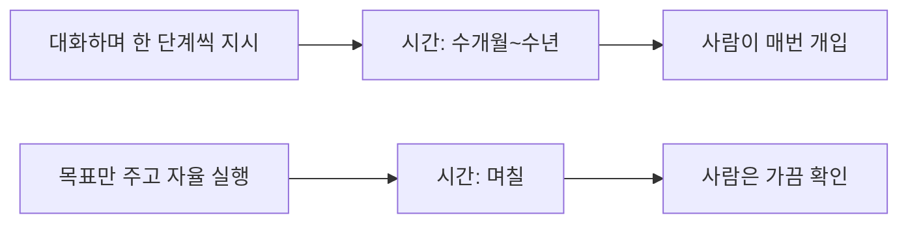

# 목표만 주면 AI가 며칠 동안 연구를 끝냅니다. 밤새 안 돌리는 게 손해입니다

> **Summary**
> 명확한 목표와 검증 기준, 지침·진척도 파일을 마련하면 AI 에이전트가 코딩·실험·디버깅을 며칠간 자율적으로 수행해 연구를 크게 앞당길 수 있습니다. 다만 결과의 정확성과 완성도를 끝까지 검증하는 일은 여전히 사람의 몫입니다.

---

- 목표만 정해주면, AI 에이전트가 며칠 동안 스스로 코딩·실험·디버깅까지 끝내는 방식이 공개됐습니다.
- 핵심은 세 가지 장치입니다. 목표를 적는 지침 파일, 진척도를 적는 기억 파일, 맞는지 재는 검증 기준.
- 전문가도 수개월이 걸리는 우주 물리 계산을, 해당 분야 비전문가가 며칠 만에 거의 완성 수준까지 끌고 갔습니다. 다만 끝까지 검증하는 일은 여전히 사람의 몫입니다.

금요일 저녁, 실험 스크립트 하나를 돌려놓고 퇴근한 적 있으시죠? 월요일 아침에 결과가 나와 있으면 하루가 가볍고, 중간에 멈춰 있으면 주말 내내 신경이 쓰입니다. 그런데 이제는 실험이 아니라 연구 자체를 밤새 맡기는 방식이 나왔습니다. 목표만 주면 됩니다!

🎥 [동영상 보기](https://www.youtube.com/watch?v=UwhSc6CaZQU)

## 대화하던 AI가, 이제는 혼자 일합니다?

지금까지 과학자들이 AI를 쓰는 방식은 대화였습니다. 한 단계씩 지시하고, 답을 확인하고, 다음 지시를 내리는 식이었습니다. 그런데 모델이 긴 작업을 잘하게 되면서 방식이 바뀌었습니다. 높은 수준의 목표만 정해주고, 에이전트 팀을 풀어놓는 겁니다. 며칠, 몇 주가 걸릴 프로젝트가 몇 시간 만에 끝나기도 합니다!

## 어떤 일에 어울릴까요?

아무 일이나 맡기면 되는 건 아닙니다. 세 가지 조건이 맞아야 합니다. 범위가 잘 정해져 있고, 성공 기준이 명확하고, 사람의 감독이 가끔씩만 있어도 되는 일입니다. 수치 해석 솔버를 다시 구현하거나, 오래된 포트란 코드를 현대 언어로 바꾸거나, 참고 구현체와 비교하며 거대한 코드베이스를 디버깅하는 일이 여기에 딱 들어맞습니다.

## 전문가도 수개월 걸리는 일을, 비전문가가 며칠 만에?

사례가 흥미롭습니다. 우주 초기의 빅뱅 잔광, 즉 우주배경복사를 예측하는 볼츠만 솔버를 미분 가능한 형태로 구현하는 일이었습니다. 광자·바리온·중성미자·암흑물질이 초기 우주에서 어떻게 함께 진화하는지 푸는 수치 코드입니다. 전문가들이 해도 수개월에서 수년이 걸리는 작업인데, 해당 분야 전문가가 아닌 사람이 최소한의 방향만 제시하며 에이전트에게 맡겼습니다. 모델은 클로드 오푸스 4.6, 언어는 자동 미분이 되는 `JAX`였습니다.

왜 이 작업이었을까요? 미분 가능한 솔버가 있으면 기울기 기반 추론으로 모수 추정을 훨씬 빠르게 할 수 있기 때문입니다. 참고 구현체와의 정확도 목표는 0.1%로 잡았습니다. 두 대표 볼츠만 코드 사이의 일반적인 일치 수준이 0.1% 정도라서, 과학적으로 의미 있는 목표였습니다.

## 목표는 파일에 적어둡니다

계획을 짜는 데 시간을 가장 많이 쓰는 게 맞습니다. 프로젝트의 목표와 맥락을 담은 `CLAUDE.md` 파일을 최상위 디렉토리에 두면, 클로드는 이 파일을 특별히 취급해 항상 문맥에 유지하고 전체 계획의 참고 자료로 삼습니다. 목표는 세 가지였습니다. 참고 구현체와 완벽한 기능 동등성, 완전한 미분 가능성, 0.1% 정확도. 그리고 AI는 작업하면서 이 파일을 스스로 고쳐서 업데이트했습니다. 계획이 살아 있는 문서가 되는 겁니다!

## 에이전트의 기억은 파일입니다

긴 작업의 적은 망각입니다. 세션이 바뀌면 에이전트는 전에 뭘 시도했는지 모릅니다. 그래서 `CHANGELOG.md`라는 진척도 파일을 만듭니다. 에이전트의 휴대용 장기 기억이자 실험 노트입니다. 현재 상태, 끝낸 일, 실패한 접근법과 그 이유, 핵심 체크포인트의 정확도 표가 들어갑니다. 실패 기록이 특히 중요합니다. 없으면 다음 세션이 같은 막다른 길을 다시 가기 때문입니다. 실제로 "섭동 미분방정식에 `Tsit5`를 썼더니 계가 너무 뻣뻣해서 `Kvaerno5`로 바꿨다" 같은 기록이 남았습니다.

## 맞는지 재는 기준이 없으면, 긴 작업은 표류합니다

자율 연구의 핵심 장치는 테스트 오라클입니다. 에이전트가 진척을 알 수 있는 방법이 있어야 합니다. 과학 코드에서는 참고 구현체, 수치로 잴 수 있는 목표, 기존 테스트 스위트가 그 역할을 합니다. 이 사례에서는 참고 구현체의 C 소스를 기준으로 단위 테스트를 계속 만들고 돌렸습니다. 테스트를 늘려서 회귀를 막는 일도 에이전트에게 맡겼습니다.

## 깃은 진행 상황을 보여주는 창입니다

`Git`은 조율 도구로 쓰였습니다. 의미 있는 작업 단위마다 커밋하고 푸시합니다. 복구 가능한 기록이 남고, 진행 상황이 눈으로 보이고, 계산 할당량이 세션 중간에 떨어져도 작업이 날아가지 않습니다. 규칙은 간단했습니다. 커밋 전에는 `pytest tests/ -x -q`를 돌리고, 이미 통과하는 테스트를 깨는 코드는 커밋하지 않습니다.

## 실행은 이렇게 돕니다

계획을 로컬에서 다듬은 뒤, 계산 노드에서 터미널 멀티플렉서 안에 클로드 코드 세션을 띄우고 맡깁니다. 노트북을 닫아도 세션은 계속 돕니다. 사람은 가끔 들여다보기만 하면 됩니다. 글쓴이는 커피 줄을 서서 기다리면서 휴대전화로 깃허브 커밋 기록을 확인했다고 합니다. 이 장면이 저는 가장 인상 깊었습니다. 연구의 진행 상황을 줄 서서 확인하는 시대라니, 놀랍지 않으세요?

## 에이전트도 게으름을 피웁니다?

긴 작업을 맡기면 모델이 핑계를 대며 중간에 멈추려는 경우가 있습니다. "늦었으니 내일 이어서 하자"는 식입니다. 이걸 에이전트의 게으름이라고 부릅니다. 해법은 랄프 루프입니다. 에이전트가 다 했다고 주장하면, 다시 문맥으로 돌려보내서 정말로 목표를 달성했는지 되묻는 `for` 루프입니다. 기준에 미달하면 에이전트는 스스로 인정하고 작업을 이어갑니다. 이 사례에서는 최대 20번까지 반복하도록 강제했습니다.

## 결과는 어땠을까요?

에이전트는 처음부터 며칠 동안 작업해 참고 구현체와 여러 출력에서 1% 미만의 일치를 달성했습니다. 주요 출력인 우주배경복사 각 파워 스펙트럼의 정확도를 개발 과정의 이정표마다 다시 재서, 1% 미만 정확도에 도달하는 경로를 그림으로 남기기도 했습니다. 다만 과정이 매끄럽진 않았습니다. 한동안은 하나의 기준 모수 지점에서만 테스트해서 버그를 잡는 범위가 크게 줄었고, 게이지 관례 같은 기본적인 실수로 몇 시간을 허비하기도 했습니다. 우주론 전문가라면 바로 알아챌 실수였습니다. 그래도 목표를 향해 꾸준히 나아갔습니다!

그리고 뜻밖의 부수 효과가 있었습니다. 글쓴이는 깃 커밋 기록을 보며 볼츠만 솔버와 그 물리학을 꽤 배웠다고 합니다. 커밋 로그가 빠르고 문자 그대로 받아들이는 박사후 연구원의 실험 노트처럼 읽혔다고 합니다.

## 어디까지 믿어야 할까요?

정직하게 짚을 점이 있습니다. 결과물은 상용 수준이 아닙니다. 모든 영역에서 참고 구현체와 허용 가능한 정확도로 일치하지는 않습니다. 그래도 에이전트 주도 개발이 수개월, 어쩌면 수년의 연구자 작업을 며칠로 압축할 수 있다는 걸 보여줬습니다. 이게 핵심입니다!

예전에는 퇴근 전에 밤새 돌아갈 훈련을 걸어두지 않으면 기회비용을 느꼈습니다. 이제는 목표가 분명한 프로젝트에서 밤새 에이전트를 일하게 두지 않는 것 자체가 잠재적 진전을 포기하는 비용이라고 합니다. 밤에 잠자는 에이전트가 아니라, 밤에 쉬는 에이전트가 아까운 시대가 온 겁니다. 여러분의 일 중에는 밤새 맡길 만한 목표가 있으신가요?

