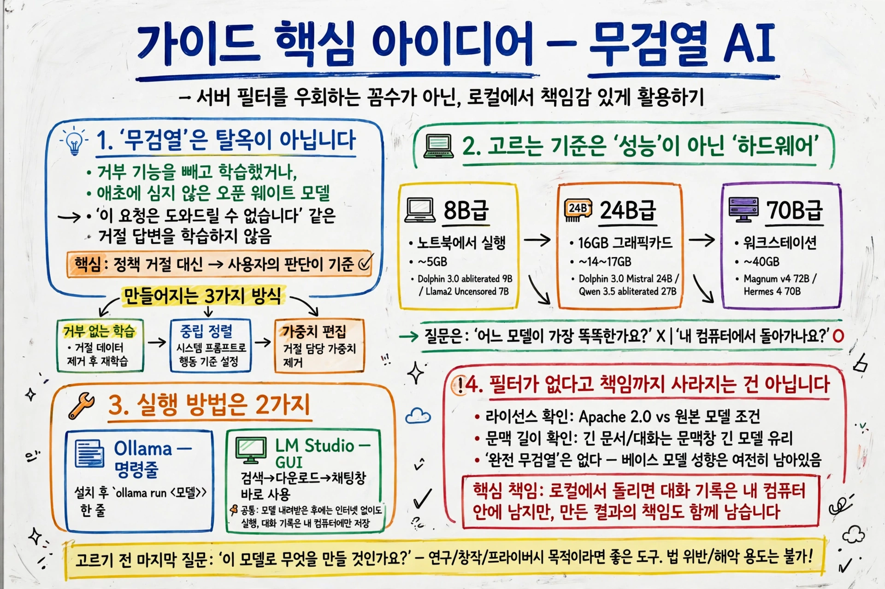
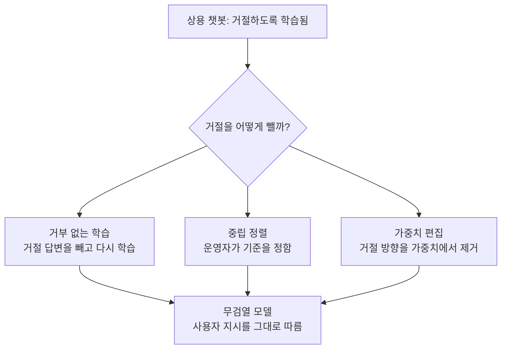
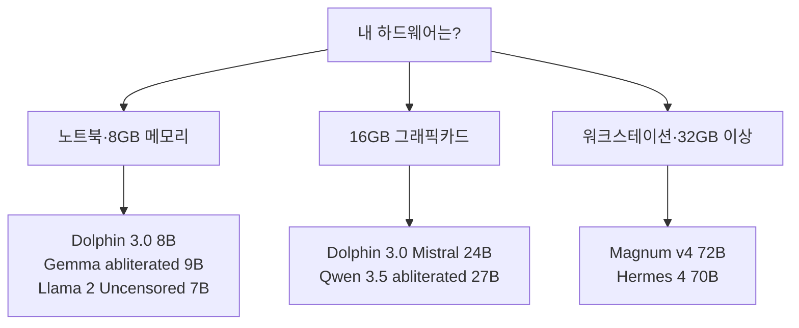

# 무검열 AI, 막힌다고 끝이 아닙니다. 내 컴퓨터에 직접 두는 모델 7가지

> **Summary**
> 무검열 AI는 서버 필터를 우회하는 것이 아니라 거절 기능을 제거하거나 중립적으로 정렬한 오픈 웨이트 모델이며, 선택할 때는 성능보다 컴퓨터 사양과 라이선스·문맥 길이를 먼저 살펴야 합니다. 8B급은 노트북, 24B급은 16GB 그래픽카드, 70B급은 워크스테이션에 적합하며, Ollama나 LM Studio로 로컬에서 실행할 수 있습니다. 로컬 실행은 대화의 프라이버시를 높이지만, 모델 결과물에 대한 책임은 사용자에게 있습니다.

---

- "무검열" AI는 탈옥이 아닙니다. 거부 기능을 빼고 학습했거나, 애초에 심지 않은 오픈 웨이트 모델입니다.
- 고르는 기준은 성능이 아니라 하드웨어입니다. 8B는 노트북에서, 24B는 16GB 그래픽카드에서, 70B는 워크스테이션에서 돕니다.
- 필터가 없다고 책임까지 사라지는 건 아닙니다. 로컬에서 돌리면 대화 기록은 내 컴퓨터 안에 남지만, 만든 결과의 책임도 함께 남습니다.

채팅창에 질문을 던졌는데, 답 대신 정중한 거절 한 단락이 돌아온 적 있으시죠? 질문이 위험해서가 아니라, 서비스 정책에 걸렸기 때문입니다. 그런데 그 질문이 연구나 창작을 위한 정당한 질문이라면 어떨까요? 그럴 때 사람들이 찾는 것이 바로 무검열 모델입니다. 서버의 필터를 우회하는 꼼수가 아니라, 처음부터 거부 기능 없이 만들어진 모델을 내 컴퓨터에 직접 두는 방법입니다!

🎥 [동영상 보기](https://www.youtube.com/watch?v=jUMnGOYcIkg)

## "무검열"은 무슨 뜻일까요?

무검열 모델은 정책을 어기는 모델이 아닙니다. 상용 챗봇처럼 "이 요청은 도와드릴 수 없습니다"라는 거절을 하도록 학습되지 않은 모델입니다. 거절하는 습관이 빠진 자리에, 사용자의 지시를 그대로 따르는 습관이 들어갑니다. 그래서 무검열 모델을 고를 때는 이름이 아니라, 거절이 어떻게 빠졌는지를 먼저 봐야 합니다.

크게 세 가지 방식이 있습니다. 첫째, 거부 없는 학습입니다. 학습 데이터에서 거절 답변을 빼고 다시 학습시키는 방식입니다. 둘째, 중립 정렬입니다. 운영자가 시스템 프롬프트로 행동 기준을 정하게 하고, 모델은 그 지시를 따르는 방식입니다. 셋째, 가중치 편집입니다. 이미 학습된 모델에서 거절을 담당하는 방향을 가중치에서 덜어내는 방식입니다. 방식이 달라도 결과는 같습니다. 정책 거절이 아니라 사용자의 판단이 기준이 됩니다.

## 하드웨어부터 정하세요. 모델은 그 다음입니다

무검열 모델 리스트를 볼 때 가장 먼저 물을 질문은 "어느 모델이 가장 똑똑한가요?"가 아닙니다. "내 컴퓨터에서 돌아가나요?"가 먼저입니다. 모델 크기는 다운로드 용량과 필요 메모리를 그대로 정합니다. 8B 모델은 5GB 안팎, 24B 모델은 14~17GB, 70B 모델은 40GB가 필요합니다. 리스트 7가지를 하드웨어 기준으로 나눠 봤습니다.

### 노트북에서 바로: 8B급

**Dolphin 3.0**이 기본 추천입니다! 거부 없는 학습으로 만든 시리즈의 최신작으로, 지시 따르기와 함수 호출이 강점입니다. 8B 버전은 `ollama run dolphin3` 한 줄이면 내려받고 바로 대화가 시작됩니다. **Gemma abliterated 9B**도 노트북 친화적입니다. 12GB 그래픽카드에 들어가고, 만든 쪽 측정에서는 추론 점수가 원본 모델과 거의 그대로 유지됐습니다. 다만 이 수치는 만든 쪽이 직접 잰 결과라는 점은 기억해 두세요.

**Llama 2 Uncensored**는 가장 오래된 고전입니다. `ollama run llama2-uncensored` 한 줄로 돌릴 수 있고, 7B와 70B 두 크기가 있습니다. 최신 모델보다 똑똑하지는 않지만, 입문용으로는 여전히 가장 간단한 선택지입니다.

### 16GB 그래픽카드가 있다면: 24B급

**Dolphin 3.0 Mistral 24B**는 이 리스트의 간판입니다. 24B급 베이스에 거부 없는 학습을 적용했고, 일반 대화부터 함수 호출, 추론 모드까지 한 모델이 맡습니다. **Qwen 3.5 abliterated**는 검증된 일꾼입니다. 0.8B부터 122B까지 크기가 다양하고, 27B가 기본 내려받기 크기(17GB)이며, 문맥 창이 256K로 깁니다. 참고로 2026년 8월에는 더 새로운 `Qwen` 3.8-27B 기반의 무검열 빌드도 나왔습니다.

### 창작이 목적이라면: 70B급

**Magnum v4 72B**는 문체에 특화된 모델입니다. 상용 최고 모델의 글맛을 닮게 학습시켰고, 거절만 뺐다는 것이 특징입니다. 소설, 롤플레이, 긴 글쓰기에 강합니다. **Hermes 4 70B**는 추론까지 되는 대형 모델입니다. 중립 정렬 철학으로 만들어져서, 시스템 프롬프트로 성격을 정하면 그 기준을 따릅니다. 문맥 창이 131K로 길고, 만든 쪽이 직접 만든 거절 측정에서는 거절이 가장 적었다고 밝혔습니다. 역시 만든 쪽의 자체 측정이라는 점은 함께 적어 둡니다.

## 돌리는 방법은 두 가지뿐입니다

모델을 골랐다면 실행기는 취향대로 고르면 됩니다. 명령줄이 편하면 `Ollama`입니다. 설치하고 `ollama run` 뒤에 모델 이름만 붙이면 됩니다. 화면으로 고르고 싶으면 `LM Studio`입니다. 모델을 검색해 내려받고, 채팅창에서 바로 씁니다. 두 도구 모두 모델 파일을 내려받은 뒤에는 인터넷 없이도 돌아갑니다. 대화 기록이 서버로 나가지 않는다는 점이 로컬 실행의 가장 큰 이유입니다!

## 고르기 전에 확인할 3가지가 있습니다

첫째, 라이선스입니다. 거절을 뺐다고 라이선스가 바뀌지 않습니다. 어떤 모델은 `Apache 2.0`이라 상용 이용이 자유롭고, 어떤 모델은 원본 모델의 자체 이용 조건을 그대로 따릅니다. 둘째, 문맥 길이입니다. 긴 문서를 요약하거나 긴 대화를 이어가려면 문맥 창이 긴 모델이 유리합니다. 셋째, "완전 무검열"은 없다는 점입니다. 한 모델 카드에는 아예 이렇게 적혀 있습니다. 진짜 무검열 모델은 없다고요. 베이스 모델 자체의 성향이 남아 있기 때문입니다. "거절 0건" 같은 수치는 만든 쪽이 자기 기준으로 잰 결과라서, 그대로 믿기보다는 참고 수치로 보는 것이 맞습니다.

## 필터가 없다고 책임도 없는 건 아닙니다

무검열 모델을 내 컴퓨터에 두면, 대화는 서버를 거치지 않습니다. 그 말은 검열이 없다는 뜻이기도 하고, 대신 책임질 사람도 나밖에 없다는 뜻이기도 합니다. 모델이 만든 결과물의 책임은 모델이 아니라 사용자에게 있습니다. 연구, 창작, 프라이버시가 필요한 정당한 용도라면 로컬 무검열 모델은 좋은 도구입니다. 하지만 법을 어기거나 남에게 해를 끼치는 용도라면, 필터가 없다고 해서 허용되는 건 아닙니다. 리스트를 고를 때 마지막 질문은 이것입니다. "이 모델로 무엇을 만들 것인가요?" 답이 분명하다면, 하드웨어에 맞는 한 줄이면 충분합니다!

