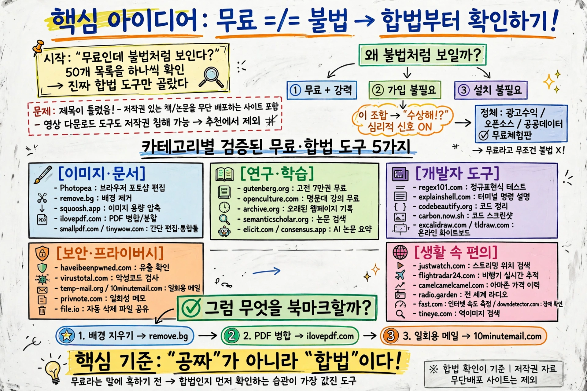
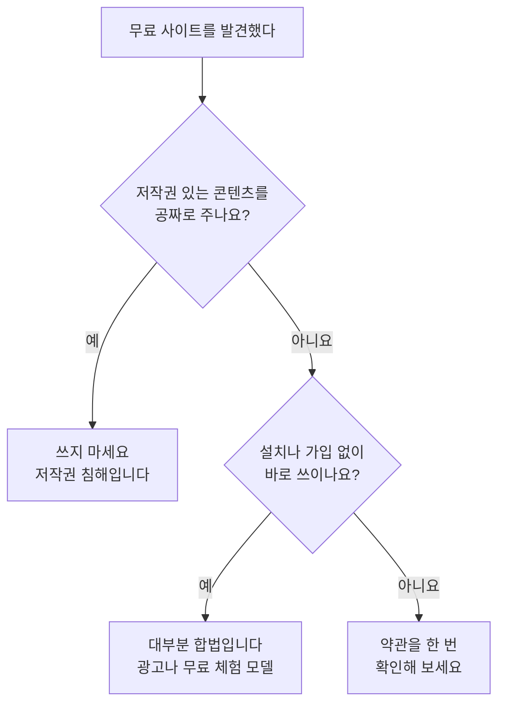
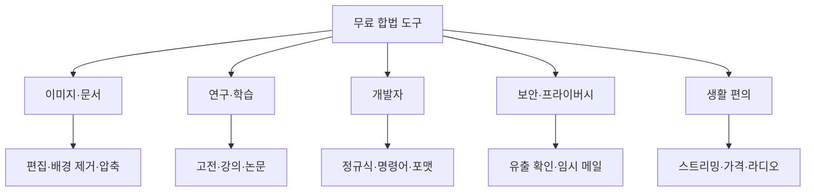

# 무료인데 불법처럼 보인다? 50개 중 진짜 합법 도구만 골랐습니다

> **Summary**
> 50개 무료 웹사이트 목록을 하나씩 확인했더니, 저작권이 있는 책과 논문을 허락 없이 배포하는 사이트가 섞여 있어 추천에서 뺐습니다. 이미지와 문서, 연구와 학습, 개발자 도구, 보안과 프라이버시, 생활 편의까지 검증된 합법 도구만 카테고리별로 골랐습니다. 무료 도구의 기준은 공짜가 아니라 합법이며, 오늘 당장 쓸 것 3개부터 북마크하면 됩니다.

---

- 무료인데 불법처럼 보인다? 50개 목록을 하나씩 확인했더니, 진짜 합법 도구만 골라야 했습니다.
- 이미지, 문서, 연구, 개발, 보안까지 — 설치 없이 브라우저에서 바로 쓰는 검증된 무료 도구들을 카테고리별로 정리했습니다.
- 단, 저작권이 있는 책과 논문을 허락 없이 배포하는 사이트는 소개하지 않았습니다. 합법인지부터 확인하는 것이 기준입니다.

"포토샵을 공짜로 쓴다고요?" 이런 말을 들으면 십중팔구 불법 복제부터 떠올립니다. 그런데 브라우저만 열면 포토샵 파일을 그대로 편집할 수 있는 사이트가 있습니다. 이 글의 출발점은 그런 사이트 50개를 모은 목록입니다. 그런데 목록을 하나씩 뜯어보니, 제목이 틀렸습니다!

🎥 [동영상 보기](https://www.youtube.com/watch?v=bNoGWjMt-CM)

## 왜 불법처럼 보일까요?

무료인데 강력하고, 가입도 필요 없고, 설치도 없습니다. 이 세 가지가 합쳐지면 "이거 뭔가 수상한데?"라는 신호가 먼저 켜집니다. 그런데 이 조합의 정체는 따로 있습니다. 광고 수익, 오픈소스, 공공 데이터, 무료 체험판이라는 비즈니스 모델입니다. 무료라고 무조건 불법이 아닙니다!

## 먼저, 제목부터 바로잡겠습니다

50개 목록을 하나씩 확인했더니, 저작권이 있는 책과 논문을 권리자 허락 없이 배포하는 사이트가 섞여 있었습니다. 그런 사이트는 이 글에서 소개하지 않습니다. 이름도 주소도 적지 않았습니다. 영상 다운로드 도구도 용도에 따라 저작권 침해가 될 수 있어 추천 목록에서 뺐습니다. 저작권이 있는 콘텐츠를 무료로 푼다면, 합법일까요? 답은 정해져 있습니다. "모두 합법"이라는 제목은 과장이었습니다.

## 진짜 합법만 골랐습니다

### 이미지와 문서, 브라우저에서 끝냅니다

포토샵 없이 이미지 편집이 필요하면 `Photopea`를 씁니다. 브라우저에서 포토샵 파일을 그대로 엽니다. 배경만 지울 때는 `remove.bg`, 용량만 줄일 때는 `squoosh.app`이 빠릅니다. PDF 병합과 분할은 `ilovepdf.com`, 간단한 편집은 `smallpdf.com`이 맡습니다. `tinywow.com`은 이런 도구들을 한곳에 모아둔 모음집입니다. 설치가 필요 없다는 게 공통점입니다!

### 연구와 학습, 공짜 자료의 보고입니다

저작권이 만료된 고전 7만 권은 `gutenberg.org`에서 읽습니다. 명문대 강의를 무료로 듣는 건 `openculture.com`입니다. 오래된 웹페이지를 되돌아보는 건 `archive.org`의 몫입니다. 논문은 `semanticscholar.org`에서 검색하고, `elicit.com`과 `consensus.app`이 AI로 논문을 요약하고 과학적 합의를 찾아줍니다. 전부 정식 공개 자료입니다!

### 개발자 도구, 손에 익으면 못 놓습니다

정규표현식은 `regex101.com`에서 바로 테스트합니다. 낯선 터미널 명령은 `explainshell.com`에 붙여넣으면 한 줄씩 풀어줍니다. 코드는 `codebeautify.org`에서 정리하고, `carbon.now.sh`로 예쁘게 찍습니다. 회의용 그림은 `excalidraw.com`과 `tldraw.com`이 브라우저 화이트보드를 대신합니다.

### 보안과 프라이버시, 의심부터 확인합니다

내 이메일이 유출됐는지 `haveibeenpwned.com`에서 확인합니다. 수상한 파일은 `virustotal.com`에 올려 수십 개 백신 엔진으로 검사합니다. 가입용 일회용 메일은 `temp-mail.org`와 `10minutemail.com`이 만들어줍니다. 일회성 메모는 `privnote.com`, 자동 삭제 파일 공유는 `file.io`가 맡습니다.

### 생활 속 편의, 알면 계속 쓰게 됩니다

보고 싶은 콘텐츠가 어디에 있는지 `justwatch.com`이 알려줍니다. 비행기 위치는 `flightradar24.com`, 아마존 가격 이력은 `camelcamelcamel.com`이 추적합니다. 전 세계 라디오는 `radio.garden`에서 듣고, 인터넷 속도는 `fast.com`, 사이트 장애 여부는 `downdetector.com`에서 확인합니다. 이미지 출처는 `tineye.com`이 역검색으로 찾아줍니다.

## 그래서 뭘 북마크해야 할까요?

50개를 다 외울 필요는 없습니다. 오늘 당장 쓸 것 3개만 골라보세요. 이미지 배경 지우기, PDF 병합, 일회용 메일이면 충분합니다. 나머지는 필요할 때 이 글을 다시 열면 됩니다. 무료 도구의 기준은 하나입니다. "공짜"가 아니라 "합법"입니다!

무료라는 말에 혹하기 전에, 합법인지부터 확인하는 습관이 가장 값진 도구입니다.

