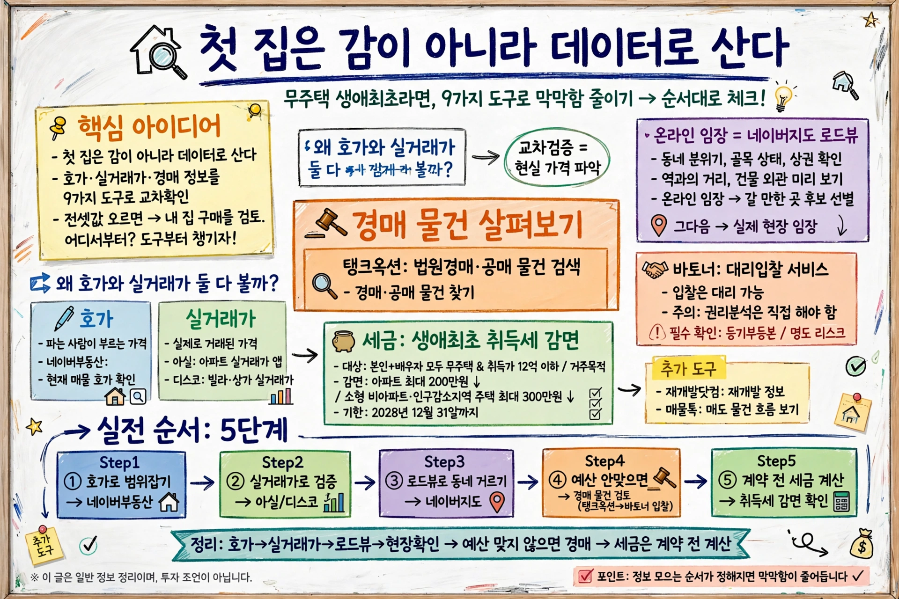
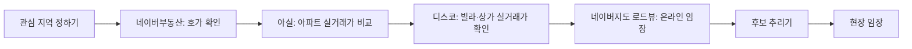
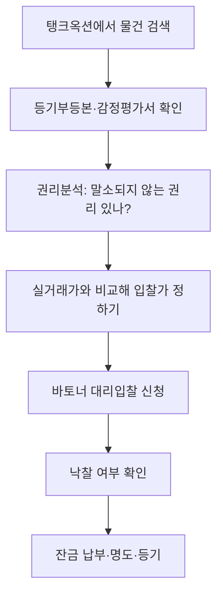

# 무주택 생애최초, 첫 집은 아홉 가지 도구로 가격부터 확인합니다

> **Summary**
> 첫 집을 살 때는 호가와 실거래가를 여러 도구로 교차 확인하고, 로드뷰와 현장 방문으로 입지를 살펴야 합니다. 예산에 맞지 않으면 경매를 검토하되 권리분석은 직접 확인하고, 취득세 감면 등 세금도 계약 전에 챙기는 것이 중요합니다.

---

- 무주택 생애최초라면, 첫 집은 감이 아니라 데이터로 삽니다. 호가·실거래가·경매 정보를 확인하는 아홉 가지 도구가 출발점입니다.
- 가격은 한 곳이 아니라 여러 곳에서 교차 확인합니다. 호가는 네이버부동산에서, 실거래가는 아실과 디스코에서, 현장은 네이버지도 로드뷰로 먼저 봅니다.
- 경매까지 눈을 돌리면 탱크옥션에서 물건을 찾고, 입찰은 바토너 같은 대리입찰로 맡길 수 있습니다. 세금은 국세청 정보로, 생애최초 취득세 감면부터 챙깁니다.

전셋값이 오를 때마다 "이 돈이면 내 집을 사는 게 낫지 않을까?"라는 생각이 스치신 적 있으시죠? 마음은 섰는데, 어디서부터 손대야 할지 막막합니다. 부동산 앱을 켜면 매물은 수두룩한데, 이 가격이 싼 건지 비싼 건지 알 수가 없습니다. 그래서 첫 집을 사는 사람들은 도구를 먼저 챙깁니다. 정보를 모으는 순서가 정해져 있으면, 막막함이 줄어듭니다!

🎥 [동영상 보기](https://www.youtube.com/watch?v=M8f6nUmuSrs)

## 호가와 실거래가, 왜 두 개를 봐야 할까요?

호가는 파는 사람이 부르는 가격입니다. 실거래가는 실제로 거래된 가격입니다. 두 숫자는 자주 다릅니다. 호가만 보고 판단하면 비싸게 살 수 있습니다. 그래서 가격 확인은 두 갈래로 나눠서 봅니다.

**네이버부동산**은 현재 호가를 보는 창구입니다. 관심 단지의 매물 가격과 전세 가격을 한눈에 비교할 수 있습니다. **아실**은 아파트 실거래가를 보여주는 앱입니다. 국토부 실거래가 공개시스템 데이터를 바탕으로, 2006년부터 지금까지의 매매·전세 가격을 단지별로 비교해 줍니다. 아파트끼리 가격을 겹쳐 보는 기능이 강점입니다.

빌라나 상가를 본다면 **디스코**를 함께 봅니다. 아파트 중심인 아실과 달리, 빌라·상가·토지 같은 비아파트 거래 정보를 다루는 도구입니다. 첫 집 후보가 빌라라면, 아실만으로는 가격 감이 안 잡힙니다. 용도별로 도구를 나누는 이유가 여기에 있습니다!

## 집에 직접 가기 전에, 온라인 임장은 어떻게 하나요?

**네이버지도**의 로드뷰가 온라인 임장 도구입니다. 동네 분위기, 골목 상태, 상권, 역과의 거리를 화면으로 먼저 확인합니다. 현장에 가기 전에 후보를 추리는 용도입니다. 로드뷰만으로 결정을 내리면 안 됩니다. 사진은 날짜가 지났을 수 있고, 소음이나 냄새는 화면에 안 보입니다. 온라인 임장은 "갈 만한 곳"을 고르는 단계입니다. 직접 가 보는 임장은 그다음입니다!

## 경매, 초보도 물건을 찾을 수 있을까요?

일반 매매만 보다 보면 예산이 안 맞는 경우가 많습니다. 그럴 때 경매를 함께 봅니다. **탱크옥션**은 법원경매·공매·신탁공매 물건을 검색하는 유료 정보 플랫폼입니다. 예정물건부터 진행물건, 낙찰 결과까지 한곳에서 확인하고, 관심 지역이나 관심 물건에 변동이 생기면 알림을 받을 수 있습니다. 등기부등본, 감정평가서, 건축물대장 같은 자료도 물건 상세에서 함께 봅니다.

물건을 골랐다면 입찰은 어떻게 할까요? 평일에 법원에 직접 가기 어려운 직장인이라면 **바토너** 같은 대리입찰 서비스를 씁니다. 공인중개사인 매수신청대리인이 대신 입찰해 주는 비대면 서비스입니다. 이용료는 개인·법인 기준 10만 원 수준이고, 입찰기일 하루 전에 신청하면 추가 비용이 붙습니다. 전자본인서명확인서를 미리 준비해야 합니다.

여기서 꼭 짚을 점이 있습니다. 대리입찰은 입찰만 대신해 줄 뿐, 권리분석은 해 주지 않습니다. 등기부등본에 말소되지 않는 권리가 있는지, 임차인 보증금을 떠안아야 하는지, 명도에 어려움은 없는지는 직접 확인해야 합니다. 입찰을 맡긴다고 조사가 끝나는 게 아닙니다!

## 세금과 미래 가치, 어디서 챙기나요?

첫 집을 사면 세금이 따라옵니다. **국세청** 정보로 생애최초 주택 구입 취득세 감면을 먼저 확인합니다. 본인과 배우자 모두 주택을 소유한 적이 없고, 취득가액 12억 원 이하 주택을 거주 목적으로 유상거래로 살 때 감면 대상이 됩니다. 아파트는 최대 200만 원, 소형 비아파트나 인구감소지역 주택은 최대 300만 원까지 줄어듭니다. 감면 기한은 2028년 12월 31일까지입니다. 3년 안에 팔거나 증여하거나 세를 놓으면 감면받은 세금을 추징당합니다. 취득세 신고할 때 감면 신청서를 함께 내야 합니다.

**재개발닷컴**은 재개발 정보를 보는 도구입니다. 관심 지역이 재개발 구역인지, 사업이 어느 단계인지 확인하는 용도입니다. 당장 살 집의 가치를 판단하는 자료라기보다, 동네의 중장기 변화를 읽는 참고 자료입니다. **매물톡**은 매도 물건을 여러 부동산에 뿌리는 도구입니다. 사는 쪽보다는 파는 쪽에 가까운 도구지만, 어떤 매물이 시장에 많이 나오는지 흐름을 보는 데도 쓸 수 있습니다.

## 아홉 가지 도구, 어떻게 이어서 쓰나요?

순서는 단순합니다. 호가로 범위를 잡고, 실거래가로 가격을 검증하고, 로드뷰로 동네를 거르고, 현장에서 확인합니다. 예산이 안 맞으면 경매 물건을 찾아보고, 권리분석을 마친 뒤에 입찰을 맡깁니다. 세금은 계약 전에 미리 계산합니다. 도구는 아홉 가지지만, 흐름은 하나입니다. 가격을 확인하고, 현장을 보고, 세금을 챙기는 순서입니다!

이 글은 일반 정보 정리이며, 투자 조언이 아닙니다. 경매 물건의 권리관계나 세금 감면 적용 여부는 계약 전에 반드시 공인중개사나 세무 전문가와 직접 확인하시기 바랍니다. 첫 집은 서두르는 것보다, 확인하는 순서가 먼저입니다.

