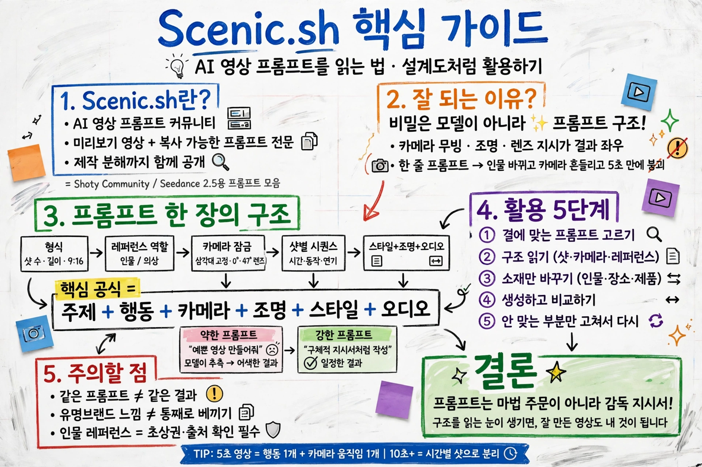
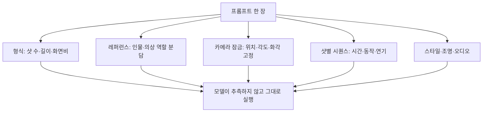
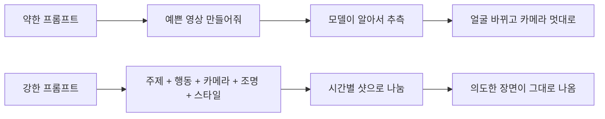
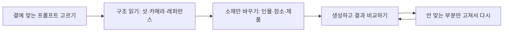

# 바이럴 영상 프롬프트가 오픈소스처럼 공유됩니다. 중요한 건 AI가 아니라 카메라 무빙입니다

> **Summary**
> Scenic.sh는 Seedance 2.5용 AI 영상 프롬프트와 미리보기, 제작 과정을 공유하는 라이브러리입니다. 좋은 영상의 핵심은 모델보다 샷 구성, 카메라 움직임, 조명, 렌즈와 오디오를 구체적으로 설계하는 데 있으며, 프롬프트의 구조를 익힌 뒤 소재를 바꾸고 결과에 맞춰 수정하면 됩니다. 같은 프롬프트가 같은 결과를 보장하지 않으며, 브랜드 자산과 인물 이미지의 사용 권리도 확인해야 합니다.

---

- `Scenic.sh`는 실제로 바이럴을 만든 AI 영상 프롬프트를 모아둔 커뮤니티입니다. 미리보기 영상과 복사 가능한 프롬프트 전문, 제작 분해까지 함께 공개됩니다.
- 잘 나가는 영상들의 비밀은 모델이 아니라 프롬프트 구조입니다. 카메라 무빙과 조명, 렌즈 지시가 결과를 갈랐습니다.
- 프롬프트를 통째로 베끼는 게 아니라 구조를 읽고 소재만 바꾸면, 내 영상에도 같은 설계도를 쓸 수 있습니다.

AI 영상 생성기에 한 줄 적어 넣고 기다렸는데, 나온 영상이 어딘가 어색했던 적 있으시죠? 인물 얼굴은 바뀌고, 카메라는 멋대로 움직이고, 5초 만에 분위기가 무너집니다. 그럴 때 드는 생각이 있습니다. "모델이 아직 부족한가?" 그런데 잘 만든 영상과 내 영상의 차이는 모델이 아니었습니다. 프롬프트에 있었습니다!

🎥 [동영상 보기](https://www.youtube.com/watch?v=aRQufkKIa4s)

## 여기는 뭐가 모여 있나요?

`Scenic.sh`는 `Shoty Community`라는 이름의 AI 영상 프롬프트 라이브러리입니다. Seedance 2.5용 프롬프트를 모았고, 각 프롬프트마다 미리보기 영상과 복사 가능한 프롬프트 전문, 제작 분해가 함께 딸려 있습니다. 그냥 글만 있는 게 아니라, 결과가 어떻게 나왔는지 눈으로 확인하고 가져갈 수 있는 구조입니다.

찾는 방법도 잘게 쪼개져 있습니다. 장르(액션·로맨스·코미디·호러·SF·판타지·드라마·광고·다큐멘터리), 스타일(애니메이션·클레이·애니메·실사·시네마틱·레트로·초현실·미니멀), 주제(자연·음식·패션·건축·인물·동물·제품·추상·도시), 카메라(클로즈업·에어리얼·트래킹·슬로모션·타임랩스·팬·줌·1인칭) 네 축으로 고릅니다. 만들고 싶은 영상의 결이 정해지면, 그 결에 맞는 프롬프트만 골라 볼 수 있습니다.

블로그에는 가이드도 있습니다. Seedance 2.0 완전 가이드, Seedance와 Sora·Veo·Kling을 비교한 글, 광고·애니메이션·제품샷·액션 장면용 프롬프트 모음까지 있습니다. 프롬프트만 모아둔 게 아니라, 쓰는 법까지 같이 알려주는 셈입니다.

## 프롬프트 한 장, 어떻게 생겼나요?

홈페이지에 걸린 패션 릴 프롬프트를 뜯어보면 구조가 보입니다. 20초짜리 세로 9:16 영상인데, 샷이 정확히 10개로 나뉩니다. 각 샷마다 시간(0~1.7초, 1.7~3.4초…), 카메라, 화면 동작, 연기가 따로 적혀 있습니다.

레퍼런스 역할도 나눠져 있습니다. 첫 번째 이미지는 인물의 얼굴과 체형을, 두 번째 이미지는 의상의 디자인과 색감, 재질을 맡습니다. 카메라 규칙은 더 단단합니다. 삼각대에 고정한 세로 카메라 한 대, 정면 0도, 47도 화각, 샷 전환은 하드 컷으로만. 카메라 위치도 초점도 노출도 10개 샷 내내 똑같이 유지하라고 못 박았습니다. 마지막에는 오디오 지시까지 붙습니다. 비트에 맞춰 컷이 떨어지고, 옷감 소리와 향수 분사 소리, 부츠 소리가 깔립니다.

프롬프트가 길어서가 아닙니다. 빈틈이 없어서입니다. 모델이 알아서 채우게 두지 않고, 감독이 지시서 쓰듯 하나하나 정해둔 겁니다.

## 왜 카메라 무빙이 핵심일까요?

핵심 질문이 있습니다. "무슨 AI 쓰냐"가 중요할까요, "어떻게 움직이냐"가 중요할까요? 모음집의 답은 뒤쪽입니다. 요즘 잘 나가는 영상들은 구조가 거의 비슷합니다. 카메라가 어떻게 움직이고, 빛이 어디서 들어오고, 렌즈가 무엇을 보는지. 이 세 가지가 적혀 있으면 모델이 달라도 비슷한 결이 나옵니다.

그래서 프롬프트 공식도 단순합니다. 주제 + 행동 + 카메라 + 조명 + 스타일, 그리고 오디오입니다. 5초짜리 짧은 영상은 행동 하나와 카메라 움직임 하나로 충분합니다. 10초가 넘어가면 시간대별로 샷을 나눠 적습니다. 0~5초에는 무엇을, 6~12초에는 무엇을. 이렇게 나누는 순간, 영상은 우연이 아니라 설계가 됩니다.

이 장면이 저는 가장 인상 깊었습니다. 프롬프트가 길어진 게 아니라, 지시가 구체적이 된 겁니다. "예쁘게" 같은 형용사를 빼고, 보이는 것만 적는 겁니다!

## 어떻게 쓰면 되나요?

순서는 세 단계입니다. 먼저 만들고 싶은 결에 맞는 프롬프트를 고릅니다. 그다음 프롬프트를 통째로 복사하기 전에 구조부터 읽습니다. 샷은 몇 개로 나뉘는지, 카메라 규칙은 무엇인지, 레퍼런스는 무슨 역할을 하는지. 마지막으로 소재만 바꿉니다. 인물과 장소, 제품만 내 것으로 바꾸고 뼈대는 그대로 두는 겁니다.

이 반복이 중요합니다. 한 번에 완벽한 영상이 나오는 경우는 드뭅니다. 잘 나온 프롬프트도 내 소재에서는 어긋날 수 있습니다. 그럴 땐 프롬프트 전체를 버리지 말고, 어긋난 부분만 고칩니다. 카메라 지시를 하나 바꾸고, 조명 한 줄을 고치는 식입니다. 프롬프트 공부는 이렇게 쌓입니다!

## 주의할 점은 없나요?

있습니다. 첫째, 같은 프롬프트가 같은 결과를 보장하지 않습니다. 모델 버전이 바뀌고, 생성할 때마다 결과가 달라집니다. 프롬프트는 출발점이지 완성품이 아닙니다. 둘째, 유명 브랜드의 느낌을 빌리는 것과 통째로 베끼는 건 다릅니다. 광고 감각을 참고하는 건 공부지만, 브랜드 자산과 결과물을 그대로 흉내 내는 건 선을 넘는 일입니다. 셋째, 프롬프트 속 인물 레퍼런스를 쓸 때는 초상권과 출처를 따져야 합니다. 남의 얼굴과 사진을 재료로 쓰는 일은 가볍게 넘길 일이 아닙니다.

그래도 출발점은 분명합니다. 바이럴 영상의 프롬프트가 공개돼 있다는 사실 자체가 공부의 지름길입니다. "아, 이런 식으로 쓰는구나" 하는 감이 오는 순간, 다음 영상부터는 프롬프트 쓰는 손이 달라집니다. 프롬프트는 마법 주문이 아니라 감독 지시서입니다. 구조를 읽는 눈이 생기면, 잘 만든 영상도 더 이상 남의 일이 아닙니다!

