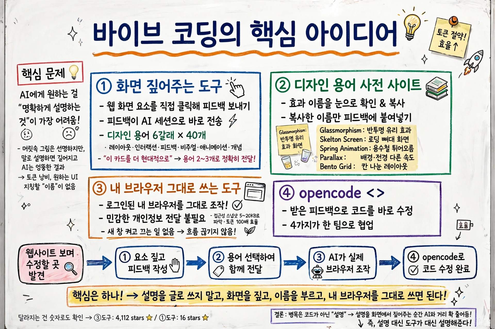
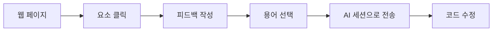
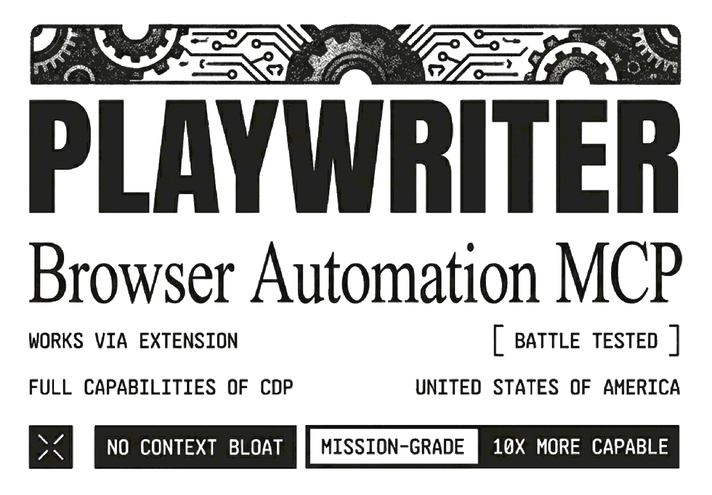
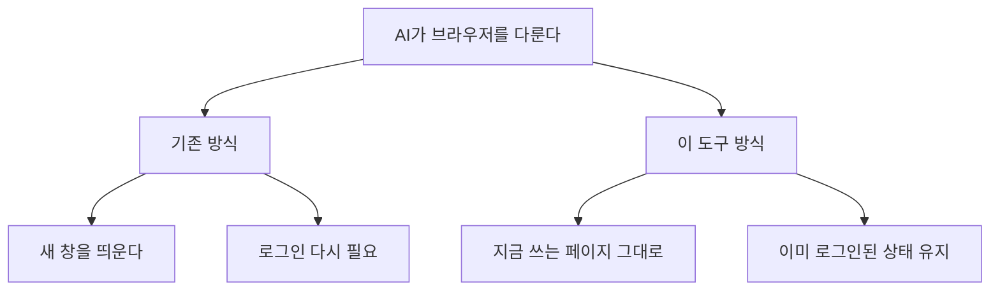
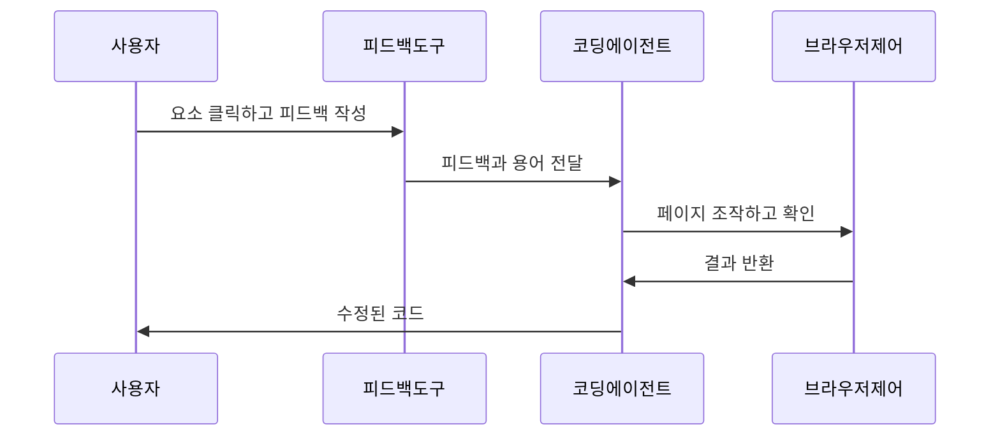

# 바이브 코딩, 긴 프롬프트 대신 화면을 짚어주면 됩니다

> **Summary**
> 바이브 코딩에서 AI에게 원하는 화면을 설명하기 어려울 때, 화면 요소를 클릭해 피드백을 보내고 디자인 용어 이름으로 효과를 지칭하며 이미 로그인된 브라우저를 그대로 쓰는 네 가지 도구 조합을 소개한다. 첫 번째는 요소 표시와 피드백 전송을 하는 확장 프로그램, 두 번째는 디자인 용어를 눈으로 보고 복사하는 사이트, 세 번째는 기존 페이지를 그대로 조작하는 브라우저 도구, 네 번째는 받은 피드백으로 코드를 고치는 코딩 에이전트이다.

---

- 바이브 코딩에서 가장 어려운 건 AI에게 원하는 걸 "명확하게 설명하는 것"입니다.
- 화면 요소를 클릭해 피드백을 보내고, 디자인 용어 이름으로 효과를 지칭하고, 이미 로그인된 내 브라우저를 그대로 쓰는 조합이 있습니다.
- 네 가지 도구가 각자 역할을 나눠서, 긴 프롬프트 없이도 원하는 화면에 가까워집니다.

바이브 코딩으로 웹을 만들다 보면 이런 순간이 있습니다. 머릿속 그림은 선명한데, 막상 AI에게 설명하려니 말이 안 나옵니다. "이 버튼이 커서가 올라갔을 때 위에서 아래로 떨어졌다가 다시 튀어오르는 애니메이션 효과가 있으면 좋겠어" — 프롬프트부터 너무 깁니다. 토큰은 줄줄 새고, 결과는 엉뚱합니다. 이런 적 있으시죠?

🎥 [동영상 보기](https://www.youtube.com/watch?v=G1u1Qb-tptA)

## 바이브 코딩, 왜 설명이 이렇게 어려울까요?

UI와 디자인은 머릿속 이미지가 너무 두루뭉술합니다. 말로 풀어내려면 길어지고, 길어질수록 AI는 엉뚱한 곳으로 갑니다. 원하는 디자인을 지칭하는 "이름"이 없기 때문입니다. 그래서 필요한 건 설명을 잘하는 프롬프트가 아니라, 설명을 대신해주는 도구입니다!

## 화면을 짚어주는 도구, 뭐가 있을까요?

첫 번째 도구는 웹 화면의 요소를 직접 짚어서 AI에게 피드백을 보내는 확장 프로그램입니다. 요소를 클릭하고, 피드백을 적고, 버튼 하나만 누르면 됩니다. 복사해서 붙여넣는 방식과 달리, 피드백이 AI 세션으로 바로 전달됩니다.

확장 프로그램만으로도 쓸 수 있습니다. 요소를 표시하고 클립보드에 복사한 뒤, 어떤 AI 채팅에든 붙여넣으면 됩니다. 여기에 전용 서버를 연결하면 "AI에게 보내기"가 열립니다. 웹페이지와 AI 세션 사이를 웹소켓으로 이어서, 피드백이 바로 전달되는 구조입니다. 단, 직접 전송은 현재 opencode에서만 가능합니다.

이 도구의 또 다른 강점은 디자인 용어입니다. 레이아웃·인터랙션·피드백·비주얼·애니메이션·개념, 여섯 갈래에 40개 용어가 들어 있습니다. 용어에 마우스를 올리면 실제 효과가 미리보기로 보이고, 클릭하면 여러 개를 골라서 피드백에 함께 보낼 수 있습니다. "이 카드를 더 현대적으로 만들어줘" 같은 막연한 말이, 용어 두세 개로 정확해집니다!

## 디자인, 이름만 알면 됩니다

두 번째는 웹 디자인 용어를 한 페이지에 모아둔 사이트입니다. 자주 쓰이고 트렌디한 디자인 효과들을 직접 눈으로 보면서 고를 수 있습니다. 원하는 효과 박스를 클릭하면 그 이름이 복사됩니다. 복사한 이름을 피드백에 붙여넣으면 됩니다. 나중에는 이 기능이 첫 번째 도구 안에 들어갈 예정이라고 합니다.

예를 들어 볼게요. 반투명 유리 같은 `Glassmorphism`, 로딩 중에 보여주는 뼈대 화면 `Skeleton Screen`, 용수철처럼 튀어오르는 `Spring Animation`, 배경과 전경이 다른 속도로 움직이는 `Parallax`, 도시락 통처럼 칸을 나누는 `Bento Grid` — 이름만 알면 AI가 알아듣습니다!

## 내 브라우저를 그대로 쓰는 도구, 왜 다를까요?

세 번째 도구는 AI가 웹 브라우저를 다룰 수 있게 하는 확장 프로그램입니다. 겉으로 보면 기존 자동화 도구와 차이가 없어 보입니다. 하지만 결정적인 차이가 하나 있습니다. 기존 도구는 작업할 때마다 매번 새 창을 띄우는 반면, 이 도구는 지금 쓰고 있는 페이지를 그대로 조작합니다.

이 하나가 엄청난 차이를 만듭니다! 이미 로그인한 화면을 그대로 쓰니까, 민감한 개인정보를 AI에게 직접 전달하지 않아도 됩니다. 새 창이 켰다 꺼졌다 하는 일도 없으니, 지금 진행 상황이 한눈에 들어옵니다. 이 부분이 저는 가장 와닿았습니다. 새 창이 켰다 꺼졌다 하는 걸 보는 것만으로도 흐름이 끊기니까요.

게다가 화면을 통째로 찍는 대신 접근성 스냅샷(5~20KB)으로 파악해서, 토큰도 훨씬 적게 씁니다. 영상 녹화도 기존 방식보다 100배 효율적이라고 합니다.

## 네 가지가 한 팀으로 움직입니다

네 도구는 각자 맡은 일이 다릅니다. 첫 번째는 화면을 짚어서 피드백을 보내고, 두 번째는 효과의 이름을 알려주고, 세 번째는 AI가 브라우저를 직접 다루게 하고, 네 번째인 opencode는 받은 피드백으로 코드를 고칩니다.

흐름은 이렇습니다. 웹사이트를 둘러보다가 고칠 곳을 발견합니다. 첫 번째 도구로 해당 요소를 짚고, 두 번째 사이트에서 고른 용어 이름을 함께 붙여서 AI에게 보냅니다. AI는 세 번째 도구로 실제 페이지를 조작하며 확인하고, 코드를 고칩니다.

## 달라지는 건 숫자로도 보입니다

세 번째 도구는 4,112개의 스타를 받았습니다. 반면 첫 번째 도구는 아직 16개로, 이제 막 알려진 단계입니다. 직접 전송 기능도 아직 opencode에서만 쓸 수 있고, 설치도 개발자 모드에서 직접 불러오는 방식이라 손이 조금 갑니다. 그래도 방향은 분명합니다.

핵심은 하나입니다. AI에게 긴 설명을 쓰지 않아도 됩니다. 화면을 짚고, 이름을 부르고, 내 브라우저를 그대로 쓰면 됩니다. 바이브 코딩의 병목은 코드가 아니라 설명이었습니다. 설명을 글로 쓰지 않고 화면에서 짚어주는 순간, AI와의 거리가 확 줄어듭니다!

