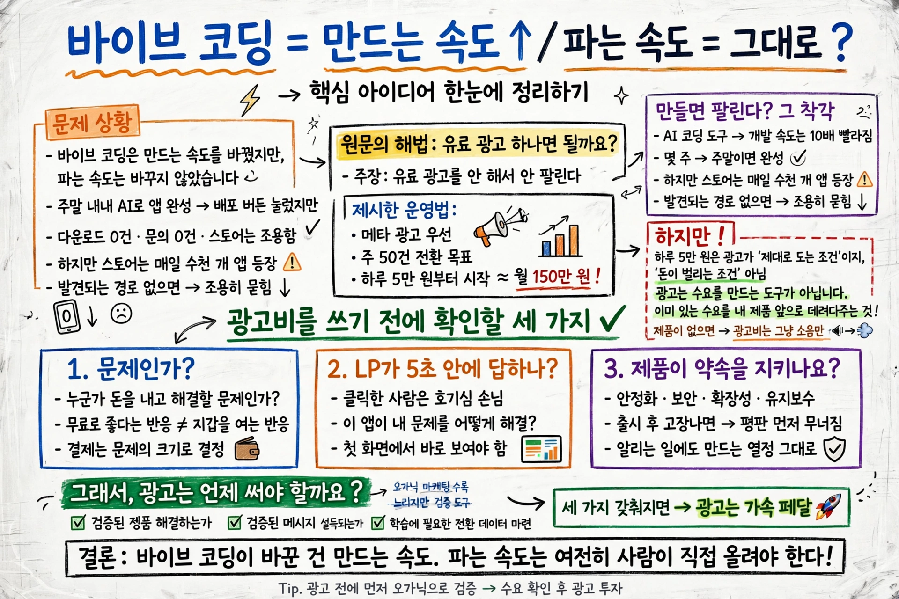

# 바이브 코딩으로 돈이 안 벌리는 이유, 정말 광고 하나 때문일까요?

> **Summary**
> 바이브 코딩은 앱을 만드는 속도는 높였지만, 판매까지 보장하지는 않습니다. 유료 광고는 검증된 제품과 메시지가 있을 때 성장을 돕는 수단이며, 광고비를 쓰기 전에는 고객의 지불 의사, 랜딩페이지의 설득력, 제품의 안정성을 확인해야 합니다. 오가닉 채널로 수요를 먼저 검증하고 감당 가능한 예산으로 광고를 시작하는 것이 중요합니다.

---

- 바이브 코딩은 만드는 속도를 바꿨지만, 파는 속도는 바꾸지 않았습니다.
- 원문 게시글은 그 빈자리를 유료 광고 하나로 채우자고 말합니다. 메타 광고 우선, 주 50건 전환, 하루 5만 원부터라는 구체적인 운영법까지 내놨습니다.
- 그런데 광고는 확성기일 뿐입니다. 살 만한 제품이 없으면 소음만 커집니다. 광고비를 쓰기 전에 확인할 것부터 짚어보겠습니다!

주말 내내 AI와 씨름해서 앱 하나를 완성했습니다. 배포 버튼까지 눌렀는데, 스토어는 조용합니다. 다운로드 0건, 문의 0건. 이런 적 있으시죠?

🎥 [동영상 보기](https://www.youtube.com/watch?v=nPSvUczm8M0)

## 만들면 팔린다? 그 착각은 어디서 왔을까요?

AI 코딩 도구가 만드는 속도를 확 올렸습니다. 예전에는 몇 주 걸리던 일이 이제 주말이면 끝납니다. 그러다 보니 만드는 일과 파는 일의 경계가 흐려졌습니다. 앱이 완성되는 순간, 왠지 손님이 올 것 같은 기분이 듭니다.

그런데 스토어는 기다려주지 않습니다. 매일 수천 개의 앱이 올라오는데, 새로 올라온 앱을 누가 찾아줄까요? 발견되는 경로가 없으면, 잘 만든 앱도 조용히 묻힙니다. 만드는 속도가 빨라진 만큼, 안 팔리는 앱도 더 빨리 쌓입니다!

## 원문의 해법: 유료 광고 하나면 될까요?

원문 게시글의 주장은 분명합니다. 죽어라 만들어도 돈이 안 되는 이유는 딱 하나, 유료 광고를 안 해서랍니다. 그러면서 구체적인 운영법까지 제시했습니다. 메타 광고를 우선하고, 주 50건 전환을 목표로 삼고, 하루 5만 원부터 시작하라는 겁니다. 크리에이티브를 만들 때는 퍼널 단계, 페르소나, 앵글, 오퍼 같은 키워드를 챙기라고 덧붙였습니다. 플랫폼의 최신 광고 기술 키워드도 함께 거론됐습니다.

숫자부터 따져보겠습니다. 하루 5만 원이면 한 달 150만 원입니다. 작은 돈이 아닙니다! 주 50건 전환이라는 목표도 가볍지 않습니다. 광고 시스템이 학습을 안정시키려면 일정량의 전환 데이터가 필요하다는 점은 공개된 운영 기준과도 맞닿아 있습니다. 즉, 이 숫자들은 "광고가 제대로 도는 조건"이지, "돈이 벌리는 조건"이 아닙니다.

광고는 수요를 만드는 도구가 아닙니다. 이미 있는 수요를 내 제품 앞으로 데려다주는 일입니다. 살 만한 제품이 없으면, 광고비는 그냥 소음을 사는 돈이 됩니다.

## 광고비를 쓰기 전에 확인할 세 가지

첫째, 누군가 돈을 내고 해결하고 싶은 문제인가요? 무료로 쓰면 좋겠다는 반응과, 지갑을 여는 반응은 다릅니다. 결제는 문제의 크기로 결정됩니다.

둘째, 랜딩페이지가 5초 안에 답하나요? 광고를 클릭한 사람은 호기심으로 온 손님입니다. 이 앱이 내 문제를 어떻게 해결해주는지, 첫 화면에서 바로 보여야 합니다. 댓글에서도 랜딩페이지 설득력을 묻는 질문이 나왔습니다. 우연이 아닙니다!

셋째, 제품이 약속을 지키나요? 바이브 코딩으로 만든 앱의 약점은 대개 출시 뒤에 드러납니다. 안정화, 보안, 확장성, 유지보수 같은 부분입니다. 팔고 나서 고장 나면, 환불보다 평판이 먼저 무너집니다. 이 대목이 저는 가장 와닿았습니다. 만드는 데 썼던 열정을, 알리는 일에도 똑같이 써야 한다는 점이요.

## 숫자는 단정할수록 의심해야 합니다

원문 게시글은 스레드 마케터의 3% 미만만 성공한다고 말했습니다. 그런데 이 숫자의 출처는 제시되지 않았습니다. 단정적인 숫자일수록 근거를 먼저 물어야 합니다. "광고만 하면 된다"는 주장도 마찬가지입니다. 광고가 답이 될 수는 있습니다. 하지만 답이 되는 조건을 빼놓고 말하면, 그건 해법이 아니라 광고비 지출 계획입니다.

오가닉 마케팅을 묻는 댓글도 있었습니다. 오가닉은 느립니다. 하지만 작은 규모로 반응을 확인하는 검증 도구로는 쓸 만합니다. 광고비를 태우기 전에, 무료 채널에서라도 "이거 필요하다"는 반응을 먼저 확인해보는 겁니다. 검증 없이 광고를 돌리는 건, 문이 잠긴 가게에 간판을 다는 일과 비슷합니다.

## 그래서, 광고는 언제 써야 할까요?

세 가지가 갖춰졌을 때입니다. 검증된 제품, 검증된 메시지, 감당 가능한 예산. 이 세 가지가 있으면 광고는 가속 페달이 됩니다. 그 전에는 그냥 돈을 태우는 일입니다.

바이브 코딩이 바꾼 건 만드는 속도입니다. 파는 일의 속도는, 여전히 사람이 직접 올려야 합니다!

