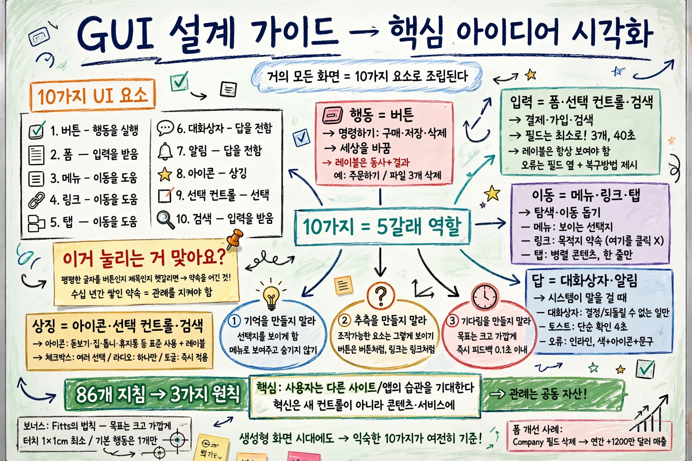
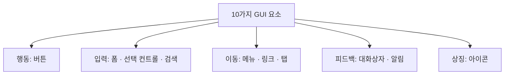
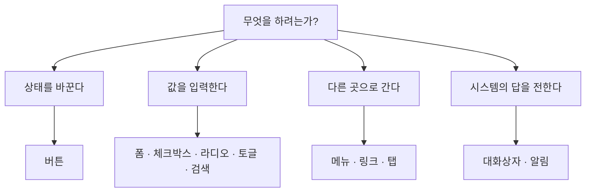

# 버튼이 안 눌리는 것 같다고요? 10가지 GUI 알파벳을 어겼기 때문입니다

> **Summary**
> 거의 모든 화면은 버튼·폼·메뉴·링크·대화상자·알림·아이콘·선택 컨트롤·탭·검색이라는 10가지 상호작용 요소로 조립되며, 각 요소는 행동 실행·입력·이동·피드백·의미 전달이라는 서로 다른 역할을 맡았습니다. 버튼은 결과 중심 레이블을 쓰고, 폼은 불필요한 필드를 지우며, 링크와 버튼의 문법을 섞지 않는 것처럼, 요소마다 지켜야 할 설계 원칙이 따로 있습니다. 86개 지침은 기억하게 만들지 않고, 추측하게 만들지 않고, 기다리게 만들지 않는다는 세 가지 원칙으로 압축되며, 생성형 화면에서도 익숙한 컨트롤이 방향 감각을 지켜줍니다.

---

- 거의 모든 화면은 버튼·폼·메뉴·링크·대화상자·알림·아이콘·선택 컨트롤·탭·검색, 10가지 요소로 조립됩니다.
- 요소마다 역할이 다릅니다. 버튼은 행동을 실행하고, 폼은 입력을 받고, 메뉴·링크·탭은 이동을 돕고, 대화상자·알림은 답을 전합니다.
- 86개 지침은 세 가지로 압축됩니다. 기억·추측·기다림을 만들지 않는 것입니다.

"이거 눌리는 거 맞아요?"

평평한 글자를 보고 버튼인지 제목인지 헷갈린 적 있으시죠? 눌렀는데 아무 일도 안 일어나면, 그제야 장식이었다는 걸 알게 됩니다. 화면이 복잡해서가 아니라 수십 년간 쌓인 약속을 어겼기 때문입니다.

🎥 [동영상 보기](https://www.youtube.com/watch?v=EsHA6k0x8wA)

## GUI, 왜 알파벳에 비유할까요?

영어 알파벳 26자로 모든 단어를 쓰듯, GUI도 10가지 요소로 거의 모든 화면을 만듭니다. 10가지는 다섯 갈래입니다. 버튼은 행동하고, 폼·선택 컨트롤·검색은 입력을 받고, 메뉴·링크·탭은 이동시키고, 대화상자·알림은 답을 전하고, 아이콘은 다른 요소가 입는 상징입니다. 버튼은 명령하고, 알림은 단언하고, 대화상자는 묻고, 링크는 약속하고, 검색은 듣습니다!

사용자는 대부분의 시간을 다른 사이트와 앱에서 보내므로, 새 제품도 이미 아는 방식으로 작동하기를 기대합니다. 표준 돋보기 아이콘은 모두의 학습을 강화하지만, 링크를 버튼처럼 꾸미면 약속이 흔들립니다. 관례는 여러 제품이 함께 쌓는 공동 자산이라서, 한 곳에서 어기면 다음 화면까지 헷갈리게 됩니다!

## 버튼: 결과를 실행하는 유일한 요소

버튼은 화면이 아니라 세상을 바꿉니다. 구매·저장·삭제, 누르는 순간 돈이 움직이고 파일이 사라집니다. 잘못된 탐색은 뒤로 가기로 되돌릴 수 있지만, 잘못 누른 버튼은 되돌리기 어렵습니다. 그래서 레이블이 가장 중요합니다. `OK` 대신 `주문하기`, `파일 3개 삭제하기`처럼 동사와 결과를 함께 적어야 합니다. 누르면 무슨 일이 일어날지 바로 알아야 합니다.

크기와 위치도 물리 법칙을 따릅니다. 1954년에 발표된 Fitts의 법칙에 따르면, 목표가 멀고 작을수록 누르는 데 오래 걸립니다. 자주 쓰는 버튼은 크고 가깝게 두고, 터치 목표는 최소 1×1cm를 지켜야 합니다. 모든 누름에는 0.1초 이내로 반응하고, 한 화면의 지배적인 기본 행동은 하나만 두어야 합니다. 비활성 버튼은 숨기지 말고 흐린 색으로 보여주면서, 왜 쓸 수 없는지 알려주어야 합니다.

## 폼: 주의를 전환으로 바꾸는 구조

폼은 결제와 가입이 일어나는 곳이라 사용성이 매출에 바로 연결됩니다. 가장 강력한 개선 방법은 필드 삭제입니다. 선택 필드도 읽기·해석·적용 여부 판단·생략 가능성 확인이라는 부담을 지웁니다. 느낀 부담이 이탈을 예측합니다. 그래서 `질문 3개, 40초`처럼 예상 부담을 정확히 보여주면 막연한 두려움이 거래로 바뀝니다. 한 여행 예약 사이트는 `Company` 항목 하나를 지운 뒤 연간 1,200만 달러를 더 벌었습니다. 고객이 그 칸에 은행 정보를 적어 결제 검증에 실패했기 때문입니다!

자리표시자는 타이핑을 시작하면 사라지므로 레이블을 대신할 수 없습니다. 모든 필드에는 입력 중에도 남아 있는 외부 레이블이 필요합니다. 오류는 문제가 있는 필드 옆에서 평이한 언어로 알리고, 입력한 데이터는 보존해야 합니다. 날짜에는 날짜 선택기, 장바구니 항목 제거에는 휴지통처럼 생각에 맞는 컨트롤을 써야 합니다.

## 메뉴·링크·탭: 이동을 돕는 세 가지 문법

메뉴는 필요할 때 나타나는 명령·탐색 목록으로, 사용자가 명령을 기억하지 않고 보이는 선택지를 고르게 해줍니다. 다만 선택지 전체를 보여준다는 약속을 내포합니다. 열거할 수 있으면 메뉴를, 선택지가 사실상 무한하면 검색을 써야 합니다. 계단식 메뉴는 2단계까지만 허용하고, 데스크톱에서는 최상위 탐색을 직접 보여주는 게 좋습니다. 햄버거 메뉴는 모바일의 타협안일 뿐입니다.

링크는 목적지를 약속하는 웹의 기본 단위입니다. 클릭할 수 있다는 시각적 약속과 목적지를 알려주는 언어적 약속을 함께 줍니다. 링크 앞부분에 의미 있는 단어를 두어야 합니다. `여기를 클릭`은 목적지를 알려주지 못합니다. 버튼은 행동을, 링크는 이동을 맡으므로 두 시각 언어를 섞으면 안 됩니다. 링크를 버튼처럼 꾸미는 순간 약속이 무너집니다.

탭은 같은 수준의 병렬 콘텐츠를 한 화면 영역에서 나눠 보여줍니다. 항상 한 줄만 쓰고, 비교할 내용은 여러 탭으로 나누지 말고 표로 함께 보여주어야 합니다. 순차적인 결제 단계에는 맞지 않으므로 단계 표시가 있는 마법사를 써야 합니다.

## 대화상자·알림: 시스템이 말을 걸 때

대화상자는 질문·결정·확인이 필요할 때 흐름을 멈추는 창입니다. 모달은 작업 기억을 끊으므로 차단이 필요한 결정, 되돌릴 수 없는 결과, 진행에 필수적인 입력에만 써야 합니다. 사소한 행동마다 확인을 띄우면 확인 피로가 생겨 중요한 경고도 반사적으로 닫게 됩니다. 되돌릴 수 있는 행동에는 확인보다 실행 취소가 낫습니다!

토스트는 `메시지를 보냈습니다` 같은 단순 확인에 어울리지만, 조치해야 하는 오류를 4초 뒤에 사라지게 해서는 안 됩니다. 오류 메시지는 평이한 언어로 문제와 위치를 정확히 밝히고, 복구 방법을 한 문장으로 알려주어야 하며, 사용자를 탓하는 표현은 쓰지 않습니다. 남성 12명 중 1명은 적록 색각 이상이 있으므로, 빨간색만으로 오류를 표시하지 말고 아이콘과 문구를 함께 써야 합니다. 확인만 전할 때는 토스트, 남아야 하는 오류는 인라인, 재앙적인 상황만 모달로 처리합니다.

## 아이콘·선택 컨트롤·검색: 작은 것들의 문법

아이콘은 객체·행동·상태를 나타내는 작은 그림으로, 널리 인식되는 것은 돋보기·집·톱니바퀴·휴지통 정도뿐입니다. 공간이 허용되면 텍스트 레이블을 붙여야 합니다. 레이블이 붙은 아이콘은 학습 기회이고, 없는 아이콘은 사용자를 시험하는 셈입니다. 표준 아이콘을 새로 그리면 수십 년의 학습을 소모합니다.

체크박스와 라디오 버튼, 토글은 모양부터 다릅니다. 사각형은 여러 개 선택, 원은 하나만 선택이라는 문법이 수십 년간 학습됐습니다. 라디오 그룹은 선택 전 상태로 돌아갈 수 없으므로, 선택하지 않기가 유효하면 `None`을 제공해야 합니다. 토글은 변경이 즉시 적용되는 설정에만 쓰고, 저장 버튼과 함께 두면 시점이 모호해집니다. 예·아니요는 라디오 버튼 두 개가 아니라 체크박스 하나로 나타냅니다.

검색은 텍스트 필드와 돋보기의 결합으로, 사용자가 탐색 구조 대신 자신의 말로 목표를 입력하게 합니다. 명령어를 선택지로 대체한 GUI에서도, 검색은 무한한 의도를 언어로 다룰 수 있어 살아남은 명령줄입니다. 검색창은 전체 질의를 볼 만큼 넓어야 하고, 최소 27자 너비를 권장합니다. 오타·복수형·동의어를 허용하고, 결과 페이지에서도 질의를 검색창에 남겨야 합니다. 검색 로그에는 사용자의 목표와 어휘가 그대로 남으므로, 검색량은 많지만 결과가 나쁜 질의부터 고치면 됩니다.

## 보너스: 창·스크롤·포인터

창은 여러 문서와 앱을 한 화면에 함께 두는 영역이라, 새 창을 예고 없이 열면 뒤로 가기가 깨집니다. 스크롤바는 이동 수단이자 현재 위치와 남은 양을 보여주는 지도입니다. 포인터는 사용자의 손을 화면에 투영하고, 커서 모양이 클릭 결과를 알려줍니다. 터치스크린에는 마우스 오버가 없어 오버로만 나타나는 컨트롤은 모바일에서 접근할 수 없습니다.

## 86개 지침, 세 줄로 줄이면?

86개 지침은 세 가지 원칙으로 압축됩니다. 기억·추측·기다림을 만들지 않는 것입니다. 선택지를 보이게 하고, 조작 가능한 요소는 그렇게 보이게 하고, 목표물은 크고 가깝게 만드는 것이 전부입니다. 혁신은 새 체크박스보다 콘텐츠와 서비스에 써야 합니다!

생성형 화면이 즉석에서 화면을 만들어내는 시대에도, 사람은 여전히 버튼·필드·탭을 읽고 조작합니다. 동적인 화면일수록 익숙한 컨트롤이 필요합니다. 좋은 표준 컨트롤은 요소를 의식하지 않고 작업에 집중하게 합니다. 인터페이스에서 사라진 듯 느껴지는 상태가 가장 높은 평가입니다.

