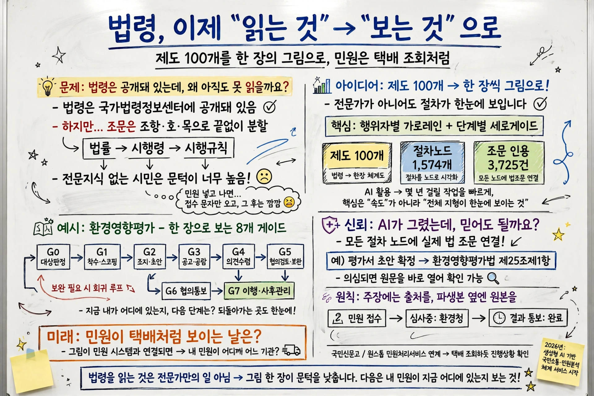
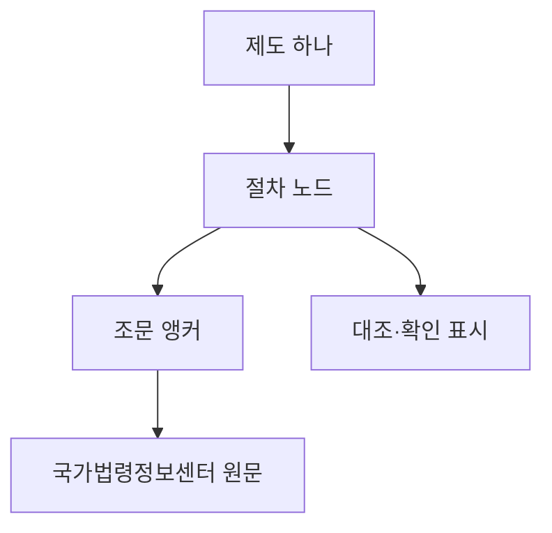

# 법령 100개를 한 장씩 그림으로 그리면, 전문가가 아니어도 제도가 보입니다

> **Summary**
> 대한민국 제도 100개가 한 장씩 체계도로 만들어졌습니다. 행위자별 레인과 단계별 게이트로 절차를 펴고, 모든 노드는 실제 법 조문에 묶여 있어 AI가 지어낸 얘기인지 원문으로 바로 확인할 수 있습니다. 그림이 민원 시스템과 이어지면, 내 민원이 어디까지 갔는지 택배 조회하듯 볼 수 있는 날이 옵니다.

---

- 법령은 이미 공개돼 있는데, 왜 아직도 못 읽을까요? 제도 100개가 한 장씩 그림이 되면, 전문가가 아니어도 절차가 보입니다.
- 모든 그림은 실제 조문에 묶여 있습니다. AI가 지어낸 얘기인지, 원문을 열어 바로 확인할 수 있습니다.
- 그림이 민원 시스템과 이어지면, 내 민원이 어디까지 갔는지 택배 조회하듯 볼 수 있습니다.

민원 하나 넣고 나서, 어떻게 되셨나요? 접수됐다는 문자 하나 받고, 그 뒤는 깜깜합니다. 어디까지 갔는지, 지금 어느 기관에 있는지, 알 길이 없습니다. 법령을 직접 찾아보자니 조문은 끝없이 이어지고 용어는 낯설기만 합니다. 이런 적 있으시죠?

🎥 [동영상 보기](https://www.youtube.com/watch?v=CorQtMQgXo0)

## 법은 공개돼 있는데, 왜 못 읽을까요?

법령은 국가법령정보센터에서 누구나 볼 수 있습니다. 그런데 "공개됐다"와 "읽을 수 있다"는 다른 문제입니다. 조문은 조항·호·목으로 끝없이 나뉘고, 한 제도를 이해하려면 법률·시행령·시행규칙을 오가며 읽어야 합니다. 전문 지식이 없는 시민에게는 문턱이 너무 높습니다!

행정 현장에서는 이 간극을 매일 느낍니다. 공공행정 영역에는 전문성과 암묵지가 막대하게 쌓여 있는데, 그걸 시민이 알아서 읽어내기는 어렵습니다. 그래서 나온 생각이 조금 다릅니다. 일반인이 AI를 배우는 게 아니라, AI를 통해서 다른 전문 영역의 리터러시를 높이는 것입니다.

## 제도 100개, 한 장씩 그림이 됐습니다

대한민국 제도 100개를 한 장씩 체계도로 만든 작업이 있습니다. 제도 하나를 줄글로 설명하는 대신, 절차를 한 장의 구조도로 펴는 방식입니다. 행위자별로 가로 레인을 나누고, 단계별로 세로 게이트를 세워, 누가·언제·무엇을 하는지를 격자 위에 그립니다.

규모부터 남다릅니다. 제도 100개, 절차 노드 1,574개, 조문 인용 대조 3,725건입니다. 사람이 법령을 읽고 그림으로 옮기려면 몇 년이 걸릴 일이지만, AI를 활용하면 금방 할 수 있는 일이 됐습니다. 속도가 핵심이 아닙니다. 그림 한 장으로 제도의 전체 지형이 보인다는 게 핵심입니다!

## 환경영향평가, 그림 한 장이면 뭐가 보일까요?

환경영향평가를 예로 들어볼까요? 이 제도는 대상판정부터 이행·사후관리까지 8개 게이트(G0~G7)를 거칩니다. 착수·스코핑, 조사·초안, 공고·공람, 의견수렴·본안, 협의검토·보완, 협의통보·승인 순으로 이어집니다. 보완이 필요하면 이전 게이트로 되돌아가는 회귀 루프까지 그려져 있습니다.

줄글로 읽으면 머릿속에서 길을 잃기 쉬운 절차가, 그림에서는 한눈에 들어옵니다. 지금 내가 어디에 서 있는지, 다음에 무엇이 오는지, 어디로 되돌아가는지가 보입니다. 이 장면이 저는 가장 인상 깊었습니다. 복잡한 제도가 "읽는 것"에서 "보는 것"으로 바뀌는 순간이니까요!

## AI가 그렸는데, 믿어도 될까요?

여기서 제일 먼저 드는 질문이 있습니다. AI가 그렸는데, 믿어도 될까요? AI는 그럴듯한 소설을 쓸 수 있으니까요. 이 작업의 답은 "그림을 예쁘게 그리는 것"이 아니라 "모든 노드를 조문에 묶는 것"입니다.

각 절차 노드에는 실제 법 조문이 붙어 있습니다. '평가서 초안 확정' 노드에는 환경영향평가법 제25조제1항이 붙는 식입니다. 환경영향평가 하나에만 55개 조문이 대조·확인됐습니다. 주장마다 출처가 따라붙으니, 의심스러우면 원문을 열어 바로 검증할 수 있습니다. AI의 답을 믿는 게 아니라, AI의 답을 확인할 수 있게 만드는 구조입니다!

> 주장에는 출처를, 파생본 옆엔 원본을.

이 원칙은 같은 뿌리에서 나온 또 하나의 작업에서도 이어집니다. 전자관보 12만 8천여 건(2020년 1월 2일~2026년 4월 7일)을 마크다운 코퍼스로 바꾼 작업입니다. 깨진 글자를 사전으로 되살리고, 원본 PDF는 그대로 둔 채 그 위에 AI가 읽을 수 있는 층을 한 겹 더 올렸습니다. 원본을 지우지 않으니, 파생본이 틀려도 언제든 원본으로 돌아가 대조할 수 있습니다.

## 민원이 택배처럼 보이는 날이 올까요?

이 그림들의 끝에는 한 가지 바람이 있습니다. 국민신문고나 원스톱 민원처리서비스와 연계돼, '내 민원이 어디까지 갔고, 지금 어느 기관에 있는지'를 택배 조회하듯 볼 수 있는 날입니다.

아직은 바람입니다. 연계 자체가 만들어진 건 아닙니다. 하지만 방향은 분명합니다. 제도를 그림으로 바꾸는 일이 시민의 눈높이에 맞추는 일이라면, 민원 진행 상황을 보여주는 일은 그 다음 걸음입니다. 2026년 2월에는 국민신문고의 대규모 민원 데이터를 AI가 스스로 분석·처리하는 생성형 AI 기반 국민소통·민원분석 체계가 서비스를 시작하기도 했습니다. 답변 추천부터 빈발 민원 일괄처리, 민원 분석까지, 행정의 AI 전환은 이미 진행 중입니다!

법령을 읽는 일은 전문가만의 일이 아니었습니다. 그림 한 장이 그 문턱을 낮췄습니다. 다음 문턱은 내 민원이 지금 어디에 있는지를 아는 일입니다. 그날이 오면, 행정은 설명하는 대상이 아니라 함께 보는 대상이 됩니다.

