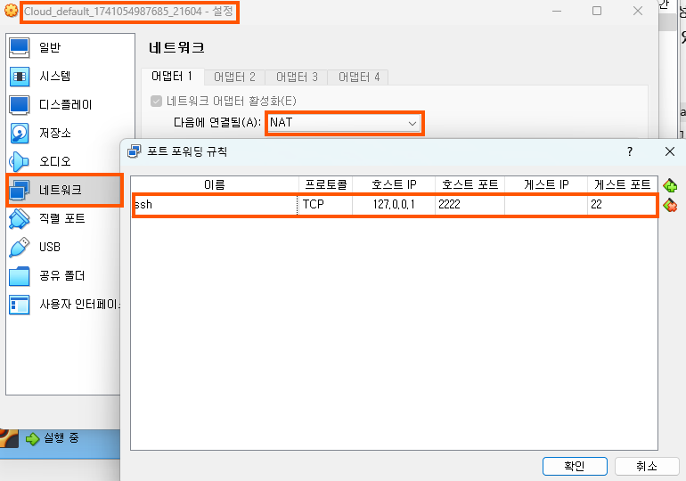
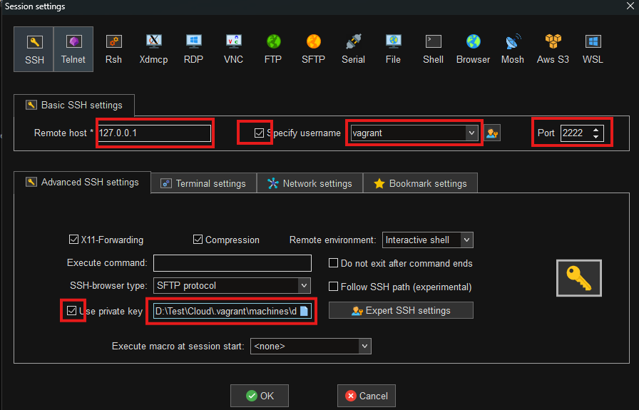
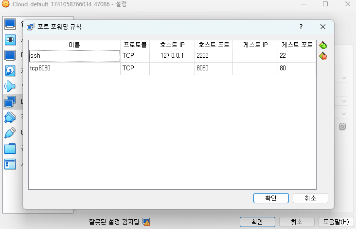
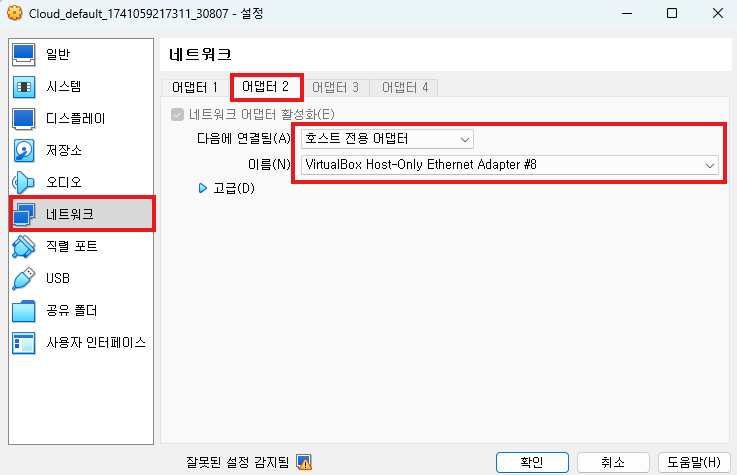
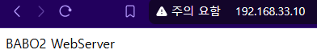

# 베이그런트Vagrant 설치 및 설정

> **Summary**
> 콘텐츠 없음

---


[https://developer.hashicorp.com/vagrant/install?product_intent=vagrant](https://developer.hashicorp.com/vagrant/install?product_intent=vagrant)

[https://portal.cloud.hashicorp.com/vagrant/discover](https://portal.cloud.hashicorp.com/vagrant/discover)

## 실습 - 베이그런트 기본 설치 및 이미지1개 생성 및 삭제

윈도우 터미널에서…

```yaml
cd d:
mkdir Test
cd .\Test\
mkdir Cloud
cd .\Cloud\
```

jammy64 설정을 다운받자!

```yaml
vagrant init hasicorp/jammy64
```

파일 수정해주자

```yaml
code D:\\Test\Cloud\vagrant
```

```yaml
Vagrant.configure("2") do |config|    # "2"는 현재 vagrant 설정 형식 버전 2를 사용한다는 의미
  config.vm.box = "ubuntu/jammy64"    # Ubuntu 22.04 (Jammy Jellyfish) 버전의 box 이미지 사용
  config.vm.box_version = "20250301.0.0"     # box 이미지의 버전 정보
  config.vm.provision "shell", inline: "apt update && apt upgrade -y"  # 배포 중 실행 (업그레이드 포함)
  config.vm.provider "virtualbox" do |vb1|   # 가상머신의 세부 설정 정보
    vb1.memory = "2048"
    vb1.cpus = "1"
  end
end

```

### 베이그런트 실행 및 상태확인

```yaml
vagrant up
```

```yaml
vagrant status
```


### 베이그런트 ssh 접속

```yaml
vagrant ssh-config
```

```yaml
Host default
  HostName 127.0.0.1
**  User vagrant
  Port 2222
**  UserKnownHostsFile /dev/null
  StrictHostKeyChecking no
  PasswordAuthentication no
**  IdentityFile D:/Test/Cloud/.vagrant/machines/default/virtualbox/private_key
**  IdentitiesOnly yes
  LogLevel FATAL
  PubkeyAcceptedKeyTypes +ssh-rsa
  HostKeyAlgorithms +ssh-rsa
```



```yaml
vagrant ssh
```



```yaml
sudo su -
```

```yaml
root@ubuntu-jammy:~# lsb_release -a
No LSB modules are available.
Distributor ID: Ubuntu
Description:    Ubuntu 22.04.5 LTS
Release:        22.04
Codename:       jammy
```

```yaml
root@ubuntu-jammy:~# cat /proc/cpuinfo |egrep '(processor|name)'
processor       : 0
model name      : 11th Gen Intel(R) Core(TM) i7-1165G7 @ 2.80GHz
```

```yaml
root@ubuntu-jammy:~# cat /proc/meminfo |grep MemTotal
MemTotal:        2011148 kB
```

### 베이그런트 삭제

```yaml
vagrant halt
```

```yaml
vagrant destroy -f
```

## 실습 - 베이그런트 기본 설치 및 이미지2개 생성

```yaml
# Ubuntu VM 2개 동시 배포
Vagrant.configure("2") do |config|

  config.vm.define "frontend" do |frontend|
    frontend.vm.box = "ubuntu/jammy64"
    frontend.vm.box_version = "20241002.0.0"
    frontend.vm.host_name = "front"
    frontend.vm.provider :virtualbox do |spec|
      spec.cpus = 1
      spec.memory = 2048
    end
  end

  config.vm.define "backend" do |backend|
    backend.vm.box = "ubuntu/jammy64"
    backend.vm.box_version = "20241002.0.0"
    backend.vm.host_name = "backend"
    backend.vm.provider :virtualbox do |spec|
      spec.cpus = 1
      spec.memory = 2048
    end
  end
end
```

### 베이그런트 실행 및 상태확인

```yaml
vagrant up
```

```yaml
vagrant status
```

```yaml
PS D:\Test\Cloud> vagrant status
Current machine states:

frontend                  running (virtualbox)
backend                   running (virtualbox)
```

### 각 VM 이름별로 ssh 접근이 가능하다`

```yaml
vagrant ssh frontend
```

```yaml
vagrant ssh backend
```

## 실습 - 베이그런트 도커 설치

```yaml
Vagrant.configure("2") do |config|
  config.vm.box = "ubuntu/jammy64"
  config.vm.box_version = "20241002.0.0"
  
  config.vm.provision "shell", inline: "curl -fsSL https://get.docker.com -o get-docker.sh"
  config.vm.provision "shell", inline: "sh get-docker.sh"
  config.vm.provision "shell", inline: "usermod -aG docker vagrant"
  config.vm.provision "shell", inline: "echo 'sudo su -' >> .bashrc"

  config.vm.provider "virtualbox" do |vb1|
    vb1.memory = "4096"
    vb1.cpus = "2"
  end
end
```

- **가상 머신 설정:**
  Ubuntu 22.04 (Jammy Jellyfish) 운영체제를 사용하는 가상 머신을 생성합니다. 지정된 버전("20241002.0.0")의 이미지가 사용됩니다.

- **도커 설치 및 설정:**
  가상 머신이 시작되면 자동으로 다음 작업들이 진행됩니다:

  1. 도커 설치 스크립트를 다운로드합니다.
  1. 해당 스크립트를 실행하여 도커를 설치합니다.
  1. `vagrant` 사용자를 도커 그룹에 추가하여, 나중에 도커 명령어를 사용할 때 sudo 없이 실행할 수 있도록 합니다.
  1. `.bashrc` 파일에 `sudo su -` 명령어를 추가하여, 터미널을 열 때 자동으로 관리자 권한으로 전환되도록 합니다.
- **가상 머신 자원 할당:**
  VirtualBox를 가상 머신 제공자로 사용하며, 메모리 4096MB와 CPU 2개를 할당하여 성능을 지정합니다.

```yaml
vagrant up
```

```yaml
vagrant ssh
```

```yaml
sudo systemctl status docker
```

## 실습 - 베이그런트 포트포워딩 설정

guest : 버추얼 박스에 생성되는 포트

host : 버추얼박스에 접근할때 사용하는 진입포트

```yaml
Vagrant.configure("2") do |config|
  config.vm.box = "ubuntu/jammy64"
  config.vm.box_version = "20241002.0.0"
**  config.vm.network "forwarded_port", guest: 80, host: 8080
**  config.vm.provision "shell", inline: "apt update && apt install -y apache2 && systemctl enable apache2"
  config.vm.provision "shell", inline: "echo BABO WebServer > /var/www/html/index.html"
  config.vm.provider "virtualbox" do |vb1|
    vb1.memory = "2048"
    vb1.cpus = "1"
  end
end
```



```yaml
systemctl status apache2
```


## 실습 - 네트워크 인터페이스 생성

```yaml
Vagrant.configure("2") do |config|
  config.vm.box = "ubuntu/jammy64"
  config.vm.box_version = "20241002.0.0"
  config.vm.network "private_network", ip: "192.168.33.10"
  config.vm.provision "shell", inline: "apt update && apt install -y apache2 && systemctl enable apache2"
  config.vm.provision "shell", inline: "echo BABO2 WebServer > /var/www/html/index.html"
  config.vm.provider "virtualbox" do |vb1|
    vb1.memory = "2048"
    vb1.cpus = "1"
  end
end

```

- **운영체제 설정:**
  Ubuntu의 Jammy Jellyfish 버전(ubuntu/jammy64)을 사용하며, 특정 버전("20241002.0.0")의 이미지를 기반으로 가상 머신을 생성합니다.

- **네트워크 설정:**
  가상 머신에 사설 IP 주소(192.168.33.10)를 할당하여 외부와의 네트워크 연결 없이 내부적으로 통신할 수 있도록 합니다.

- **Apache2 웹 서버 설치 및 설정:**
  가상 머신이 시작되면 자동으로 apt 업데이트를 실행하고 Apache2 웹 서버를 설치합니다. 설치 후, Apache2가 시스템 부팅 시 자동으로 시작되도록 설정합니다.

  또한, `/var/www/html/index.html` 파일에 "BABO2 WebServer"라는 내용을 기록하여 기본 웹 페이지로 설정합니다.

- **가상 머신 자원 할당:**
  VirtualBox를 가상 머신 제공자로 사용하며, 메모리 2048MB와 CPU 1개를 할당하여 가상 머신의 성능을 지정합니다.





```yaml
vagrant@ubuntu-jammy:~$ ip add
1: lo: <LOOPBACK,UP,LOWER_UP> mtu 65536 qdisc noqueue state UNKNOWN group default qlen 1000     
    link/loopback 00:00:00:00:00:00 brd 00:00:00:00:00:00
    inet 127.0.0.1/8 scope host lo
       valid_lft forever preferred_lft forever
    inet6 ::1/128 scope host
       valid_lft forever preferred_lft forever
2: enp0s3: <BROADCAST,MULTICAST,UP,LOWER_UP> mtu 1500 qdisc fq_codel state UP group default qlen 1000
    link/ether 02:01:fa:1e:0e:e4 brd ff:ff:ff:ff:ff:ff
    inet 10.0.2.15/24 metric 100 brd 10.0.2.255 scope global dynamic enp0s3
       valid_lft 86306sec preferred_lft 86306sec
    inet6 fe80::1:faff:fe1e:ee4/64 scope link
       valid_lft forever preferred_lft forever
**3: enp0s8: <BROADCAST,MULTICAST,UP,LOWER_UP> mtu 1500 qdisc fq_codel state UP group default qlen 1000
    link/ether 08:00:27:52:32:ca brd ff:ff:ff:ff:ff:ff
    inet 192.168.33.10/24 brd 192.168.33.255 scope global enp0s8**
       valid_lft forever preferred_lft forever
    inet6 fe80::a00:27ff:fe52:32ca/64 scope link
       valid_lft forever preferred_lft forever
```

```yaml
vagrant@ubuntu-jammy:~$ cat /etc/netplan/50-vagrant.yaml 
---
network:
  version: 2
  renderer: networkd
  ethernets:
    enp0s8:
      addresses:
      - 192.168.33.10/24
```


