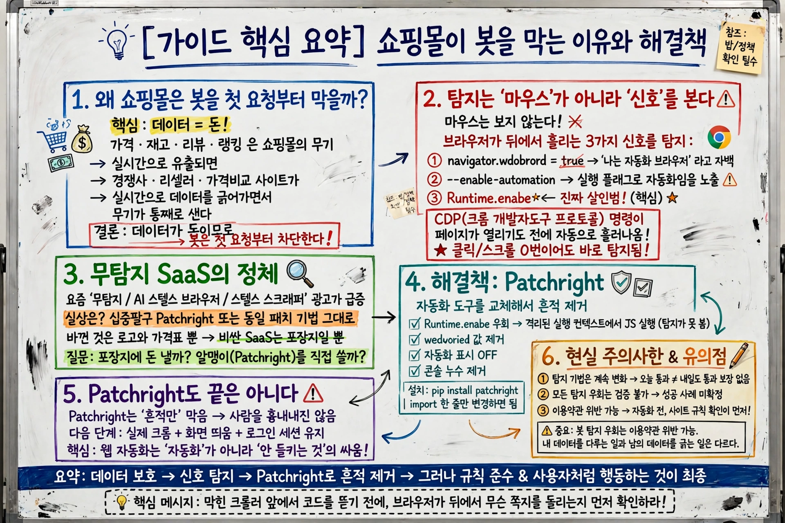
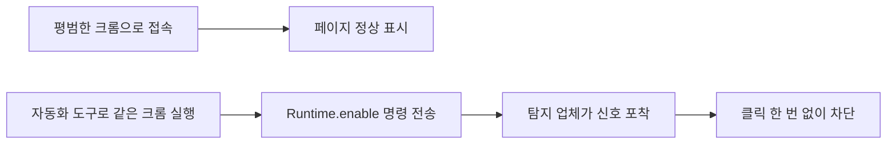
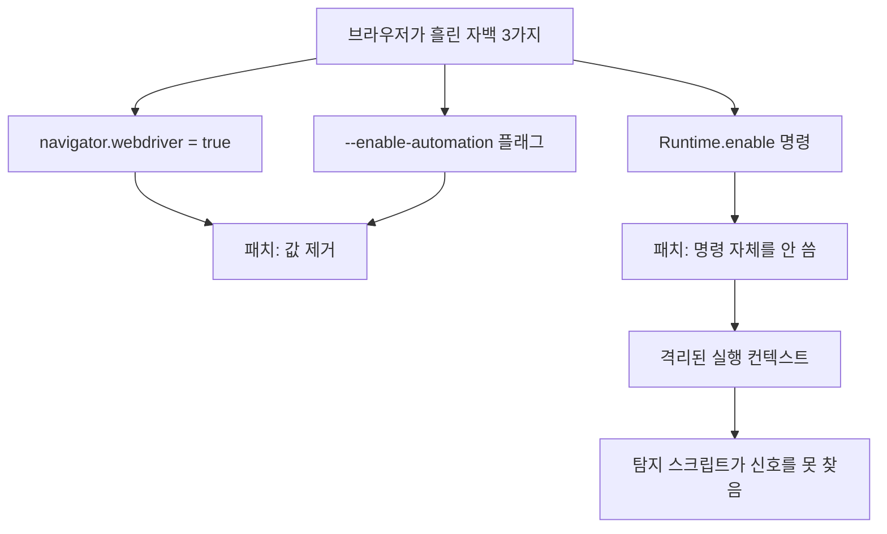
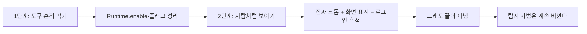

# 봇 탐지는 당신이 뭘 하는지 안 봅니다. 브라우저가 뒤에서 흘리는 신호를 봅니다

> **Summary**
> 쇼핑몰이 봇을 막는 이유는 데이터가 곧 돈이기 때문입니다. 가격·재고·리뷰·랭킹이 실시간으로 새면 무기가 통째로 샙니다. 탐지는 마우스 움직임이 아니라 브라우저가 뒤에서 흘리는 신호를 봅니다. Runtime.enable 명령 하나면 클릭 한 번 없이도 봇으로 찍힙니다. 요즘 쏟아지는 무탐지 SaaS의 속은 십중팔구 패치된 드라이버 그대로라, 포장지에 돈을 내기 전에 알맹이를 먼저 볼 일입니다.

---

- 쇼핑몰이 봇을 막는 이유는 데이터가 곧 돈이기 때문입니다. 가격·재고·리뷰·랭킹이 실시간으로 새면 무기가 통째로 샙니다.
- 탐지는 마우스 움직임이 아니라, 브라우저가 뒤에서 흘리는 신호를 봅니다. `Runtime.enable` 명령 하나면 클릭 한 번 없이도 봇으로 찍힙니다.
- 요즘 쏟아지는 "무탐지" SaaS의 속은 십중팔구 패치된 드라이버 그대로입니다. 포장지에 돈을 내기 전에 알맹이를 먼저 볼 일입니다.

상품 페이지 하나 보려고 브라우저 자동화를 돌렸는데, 페이지가 열리기도 전에 차단 화면이 떴던 적 있으시죠? 코드는 멀쩡했습니다. 클릭 한 번, 스크롤 한 번 안 했는데 말이죠.

🎥 [동영상 보기](https://www.youtube.com/watch?v=afobK3UbTeE)

### 쇼핑몰은 왜 봇을 첫 요청부터 자를까요?

데이터가 돈이기 때문입니다. 가격·재고·리뷰·랭킹, 이 네 가지가 쇼핑몰의 무기입니다. 경쟁사, 가격비교 사이트, 리셀러가 이걸 실시간으로 긁어가면 무기가 통째로 샙니다. 그래서 봇은 첫 요청부터 잘라야 합니다. 그냥 상품 페이지인데 왜 이렇게까지 막느냐고요? 그 페이지에 돈이 들어 있기 때문입니다.

### 탐지는 뭘 볼까요? 마우스가 아닙니다!

소름 돋는 진실이 있습니다. 탐지는 내가 뭘 하는지 안 봅니다. 내 브라우저가 뒤에서 뭘 흘리는지 봅니다. 내 크롬은 나도 모르게 사이트한테 쪽지를 돌리고 있었습니다. "얘 봇이에요."

브라우저가 흘린 자백은 크게 세 가지입니다. 첫째, `navigator.webdriver = true`입니다. 대놓고 "나 자동화됨"이라고 적혀 있습니다. 둘째, `--enable-automation` 같은 실행 플래그입니다. 브라우저가 자동화 도구라는 사실을 그대로 알립니다. 셋째, 그리고 진짜 살인범은 `Runtime.enable`입니다. 자동화 도구가 브라우저를 조종하려고 보내는 CDP(크롬 개발자도구 프로토콜) 명령인데, 마우스를 0번 움직여도 페이지가 로드되는 그 순간 이 명령이 흘러나옵니다. 탐지 업체는 이거 하나만 잡으면 끝입니다!

### 자동화 도구의 정체는 뭘까요?

자동화 도구는 브라우저를 CDP로 조종합니다. 개발자도구 뒷문을 프로그램이 잡고 흔드는 셈입니다. 문제는 그 뒷문이 활짝 열려 있다는 점입니다. 지문이 줄줄 샙니다. 겉에 스텔스 플러그인을 덧씌워도 소용없습니다. 자바스크립트 겉면만 가렸을 뿐, 신호 자체는 그대로 남아 있기 때문입니다.

### 그럼 어떻게 뚫을까요?

해결책은 Patchright입니다. 자동화 도구를 교체하면 됩니다. 하는 일은 네 가지입니다. `Runtime.enable` 우회, `webdriver` 제거, 자동화 표시 끄기, 콘솔 누수 제거입니다. 핵심은 첫 번째입니다. `Runtime.enable`을 아예 쓰지 않고, 자바스크립트를 격리된 실행 컨텍스트에서 돌립니다. 사이트의 탐지 스크립트는 그 컨텍스트를 볼 수 없어서 신호를 찾을 수 없습니다. 설치는 `pip install patchright` 한 줄, import 한 줄만 바꾸면 됩니다.

### "무탐지 AI 브라우저"의 정체는 뭘까요?

여기서 진짜 폭로가 나옵니다. 요즘 쏟아지는 "AI 브라우저", "스텔스 스크래퍼", "무탐지 자동화 SaaS"들, 까보면 십중팔구 포장지입니다. 속은 그냥 Patchright, 또는 똑같은 패치 기법 그대로입니다. 바뀐 건 로고랑 가격표뿐입니다. 비싼 무탐지 툴 결제하기 전에 한 번만 생각해 보세요. 한 줄 설치면 그 코어를 그대로 쥐는 거니까요. 포장지에 돈 낼 거냐, 알맹이를 직접 쓸 거냐, 그게 질문입니다.

### Patchright도 끝은 아닙니다

물론 Patchright도 끝은 아닙니다. 얘는 도구가 흘리는 흔적만 막아줍니다. 진짜 사람처럼 보이게 하는 건 그 다음 단계입니다. 진짜 크롬으로, 화면 띄운 채로, 로그인 흔적까지 갖춘 상태로 말이죠. 결국 웹 자동화의 정체는 "자동화"가 아니라 "안 들키기"의 싸움입니다!

### 어디까지 믿을 수 있을까요?

정직하게 짚을 점이 세 가지 있습니다. 첫째, 탐지 업체의 기법은 계속 바뀝니다. 오늘 통과했다는 말이 내일도 통한다는 보장은 없습니다. 둘째, 모든 탐지 업체를 뚫었다는 검증된 사례가 있는 건 아닙니다. 스레드 댓글에서도 "특정 탐지 업체를 우회해서 수집에 성공한 케이스가 있나요?"라는 질문이 그대로 남아 있었습니다. 셋째, 탐지가 완벽하지도 않습니다. 일반 유저 활동까지 막힌다는 반응도 있었습니다. 막는 쪽도, 뚫는 쪽도 완벽하지 않습니다.

그리고 한 가지 더 있습니다. 봇 탐지를 우회하는 행위는 사이트 이용 약관에 어긋날 수 있습니다. 자동화하기 전에 대상 사이트의 규칙부터 확인하는 게 먼저입니다. 내 데이터를 다루는 일과 남의 데이터를 긁어오는 일은 다릅니다.

막힌 크롤러 앞에서 코드를 뜯기 전에, 브라우저가 뒤에서 무슨 쪽지를 돌리는지부터 살펴볼 일입니다!

