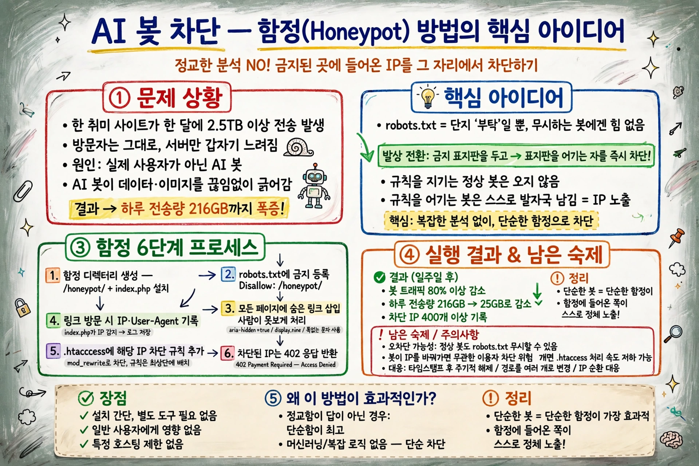
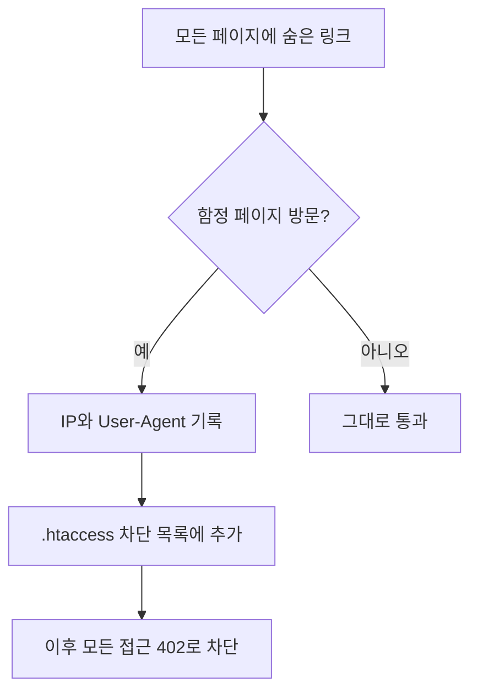
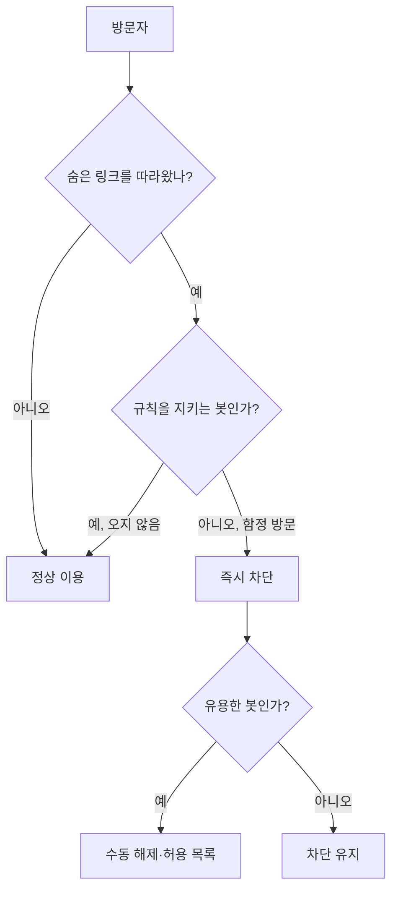

# 봇 트래픽 80%를 줄인 비결은 정교한 분석이 아닙니다. 함정 하나면 됩니다

> **Summary**
> 한 취미 사이트가 한 달에 2.5TB를 넘게 전송했습니다. 인기가 아니라 AI 봇이 데이터와 이미지를 끝없이 긁어간 탓이었습니다. 해법은 정교한 분석이 아니었습니다. robots.txt에서 접근을 금지한 숨은 함정에 발을 들인 IP를 그 자리에서 차단하는 투박한 방법이었습니다. 일주일 만에 봇 트래픽이 80% 넘게 줄고, 하루 전송량은 216GB에서 25GB로 떨어졌습니다. 다만 오차단과 회피라는 숙제도 함께 남았습니다.

---

- 한 취미 사이트가 한 달에 2.5TB를 넘게 전송했습니다. 인기가 아니라 AI 봇이 데이터와 이미지를 끝없이 긁어간 탓이었습니다.
- 해법은 정교한 분석이 아니었습니다. `robots.txt`에서 접근을 금지한 숨은 함정에 발을 들인 IP를 그 자리에서 차단하는 투박한 방법이었습니다.
- 일주일 만에 봇 트래픽이 80% 넘게 줄고, 하루 전송량은 216GB에서 25GB로 떨어졌습니다. 다만 오차단과 회피라는 숙제도 함께 남았습니다.

사이트가 갑자기 느려졌습니다. 방문자는 그대로인데 전송량은 한 달에 2.5TB를 넘겼습니다. 뭔가 이상하지 않으세요? 범인은 사람이 아니었습니다. AI 봇이 데이터와 이미지를 끊임없이 수집하고 있었던 것입니다. 이 글은 그런 봇을 정교한 분석 없이, 함정 하나로 막아낸 방법을 소개합니다.

🎥 [동영상 보기](https://www.youtube.com/watch?v=FkxAMNmoGSg)

## `robots.txt`는 부탁일 뿐입니다

`robots.txt`는 사이트 루트에 두는 크롤러용 안내문입니다. 예의를 지키는 봇은 이 파일을 읽고, 접근이 금지된 경로는 방문하지 않습니다. 문제는 안내문이 부탁에 불과하다는 점입니다. 규칙을 무시하는 봇에게는 아무런 힘이 없습니다. 그래서 이 방법의 발상은 방향을 바꿨습니다. 금지 표지판을 세우는 데서 멈추지 않고, 금지된 곳에 발을 들이는 쪽을 그 자리에서 걸러내는 것입니다. 규칙을 지키는 봇은 오지 않고, 규칙을 어기는 봇은 스스로 정체를 밝히는 셈입니다!

## 함정은 이렇게 만듭니다

방법은 여섯 단계로 단순합니다. `/honeypot/` 같은 디렉터리를 만들고, 그 안에 `index.php`를 둡니다. `robots.txt`에 해당 경로 접근 금지를 적습니다. 사이트의 모든 페이지에 함정으로 향하는 숨은 링크를 넣습니다. 누군가 그 페이지를 방문하면 IP를 `.htaccess`에 기록합니다. 그러면 `.htaccess`가 그 IP의 사이트 접근을 영원히 막습니다. 끝입니다! 복잡한 판별 로직도, 머신러닝도 없습니다.

## 숨은 링크, 사람은 못 보고 봇은 봅니다

함정의 핵심은 링크를 숨기는 방법입니다. 크롤러는 페이지의 링크를 찾아 따라가는 습성이 있습니다. 그래서 모든 페이지에 함정 링크를 심되, 사람이 찾거나 클릭할 수 없게 만듭니다. 링크에는 `aria-hidden="true"`를 달아 접근성 트리에서 제외하고, 링크 텍스트로는 폭 없는 결합 문자(Zero Width Joiner)를 씁니다. CSS로는 `display: none !important`와 `cursor: none !important`를 적용해 화면과 마우스 커서에서 지웁니다. 사람이 이 링크를 찾아 클릭할 가능성은 얼마나 될까요? 원문에서는 거의 없다고 봅니다. 혹시라도 차단된 사람이 있으면, 차단 안내문에 해제 요청 방법을 적어두면 됩니다.

## 차단 규칙은 서버가 적습니다

차단은 `.htaccess`의 `mod_rewrite` 설정이 담당합니다. 차단 IP 구역을 다른 재작성 규칙보다 앞에 배치하는 것이 중요합니다. `RewriteCond`로 `REMOTE_ADDR`를 비교하고, `RewriteRule ^ - [R=402,L]`로 요청을 막습니다. 차단된 IP에는 `ErrorDocument 402`로 "Payment Required - Access Denied."라는 문구를 돌려줍니다. 안내문은 원하는 일반 텍스트로 바꿀 수 있습니다. 함정의 `index.php`는 방문자의 IP와 User-Agent를 읽어, 기존 `.htaccess`의 차단 구역에 새 조건을 추가한 뒤 파일을 저장합니다. 각 항목에는 시각과 User-Agent를 주석으로 남기고, IP 조건은 `[OR]`로 연결합니다. IP를 뽑는 함수는 `X-Forwarded-For`의 쉼표 구분 목록에 `REMOTE_ADDR`와 `HTTP_CLIENT_IP`를 더한 뒤, 사설·예약 주소가 아닌 첫 번째 유효 IP를 반환합니다. 캐시를 많이 쓰는 사이트에서도 동작하도록 만든 점이, 기존의 한 오픈소스 봇 차단 도구에서 느슨하게 착안한 이 방법의 특징입니다.

## 일주일, 숫자가 말해 줍니다!

일주일 동안 IP 400개 이상이 차단됐습니다. 봇 트래픽은 80% 넘게 줄었습니다. 하루 데이터 전송량은 최고 216GB에서 약 25GB로 떨어졌습니다. 당시까지 이용자 불만은 없었습니다. 재미있는 대목도 있습니다. 차단 안내문이 사실상 유료 해제처럼 보였는데, 해제 비용을 낸 봇은 하나도 없었다는 것입니다. 숫자가 먼저입니다! 효과는 분명했습니다.

## 오탐이 정말 없을까요?

원문에서는 "오탐이 없다"고 단언합니다. 일반 이용자는 숨은 링크를 따라갈 수 없고, 규칙을 지키는 봇은 따라가지 않으니까요. 그런데 실제 운영에서는 주의할 점이 있습니다. 유용한 봇도 `robots.txt`를 무시할 수 있습니다. User-Agent로 식별할 수 있다면 `.htaccess`에서 해당 항목을 수동으로 지우거나 허용 목록 예외를 만들면 됩니다. 다만 악성 봇은 User-Agent를 속이기도 합니다. 반대로 `robots.txt`를 지키면서도 문제를 일으키는 봇은 이 방식으로 잡지 못합니다. 봇이 탈취한 IP를 쓰다 떠나면 무관한 이용자가 계속 차단될 수도 있습니다. 차단 항목마다 타임스탬프가 있으니, 오래된 항목을 주기적으로 해제하는 방법이 있습니다. 봇이 수백 개 IP를 순환 사용하면 같은 봇을 여러 번 차단하게 됩니다. 차단 IP가 수천 개에 이르면 `.htaccess` 해석 비용으로 서버가 느려질 가능성도 있습니다. 다만 그 근거는 약한 일화 수준이라, 원문에서는 크게 걱정할 정도는 아니라고 판단했습니다. 봇이 CSS로 숨긴 링크를 알아보고 피할 수도 있고, `/honeypot/`이라는 경로명을 피하는 봇도 있습니다. 그럴 때는 보이지 않는 공백이나 문자를 쓰거나, 경로 이름을 바꾸거나, 함정을 여러 개 두는 식으로 대응합니다.

## 정교한 도구와 뭐가 다를까요?

정교한 봇 차단 도구도 있습니다. 그런데 설치 작업량이 많고 일반 이용자에게 불편을 주는 경우가 있습니다. 이 방법은 특정 호스팅 환경을 요구하지 않고, 일반 이용자에게 별도 화면을 보여주지 않습니다. 물론 다른 신호로 봇을 추정하는 방법도 있습니다. 언어 헤더 누락, 구형 HTTP 버전, 지나치게 오래된 User-Agent가 그런 신호입니다. 합리적인 기준이지만 오탐 가능성이 있습니다. 정교함이 답이 아닐 때가 있습니다! 단순한 봇에게는 단순한 함정이 통합니다. 함정에 발을 들인 쪽이 스스로 정체를 밝히는 셈이니까요.

