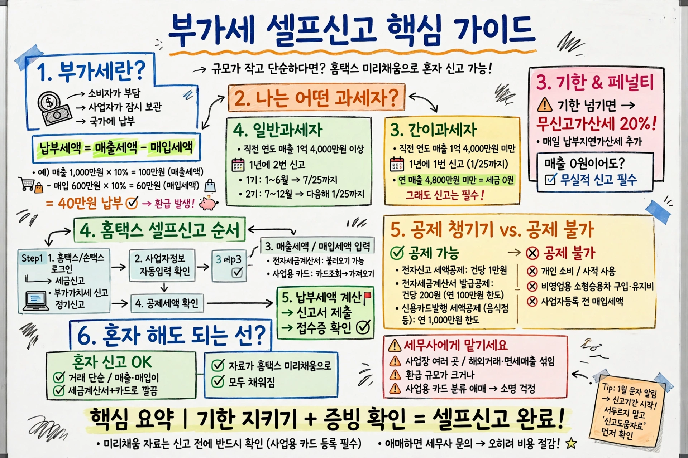
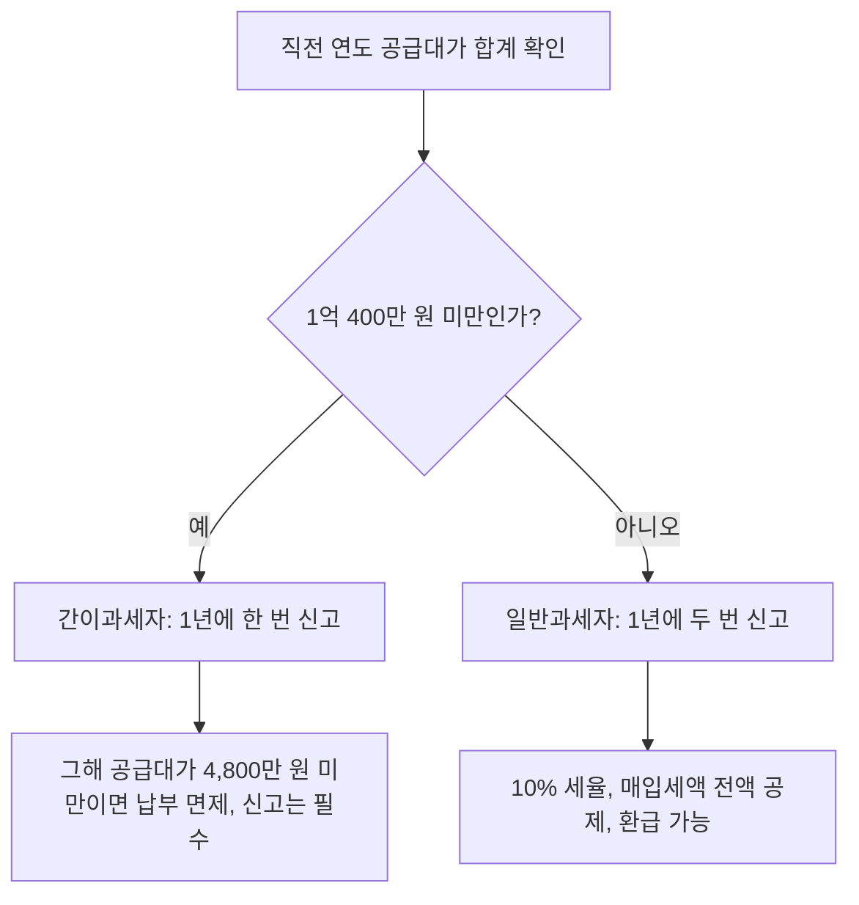
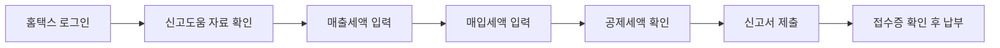
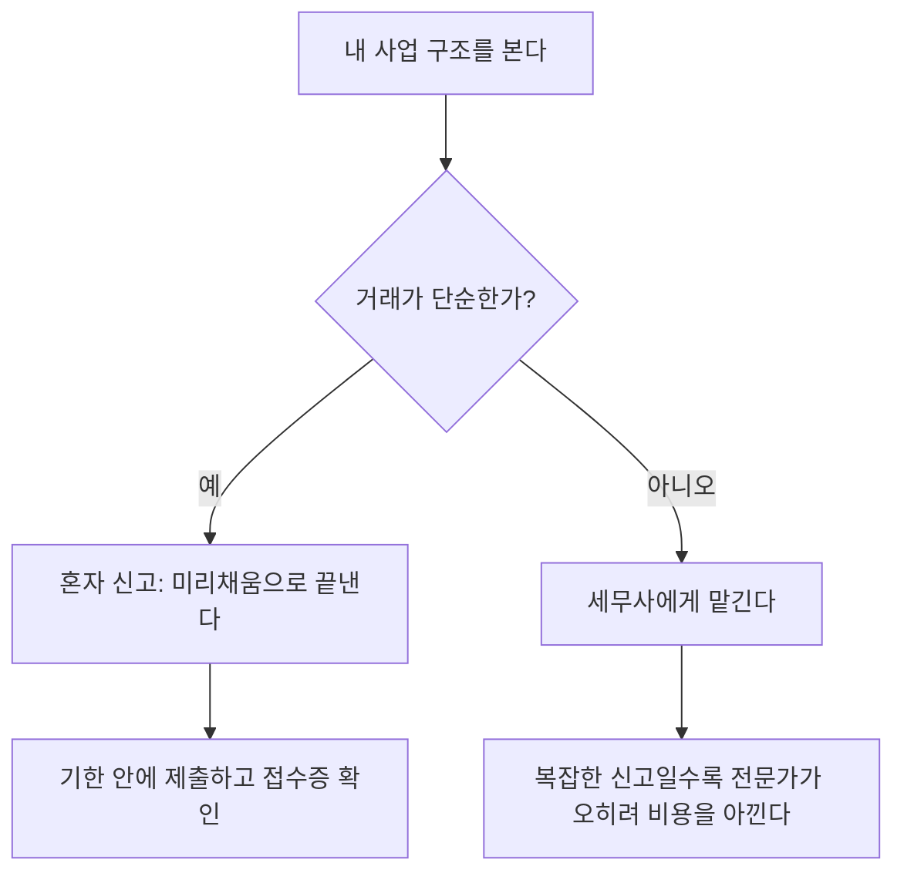

# 부가세 셀프신고, 규모가 작으면 혼자 해도 됩니다. 홈택스가 절반은 채워줍니다

> **Summary**
> 매출·매입 구조가 단순한 소규모 사업자는 홈택스의 미리채움 자료를 활용해 부가세를 직접 신고할 수 있습니다. 과세유형별 신고 주기와 기한을 확인하고, 매출·매입 자료와 공제 항목을 점검해야 하며, 매출이 없어도 신고는 필수입니다. 거래가 복잡하거나 공제 분류가 애매하면 세무사에게 맡기는 편이 안전합니다.

---

- 부가세는 매출액의 10%에서 매입액의 10%를 뺀 차액만 내는 세금입니다. 홈택스 미리채움에 매출·매입 내역이 이미 들어 있어, 규모가 작고 구조가 단순하면 혼자 신고할 수 있습니다.
- 먼저 내 과세유형을 확인하세요. 일반과세자는 1년에 두 번(1월·7월), 간이과세자는 1년에 한 번(1월) 신고하고, 간이과세자는 연 매출 4,800만 원 미만이면 낼 세금은 없어도 신고는 해야 합니다.
- 기한을 넘기면 무신고가산세 20%가 붙고, 매출이 없어도 무실적 신고는 필수입니다. 다만 사업용 카드 분류처럼 애매한 구간이 나오면, 그때는 세무사에게 맡기는 게 오히려 돈을 아끼는 길입니다.

1월이 되면 문자가 옵니다. 부가세 신고 기간이라는 안내입니다. 세무사에게 맡기자니 비용이 아깝고, 혼자 하자니 화면이 무섭습니다. 이런 적 있으시죠? 그런데 홈택스 화면을 열어보면, 생각보다 많은 칸이 이미 채워져 있습니다. 매출 내역도, 매입 내역도, 국세청이 미리 가져다 놓은 자료가 있기 때문입니다. 그래서 규모가 작고 거래가 단순한 사업자라면, 부가세 신고는 혼자서도 충분히 해낼 수 있습니다. 다만 모든 경우에 혼자 하는 게 정답은 아닙니다. 어디까지가 혼자 할 수 있는 선인지, 그 선을 먼저 그어보겠습니다!

🎥 [동영상 보기](https://www.youtube.com/watch?v=ZhCTjHH_Jbc)

## 부가세는 뭘 내는 세금일까요?

부가세는 소비자가 부담하고 사업자가 잠시 보관했다가 국가에 전달하는 세금입니다. 계산식은 단순합니다. 매출액의 10%에서 매입액의 10%를 빼면, 내야 할 세금이 나옵니다. 예를 들어 한 기수에 1,000만 원을 팔고 600만 원어치를 샀다면, 매출세액 100만 원에서 매입세액 60만 원을 빼고 40만 원을 냅니다. 매입이 매출보다 많으면 세금은 0원이 아니라 환급이 나옵니다. 이 글은 세무 조언이 아니라 정보 전달입니다. 숫자는 국세청 안내와 공개된 신고 가이드를 기준으로 정리했습니다.

## 먼저, 나는 어떤 과세자인가요?

신고 방법을 알기 전에, 먼저 내 과세유형부터 확인해야 합니다. 일반과세자와 간이과세자는 신고 횟수와 세금 계산이 다르기 때문입니다. 기준은 직전 연도 공급대가(부가세 포함 매출) 합계입니다. 1억 400만 원 미만이면 간이과세자, 그 이상이면 일반과세자입니다. 홈택스에서 사업자 정보를 조회하면 내 유형이 바로 나옵니다.

일반과세자는 1년을 두 기수로 나눠 신고합니다. 1기(1월 1일~6월 30일) 실적은 7월 25일까지, 2기(7월 1일~12월 31일) 실적은 다음 해 1월 25일까지 신고하고 냅니다. 간이과세자는 1년 전체 실적을 묶어 다음 해 1월 25일까지 한 번만 신고합니다. 간이과세자는 업종별 부가가치율을 반영한 낮은 세율을 적용받고, 그해 공급대가가 4,800만 원 미만이면 낼 세금은 면제됩니다. 하지만 신고 의무까지 사라지는 건 아닙니다. 매출이 0원이어도 신고는 해야 합니다!

## 신고 전에 자료부터 모을까요?

신고서 작성보다 먼저 할 일은 자료 점검입니다. 홈택스에는 `신고도움 서비스`와 `신고도움 자료 조회`가 있습니다. 국세청이 가진 내 사업장 자료를 요약해 놓은 화면입니다. 신고서를 열기 전에 여기를 먼저 보고, 빠진 자료가 없는지 확인하세요. 사업용 신용카드를 홈택스에 등록했는지도 꼭 확인하세요. 등록이 안 된 카드로 쓴 사업 비용은 미리채움에 잡히지 않습니다. 나중에 수기로 넣으면 소명을 요구받을 수 있습니다. 전자세금계산서나 사업용 카드 매입 내역은 신고 기간이 시작되고 며칠 뒤에 제공되는 자료도 있습니다. 너무 이른 날짜에 신고하면 6월 자료가 안 잡힐 수 있으니, 자료 제공 일정을 확인하고 신고하는 게 안전합니다.

## 홈택스 신고, 순서대로 따라가면 됩니다

홈택스(PC)나 손택스(모바일 앱)에 로그인한 뒤, `세금신고` → `부가가치세 신고` → `정기신고` 메뉴로 들어갑니다. 사업자등록번호를 입력하고 확인을 누르면 상호·대표자명·사업장 주소·업종이 자동으로 채워집니다. 그다음은 매출세액, 매입세액, 공제세액 순서로 입력합니다. 전자세금계산서는 `불러오기`를 누르면 홈택스에 쌓인 내역이 자동으로 들어갑니다. 종이 세금계산서를 받은 내역은 여기에 잡히지 않으니, 직접 입력해 추가해야 합니다. 카드 매출이나 현금영수증 발행분은 해당 칸에, 증빙 없는 현금 매출은 `기타` 칸에 넣습니다. 매입도 마찬가지입니다. 세금계산서 수취분은 불러오기로, 사업용 카드 매입은 카드 조회 화면에서 가져옵니다. 마지막에 매출세액에서 매입세액을 빼면 납부세액이 나옵니다. 양수면 납부, 음수면 환급입니다. `신고서 제출하기`를 누르고 접수증을 확인하면 끝입니다.

## 공제는 챙기고, 안 되는 건 거르세요

전자신고를 직접 하면 건당 1만 원의 전자신고 세액공제가 자동으로 적용됩니다. 전자세금계산서를 발급한 사업자라면 발급 세액공제도 있습니다. 직전 연도 사업장별 공급가액이 3억 원 미만인 개인사업자는 전자세금계산서 한 건당 200원을 공제받고, 한도는 100만 원입니다. 음식점처럼 카드·현금영수증을 주로 발행하는 사업자는 신용카드 매출전표 등 발행세액공제도 챙길 수 있습니다. 한도는 연간 1천만 원입니다. 반대로, 공제가 안 되는 지출도 있습니다. 사업과 무관한 개인 소비, 비영업용 소형승용차의 구입·임차·유지비, 사업자등록 전 매입세액이 대표적입니다. 사업용 카드로 결제했더라도 공제 대상이 아니면 빼야 합니다. 이 분류가 애매하면 홈택스가 임의로 분류한 금액을 그대로 쓰지 말고, 한 번 더 확인하세요. 사업용 카드 매입세액의 공제 사유는 여덟 가지로 나뉘어 있어, 혼자 분류하기 까다로운 구간입니다.

## 기한을 놓치면 어떻게 될까요?

법정 기한을 넘기면 무신고가산세가 붙습니다. 일반 무신고는 납부세액의 20%입니다. 세금을 기한 안에 내지 않으면 납부지연가산세가 매일 쌓입니다. 매출이 전혀 없어도 신고는 해야 합니다. 홈택스에서 `무실적 신고` 버튼을 눌러 접수하면 됩니다. 무실적 신고를 안 하면 가산세 부담이나 사업자등록 관련 불이익이 생길 수 있습니다. 예정고지가 나온 사업자는 4월에 전기 세금의 절반이 고지되는데, 이미 낸 세금이므로 확정신고 때 차감합니다. 환급이 나오면 환급 계좌를 신고해 두세요.

## 혼자 해도 되는 선은 어디까지일까요?

거래가 단순하고 매출·매입이 세금계산서와 카드로 깔끔하게 정리되는 사업자라면, 홈택스 미리채움만으로 신고가 끝납니다. 그게 바로 원문에서 말한 "규모 작다면 혼자 하세요"의 조건입니다. 반대로 이런 경우는 세무사에게 맡기는 게 낫습니다. 사업장이 여러 곳이거나, 해외 거래·면세 매출이 섞여 있거나, 환급 규모가 크거나, 사업용 카드 분류가 애매해서 소명이 걱정되는 경우입니다. 영상에서도 같은 말을 합니다. 조금이라도 복잡한 신고는 세무 대리인을 통하는 게 오히려 비용을 아끼는 길이라고요. 댓글에서도 같은 질문이 쏟아졌습니다. "규모 작다"는 기준이 뭔지, 사업용 카드는 어떻게 나누는지, 해외 프리랜서나 임대사업자는 어떻게 하는지 말입니다. 그 질문들이야말로 혼자 신고의 경계선을 보여줍니다. 경계선 안쪽은 혼자, 바깥쪽은 전문가에게 맡기면 됩니다!

부가세 신고는 세무사만 할 수 있는 일이 아닙니다. 홈택스가 자료를 미리 채워주고, 전자신고 공제까지 챙겨주니, 작은 사업자는 혼자서도 충분히 해낼 수 있습니다. 다만 기한과 증빙, 이 두 가지는 타협이 없습니다. 기한 안에, 빠진 증빙 없이 신고하는 게 셀프신고의 전부입니다. 그 선만 지키면, 세무사 비용은 아끼고 내 사업 숫자도 내 손에 남습니다!

