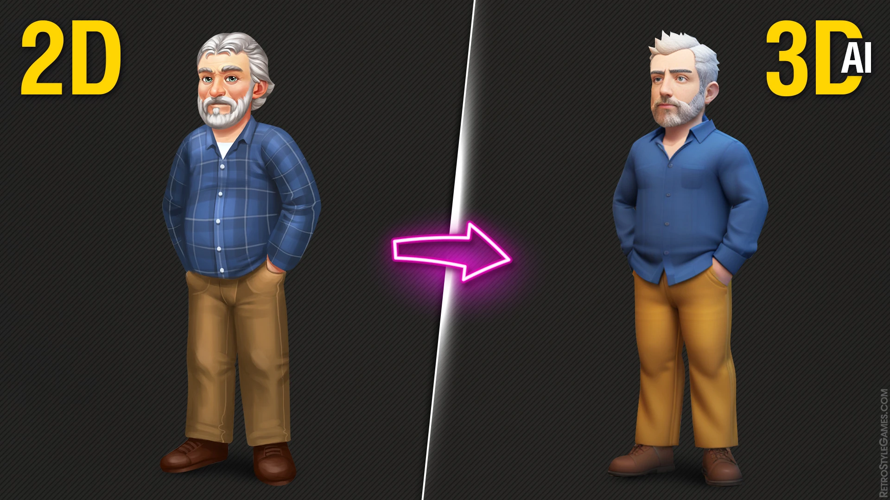

# 생성형 AI를 활용한 게임 애셋 제작 자동화

> **Summary**
> 미드저니를 사용하여 이미지를 생성하고, KADIM을 통해 3D 모델을 제작하며, Mixamo 또는 Text to Animation AI로 애니메이션을 생성하는 방법을 설명합니다. 애프터이펙트를 활용하여 프레임 단위로 이미지를 추출해 스프라이트를 제작하는 과정도 포함되어 있습니다.

---



```latex
큰 아이디어는 다음과 같다

미드저니로 이미지 생성 (앞 옆 뒤 정보를 뽑아내도록)

KADIM 을 이용해 생성된 이미지를 기반으로 3D를 만들어냄 (조감도를 기반으로 3D Obj를 만들어냄)

애니메이션은 Mixamo 혹은 Text to Animation AI 를 활용하여 생성하고

애프터이펙트에서 프레임단위로 이미지 뽑아 스프라이트로 제작
```

🔗 [https://medium.com/@kaedim/how-to-create-consistent-characters-in-midjourney-5a6cb9f23a1f](https://medium.com/@kaedim/how-to-create-consistent-characters-in-midjourney-5a6cb9f23a1f)

🔗 [https://www.youtube.com/watch?v=eOc_aFxux4w&list=PLjDg5rfHIT1UgjUzjJ9vitF5Oktx5Je4q&index=2](https://www.youtube.com/watch?v=eOc_aFxux4w&list=PLjDg5rfHIT1UgjUzjJ9vitF5Oktx5Je4q&index=2)

🔗 [https://huiyu.tistory.com/entry/SDL-Sprite-Animation](https://huiyu.tistory.com/entry/SDL-Sprite-Animation)


### character sheet turnaround 모델을 어떻게 얻을 수 있을까

🔗 [https://www.reddit.com/r/StableDiffusion/comments/z8peof/consistent_characters_and_outfits_in_stable/](https://www.reddit.com/r/StableDiffusion/comments/z8peof/consistent_characters_and_outfits_in_stable/)

🔗 [https://www.reddit.com/r/StableDiffusion/comments/zy78sr/is_there_any_way_to_use_stable_diffusion_to/](https://www.reddit.com/r/StableDiffusion/comments/zy78sr/is_there_any_way_to_use_stable_diffusion_to/)

🔗 [https://www.reddit.com/r/StableDiffusion/comments/16wwgu4/moving_from_dall_e_3_to_stable_diffusion/](https://www.reddit.com/r/StableDiffusion/comments/16wwgu4/moving_from_dall_e_3_to_stable_diffusion/)

🔗 [https://chatx.ai/marketplace/midjourney/character-design-with-midjourney/](https://chatx.ai/marketplace/midjourney/character-design-with-midjourney/)

🔗 [https://civitai.com/models/104330/character-sheet-turnaround-front-side-back](https://civitai.com/models/104330/character-sheet-turnaround-front-side-back)

🔗 [https://echoesofsomewhere.com/2023/01/04/ai-character-design/](https://echoesofsomewhere.com/2023/01/04/ai-character-design/)

