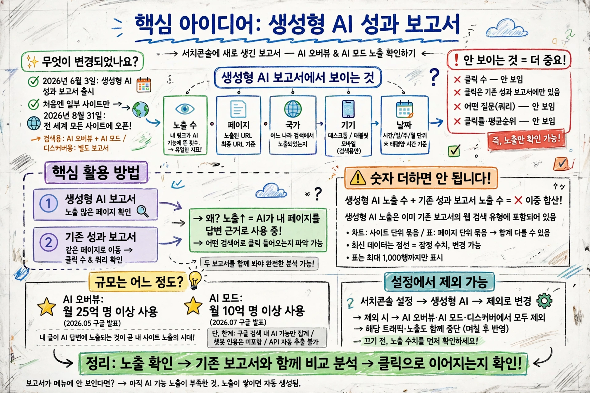
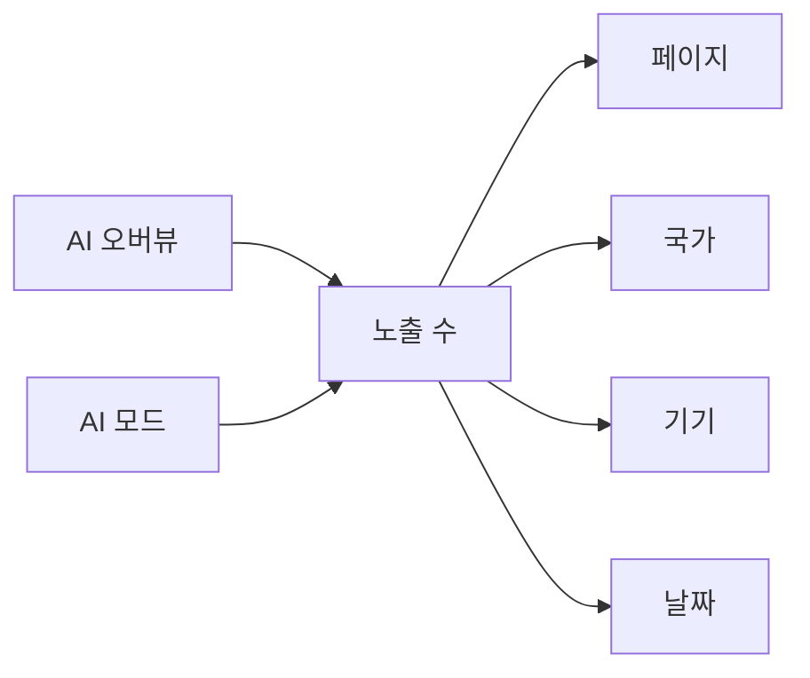
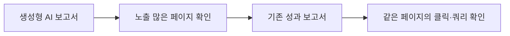
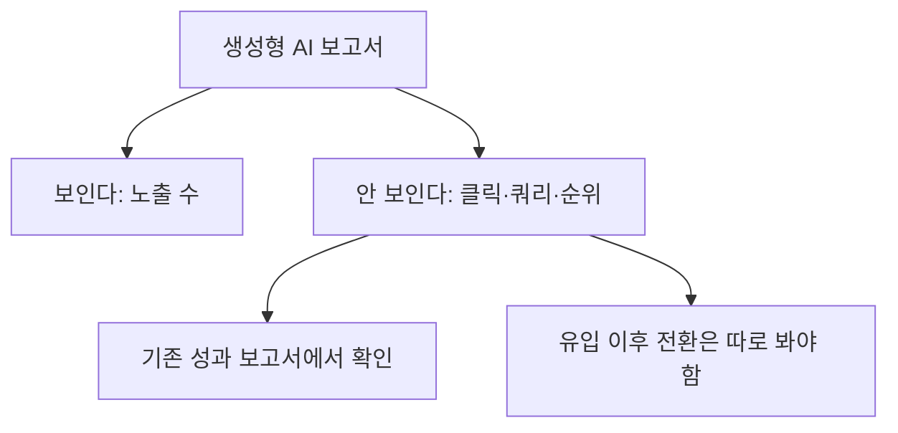

# 서치콘솔에 생성형 AI 보고서가 생겼습니다. 보이는 건 노출뿐입니다

> **Summary**
> 서치콘솔의 생성형 AI 보고서는 AI 오버뷰와 AI 모드에서 발생한 사이트 노출 수를 페이지·국가·기기·날짜별로 보여주지만, 클릭이나 검색어는 제공하지 않습니다. 클릭과 쿼리는 기존 성과 보고서에서 확인해야 하며, 두 보고서의 노출 수를 더하면 중복 집계됩니다.

---

- 서치콘솔에 생성형 AI 성과 보고서가 생겼습니다. 내 사이트가 AI 오버뷰와 AI 모드에 얼마나 노출됐는지, 이제 따로 볼 수 있습니다.
- 보이는 건 노출 수뿐입니다. 클릭도, 어떤 질문이 불렀는지도 이 보고서에는 안 나옵니다.
- 2026년 6월 3일 발표 뒤 일부 사이트만 쓰다가, 8월 31일부터 전 세계 모든 사이트에 열렸습니다.

서치콘솔을 열면 클릭 수, 노출 수, 평균 순위가 한눈에 들어오는데, 정작 궁금한 건 따로 있지 않으시죠? 내 글이 AI 오버뷰 답변에 떴는지, AI 모드 대화에서 인용됐는지 말입니다. 그동안은 그 숫자가 기존 성과 보고서에 섞여 있어서 따로 볼 방법이 없었습니다. 이제 그 숫자를 따로 보는 보고서가 생겼습니다!

🎥 [동영상 보기](https://www.youtube.com/watch?v=Uk1-vGA7KpE)

## 생성형 AI 보고서, 뭐가 보일까요?

2026년 6월 3일, 구글은 서치콘솔에 **생성형 AI 성과 보고서**를 새로 내놨습니다. 검색용과 디스커버용이 따로 있고, 처음에는 일부 사이트에만 열렸다가 8월 31일부터 전 세계 모든 사이트에 열렸습니다. 검색용 보고서가 다루는 AI 기능은 두 가지, **AI 오버뷰**와 **AI 모드**입니다. 참고로 검색 실험실 기능의 데이터는 안 들어갑니다.

보고서가 보여주는 건 다섯 가지입니다.

- **노출 수**: 내 사이트 링크가 AI 기능 안에 뜬 횟수입니다. 이 보고서의 유일한 지표입니다!
- **페이지**: 어떤 URL이 AI 기능에 떴는지, 최종 URL 기준으로 묶어서 보여줍니다.
- **국가**: 어느 나라 검색에서 노출됐는지 보여줍니다.
- **기기**: 데스크톱, 태블릿, 모바일 중 어디서 봤는지 보여줍니다. 검색용 보고서에만 있습니다.
- **날짜**: 시간, 일, 주, 월 단위로 성과를 봅니다. 날짜는 태평양 시간 기준입니다.

## 안 보이는 게 더 중요하지 않을까요?

보고서를 열기 전에 한 가지는 알고 가야 합니다. 이 보고서는 **노출만** 보여줍니다. 클릭은 안 나옵니다. 어떤 질문이 내 페이지를 불렀는지도 안 나옵니다. 클릭률이나 순위는 말할 것도 없고요.

그럼 클릭은 어디서 볼까요? 클릭은 기존 **성과 보고서**에 그대로 있습니다. AI 기능에서 나온 클릭도 웹 검색 유형에 섞여서 잡힙니다. 그래서 읽는 순서는 이렇게 됩니다.

노출이 많은 페이지는 구글이 이미 답변 근거로 쓰고 있다는 뜻입니다. 그 페이지를 기존 성과 보고서에서 같은 기간으로 열어보면, 어떤 쿼리로 클릭이 들어오는지까지 이어서 볼 수 있습니다. 두 보고서를 따로 읽으면 반쪽짜리입니다!

## 숫자 더하면 안 됩니다!

여기서 흔히 하는 실수가 하나 있습니다. 생성형 AI 보고서의 노출 수와 기존 성과 보고서의 노출 수를 **더하면 안 됩니다**. 생성형 AI 노출은 기존 성과 보고서의 웹 검색 유형 안에 이미 들어 있거든요. 더하면 같은 숫자를 두 번 세는 셈입니다.

차트 합계와 표 합계가 살짝 다르게 보일 수도 있습니다. 차트는 사이트 단위로 묶고, 표는 페이지 단위로 묶기 때문입니다. 한 AI 기능 안에 내 사이트 링크가 두 개 떴다면, 차트에서는 노출 1개로 칩니다. 최신 데이터는 잠정 수치라 점선으로 표시되고, 몇 시간 뒤에 바뀔 수 있습니다. 표는 1,000행까지만 보여준다는 제한도 그대로입니다.

보고서가 메뉴에 안 보인다면요? 내 사이트가 AI 기능에서 노출을 아직 충분히 받지 못했다는 뜻입니다. 노출이 쌓이면 저절로 생깁니다.

## 규모는 어느 정도일까요?

왜 이 보고서가 중요할까요? AI 오버뷰는 월 25억 명 이상이 쓰고, AI 모드는 10억 명을 넘겼습니다. 구글이 2026년 5월과 7월에 직접 밝힌 숫자입니다. 내 글이 AI 답변에 뜨는지가 곧 내 사이트가 보이는지 말하는 시대가 된 겁니다!

다만 한계도 분명합니다. 이 보고서는 **구글 검색 안의 AI 기능만** 봅니다. 챗봇에서 내 사이트가 얼마나 인용되는지는 여기에 안 잡힙니다. 그건 따로 봐야 합니다. API로 자동 추출하는 길도 아직 없습니다. 내보내기 버튼으로 표와 차트 데이터를 내려받는 게 지금 할 수 있는 전부입니다.

## 빼고 싶으면 설정에서 끌 수 있습니다

AI 기능에 내 사이트를 안 보이게 하고 싶다면요? 서치콘솔 **설정**에서 생성형 AI 항목을 찾아 제외로 바꾸면 됩니다. 다만 제외하면 AI 오버뷰, AI 모드, 디스커버의 생성형 AI 기능에서 내 콘텐츠가 전부 빠지고, 그쪽 트래픽과 노출도 같이 멈춥니다. 며칠 지나야 반영됩니다. 끌지 말지는 노출 수치를 보고 나서 정해도 늦지 않습니다!

노출이 보이기 시작했으니, 이제는 그 노출이 클릭으로 이어지는지를 기존 보고서와 겹쳐서 볼 차례입니다.

