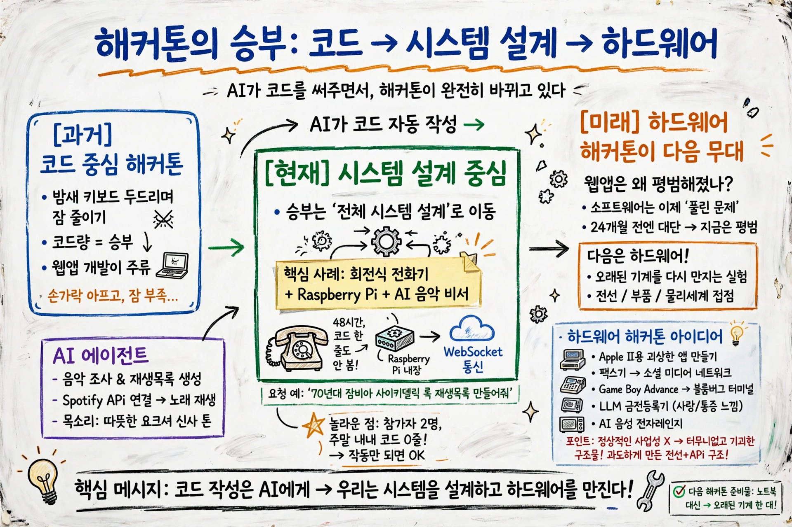
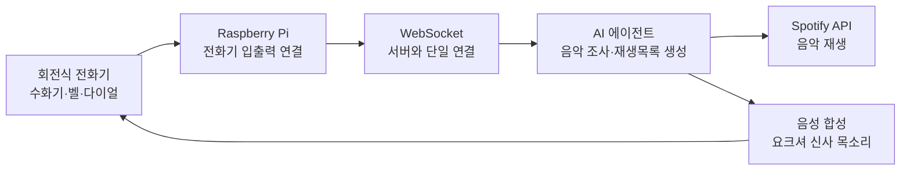
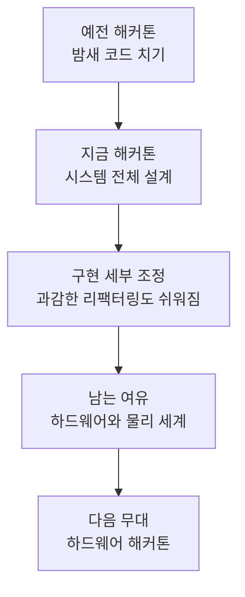
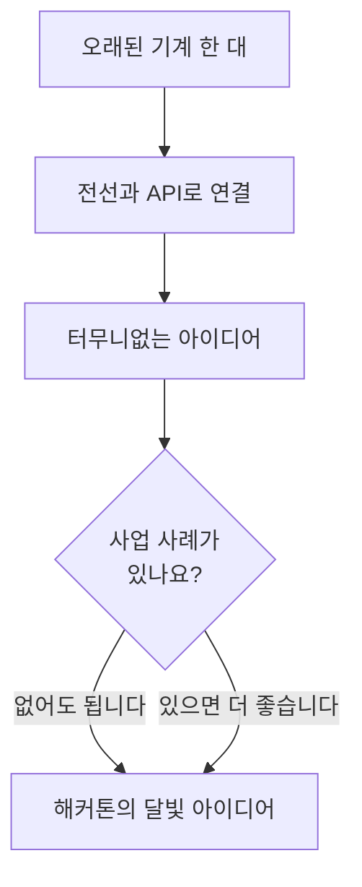

# 소프트웨어 해커톤은 끝났습니다. 이제 전선과 API가 주인공입니다

> **Summary**
> AI가 코드를 써주면서 해커톤의 승부는 코드량에서 시스템 설계로 옮겨갔습니다. 48시간 동안 코드 한 줄도 보지 않고, 회전식 전화기에 Raspberry Pi를 달아 AI 음악 비서를 만든 팀이 그 증거입니다. 웹 앱만으로는 이제 놀라기 어려워졌고, 오래된 기계를 다시 만지는 하드웨어 해커톤이 다음 무대가 됩니다.

---

- AI가 코드를 써주면서 해커톤의 승부는 코드량에서 시스템 설계로 옮겨갔습니다.
- 48시간 동안 코드 한 줄도 보지 않고, 회전식 전화기에 `Raspberry Pi`를 달아 AI 음악 비서를 만든 팀이 그 증거입니다.
- 웹 앱만으로는 이제 놀라기 어려워졌고, 오래된 기계를 다시 만지는 하드웨어 해커톤이 다음 무대가 됩니다.

해커톤에 가면 어떤 장면이 떠오르시나요? 밤새 키보드를 두드리며 잠을 줄이는 모습이 먼저 떠오르신다면, 그 풍경이 바뀌고 있습니다. 코드가 더 이상 승부가 아니게 됐거든요!

🎥 [동영상 보기](https://www.youtube.com/watch?v=y9bsL0o6I-A)

### 전화기 한 대가 해커톤의 주인공이 된 이유는?

빌뉴스에서 열린 해커톤, 48시간짜리 일정이었습니다. 2인 팀이 가져온 건 오래된 회전식 전화기 한 대였습니다. 팀은 전화기 안에 `Raspberry Pi`를 넣어 전화기의 모든 입출력과 연결했고, 서버와는 `WebSocket` 연결 하나로 통신했습니다.

이 연결 하나로 양방향 오디오, 맞춤 주파수와 소리 패턴을 가진 벨, 수화기 내려놓기 스위치까지 전부 제어했습니다. 데모의 핵심은 AI 에이전트였습니다. 음악을 조사하고, 재생목록을 만들고, `Spotify API`로 원하는 음악을 틀어주는 구조였습니다. 요청은 이런 식이었습니다. "특정 명단에 올랐다고 알려진 아티스트 음악을 틀어줘", "70년대 잠비아 사이키델릭 록 재생목록을 만들어줘" 같은 주문이 전화기 너머로 오갔고, 전화기 반대편의 목소리는 따뜻한 요크셔 신사처럼 설정됐습니다.

### 코드 한 줄도 안 봤다고요?

이 데모에서 가장 놀라운 부분은 따로 있습니다. 두 참가자는 주말 내내 코드 한 줄도 직접 보지 않았습니다. 12개월 전만 해도 상상하기 어려웠던 방식이 지금은 현실이 됐습니다. 해커톤에서는 작동 여부가 전부였고, 코드 속 내용은 중요하지 않았거든요.

그래서 해커톤의 초점이 완전히 옮겨갔습니다. 손가락이 아프도록 코드를 치고 잠을 줄이는 방식에서, 시스템 전체를 사고하는 방식으로 말입니다. 구현 세부 사항을 고치고 과감하게 다시 짜는 일은 이제 사소한 작업이 됐습니다. 덕분에 하드웨어와 물리 세계의 접점을 다룰 정신적 여유가 생겼습니다!

### 웹 앱은 왜 평범해졌을까요?

소프트웨어가 점점 "풀린 문제"가 되면서, 24개월 전에는 대단한 성취였던 웹 앱도 이제는 평범해졌습니다. 해커톤의 기준을 계속 밀어 올리려면 어디로 가야 할까요? 글쓴이의 답은 하드웨어입니다.

앞으로 몇 달 동안 하드웨어 해커톤에 대한 강조가 더 커질 거라는 전망도 덧붙였습니다. 특히 예전에는 아주 좁고 시간 많이 드는 도메인 지식이 필요했던 오래된 기술이 다시 실험 대상이 될 수 있다는 기대입니다.

### 하드웨어 해커톤, 뭐가 재밌을까요?

글에서 나온 아이디어 목록은 이렇습니다. `Apple II`용 괴상한 앱 만들기, 팩스기를 소셜 미디어 네트워크로 바꾸기, `Game Boy Advance`를 블룸버그 터미널로 바꾸기, 사랑과 고통을 느낄 수 있는 LLM 기반 금전등록기, AI 음성 활성화 전자레인지까지. 정상적인 사업 사례가 있는 프로젝트는 하나도 없습니다. 그런데 그게 포인트입니다!

> 해커톤은 다소 터무니없어야 합니다. 투자 피칭이나 해결하려는 문제가 아니라, 전선과 API로 이루어진 과도하게 만들어진 기괴한 구조물이 보고 싶은 겁니다.

물론 하드웨어가 만능은 아닙니다. 부품값과 납땜, 안전 문제까지 신경 쓸 게 소프트웨어보다 많습니다. 그래도 코드가 알아서 써지는 시대에, 손으로 만지고 전선을 연결하는 경험이 해커톤의 새로운 재미가 되고 있습니다. 다음 해커톤에 갈 때는 노트북보다 오래된 기계 한 대를 먼저 챙겨보는 게 어떨까요?

