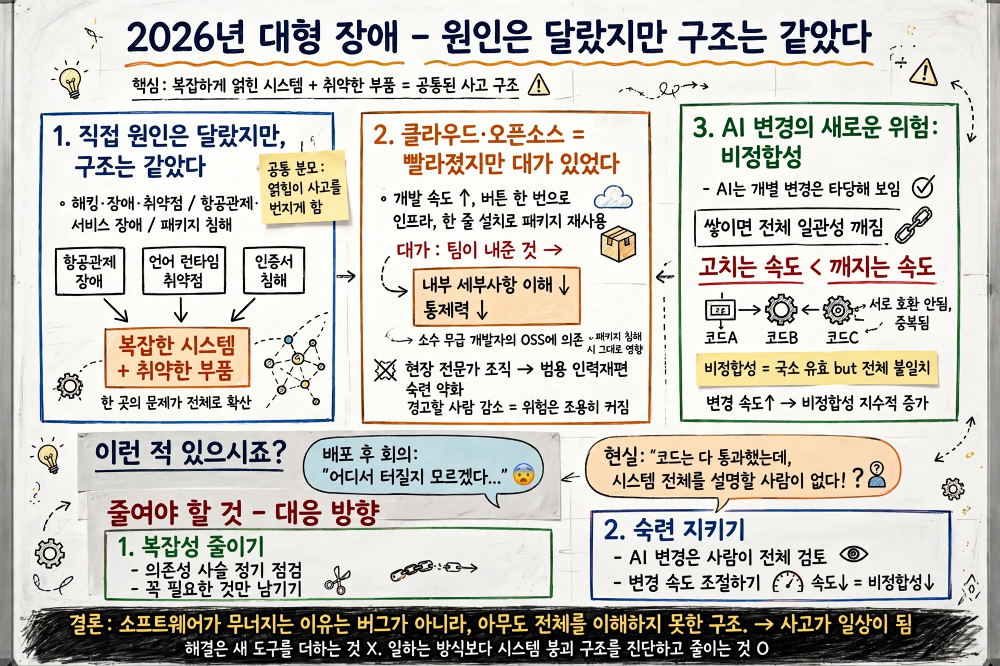
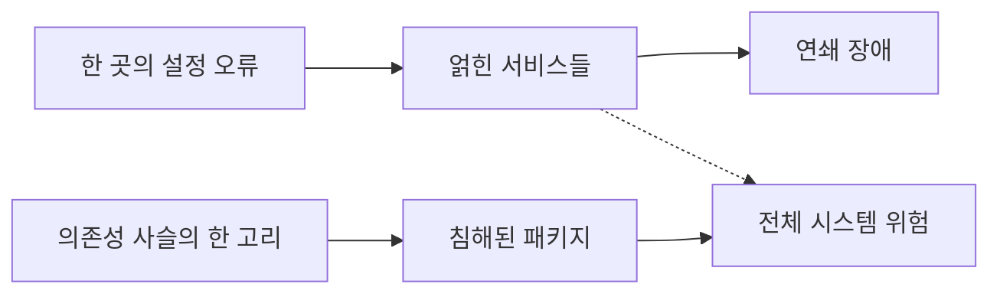
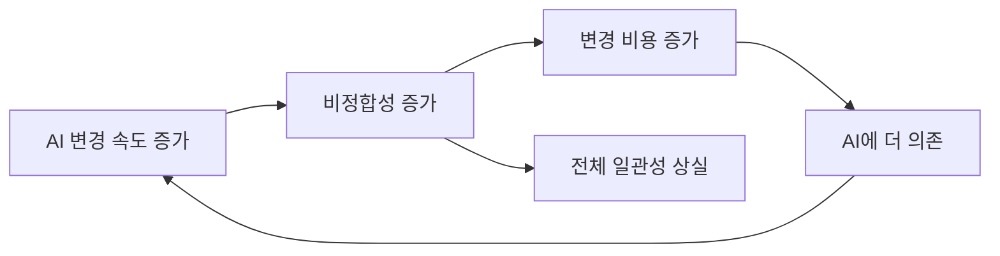

# 소프트웨어가 무너지는 이유는 버그가 아닙니다. 아무도 전체를 이해하지 못하기 때문입니다

> **Summary**
> 소프트웨어 장애와 보안 사고의 근본 원인은 개별 버그보다 복잡하게 얽힌 시스템과 의존성, 그리고 전체를 이해하고 통제하는 능력의 약화에 있다. 클라우드와 오픈소스는 개발을 빠르게 했지만 통제력과 전문성을 낮췄고, AI가 만든 변경도 검토 없이 누적되면 시스템의 일관성을 무너뜨릴 수 있다. 의존성을 줄이고 변경 속도를 조절하며, 사람이 전체 구조와 일관성을 살피는 숙련과 책임을 지켜야 한다.

---

- 2026년 대형 장애들의 직접 원인은 달랐습니다. 하지만 구조는 같았습니다. 복잡하게 얽힌 시스템에 취약한 부품이 끼어 있었습니다.
- 클라우드와 오픈소스는 개발을 빠르게 만들었습니다. 그 대가로 팀은 내부 세부사항에 대한 이해와 통제력을 내줬습니다.
- AI가 만든 변경은 하나하나 타당해 보입니다. 쌓이면 전체의 일관성이 깨집니다. 고치는 속도보다 깨지는 속도가 빨라질 수 있습니다.

이런 적 있으시죠? 배포가 끝나고 나서 회의에서 "어디서 터질지 모르겠다"는 말이 나옵니다. 코드는 다 통과했는데, 시스템 전체가 어떻게 돌아가는지 설명할 사람이 없습니다!

🎥 [동영상 보기](https://www.youtube.com/watch?v=pW-SOdj4Kkk)

## 2026년, 원인은 달랐는데 구조는 같았습니다

2026년에는 해킹과 장애, 취약점이 잇따랐습니다. 주말에는 이틀간의 글로벌 서비스 장애와 항공 관제 통신 장애가 연이어 터졌고, 미국 전역에서 항공편 이륙을 일시 중단시키는 지상 대기 조치가 내려졌습니다. 불과 4주 전에는 전 세계 웹사이트의 약 70%를 구동하는 것으로 추정되는 언어에서 원격 코드 실행 취약점이 드러났고, 긴급 패치 과정에서 사이트들이 완전히 멈췄습니다. 또 다른 사고에서는 지나치게 약한 개인키 때문에 인증서 수천 개가 침해됐습니다.

직접 원인은 제각각이었습니다. 하지만 세 사고가 보여준 구조는 같았습니다. 복잡한 시스템과 취약한 부품의 조합이었습니다. 한 곳의 문제가 넓게 번질 수 있는 얽힘이, 사고의 공통 분모였습니다.

## 복잡성은 임시 조치로 떠받쳐졌습니다

대규모 서비스 장애는 데이터센터 간 통신을 막은 네트워크 설정 오류에서 시작됐을 가능성이 있습니다. 정확한 경위는 공개되지 않았지만, 서비스가 트래픽을 감당하지 못하는 연쇄 장애로 이어졌습니다. 온라인에서는 현장 엔지니어조차 장애의 복잡성을 제대로 파악하지 못했다는 추측까지 돌았습니다.

한 전직 엔지니어는 몇 달 전 공개한 비판 글에서, 경쟁 압력 아래 서둘러 출시하면서 신뢰성과 운영 단순성의 기본 원칙을 포기했다고 지적했습니다. 늘어나는 기술 부채를 근본적으로 해결하기보다, 완화 스크립트를 실행하는 자동화 계층과 늘어나는 당직 인력, 수동 복구에 의존했다는 것입니다. 그 결과 품질 낮은 구성 요소가 복잡하게 얽혀, 누구도 전체를 이해하기 어려운 시스템이 됐다는 비판이었습니다.

## 의존성 사슬, 한 고리가 전체를 흔듭니다

한 보안 연구 기업이 10월 21일에 공개한 공격은, 10년 넘게 런타임에 숨어 있던 복잡한 메모리 관리 버그를 파고들었습니다. 해당 언어는 전자상거래에서 널리 쓰이고, 저렴하고 단순한 웹사이트 구축의 대표 선택지였던 콘텐츠 관리 시스템에도 사용됐습니다. 인터넷이 사람이 찾아내기 어려울 만큼 복잡한 취약점을 품은 긴 의존성 사슬에 기대고 있다는 사실이 드러난 셈입니다.

2026년 5월의 또 다른 공격에서는 자바스크립트 생태계의 주요 패키지들이 침해됐습니다. 지속적 통합 설정의 오류로 변조된 코드가 상위 프로젝트로 들어갔고, 다음 실행에서 라이브러리 스크립트가 비밀 토큰을 탈취했습니다.

의존성은 다른 의존성을 계속 호출합니다. 어느 의존성이든 스크립트를 포함할 수 있습니다. 한 구성 요소의 오류가 전체를 위험에 빠뜨리는 구조입니다.

2016~2017년에는 이미 경고가 있었습니다. 한 개발자가 법적 분쟁으로 작은 패키지 하나를 내리자, 얽힌 의존성 때문에 광범위한 프로젝트가 깨졌습니다. 팬데믹 이후의 위기를 버틴 것도 개발자와 운영 인력의 성실한 작업 덕분이었습니다. 구조가 좋아서가 아니라, 사람들이 버텼기 때문입니다!

## 빨라진 대가, 통제력을 내줬습니다

약 12년 전의 소프트웨어 개발은 수많은 명령과 상호작용하는 구성 요소를 하나의 전체로 조율하는 고도의 수작업에 가까웠습니다. 매번 새롭고 다른 일을 해야 하는 시계를 손으로 조립하는 것과 같았습니다. 직접 프로그램을 만드는 일은 모든 부분을 머릿속에 담고 일관된 전체로 구성하는 경험을 줬습니다.

약 10년 전 클라우드 컴퓨팅은 하드웨어와 인프라를 빌리는 가상 인프라로 대체했습니다. 버튼으로 서버를 만들 수 있게 됐습니다. 오픈소스 라이브러리는 인터넷의 낯선 개발자가 만든 구성 요소와 완성된 기능을 무료로 재사용하게 했습니다. 2014년 무렵 패키지 관리 도구의 등장은 설정 파일에 한 줄을 추가하고 설치 명령을 실행하는 방식으로 재사용을 쉽게 만들었습니다.

이 편의는 소수의 열정적인 무급 개발자가 모두의 기반 코드를 만드는 구조에 의존했습니다. 팀은 세부사항에 대한 이해와 통제력을 내줬고, 패키지가 침해되거나 개발자가 다른 의도를 가지면 그대로 영향을 받게 됐습니다.

## 현장의 목소리가 작아졌습니다

관리해야 할 세부사항이 줄면서 운영, 백엔드, 모바일, 테스트 전문가 조직을 범용 인력 중심으로 재편할 수 있게 됐습니다. 모두가 여러 역할을 섞어 수행하면 개별 전문 인력의 협상력이 줄어듭니다.

숙련 약화는 개발자의 영향력과 경고 능력을 줄입니다. 경고할 사람이 줄면, 위험은 경고 없이 커집니다. 이건 기술 문제가 아니라 조직 문제입니다!

## AI의 진짜 위험은 틀린 답이 아닙니다

AI가 환각과 버그를 만든다는 비판에는 타당한 부분이 있습니다. 하지만 지금 더 큰 위험은 출력 품질 자체보다 전체의 비정합성에 있습니다. AI는 실제로 요청받은 일을 꽤 잘 수행합니다. 문제는 따로 있습니다.

비정합성이란 국소적으로 유효하지만 서로 호환되지 않거나 중복되는 모델이 쌓이는 현상입니다. 한 분석 글은 개별 부분은 타당해 보여도 전체 시스템에서는 맞물리지 않는 문제를 다뤘습니다. 변경 비용의 대부분이 모델 사이의 변환과 의도하지 않은 부작용 방지에 쓰이게 됩니다.

지난 1년간 개발 현장에서는 AI 에이전트에 맡기는 범위가 테스트, 함수, 개별 구성 요소에서 설계와 조율, 전체 구상까지 확대됐습니다. 프로그래밍은 본래 모호한 인간의 의도를 컴퓨터도 실행할 만큼 정확한 코드로 바꾸며 복잡성을 질서로 정제하는 활동이었습니다. 이 활동이 빠르게 사라지고 있으며, 많은 개발자는 무능해서가 아니라 폭증하는 복잡성을 따라가지 못해 AI 없이 문제를 해결하기 어려워지는 것으로 보입니다. 그 분석에 따르면 비정합성은 변경 속도에 따라 증가하고, 이미 비정합적인 시스템일수록 지수적 폭주로 이어질 수 있습니다.

LLM은 세부사항을 충분히 생각하지 않고도 일을 했다는 착각을 줘, 학습된 무기력과 잘못된 자신감을 동시에 만들 수 있습니다. 숙련 약화는 개발자의 영향력과 경고 능력을 더 줄입니다.

## 아무도 전체를 통제하지 못하면 어떻게 될까요?

AI 의존은 프로그래머만이 아니라 업무 사슬 전체에 퍼져 있습니다. AI가 작성한 계산 결과를 바탕으로 문서를 만들고 요약하며, 그 요약에서 티켓과 프롬프트를 만들고 다시 AI가 코드를 생성하는 흐름입니다.

기술 기업은 하나의 일관된 단위로 사고하고 대응하는 능력인 조직적 인지를 잃을 위험이 있습니다. 아무도 의도를 갖고 전체를 통제하지 못하는 상태에서, 길들일 수 있는 속도보다 더 빠르게 복잡성을 생성하게 됩니다.

소프트웨어는 항공, 금융, 주유기, TV, 급여뿐 아니라 길 찾기, 친구와의 연락, 만남, 식사 등 일상의 기반입니다. 사회는 구조적 악화의 징후를 보이는 기술 시스템에 지나친 신뢰를 부여해 왔습니다.

## 그럼 무엇을 줄여야 할까요?

대응의 출발점은 새 도구를 더하는 것이 아니라, 복잡성을 줄이는 것입니다. 의존성 사슬을 정기적으로 점검하고, 꼭 필요한 것만 남기는 일부터 시작합니다.

두 번째는 숙련을 지키는 것입니다. AI가 만든 변경을 그대로 통과시키지 않고, 사람이 전체의 일관성을 검토하는 자리를 남겨둬야 합니다. 변경 속도를 조절하는 것도 대응입니다. 비정합성은 변경 속도에 따라 커지니까요.

소프트웨어가 무너지는 이유는 버그가 아닙니다. 아무도 전체를 이해하지 못하게 된 구조가, 사고를 일상으로 바꾸고 있습니다. 루프 설계나 자동화 이전에 없애는 일과는 다른 이야기입니다. 일하는 방식이 아니라, 시스템이 무너지는 구조 자체에 대한 진단입니다.

