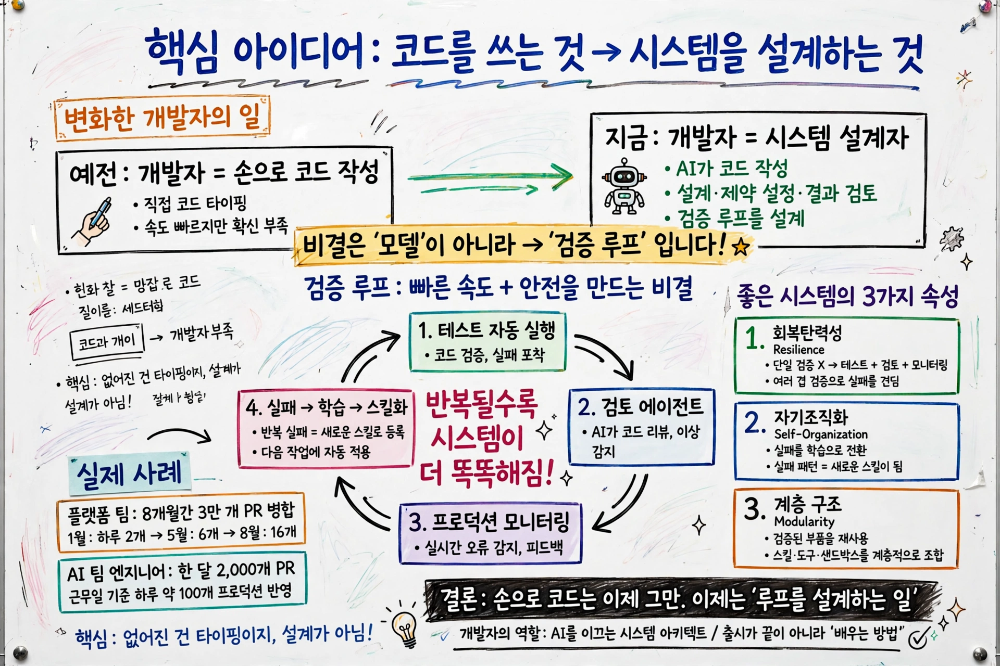
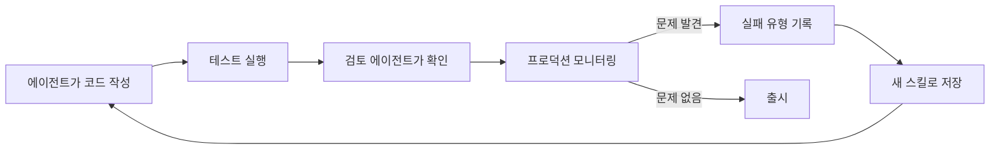
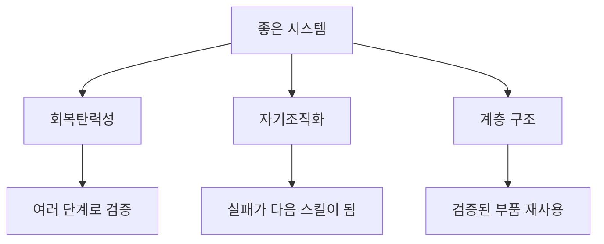

# 손으로 코드를 짜는 시대는 끝났습니다. 이제는 루프를 설계하는 일입니다

> **Summary**
> AI가 코드를 대신 쓰면서, 개발자의 일은 코드를 짜는 일에서 맞는 코드가 나오게 하는 시스템을 설계하는 일로 옮겨갔습니다. 한 플랫폼 팀은 8개월 동안 3만 개의 PR을 병합했고, 한 AI 팀의 엔지니어는 한 달에 2,000개의 PR을 프로덕션에 반영했습니다. 비결은 모델이 아니라 검증 루프입니다. 좋은 시스템의 세 가지 속성은 회복탄력성·자기조직화·계층 구조입니다. 실패를 견디고, 실패에서 배우고, 검증된 부품을 재사용합니다.

---

- AI가 코드를 대신 쓰면서, 개발자의 일은 코드를 짜는 일에서 **맞는 코드가 나오게 하는 시스템을 설계하는 일**로 옮겨갔습니다.
- 한 플랫폼 팀은 8개월 동안 3만 개의 PR을 병합했고, 한 AI 팀의 엔지니어는 한 달에 2,000개의 PR을 프로덕션에 반영했습니다. 비결은 모델이 아니라 검증 루프입니다.
- 좋은 시스템의 세 가지 속성은 회복탄력성·자기조직화·계층 구조입니다. 실패를 견디고, 실패에서 배우고, 검증된 부품을 재사용합니다.

에이전트에게 기능 하나를 맡겼는데, 코드가 쏟아지는 걸 보고 기뻤던 적 있으시죠? 그런데 그 코드를 프로덕션에 올리려고 보니, 뭐가 맞는지 확인하는 일이 더 커졌던 경험 말입니다. 속도는 빨라졌는데, 확신은 그대로였습니다.

그런데 이미 이 문제를 시스템으로 푼 팀이 있습니다. 한 플랫폼 팀은 1월에 하루 2개이던 PR 병합이 5월 6개, 8월 16개로 늘었고, 8개월 동안 3만 개를 병합했습니다! 한 AI 팀의 엔지니어는 한 달에 2,000개, 근무일 기준 하루 거의 100개의 PR을 프로덕션에 반영합니다. 비결이 궁금하시죠?

🎥 [동영상 보기](https://www.youtube.com/watch?v=jPPiZ22DY3g)

## 코드는 이제 누가 쓰나요?

한 유명 웹 프레임워크 회사의 CTO는 2026년 9월 컨퍼런스에서 이렇게 말했습니다. 대부분의 기업과 프로그래머에게 손으로 코드를 쓰는 일은 더 이상 경제적으로 생산적인 활동이 아니라는 말입니다. 연말이면 사실상 모든 분야에 해당할 것이라는 전망까지 덧붙였습니다.

이 말이 과장처럼 들리시나요? 숫자가 말해줍니다. 한 플랫폼 회사의 모든 코드는 이미 에이전트가 작성하고, 엔지니어는 시스템 설계와 제약 설정, 결과 검토를 맡습니다. 코드를 직접 만드는 손이 사라진 자리에, 시스템을 설계하는 머리가 남았습니다.

이 대목이 저는 가장 인상 깊었습니다. 없어진 건 타이핑이지, 설계가 아니라는 점입니다!

## 비결은 모델이 아니라 무엇일까요?

한 AI 팀의 엔지니어는 한 달에 2,000개의 PR을 프로덕션에 반영합니다. 비결을 묻자 모델 이름을 대지 않았습니다. 대신 검증 루프를 들었습니다. AI가 자기 작업을 스스로 검증하게 만드는 반복 구조가 비결이었습니다.

검증은 한 번의 문턱이 아닙니다. 테스트가 돌고, 검토 에이전트가 읽고, 프로덕션 모니터링이 지켜봅니다. 한 단계를 통과한 오류도 다음 단계에서 잡힙니다. 검증이 여러 겹이어야, 빠른 속도가 무너지지 않습니다.

그런데 검증 루프는 오류를 잡는 데서 끝나지 않습니다. 반복되는 실패 유형은 에이전트가 다음번에 적용할 새로운 스킬이 됩니다. 실패가 쌓일수록 시스템이 똑똑해집니다. 루프가 돌 때마다, 다음 작업의 출발점이 달라집니다!

## 좋은 시스템의 세 가지 속성은?

시스템 사상가는 이렇게 말했습니다. 시스템을 바꾸는 가장 강력한 지점은 직관적이지 않고, 사람들은 그 지점을 찾아내고도 잘못된 방향으로 개입하는 경우가 많다고 말입니다. 좋은 시스템을 만드는 세 가지 속성은 회복탄력성·자기조직화·계층 구조입니다.

**회복탄력성**은 하나의 검증에 의존하지 않는 것입니다. 테스트 하나나 단일 승인 단계 대신 테스트·검토 에이전트·프로덕션 모니터링을 함께 사용합니다.

**자기조직화**는 실패를 다음 작업의 학습으로 바꾸는 것입니다. 검증 루프가 오류를 찾아 고치는 데서 끝나지 않고, 반복되는 실패 유형을 새로운 스킬로 만듭니다.

**계층 구조**는 검증된 구성요소를 조합하는 것입니다. 스킬·도구·샌드박스를 조합 가능한 부품으로 만들고 계층적으로 쌓습니다. 작동이 검증된 부품은 다음 작업에서도 재사용합니다. 매번 처음부터 시스템을 만들 필요가 없습니다.

세 가지 속성은 따로 놀지 않습니다. 검증이 실패를 잡고, 실패가 스킬이 되고, 스킬이 부품이 되어 다음 루프를 더 강하게 만듭니다. 루프가 돌수록 시스템이 단단해집니다.

## 개발자의 일은 어떻게 바뀌나요?

시스템 아키텍처는 과거에도 지금도 어려운 작업입니다. 글을 쓴 엔지니어는 2005년 자바 엔지니어 시절부터 좋은 시스템 설계를 추구했고, 그 목표는 오늘날 에이전트 시스템을 구축하는 일에서도 이어집니다.

직접 코드를 손으로 만들지 않더라도, AI가 일할 구조와 제약·검증 방식을 설계하는 전문성은 여전히 필요합니다. 개발자는 지능을 이끌고 뛰어난 결과물을 만드는 전문가로 일할 수 있습니다!

손으로 코드를 짜는 시대는 끝났습니다. 이제는 루프를 설계하는 일입니다. 출시가 끝이 아니라 배우는 방법입니다.

