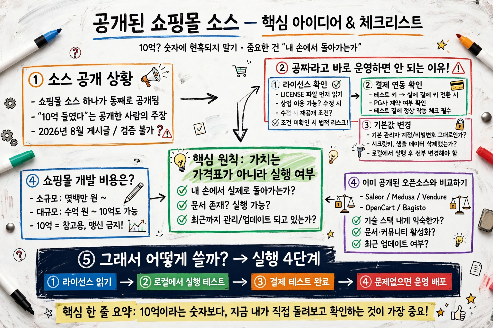
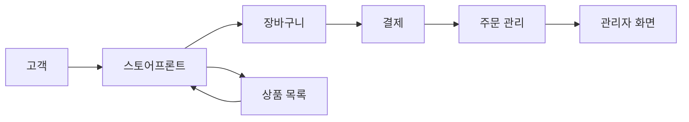
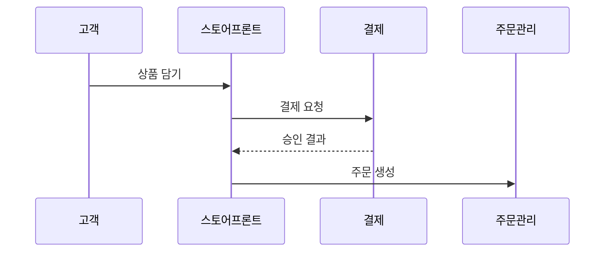
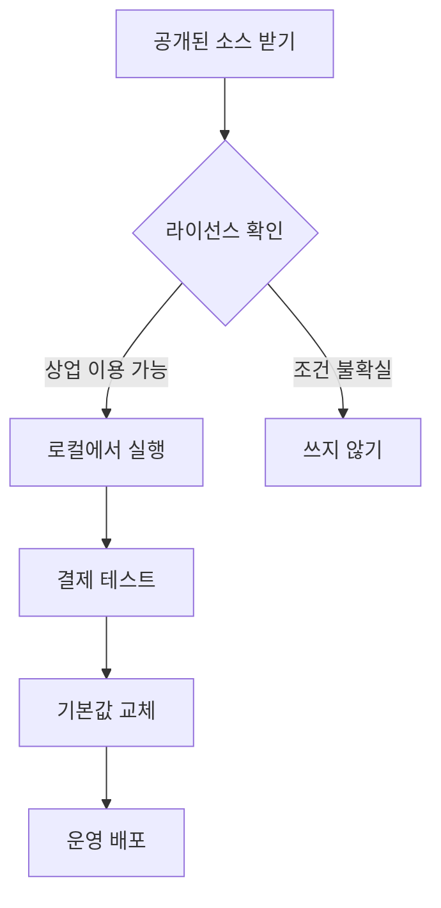

# 쇼핑몰 소스가 공짜로 풀렸습니다. 10억이라는 숫자보다 확인할 것이 먼저입니다

> **Summary**
> 공개된 쇼핑몰 소스는 무료라는 이유만으로 바로 운영에 올리지 말고, 라이선스와 결제 연동, 기본 계정·비밀 키를 확인해야 합니다. 10억이라는 개발 비용 주장은 검증되지 않았으며, 소스의 가치는 실제 실행 여부와 문서, 유지 관리 상태로 판단해야 합니다.

---

- 쇼핑몰 소스 하나가 통째로 공개됐습니다. 10억을 들였다는 말은 공개한 사람의 주장입니다.
- 공짜 코드라고 바로 운영에 올리면 안 됩니다. 라이선스, 결제 연동, 기본값을 먼저 확인해야 합니다.
- 쇼핑몰 소스의 가치는 가격표가 아니라, 내 손에서 돌아가는지로 정해집니다.

쇼핑몰 하나 만들려면 얼마가 들까요? 견적서를 받아본 적 있으시죠? 기획, 디자인, 개발, 결제 연동까지 더하면 숫자가 금방 커집니다. 그래서 "10억 들여 만든 쇼핑몰 소스, 그냥 공개했습니다"라는 말이 눈에 띄었습니다!

🎥 [동영상 보기](https://www.youtube.com/watch?v=VcZaLG7p3Og)

## 공개된 쇼핑몰 소스, 안에는 뭐가 들어 있을까요?

쇼핑몰 소스라고 하면 코드 한 덩어리처럼 들립니다. 실제로는 여러 시스템이 붙어 있습니다. 상품을 보여주는 스토어프론트, 상품과 주문을 관리하는 관리자 화면, 장바구니와 결제, 주문 처리, 데이터까지 말이죠. 이 글의 출발점이 된 게시글은 2026년 8월에 올라왔습니다. 제목 그대로, 쇼핑몰을 만드는 데 10억을 들였고 소스를 공개했다는 내용입니다. 다만 한 가지 짚고 넘어가야 합니다. 게시글 본문은 직접 확인할 수 없었습니다. 그래서 공개된 소스의 저장소 주소나 기술 스택, 라이선스는 이 글에서 확정해 말하지 않습니다. 10억이라는 숫자도 공개한 사람의 주장입니다. 검증할 방법이 없습니다.

그럼에도 이 소식에서 건질 것은 있습니다. 쇼핑몰 소스가 공개됐다는 사실 자체가 아니라, 공개된 소스를 어떻게 쓰고 무엇을 확인해야 하는지입니다.

## 공짜라고 바로 운영에 올리면 안 되는 이유가 뭘까요?

첫째, 라이선스입니다. 공개됐다고 해서 마음대로 써도 되는 것은 아닙니다. `LICENSE` 파일을 먼저 읽어야 합니다. 상업 이용이 가능한지, 수정한 코드를 다시 공개해야 하는지, 조건이 붙어 있는지가 거기에 적혀 있습니다. 라이선스를 확인하지 않고 운영에 올리면 나중에 발목을 잡힙니다!

둘째, 결제 연동입니다. 쇼핑몰 소스에서 가장 민감한 부분이 결제입니다. 테스트 키로 돌아가던 코드에 실제 결제 키를 넣는 순간, 돈이 움직입니다. 결제 대행사와 계약이 되어 있는지, 테스트 결제가 정상인지부터 확인해야 합니다.

셋째, 기본값입니다. 기본 관리자 계정과 비밀번호, 시크릿 키, 샘플 데이터가 그대로 남아 있는 소스가 많습니다. 로컬에서 실행해 보고, 운영에 올리기 전에 기본값을 전부 바꿔야 합니다. 이 세 가지만 챙겨도 공짜 소스로 인한 사고 대부분을 막을 수 있습니다.

## 10억이라는 숫자, 어떻게 읽어야 할까요?

쇼핑몰 개발 비용은 규모에 따라 천차만별입니다. 작은 쇼핑몰은 몇백만 원으로도 만들 수 있고, 큰 쇼핑몰은 수억 원이 들기도 합니다. 10억이라는 숫자가 맞는지 틀렸는지는 확인할 방법이 없습니다. 그래서 숫자에 현혹되지 않는 것이 중요합니다. 소스의 가치는 들어간 돈이 아니라, 지금 내 손에서 돌아가는지로 정해집니다. 실행이 되는지, 문서가 있는지, 최근까지 관리가 되었는지를 보는 것이 훨씬 정확합니다.

## 이미 공개된 쇼핑몰 소스와 비교하면?

세상에는 이미 공개된 쇼핑몰 소스가 많습니다. `Saleor`, `Medusa`, `Vendure`, `OpenCart`, `Bagisto` 같은 프로젝트가 대표적입니다. 이 프로젝트들은 저장소가 공개돼 있고, 문서와 커뮤니티가 함께 돌아갑니다. 새로 공개된 소스가 있다면 이들과 나란히 놓고 비교해 보면 됩니다. 기술 스택이 내게 익숙한지, 최근까지 관리가 되었는지, 문서가 있는지를 보는 것입니다. 비교 대상이 있으면 판단이 훨씬 쉬워집니다!

## 그래서, 어떻게 쓸까요?

공짜로 풀린 쇼핑몰 소스는 기회입니다. 다만 기회는 확인하는 사람에게만 기회입니다. 라이선스를 읽고, 로컬에서 돌려보고, 결제까지 테스트한 뒤에 운영에 올리면 됩니다. 10억이라는 숫자보다, 내 손에서 돌아가는 소스인지가 먼저입니다!

