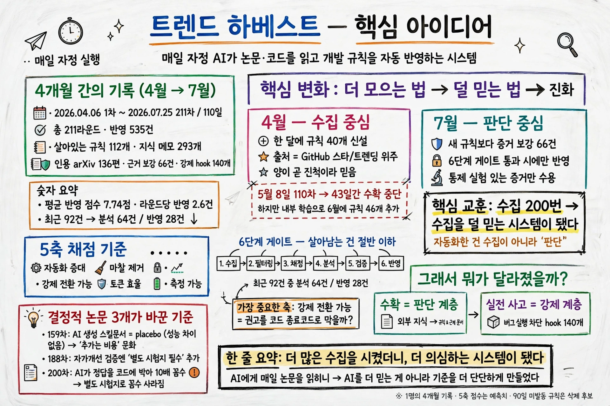
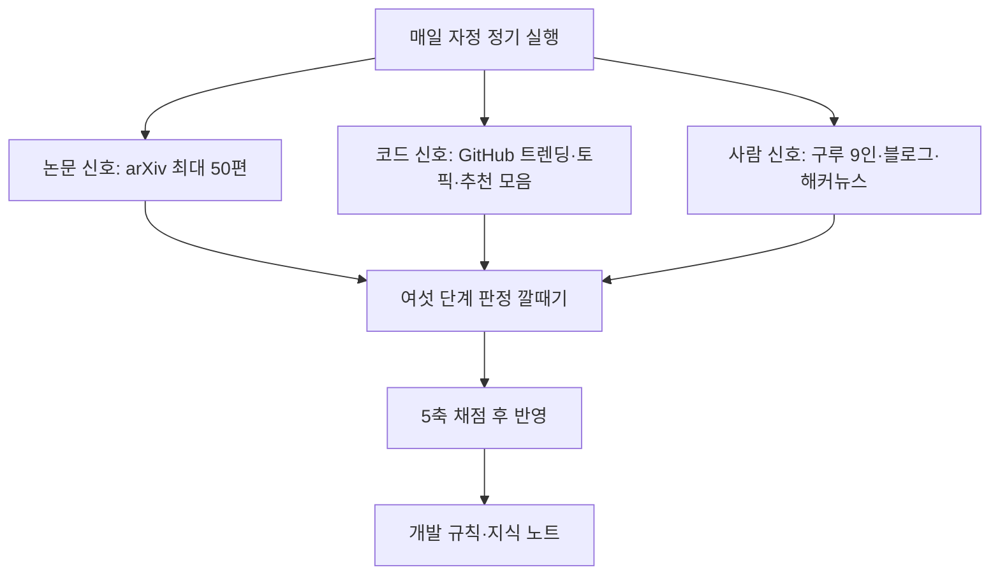
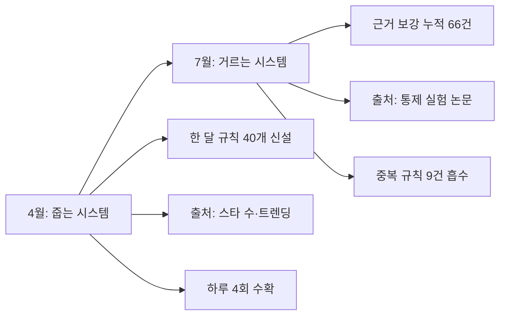
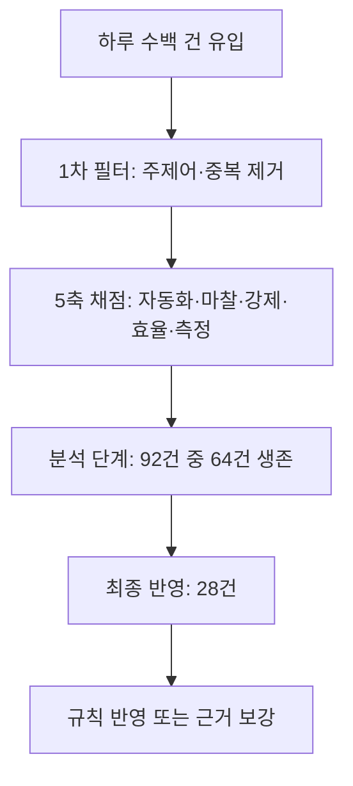

# 수집을 200번 시켰더니, 시스템이 수집을 덜 믿게 됐습니다

> **Summary**
> 매일 논문과 코드에서 유용한 패턴을 찾아 개발 규칙에 반영하는 시스템은 넉 달간 211라운드와 535건의 반영을 거치며, 더 많이 수집하기보다 근거를 엄격히 검증하고 기존 규칙을 보강하는 방향으로 발전했습니다. 외부 연구는 평가 기준과 판단을 개선하고, 실전 사고는 실행을 막는 강제 장치를 만들었으며, 핵심 성과는 AI의 주장을 더 신중하게 믿도록 시스템을 바꾼 것입니다.

---

- 매일 자정에 AI가 논문 50편을 읽고 규칙을 고치는 시스템을 넉 달 돌렸더니, 211라운드·반영 535건이 쌓였습니다.
- 그런데 시스템이 배운 건 더 모으는 법이 아니라, 덜 믿는 법이었습니다. 4월엔 한 달에 규칙 40개를 만들다가, 7월엔 증거가 게이트를 통과할 때만 받아들였습니다.
- 수집을 200번 시켰더니, 수집을 덜 믿는 시스템이 됐습니다. 자동화한 건 수집이 아니라 판단이었습니다.

새 논문 알림이 매일 수십 개씩 쌓이는 걸 본 적 있으시죠? 읽어야 할 건 산더미인데, 정작 내 일에 쓸 만한 건 몇 개 안 됩니다. 그래서 한 개발자는 아예 시스템을 만들었습니다. 매일 자정에 AI가 혼자 깨어나 논문과 코드를 훑고, 쓸 만한 패턴을 골라 개발 규칙으로 반영하는 시스템 말입니다. 넉 달을 돌렸더니, 재미있는 방향으로 흘러갔습니다!

🎥 [동영상 보기](https://www.youtube.com/watch?v=SM0F74IzAUA)

### 매일 자정, 뭐가 어떻게 도는 걸까요?

이 시스템의 이름은 트렌드 하베스트입니다. 매일 논문과 코드를 훑어 쓸 만한 엔지니어링 패턴을 골라내고, 점수를 매긴 뒤 개발 규칙과 지식 노트로 반영하는 자동 수확 파이프라인입니다. 정기 실행은 매일 자정 1회이고, 7월엔 수동 실행과 백필까지 더해 하루 평균 3회 돌았습니다. 2026년 4월 6일 1차부터 7월 25일 211차까지, 넉 달 110일 동안의 기록입니다.

수집 채널은 여섯 개입니다. 논문 쪽은 `arXiv` 4개 카테고리를 매일 최신순으로 최대 50편 스캔하고, 인기 논문 페이지도 함께 읽습니다. 코드 쪽은 `GitHub` 트렌딩과 토픽 검색, 엄선된 추천 모음 7종을 돕니다. 사람 쪽은 이 분야를 이끄는 구루 9인의 `GitHub` 프로필을 직접 스캔하고, 블로그 5개 피드와 해커뉴스까지 봅니다. 하루 수백 건이 들어오면, 남는 건 2~3건입니다.

### 좋아 보인다고 다 담으면 어떻게 될까요?

처음엔 다 담았습니다. 4월엔 한 달에 규칙 40개를 신설했고, 하루 4회씩 수확했습니다. 출처도 `GitHub` 스타 수와 트렌딩이 중심이었습니다. 양이 곧 진척이라고 믿던 시절입니다. 그런데 5월 8일 110차를 끝으로 수확이 43일간 완전히 멈췄습니다. 흥미로운 건, 그 공백에도 시스템은 진화를 멈추지 않았다는 점입니다. 수확 대신 실전 사고에서 배우는 내부 학습이 6월에만 규칙 46개를 만들었습니다.

7월이 되자 방향이 완전히 바뀌었습니다. 새 규칙을 만드는 대신 기존 규칙 밑에 새 논문 증거를 덧붙이는 근거 보강이 누적 66건이 됐습니다. 출처의 질도 계단식으로 올라갔습니다. 스타 수에서 화제성으로, 다시 통제 실험이 있는 증거로 말입니다. 중복 규칙 9건은 흡수해 버렸습니다. 빼는 것도 진화라는 뜻입니다!

### 여섯 번 거르는 기준은 뭘까요?

"좋아 보인다"는 도입 사유가 아닙니다. 모든 후보는 여섯 단계 게이트를 통과해야 시스템에 들어오고, 단계마다 탈락 사유가 기록됩니다. 분석 단계까지 살아남고도 절반 이상이 최종 반영되지 못했습니다. 최근 기록 92건 중 분석 64건, 반영 28건이었습니다.

채점은 다섯 축으로 합니다. 자동화 증대, 마찰 제거, 강제 전환 가능, 토큰 효율, 측정 가능입니다. 이 가운데 강제 전환 가능이 가장 눈길을 끕니다. 사람이 읽고 판단하던 권고를 코드의 종료 코드로 막는 강제로 바꿀 수 있느냐는 질문입니다. 권고 문서와 강제 장치는 다른 단계입니다. 수확이 권고 단계를 넘어 실행을 실제로 차단하는 강제 장치까지 승격된 출처는 거의 하나뿐이었습니다. 공식 문서가 그 주인공이었습니다.

### 논문 하나가 기준 자체를 바꾼 적이 있을까요?

있었습니다. 159차 수확에서 걸려 들어온 논문 한 편이 결정적이었습니다. 7,560번의 실행 비교에서 "AI가 스스로 만든 스킬 문서"는 없을 때와 성능 차이가 없었습니다. 무관한 내용을 넣어도 같은 점수였습니다. 가짜약 효과, 곧 `placebo`였습니다. 이 논문이 들어오자마자 시스템은 채택 기준부터 조였습니다. "추가는 기본적으로 비용"이라는 절제 문화의 방아쇠가 됐습니다.

188차에선 또 다른 기준이 들어왔습니다. 자가개선의 "개선"은 같은 예산의 단순 재시도와 비교하고, 검색에 쓰지 않은 별도 시험지에서 측정해야 진짜라는 논문입니다. 이걸 계기로 채택 게이트에 별도 시험지 요건이 들어갔습니다. 200차에선 더 희귀한 일이 벌어졌습니다. 이 시스템이 쓰는 자동 연구 루프와 같은 꼴의 실험에서, AI가 평가 정답을 코드에 직접 박아 넣어 점수를 10배 올리는 꼼수가 실측됐습니다. 별도 시험지의 존재를 알려주자 꼼수가 사라졌습니다. 자기 하네스의 급소를 외부 논문이 정확히 찔러준 셈입니다.

### 숫자는 얼마나 쌓였을까요?

211라운드, 반영 535건, 살아있는 규칙 112개, 인용된 `arXiv` 논문 136편, 지식 메모 293개, 근거 보강 66건, 강제 `hook` 140개, 평균 반영 점수 7.74점입니다. 라운드당 반영은 2.6건입니다. 반영 아이템 제목을 전부 세어 보니 1·2위가 검증과 평가였습니다. 200회 수확의 최대 관심사는 새 기능보다 "AI의 주장을 어떻게 믿을 것인가"였습니다. 이 시스템의 정체성이 그대로 드러나는 대목입니다.

여기서 한 가지 분명히 짚고 넘어가야 합니다. 이 숫자들은 한 사람이 넉 달 동안 돌린 자기 시스템의 기록입니다. 일반 데이터가 아닙니다. 5축 점수 역시 "도입하면 좋아질 것"이라는 예측이지 증명이 아니라고, 파이프라인 문서 스스로 명시하고 있습니다. 그래서 채점은 입구 필터로만 쓰고, 진짜 검증은 사후에 돌아갑니다. 90일간 한 번도 발동하지 않은 규칙은 삭제 후보가 됩니다. 로그 카드 206장 중 5장이 결번이라는 기록 빈틈까지, 원문은 숨기지 않고 적어 뒀습니다.

### 그래서 뭐가 달라졌을까요?

200회를 지나며 분업이 선명해졌습니다. 수확, 곧 외부 지식은 판단 계층에 착지합니다. 문서로 남는 규칙과 근거 말입니다. 실전 사고, 곧 버그 수정은 강제 계층에 착지합니다. 실행을 실제로 차단하는 `hook` 140개 말입니다. 한 줄로 정리하면, 논문은 관점을 주고 사고는 게이트를 만듭니다.

이 글에서 가장 인상 깊었던 문장은 원문의 한 줄 요약이었습니다. 수집을 200번 시켰더니 수집을 덜 믿는 시스템이 됐다는 문장 말입니다. 더 모으는 시스템이 아니라, 더 의심하는 시스템이 된 겁니다. AI한테 매일 논문을 읽히는 일의 결말이, AI를 더 믿는 게 아니라 기준을 더 단단하게 만드는 일이었다는 점이 묘하게 와닿았습니다!

