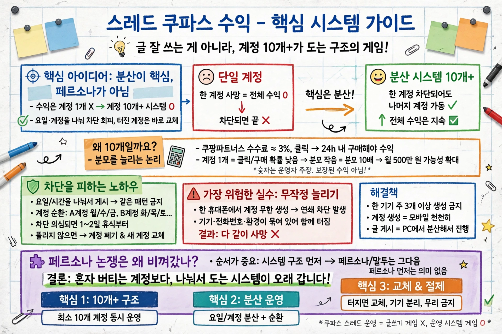
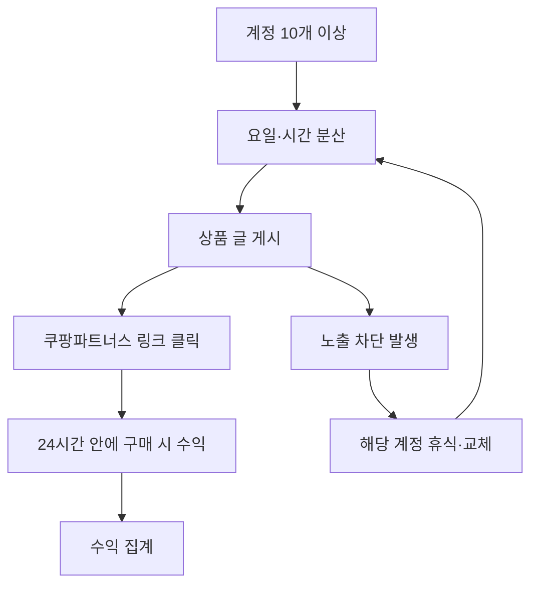
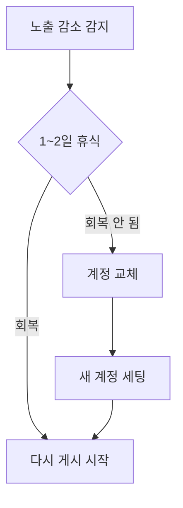
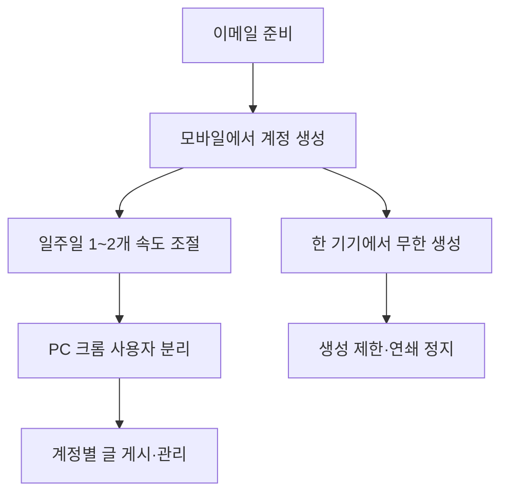

# 스레드 쿠파스, 계정 10개가 돌아가야 월 500만 원이 보입니다. 페르소나가 아니라 시스템입니다

> **Summary**
> 스레드 쿠팡파트너스 수익화는 계정 하나보다 여러 계정을 요일과 시간대별로 분산 운영하는 시스템이 핵심입니다. 계정이 노출 제한을 받으면 쉬게 하거나 교체하고, 한 기기에 계정을 무리하게 몰아 생성하면 연쇄 정지 위험이 커집니다. 월 500만 원은 운영자의 주장일 뿐 보장된 수익은 아닙니다.

---

- 스레드 쿠파스 수익은 계정 하나가 아니라, 계정 10개 이상이 돌아가는 시스템에서 나옵니다.
- 핵심은 페르소나가 아니라 분산입니다. 요일과 계정을 나눠 차단을 피하고, 터진 계정은 바로 교체합니다.
- 다만 한 휴대폰에서 계정이 터지면 관련 계정까지 함께 터집니다. 무작정 계정을 늘리는 건 시스템이 아닙니다.

스레드에 쿠파스 글을 올렸는데 조회수가 0에서 안 움직인 적 있으시죠? 글은 잘 썼는데, 계정 자체가 안 보이는 겁니다. 그럴 때 보통 "페르소나를 만들어야 한다"는 조언이 먼저 나옵니다. 그런데 5월에 세팅된 이 시스템은 다른 답을 냈습니다. 페르소나가 아니라, 계정을 여러 개 굴리는 구조 자체가 답이라는 겁니다!

🎥 [동영상 보기](https://www.youtube.com/watch?v=7TwQ5eBLre0)

## 시스템이 뭘까요? 계정 하나가 아니라 구조입니다

이 시스템의 뼈대는 단순합니다. 계정 10개 이상을 동시에 돌리는 겁니다. 계정 하나가 하루에 글을 몇 개 올리는지가 아니라, 계정 여러 개가 각자 다른 요일과 시간에 글을 올리는 구조입니다. 한 계정이 노출이 막혀도 나머지 계정이 계속 돌아가니, 전체 수익이 한 번에 멈추지 않습니다.

## 왜 10개일까요? 숫자는 분모에서 나옵니다

쿠팡파트너스 수수료는 보통 3% 수준이고, 클릭 뒤 24시간 안에 구매가 일어나야 수익이 됩니다. 계정 하나가 하루에 글 몇 개를 올려도, 클릭이 구매로 이어지는 확률은 낮습니다. 계정이 10개면 분모가 10배가 됩니다. 그래서 원문에서는 계정 10개 이상을 돌려야 월 500만 원이 보인다고 말합니다. 이 숫자는 원문 운영자의 주장입니다. 보장된 수익이 아니라, 그 시스템이 전제로 삼은 계산입니다!

## 차단을 피하는 노하우는 뭘까요?

특정 요일이나 계정에 차단이 몰리지 않게 하는 게 노하우의 핵심입니다. 같은 패턴으로 같은 시간에 계속 올리면 노출이 막힙니다. 요일을 나누고, 계정을 순환시키고, 한 계정에 무리를 주지 않는 겁니다. 노출이 막힌 계정은 바로 버리는 게 아니라, 1~2일 쉬게 두는 것부터 봅니다. 그래도 안 풀리면 그 계정은 접고 새 계정으로 교체합니다. 차단 대응도 시스템의 일부입니다!

## 가장 위험한 실수는 뭘까요? 무작정 늘리는 겁니다

"계정이 많으면 좋지 않나?" 싶으시죠? 그런데 무턱대고 한 휴대폰에서 지메일을 무한대로 만들어 돌리면 다 터집니다. 한 기기에서 계정을 계속 만들면 생성 제한이 걸리고, 전화번호 인증이나 본인 확인을 요구받습니다. 더 무서운 건 연쇄입니다. 한 휴대폰에서 터진 계정은 관련 계정들도 함께 터뜨립니다. 기기·전화번호·환경이 묶여 있기 때문입니다. 그래서 공개된 운영 매뉴얼들도 한 기기에서 일주일에 3개 이상을 한꺼번에 만들지 말라고 말합니다. 계정 생성은 모바일에서 천천히, 글 올리는 일은 PC에서 나누는 게 정석으로 통합니다.

## 페르소나 논쟁은 왜 비껴갔을까요?

원문은 "페르소나를 만들라"는 조언에 선을 그었습니다. 페르소나가 필요 없다는 뜻이 아닙니다. 순서가 다르다는 겁니다. 계정 하나가 살아남지도 못하는데 페르소나부터 논하는 건 순서가 바뀐 겁니다. 시스템이 먼저 돌아가야 페르소나도 의미가 있습니다. 이 글도 그 순서를 따릅니다. 구조가 먼저고, 말투는 그다음입니다!

## 그래서 뭐가 남을까요?

쿠파스 스레드 운영은 글 잘 쓰는 게임이 아닙니다. 계정을 몇 개나, 어떻게 나눠서, 터졌을 때 어떻게 교체하느냐의 게임입니다. 계정 10개가 돌아가는 구조, 요일과 계정을 나누는 분산, 터진 계정을 쉬게 하거나 교체하는 대응, 그리고 한 기기에 몰아넣지 않는 절제가 시스템의 전부입니다. 수익 수치는 운영자의 주장일 뿐, 보장된 약속이 아닙니다. 그래도 구조 하나는 분명합니다. 혼자 버티는 계정보다, 나눠서 도는 시스템이 오래 갑니다!

