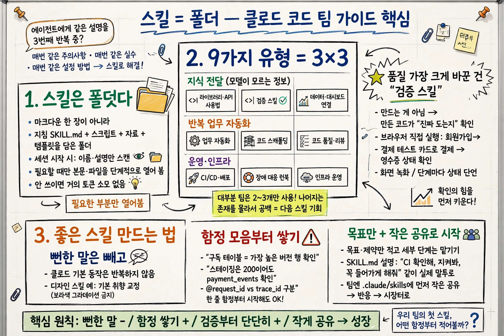
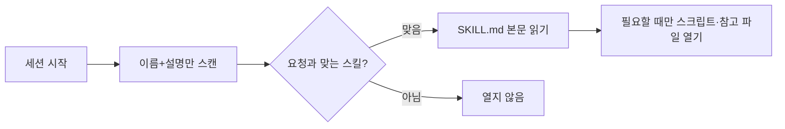
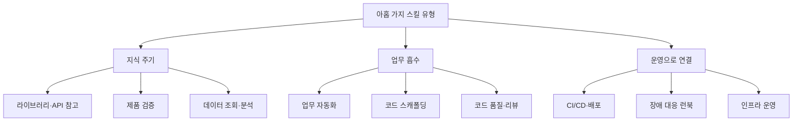
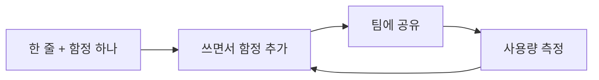

# 스킬은 마크다운 한 장이 아니라 폴더입니다. 검증 스킬이 품질을 가장 크게 바꿉니다

> **Summary**
> 스킬은 지침·스크립트·자료를 담은 폴더로, 필요한 내용만 단계적으로 불러와 재사용할 수 있습니다. 아홉 가지 유형 중 결과를 직접 확인하는 검증 스킬이 품질 향상에 가장 큰 영향을 주며, 좋은 스킬은 뻔한 설명보다 실제 함정과 실패 사례를 담고 목표 중심으로 작성해야 합니다. 작은 스킬부터 팀에 공유하고 사용량과 반응을 바탕으로 발전시키는 것이 좋습니다.

---

- 스킬은 마크다운 한 장이 아니라 지침·스크립트·자료를 담은 폴더이고, 필요한 부분만 단계적으로 열어 봅니다.
- 수백 개 스킬은 아홉 가지 유형으로 나뉘는데, 품질을 가장 크게 바꾼 건 결과를 직접 확인하는 검증 스킬입니다.
- 잘 만든 스킬은 뻔한 말을 빼고 함정 모음부터 쌓으며, 팀에 퍼뜨릴 때는 작은 공유부터 시작합니다.

에이전트에게 같은 설명을 세 번째 반복하고 계시진 않으신가요? 매번 같은 주의사항을 붙여넣고, 매번 같은 실수를 지적하고, 매번 같은 설정 방법을 알려주는 일 말입니다. 클로드 코드 팀은 이 반복을 스킬로 바꿨습니다. 수백 개 스킬을 실전에서 굴리면서 배운 내용을 전부 공개했습니다!

🎥 [동영상 보기](https://www.youtube.com/watch?v=UGSheJ862X0)

## 스킬, 마크다운 한 장이 아니라고요?

스킬을 마크다운 파일 한 장으로 아는 분이 많습니다. 그런데 클로드 코드 팀의 정의는 다릅니다. 스킬은 폴더입니다! 지침이 담긴 `SKILL.md`를 중심으로, 참고 문서·스크립트·템플릿·설정까지 한데 묶은 폴더 말입니다.

이 폴더는 한 번에 다 읽히지 않습니다. 세션이 시작될 때는 이름과 설명만 스캔합니다. 요청과 맞다고 판단되면 본문을 읽고, 본문이 가리키는 파일은 필요할 때만 엽니다. 긴 스킬도 쓰이기 전까지는 거의 토큰을 먹지 않는 구조입니다.

## 아홉 가지 유형, 우리 팀엔 몇 가지나 있을까요?

팀 안의 스킬을 전부 모아 정리했더니 아홉 가지 유형으로 나뉘었습니다. 한 스킬이 한 유형에 딱 맞는 게 좋고, 여러 유형을 넘나들면 에이전트가 헷갈린다고 합니다.

먼저 모델이 추론할 수 없는 지식을 주는 세 가지입니다. 라이브러리·API 사용법을 설명하는 스킬, 결과물을 직접 확인하는 검증 스킬, 데이터와 대시보드에 닿는 스킬입니다. 다음은 팀의 반복 업무를 흡수하는 세 가지입니다. 업무 자동화, 코드 스캐폴딩, 코드 품질·리뷰 스킬입니다. 마지막은 운영으로 이어지는 세 가지입니다. CI/CD·배포, 장애 대응 런북, 인프라 운영 스킬입니다.

대부분의 팀은 이 중 두세 가지만 쓰고 있다고 합니다. 나머지가 쓸모없어서가 아니라, 존재 자체를 몰라서 그렇습니다. 우리 팀 스킬 목록을 아홉 칸에 나눠보면 빈칸이 바로 다음에 만들 스킬입니다!

## 검증 스킬이 품질을 가장 크게 바꿉니다!

아홉 가지 중 효과가 가장 크게 측정된 건 검증 스킬이었습니다. 코드를 만드는 스킬이 아니라, 만든 코드가 진짜로 도는지 확인하는 스킬입니다. 회원가입부터 이메일 인증, 온보딩까지 브라우저로 직접 돌리거나, 결제 테스트 카드로 결제를 밀어보고 영수증 상태를 확인하는 식입니다.

그래서 팀은 검증 스킬에 한 엔지니어가 일주일을 통째로 쓰는 것도 아깝지 않다고 말합니다. 화면을 영상으로 녹화해서 무엇을 테스트했는지 눈으로 확인하거나, 단계마다 상태를 코드로 단언하게 만드는 방법이 소개됐습니다. 만드는 속도가 아니라 확인하는 힘을 먼저 키우는 셈입니다.

## 좋은 스킬은 어떻게 만들까요?

### 뻔한 말은 빼고, 함정부터 적습니다

클로드는 이미 코딩을 잘하고 저장소도 읽습니다. 뻔한 설명을 다시 적으면 토큰만 쓰고 가치는 없습니다. 스킬은 클로드의 기본 동작에서 벗어나는 정보에 집중해야 합니다. 디자인 스킬이 대표적인 예입니다. 흔한 글꼴과 보라색 그라데이션을 피하게 해서, 클로드의 기본 취향을 교정했습니다.

함정 모음이 스킬의 진짜 알맹이입니다! 구독 테이블은 추가 전용이라 최신 행이 아니라 버전이 가장 높은 행을 봐야 한다, 같은 값이 게이트웨이에선 `@request_id`, 결제 서비스에선 `trace_id`로 불린다, 스테이징은 웹훅이 처리되지 않아도 200을 돌려주니 `payment_events`를 확인해야 한다. 이런 실패 지점이 쌓일수록 스킬은 좋아집니다. 처음엔 한 줄짜리 함정 하나로 시작해도 됩니다.

### 목표만 적고, 세세한 단계는 맡깁니다

지시를 너무 세세하게 적으면 오히려 해가 됩니다. 스킬은 재사용되는 만큼, 상황에 맞게 적응할 여지를 남겨야 합니다. 체리픽을 예로 들면, 여섯 단계의 깃 명령어를 나열하는 대신 목표와 제약을 적는 편이 낫습니다. 깨끗한 브랜치에 커밋을 가져오고, 충돌은 의도를 살려 해결하고, 깨끗하게 안 되면 이유를 설명하라는 식입니다.

### 설명은 사람이 아니라 모델을 향해 씁니다

`SKILL.md` 맨 위의 설명은 요약이 아닙니다. 세션이 시작될 때 클로드가 훑는 목록이라, 언제 이 스킬을 꺼내야 하는지를 적는 자리입니다. "풀 리퀘스트 상태를 전 과정에 걸쳐 감시하는 종합 도구" 같은 설명보다, "풀 리퀘스트가 합쳐질 때까지 지켜봅니다. '지켜봐', 'CI 확인해', '꼭 들어가게 해줘'에 반응합니다" 같은 설명이 훨씬 잘 먹힙니다. 누군가 실제로 말할 법한 단어를 설명에 넣어두는 게 요령입니다.

### 기억하고, 스크립트로 묶고, 필요할 때만 잠급니다

스킬 안에 로그 파일을 두면 클로드가 자기 기록을 읽고 이어서 일합니다. 스탠드업 스킬이 어제 쓴 글을 `standups.log`에 남기면, 다음 날엔 무엇이 달라졌는지만 골라 적습니다. 반복되는 일은 스크립트로 묶어두는 편이 낫습니다. 데이터 조회용 도우미 함수를 주고, 함정까지 주석으로 적어두면, 클로드는 그 부품을 조합해 그때그때 스크립트를 새로 짭니다.

위험한 작업엔 세션 한정 훅이 있습니다. `/careful`을 켜면 `rm -rf`나 테이블 삭제, 강제 푸시 같은 명령을 실행 전에 막습니다. `/freeze`를 켜면 정한 폴더 밖의 편집을 막습니다. 항상 켜두면 답답하고, 필요할 때만 켜면 든든합니다. 늘 적용할 규칙은 `CLAUDE.md`에, 그때그때 주의는 스킬에 두는 구분이 핵심입니다.

## 팀에 퍼뜨리는 법, 시장터부터 만들지 않습니다

스킬의 큰 장점은 팀과 나눌 수 있다는 점입니다. 작은 팀이라면 저장소의 `.claude/skills`에 넣어두면 됩니다. 규모가 커지면 플러그인 시장터가 나아집니다. 팀원이 골라서 설치하고, 설치 흐름까지 갖출 수 있기 때문입니다.

그런데 시장터에 무엇을 올릴지는 중앙 팀이 정하지 않습니다. 누군가 만든 스킬을 샌드박스 폴더에 올리고 채팅방에 알리면, 써본 사람들이 모입니다. 반응이 오면 그때 풀 리퀘스트로 시장터에 옮깁니다. 사용량은 훅으로 기록해서, 인기 있는 스킬과 기대보다 덜 불리는 스킬을 구분합니다. 가장 좋은 스킬은 처음엔 몇 줄과 함정 하나에서 시작해, 클로드가 부딪힌 사례를 더하면서 자랐다고 합니다.

스킬은 결국 팀의 일하는 방식을 폴더에 담아두는 일입니다. 뻔한 말 대신 함정을 적고, 검증부터 단단히 만들고, 작게 공유하면서 키우면 됩니다. 우리 팀의 첫 스킬, 어떤 함정부터 적어볼까요?

