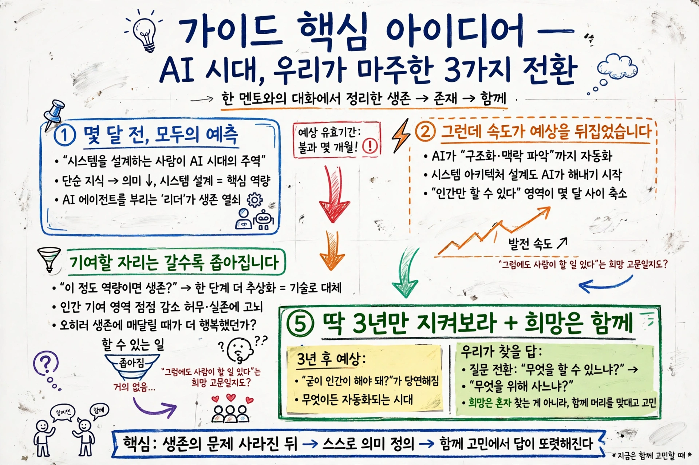
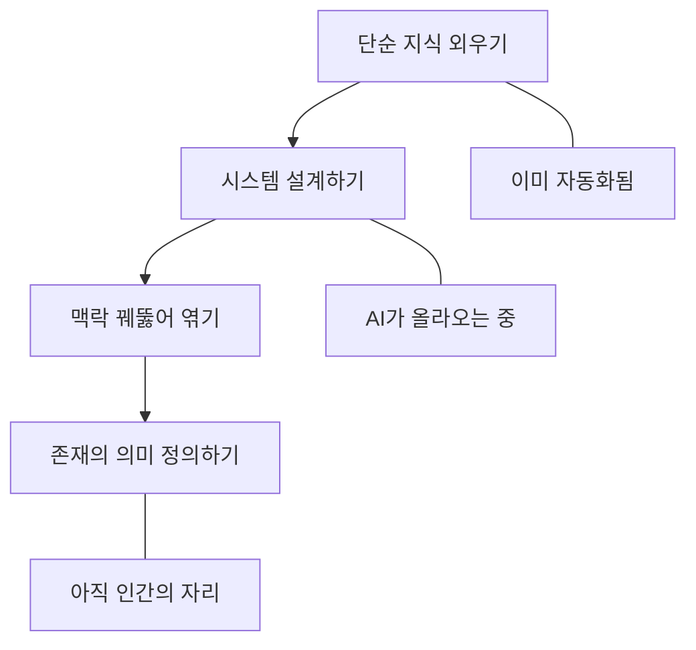
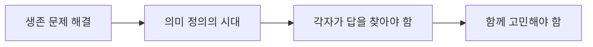

# 시스템 설계까지 AI가 한다면, 인간에게 남는 일은 무엇일까요?

> **Summary**
> 몇 달 전만 해도 "시스템을 설계하는 사람이 AI 시대의 주역"이라는 말이 당연하게 들렸습니다. 그런데 그 자리까지 AI가 올라오는 속도가 이미 예상을 뒤집고 있습니다. 단순 지식은 물론, 맥락을 꿰뚫어 구조화하는 일까지 한 단계 더 추상화되면 기술로 해결됩니다. 인간이 기여할 자리는 갈수록 좁아집니다. 생존의 문제가 사라진 뒤에는 각자가 존재의 의미를 스스로 정의해야 하는 시대가 옵니다. 희망은 혼자 찾는 게 아니라, 함께 머리를 맞대고 고민하는 데서 나옵니다.

---

- 몇 달 전만 해도 "시스템을 설계하는 사람이 AI 시대의 주역"이라는 말이 당연하게 들렸습니다. 그런데 그 자리까지 AI가 올라오는 속도가 이미 예상을 뒤집고 있습니다.
- 단순 지식은 물론, 맥락을 꿰뚫어 구조화하는 일까지 한 단계 더 추상화되면 기술로 해결됩니다. 인간이 기여할 자리는 갈수록 좁아집니다.
- 생존의 문제가 사라진 뒤에는 각자가 존재의 의미를 스스로 정의해야 하는 시대가 옵니다. 희망은 혼자 찾는 게 아니라, 함께 머리를 맞대고 고민하는 데서 나옵니다.

AI가 글을 쓰고, 코드를 짜고, 그림을 그리는 걸 보면서 "그래도 이건 인간만 할 수 있겠지"라고 생각해 본 적 있으시죠? 그런데 그 "이것"의 범위가 몇 달 사이에도 계속 줄고 있습니다. 이 글은 한 멘토와의 대화에서 나온 생각을 정리한 것입니다.

🎥 [동영상 보기](https://www.youtube.com/watch?v=sL0R_xMVZlA)

🔗 [https://youtube.com/post/UgkxH5-8dAp6tiqTcKLNYV7yIQ66hwBUy3Ph](https://youtube.com/post/UgkxH5-8dAp6tiqTcKLNYV7yIQ66hwBUy3Ph)

## 몇 달 전, 모두의 예측은 같았습니다

고작 몇 개월 전만 해도 다들 그랬습니다. 단순한 지식을 외우는 건 이제 의미가 없고, 거대한 "시스템"을 설계하는 사람들이 AI 시대의 주역이 될 거라고요. 모두가 리더가 되어 수많은 AI 에이전트들을 부려야 하고, 그래야만 살아남을 수 있을 거라고요.

이 예측이 완전히 틀렸다는 게 아닙니다. 문제는 유효 기간입니다. 생각보다 훨씬 짧았다는 게 문제입니다!

## 그런데 속도가 예상을 뒤집었습니다

지금 발전 속도를 보세요. 과연 몇 년 뒤에 AI가 우리가 짜는 수준의 "시스템"을 생각 못 해낼까요? 이 정도 차원의 구조화를 못 할까요? 일의 맥락을 꿰뚫어 서로 엮어주는 일을 못 할까요? 지금 수준에서 꽤 똑똑하다는 인간이 설계하는 시스템 아키텍처 정도를 못 짤까요?

그것까지 전부 자동화될 거라고 합니다. "그래도 이 영역만큼은 인간 고유겠지"라는 오만한 예측들을 보란 듯이 뒤집고 있는 속도인데, 인류 역사상 이런 속도는 본 적이 없었다고 합니다!

## 기여할 자리는 갈수록 좁아집니다

지금 우리가 보기에 "이 정도 역량만 갖추면 생존할 수 있겠지" 싶은 것들도, 결국 한 단계 더 추상화되면 기술로 전부 해결될 거라고 합니다. 인간이 기여할 수 있는 자리는 갈수록 좁아집니다.

믿거나 말거나 각자의 판단이지만, "그럼에도 사람이 할 일이 있을 거야"라고 계산하며 베팅하는 건 고작 일말의 희망 고문일지도 모른다고 합니다. 냉정하게 보면, 그렇다고 봐야 할까요?

이 대목이 저는 가장 묵직하게 다가왔습니다. "없어질 거야"라는 말이 아니라, "있다고 믿는 것 자체가 희망 고문일 수 있다"는 말이니까요!

## 생존 뒤에 오는 질문은 더 무겁습니다

결국 우리 각자가 존재의 의미를 스스로 정의해야만 하는 시대가 옵니다. 이건 물질적으로 풍족해지고 생존 문제를 해결하는 것과는 전혀 다른 차원의 문제입니다.

과거에 생존의 굴레에서 벗어나 철학을 파고들거나 예술적 아름다움만 추구하던 귀족과 사상가들조차, 그 허무와 실존의 무게를 못 견뎌 정신병에 시달렸다고 전해집니다. 어쩌면 인간은 그 거대한 질문에 답을 내리기 전에, 당장 먹고사는 생존 문제를 해결하려 동물처럼 치열하게 살던 때가 차라리 더 행복했던 것일지도 모릅니다.

## 딱 3년만 지켜보라는 말

딱 3년만 지켜보라고 합니다. 지금 인간들이 하고 있는 일들이 대체되는 속도를요. "굳이 인간이 해야 돼?"라는 질문이 당연해질 거라고 합니다.

그럼에도 우리는 희망을 찾아야 합니다. 이제는 정말 모두가 머리를 맞대고 고민해 봐야 합니다. 남는 질문은 "무엇을 할 수 있느냐"가 아니라 "무엇을 위해 사느냐"입니다. 그 답은 혼자 찾기보다, 함께 고민할 때 더 또렷해집니다!

