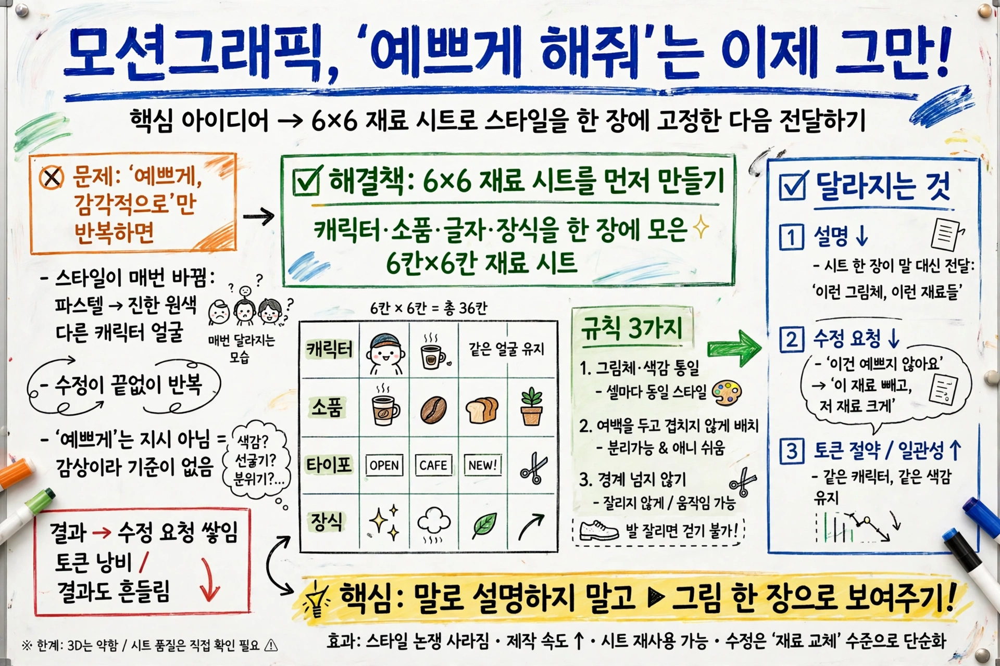
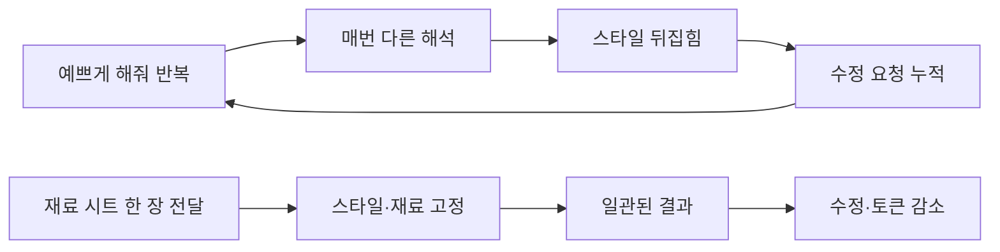
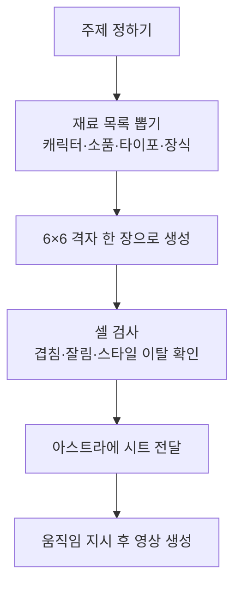

# 아스트라: '예쁘게 해줘'만 외치면 평생 걸립니다. 재료 시트 한 장이 먼저입니다

> **Summary**
> 모션그래픽 제작에서는 “예쁘게 해줘” 같은 모호한 요청보다 캐릭터·소품·타이포·장식을 6×6 재료 시트 한 장에 담아 스타일과 요소를 명확히 전달하는 것이 효과적입니다. 재료를 겹치거나 잘리지 않게 배치하면 일관성이 높아지고 수정과 토큰 사용을 줄일 수 있지만, 시트 품질은 직접 확인해야 합니다.

---

- 모션그래픽을 만들 때 "예쁘게, 감각적으로 만들어줘"만 반복하면 스타일이 매번 바뀌고 수정이 끝없이 이어집니다.
- 캐릭터·소품·글자·장식을 한 장에 모은 6칸×6칸 재료 시트를 먼저 만들면, 스타일과 재료를 한 번에 전달할 수 있습니다.
- 재료마다 여백을 두고 겹치지 않게 배치하면 분리도 쉽고 움직임도 붙이기 쉬워서, 수정 요청과 토큰이 함께 줄어듭니다.

영상 하나 만들려고 프롬프트 창을 열었는데, "예쁘게 해줘" "감각적으로 해줘"만 되풀이한 적 있으시죠? 결과물을 받아보면 어딘가 아쉽습니다. 다시 부탁하면 이번엔 분위기가 통째로 바뀌어 버립니다. 같은 말을 세 번, 네 번 반복해도 원하는 그림에 닿지 않습니다. 왜 그럴까요?

🎥 [동영상 보기](https://www.youtube.com/watch?v=Ce1Ym1HGyBA)

## "예쁘게 해줘"는 왜 안 통할까요?

"예쁘게"는 지시가 아니라 감상입니다. 모델 입장에서 예쁘다는 말은 색감도, 선의 굵기도, 캐릭터의 표정도 정해주지 않습니다. 그래서 매번 다른 해석이 나옵니다. 한 번은 파스텔 톤이었다가, 다음 번엔 진한 원색이 됩니다. 캐릭터 얼굴도 매번 조금씩 달라집니다. 스타일을 말로 길게 풀어쓰면 어떨까요? 그것도 한계가 있습니다. 문장이 길어질수록 모델이 놓치는 조건이 늘어납니다. 결국 수정 요청이 쌓이고, 토큰도 함께 새어 나갑니다!

아스트라는 추론을 맡는 모델입니다. 영상을 직접 찍어내는 네이티브 영상 모델이 아니라, 생성과 도구를 조율하는 쪽에 가깝습니다. 그래서 지시가 모호하면 조율할 기준 자체가 흔들립니다. 기준이 흔들리면 결과도 흔들립니다. 이 지점에서 접근을 바꿔야 합니다. 스타일을 말로 설명하지 말고, 그림 한 장으로 보여주는 겁니다!

## 재료 시트는 어떻게 만드나요?

재료 시트는 모션그래픽에 쓸 재료를 한 장에 모아놓은 판입니다. 규격은 가로 6칸 × 세로 6칸입니다. 한 칸에 재료 하나씩, 모두 36칸을 채우는 방식입니다. 들어가는 재료는 네 가지입니다. 캐릭터, 소품, 타이포, 장식입니다. 주제에 맞는 것들로만 고릅니다. 예를 들어 카페 홍보 영상이면 컵, 원두, 간판 글자, 김이 오르는 모티프 같은 것들입니다.

만들 때 지키는 규칙이 세 가지 있습니다. 첫째, 그림체와 색감을 하나로 통일합니다. 셀마다 스타일이 다르면 시트로서 의미가 없습니다. 둘째, 각 재료는 개별 분리와 움직임을 고려해 배치합니다. 셋째, 겹치거나 잘리지 않도록 여백을 둡니다. 재료가 칸 경계를 넘어가면 나중에 자르기가 어려워집니다. 발이 잘리면 걷는 장면을 만들 수 없습니다. 손이 경계를 넘으면 흔드는 동작이 깨집니다. 이 장면이 저는 가장 인상 깊었습니다. 재료를 그리는 일이 아니라, 재료를 떼어낼 수 있게 그리는 일이 핵심이라는 점입니다!

## 시트를 건넨 뒤에는 뭐가 달라지나요?

가장 먼저 달라지는 건 설명의 양입니다. 재료를 따로 첨부할 필요가 없어집니다. 스타일을 길게 설명할 수고도 줄어듭니다. 시트 한 장이 "이런 그림체로, 이런 재료들로"라는 말을 대신합니다. 모델은 시트를 보고 재료를 골라 씁니다. 캐릭터는 같은 얼굴로 계속 등장합니다. 색감도 시트 안에서 유지됩니다. 완성된 영상을 보는 재미도 커집니다. 재료가 한 장에서 튀어나와 움직이는 모습이 꽤 재밌습니다!

수정 요청도 확실히 줄어듭니다. 스타일 논쟁이 사라지기 때문입니다. "이건 예쁘지 않아요"라는 대화 대신 "이 재료는 빼고, 저 재료는 크게"라는 대화가 됩니다. 토큰도 아낄 수 있습니다. 매번 스타일을 다시 설명하지 않으니까요. 긴 설명을 반복하는 대신 시트 한 장을 재사용하면 됩니다.

## 어디까지 믿고 쓰면 될까요?

한계도 분명합니다. 아스트라는 네이티브 3D가 약합니다. 입체 장면이 필요하면 외부 도구로 넘기는 경우가 생깁니다. 시트 자체의 품질도 직접 검사해야 합니다. 격자가 삐뚤거나 재료가 경계를 넘으면, 그 결함이 영상까지 따라갑니다. 생성한 시트는 자르기 전에 눈으로 한 번 훑어보는 습관이 필요합니다. 여백이 충분한지, 같은 캐릭터가 셀마다 같은 모습인지, 글자가 깨지지 않았는지 확인합니다.

재료 시트는 만능이 아닙니다. 하지만 "예쁘게 해줘"를 반복하는 것보다는 훨씬 단단한 출발점입니다! 스타일을 말로 설명하는 대신, 그림 한 장으로 보여주는 것. 모션그래픽의 첫걸음은 프롬프트가 아니라 재료 시트입니다. 다음 영상을 만들 때, 프롬프트 창을 열기 전에 재료부터 한 장에 모아보시면 어떨까요?

