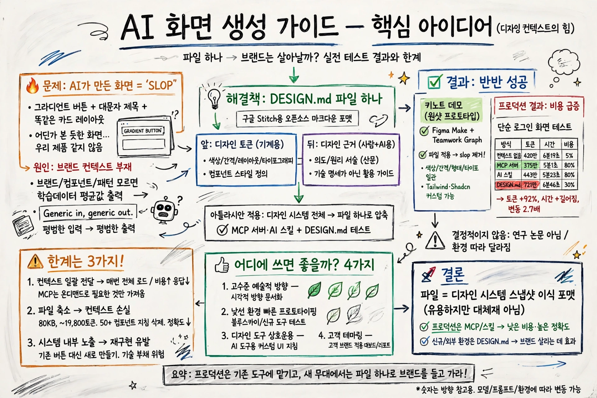
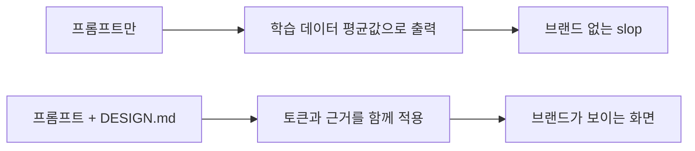
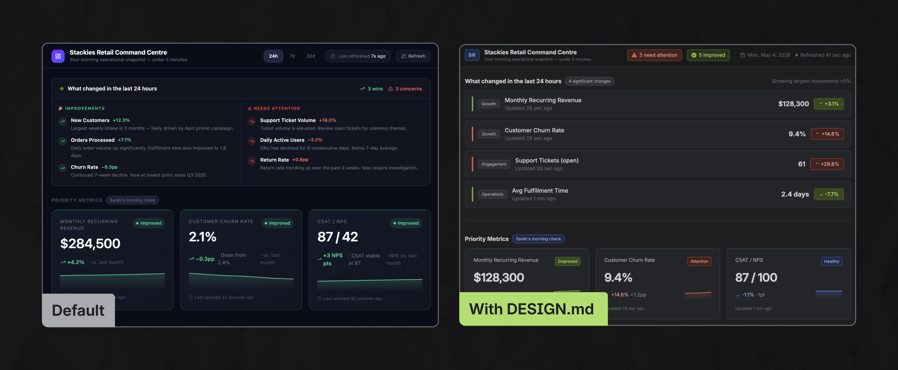
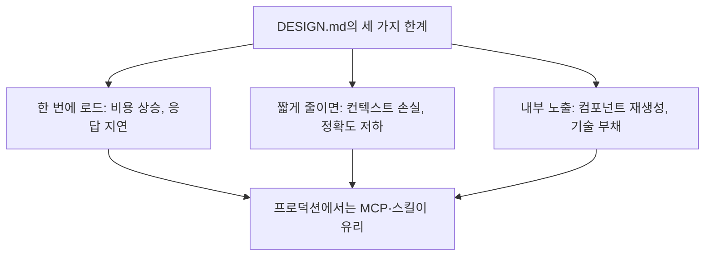
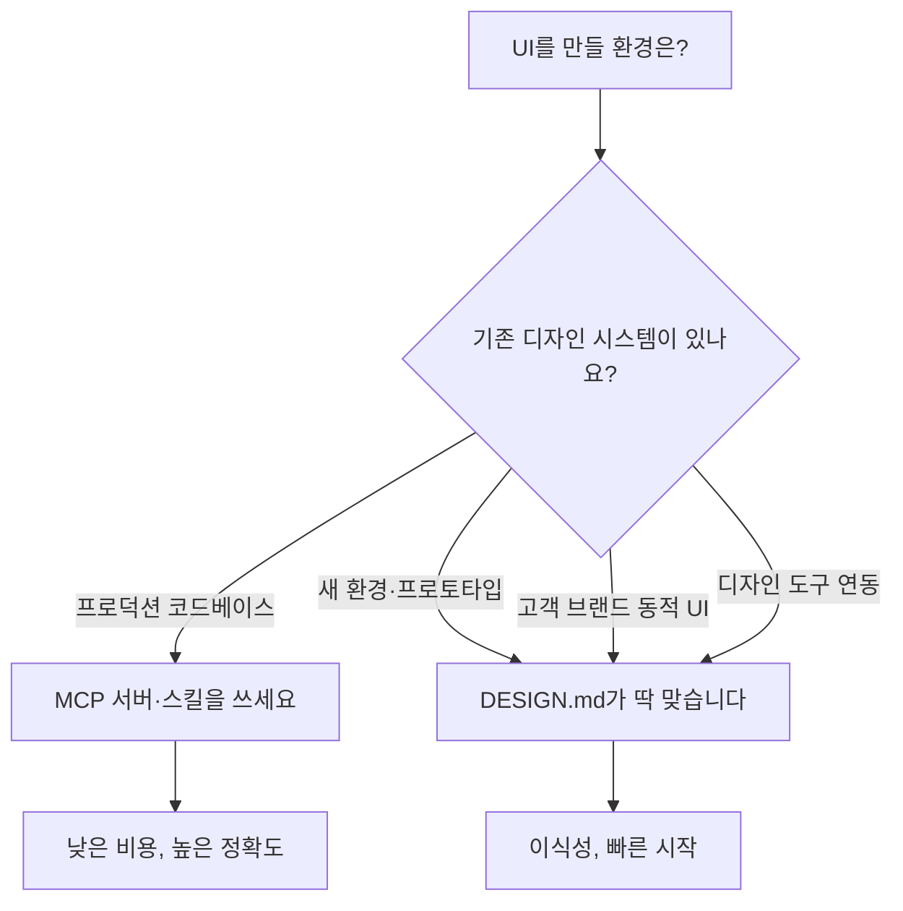

# 아틀라시안도 디자인 기준을 파일 하나로 옮겼습니다. 프로토타입은 됐고, 프로덕션은 비쌌습니다

> **Summary**
> 아틀라시안은 디자인 시스템 전체를 DESIGN.md 파일 하나로 줄여 실전 테스트를 했습니다. Team '26 키노트 데모에서는 Figma Make 대시보드가 한 번에 브랜드에 맞게 나왔지만, 로그인 화면 같은 프로덕션 작업에서는 MCP 서버와 스킬보다 토큰이 약 92% 더 들었습니다. 파일은 프로토타입·고객 테마링·디자인 도구 연동에는 잘 맞고, 프로덕션 코드베이스에서는 기존 도구가 더 싸고 정확합니다.

---

- AI가 만든 화면, 브랜드가 없습니다. 그라디언트 버튼에 대문자 제목, 똑같은 카드 레이아웃까지, 어딘가 본 듯한 화면이 나옵니다.
- 아틀라시안은 자사 디자인 시스템 전체를 파일 하나로 줄여 실전 테스트를 했습니다.
- 결과는 반반이었습니다. 원샷 프로토타입은 알아볼 수 있게 달라졌고, 프로덕션에서는 토큰이 92% 더 들었습니다.

에이전트에게 화면 하나 만들어달라고 했는데, 어딘가 본 듯한 화면이 나온 적 있으시죠? 그라디언트 버튼에 대문자 제목까지, 기능은 돌아가는데 우리 제품 같지는 않습니다. 디자인 커뮤니티는 이런 결과물을 "slop"이라고 부릅니다.

🎥 [동영상 보기](https://www.youtube.com/watch?v=pY52H5gKhGg)

### AI가 만든 화면, 왜 다 똑같이 생겼을까요?

원인은 브랜드 컨텍스트 부재입니다. AI는 브랜드·컴포넌트·패턴을 모르면 학습 데이터 평균값으로 출력합니다. "Generic in, generic out." 넣은 게 평범하면 나오는 것도 평범하다는 뜻입니다.

아틀라시안 디자인 시스템 팀은 AI 시대를 위한 컨텍스트 엔진을 구축하고 있었습니다. MCP 서버와 AI 스킬로 에이전트에 풍부한 디자인 컨텍스트를 주고, 토큰 비용을 줄이면서 수천 명 제품 빌더의 결과물 정확도와 품질을 높이는 데 성공했다고 밝혔습니다. 그런데 여기에 파일 하나짜리 새 형식이 끼어들었습니다.

### 파일 하나면 브랜드가 살아날까요?

`DESIGN.md`는 구글이 자사 디자인 도구인 Stitch를 위해 설계한 오픈소스 마크다운 포맷입니다. 팀의 브랜드와 UI 패턴을 담은 이식형 스냅샷으로, 프롬프트에 파일을 넣으면 생성 결과물이 자사 제품처럼 보이기 시작한다는 단순한 아이디어입니다.

파일은 두 부분입니다. 앞부분은 기계가 읽는 디자인 토큰 목록이고, 뒷부분은 사람과 에이전트가 읽는 디자인 근거입니다. 색상·간격·레이아웃·elevation·컴포넌트에 대한 근거를 산문으로 적습니다. 핵심은 전체 기술 명세가 아니라 **의도**를 담는다는 점입니다. 코드 라이브러리나 린터, 피그마 명세는 들어 있지 않습니다.

아틀라시안은 MCP 서버와 스킬을 구동하는 구조화 콘텐츠 파이프라인에서 자체 파일을 그대로 뽑아냈습니다. 일반 바이브 코딩 도구에서 형식을 테스트했고, 기존 가이드에 없던 흔한 실수에는 더 엄격한 지침을 추가했습니다. 그리고 실전 무대에 올렸습니다.

### 키노트 무대에서는 어땠을까요?

테스트 무대는 Team '26 키노트 데모였습니다. 애너하임 키노트에서 Figma Make가 Teamwork Graph를 이용해 맞춤형 대시보드를 만들었습니다. 내부 MCP 서버나 도구 없이 한 번에 디자인 언어를 맞추는 게 목표였습니다.

결과는 꽤 잘 됐습니다! 파일이 있자 일반적 slop이 색상·간격·형태·타이포그래피에 기대값을 쓰고, 컴포넌트에 시스템에 정렬된 elevation을 적용하는 알아볼 수 있는 결과물로 바뀌었습니다. 파일의 고수준 지침과 명세는 Tailwind, Shadcn 같은 공통 라이브러리를 커스터마이징해 UI를 처음부터 만드는 데 딱 맞았습니다!

### 그런데 프로덕션에서는 왜 비쌌을까요?

원샷 프로토타입은 됐지만, 프로덕션 코드베이스는 다른 세계입니다. 기존 토큰·컴포넌트에 엄격한 린트 규칙과 타입 검사가 적용된 환경이니까요. 로그인 화면 같은 단순 작업을 기준으로 측정한 결과는 파일에 불리했습니다. MCP 서버와 스킬 대비 토큰 약 92% 추가 소비, 더 오랜 생성 시간, 실행 간 토큰 소비 변동 약 2.7배가 나왔습니다.

| 방식 | 쓸 수 있는 디자인 컨텍스트 | 평균 토큰 | 평균 시간 | 평균 턴 |
| --- | --- | --- | --- | --- |
| 컨텍스트 없음 | 약 5% | 420만 | 6분 19초 | 43 |
| MCP 서버 | 약 80% | 375만 | 5분 1초 | 35.1 |
| AI 스킬 | 약 80% | 443만 | 5분 23초 | 36 |
| `DESIGN.md` | 약 30% | 721만 | 6분 46초 | 45.3 |

파일이 한 번에 들고 오는 컨텍스트는 전체의 약 30%에 불과한데, 토큰은 가장 많이 썼습니다. 다만 이 결과는 결정적이지 않습니다. 원문도 "연구 논문이 아니다"라고 밝혔습니다. 모델·프롬프트·환경에 따라 달라질 수 있으니, 숫자는 방향을 보는 참고값으로 읽는 게 맞습니다.

### 한계는 세 가지입니다!

첫째, 컨텍스트가 한 번에 전달됩니다. MCP 서버는 `ads_plan` 같은 툴콜로 특정 컴포넌트 지침만 온디맨드로 가져옵니다. 수백 개 아이콘과 방대한 시맨틱 토큰 중 필요한 것만 읽으면 되니까요. 파일은 매번 전체를 로드해 시작부터 비용이 높고 응답이 느리며, 컨텍스트가 잘리면 정확도가 떨어질 수 있습니다.

둘째, 파일을 짧게 유지하면 컨텍스트가 손실됩니다. MCP 서버와 스킬은 약 2.5MB 지침을 온디맨드로 가져옵니다. 파일은 한 번에 로드되므로 훨씬 더 줄여야 했고, 결과 파일은 80KB, 약 19,800 토큰(프론트매터 제외 약 10,700)으로 커뮤니티 예시보다 큰 편입니다. 이 크기를 맞추려고 50개 이상 컴포넌트의 사용 지침 상당 부분을 덜어내고, 기초 지침을 대폭 축소하고, 저사용 토큰 일부를 삭제했습니다. 컨텍스트가 없으니 에이전트는 정확도가 떨어지거나, 스스로 컴포넌트 구현을 직접 읽으며 지침을 찾습니다.

셋째, 명세가 시스템 내부를 노출합니다. 파일은 디자인 시스템을 처음부터 복제 구현하기 위한 원칙·명세·지침을 산문으로 다시 쓴 것입니다. 확립된 프로덕션 환경에서는 이 정보가 불필요하거나, 에이전트를 기술 부채 생성으로 유도합니다. 버튼 스타일 전체를 읽고 해석하기보다, 이미 있는 버튼 컴포넌트를 가져다 쓰는 편이 낫습니다. 버튼을 한 곳에서 바꾸면 코드베이스 전체에 반영되고 유지보수도 쉬워지니까요. 파일은 코드 지침을 제외하고 재구현 명세만 제공해서, 테스트에서는 기존 시스템 사용보다 컴포넌트를 다시 만드는 경향이 더 컸습니다.

### 그럼 어디에 쓰면 좋을까요?

파일이 빛나는 곳은 네 가지입니다. 첫째, 고수준 예술적 방향입니다. 시스템의 시각적 방향과 느낌을 담은 가장 단순한 파일은, 문서화하지 않았다면 그 자체로 유용한 산출물입니다. 다만 프론트매터는 코드베이스 내용을 중복합니다.

둘째, 낯선 환경에서의 빠른 프로토타이핑입니다. 블루스카이 프로토타이핑이나 신규 도구 테스트에서는 전체 기술 스택을 구성하지 않고도, 기존 컴포넌트 제약 없이 온브랜드 UI를 만들 수 있습니다.

셋째, 디자인 도구와의 상호운용입니다. 일부 AI 도구는 디자인 언어에 맞춰진 사전 제작 컴포넌트를 커스터마이징해 UI를 조립하는데, 파일은 이런 도구에 딱 맞는 수준의 지침을 제공합니다.

넷째, 적응형 UI의 고객 테마링입니다. 리포트·차트·대시보드 같은 동적 인터페이스에서 고객이 자사 브랜드를 쉽게 기술하면, AI 출력이 고객 브랜드처럼 느껴집니다. 관리자나 브랜드 팀이 업무 도구에 업로드하는 옵션으로 구상할 수 있습니다.

네 가지의 공통점은 하나입니다. 기존 디자인 시스템 출력이 없거나 비실용적인 환경의 에이전트 생성 UI라는 점입니다.

### 파일은 이미 공개됐습니다

아틀라시안은 표준에 반응하기보다 형성하고자 파일을 공개했습니다. 파일은 현재 표준과 일부 다릅니다. 컴포넌트 렌더링용 비표준 속성을 포함하고, 표준이 테마링을 지원하지 않아 별도 다크 모드 변형도 함께 제공합니다. 피드백을 공유했고 일부 제안은 명세에 반영됐습니다.

결론은 분명합니다. 파일은 디자인 시스템의 스냅샷으로 유용한 이식 포맷이지만, 더 풍부한 디자인 시스템 도구의 대체재는 아닙니다. 에이전트가 MCP나 스킬을 지원하면 더 낮은 비용으로 더 나은 결과를 냅니다. 그래도 크로스 플랫폼 이식, 고객 테마링, 블루스카이 프로토타이핑에서는 파일 하나가 의미 있는 향상을 제공합니다. 파일 하나가 만능은 아니었습니다. 하지만 어디에 쓰면 좋은지는 숫자로 알 수 있습니다. 프로덕션은 기존 도구에 맡기고, 새 무대에서는 파일 하나로 브랜드를 들고 가면 됩니다!

